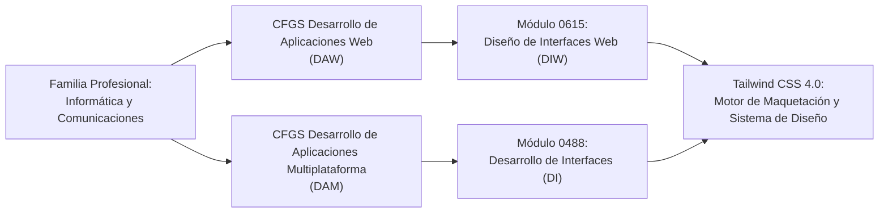

# 00. Marco Curricular y Competencias Profesionales

El aprendizaje de **Tailwind CSS 4.0** no responde a una moda tecnológica pasajera, sino a la capacitación directa en herramientas de alta demanda laboral para los ciclos formativos de grado superior de la familia profesional de **Informática y Comunicaciones**.

---

## 🏛️ Contexto Normativo y Títulos Oficiales

Este módulo de contenidos se encuadra en la legislación educativa vigente (Ley Orgánica 3/2022 de ordenación e integración de la Formación Profesional y Reales Decretos correspondientes):

---

## 🎯 Resultados de Aprendizaje y Criterios de Evaluación

### 1. En el Ciclo de DAW (Módulo 0615: Diseño de Interfaces Web)

| Resultado de Aprendizaje (RA) | Criterios de Evaluación Vinculados | Aplicación con Tailwind CSS 4.0 |
| :--- | :--- | :--- |
| **RA 2.** Planifica el diseño de una interfaz web aplicando criterios de usabilidad y accesibilidad. | - **CE a)** Se han identificado los elementos básicos de una interfaz web. - **CE b)** Se han seleccionado las herramientas para el prototipado y diseño. - **CE c)** Se han aplicado pautas de accesibilidad universales (WCAG 2.2). | Utilización de tokens en `@theme`, contrastes automáticos OKLCH, foco accesible con `focus-visible:` y clases semánticas de accesibilidad (`sr-only`). |
| **RA 3.** Crea interfaces web utilizando lenguajes de marcas y hojas de estilo. | - **CE a)** Se han definido estilos coherentes en todo el sitio. - **CE b)** Se han empleado técnicas de diseño adaptativo (responsive design). - **CE c)** Se han estructurado hojas de estilo modulares y escalables. | Adopción de la arquitectura utility-first, directiva `@import "tailwindcss";`, breakpoints móviles (`sm:`, `md:`, `lg:`) y Container Queries nativas (`@container`). |
| **RA 4.** Diseña interfaces web multimedia incorporando interactividad y efectos. | - **CE a)** Se han aplicado efectos de transición y transformaciones visuales. - **CE b)** Se ha asegurado el rendimiento en la carga de recursos de estilo. | Micro-interacciones con `transition-all`, `hover:scale-*`, `group-hover:`, animaciones nativas y optimización extrema mediante el compilador Rust Oxide. |

---

### 2. En el Ciclo de DAM (Módulo 0488: Desarrollo de Interfaces)

| Resultado de Aprendizaje (RA) | Criterios de Evaluación Vinculados | Aplicación con Tailwind CSS 4.0 |
| :--- | :--- | :--- |
| **RA 1.** Confecciona interfaces de usuario personalizadas analizando los requisitos del software. | - **CE e)** Se han diseñado los componentes gráficos con criterios de consistencia estética. | Definición de una paleta institucional y escalas de espaciado centralizadas en `@theme`, garantizando coherencia visual en todos los módulos de la aplicación. |
| **RA 4.** Diseña interfaces gráficas identificando y aplicando criterios de usabilidad y accesibilidad. | - **CE g)** Se ha diseñado el aspecto de la interfaz de usuario atendiendo a su legibilidad y contraste. | Empleo de tipografías legibles (`text-balance`, `text-pretty`), variantes de contraste para modo oscuro (`dark:`) y diseño modular de componentes. |
| **RA 6.** Realiza pruebas de usabilidad y distribuye la aplicación. | - **CE d)** Se ha verificado la adaptabilidad a diferentes tamaños de pantalla y dispositivos. | Maquetación responsiva y flexible (Flexbox y Grid), pruebas en resoluciones estándar y compatibilidad multiplataforma mediante WebView y navegadores modernos. |

---

## 💼 Conexión con la Fase de Formación en Empresa (Dual)

Durante las estancias en centros de trabajo y proyectos de FP Dual, el alumnado se incorpora a equipos de desarrollo donde:

1. **Se trabaja con Design Systems vivos:** Las empresas no reinventan el CSS para cada botón. Disponen de un conjunto estricto de tokens de diseño que Tailwind 4 plasma directamente en variables CSS.
2. **Se integran frameworks frontend modernos:** Tanto en aplicaciones web SPA (Angular, React, Vue, Next.js) como en clientes de escritorio (Electron, Tauri), Tailwind es la capa estándar de presentación.
3. **El rendimiento de compilación es crítico:** La velocidad del motor Oxide elimina los cuellos de botella en entornos de integración continua (CI/CD), permitiendo ciclos de feedback de milisegundos.
4. **Mantenibilidad sin deuda técnica:** Al evitar la acumulación de selectores huérfanos y clases CSS no documentadas, los equipos reducen drásticamente los costes de refactorización de interfaces.
