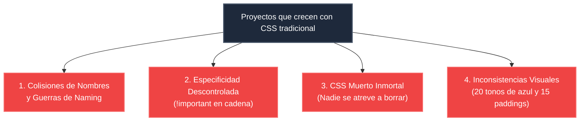
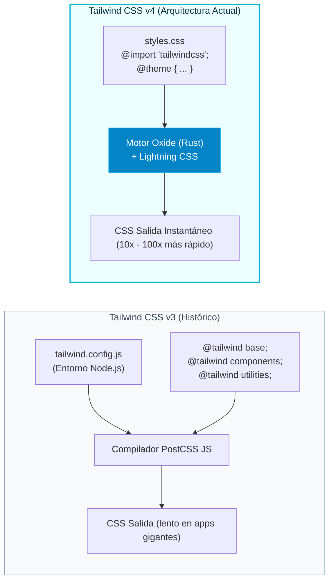

# 01. De CSS Tradicional a Utility-First y Tailwind 4

En el desarrollo web, las hojas de estilo en cascada (CSS) son la piedra angular del diseño. Sin embargo, a medida que los proyectos crecen y múltiples desarrolladores colaboran en el mismo código, el modelo tradicional de escritura de CSS presenta retos estructurales graves.

---

## 🛑 Los Dolores del CSS Tradicional en Equipos de Software

Cuando un equipo maqueta interfaces medianas o grandes utilizando archivos `.css` convencionales, suelen aparecer cuatro problemas recurrentes:



1. **Guerras de Nombres:** ¿Llamamos al botón `.btn`, `.button`, `.action-button` o `.c-btn--primary`? Metodologías como BEM (*Block Element Modifier*) intentaron resolver esto, pero generaron clases kilométricas e incrementaron la fatiga mental del desarrollador al tener que inventar nombres abstractos para cada simple `<div>`.
2. **Especificidad Descontrolada:** Para forzar que un estilo gane a otro heredado, se añaden selectores cada vez más específicos (`.sidebar .menu ul li a.active span`), hasta que alguien introduce `!important`, desencadenando una espiral inmanejable.
3. **El CSS Muerto Inmortal:** Cuando se elimina una funcionalidad de una pantalla HTML, casi ningún programador borra las clases CSS asociadas del archivo global porque *nadie sabe con certeza si otra pantalla oculta de la app depende de esa misma clase*. El archivo CSS solo crece con el tiempo.
4. **Falta de Consistencia Visual:** Un programador usa `padding: 15px`, otro `padding: 16px` y un tercero `padding: 1rem`. Uno usa `#0070f3`, otro `#1a73e8` y otro `#0d6efd`. El resultado final carece de armonía estética.

---

## 💡 El Paradigma Utility-First

Frente a la aproximación tradicional (*"inventa una clase con nombre semántico y escríbele propiedades en un archivo separado"*), el enfoque **Utility-First** propone:

> **Construir interfaces complejas combinando pequeñas clases utilitarias de propósito único directamente en el marcado HTML.**

Veamos la comparativa visual de ambos enfoques:

=== "Aproximación Tradicional (CSS Semántico)"
    ```html title="index.html"
    <button class="chat-button">
      Enviar Mensaje
    </button>
    ```

    ```css title="styles.css"
    .chat-button {
      display: inline-flex;
      align-items: center;
      padding: 0.625rem 1.25rem;
      background-color: #0284c7;
      color: #ffffff;
      font-weight: 600;
      font-size: 0.875rem;
      border-radius: 0.5rem;
      box-shadow: 0 4px 6px -1px rgba(0, 0, 0, 0.1);
      transition: background-color 0.2s ease;
    }

    .chat-button:hover {
      background-color: #0369a1;
    }
    ```

=== "Aproximación Utility-First (Tailwind CSS)"
    ```html title="index.html"
    <button class="inline-flex items-center px-5 py-2.5 bg-sky-600 hover:bg-sky-700 text-white font-semibold text-sm rounded-lg shadow-md transition-colors">
      Enviar Mensaje
    </button>
    ```

    *No requiere escribir una sola línea de CSS manual en `styles.css`.*

---

## ❓ Mitos y Realidades sobre Tailwind

!!! warning "La Premisa Fundamental: Tailwind no sustituye a CSS"
    Tailwind **es CSS con otro nombre**. 
    
    Si no sabes qué hace `display: flex`, no sabrás cuándo aplicar la clase `flex`. Si no entiendes la diferencia entre `margin` y `padding`, escribir `m-4` o `p-4` será dar palos de ciego. Tailwind no te exime de entender el navegador; al contrario, recompensa a quien domina los fundamentos de CSS permitiéndole expresarlos a la velocidad del pensamiento.

### Desmontando objeciones comunes:

- **¿"No es esto volver a los estilos en línea (`style='...'`)"?**  
  **No**, por tres razones fundamentales:

    1. *Sistema de diseño embebido:* En `style=""` puedes poner `margin: 17.3px; color: #384729;`. En Tailwind estás restringido a los tokens del sistema (`p-4`, `text-sky-600`), asegurando consistencia.
    2. *Soporte completo de estados:* Con `style=""` no puedes definir `:hover`, `:focus`, `:active` ni `@media` queries. En Tailwind escribes `hover:bg-blue-600`, `focus:ring-2` y `md:flex`.
    3. *Optimización y caché:* Los estilos inline hinchan el HTML y no se cachean como CSS. Tailwind genera una hoja CSS minúscula y altamente cacheable por el navegador.

- **¿"El HTML no queda demasiado recargado de clases"?**  
  Al principio resulta chocante, pero a cambio obtienes **inmediatez de lectura**: al mirar una etiqueta sabes exactamente cómo se ve, sin cambiar de pestaña, sin buscar en hojas de 3.000 líneas y sin preocuparte de que modificar ese botón rompa accidentalmente otro botón en otra página.

---

## 🚀 La Revolución de Tailwind CSS 4.0

Lanzada en 2025, la **versión 4.0** de Tailwind rediseña por completo las tripas del framework para eliminar las fricciones históricas de la v3:



### Principales novedades de Tailwind 4:

1. **Arquitectura CSS-First:** El archivo `tailwind.config.js` ya **no es necesario**. Todo el tema y las personalizaciones se declaran en tu propio archivo `.css` mediante la directiva nativa `@theme`.
2. **Motor Oxide escrito en Rust:** Sustituye el antiguo pipeline en JavaScript. Es capaz de procesar árboles de miles de componentes en milisegundos, ofreciendo una experiencia instantánea en el Hot Module Replacement (HMR) de Vite y Angular.
3. **Detección Automática de Fuentes (`content`):** En v3 era obligatorio configurar un array `content: ['./src/**/*.{html,ts}']`. Si olvidabas una extensión, las clases no se generaban. En v4, Oxide detecta automáticamente todos los archivos relevantes del proyecto.
4. **Espacio de Color OKLCH por Defecto:** Las paletas de colores de Tailwind 4 están basadas en el espacio perceptual OKLCH, garantizando que un tono `500` de verde tenga exactamente la misma luminosidad aparente que un tono `500` de azul o rojo.
5. **Container Queries y Funcionalidades Modernas Integradas:** Propiedades de CSS contemporáneo como `@container`, `text-wrap: balance`, `text-wrap: pretty`, 3D transforms y la variante `@starting-style` vienen listas para usar sin necesidad de instalar plugins de terceros.
