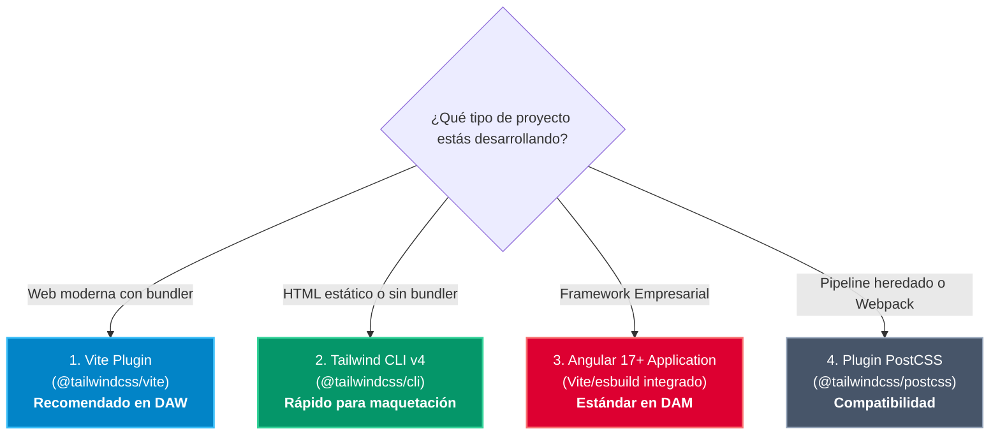

# 02. Instalación, Herramientas y Entorno de Desarrollo

Una de las grandes ventajas de **Tailwind CSS 4.0** es la drástica simplificación de su proceso de instalación. Ya no se requieren complicados ficheros de configuración ni dependencias cruzadas de PostCSS en la mayoría de escenarios.

---

## 🛠️ Los Cuatro Métodos de Instalación

Dependiendo de la naturaleza del proyecto en el aula (desde una práctica básica con HTML hasta una SPA con Angular), seleccionaremos una de las siguientes vías:



---

### Método 1: Con Vite (El Estándar Moderno Recomendado)

Es el entorno ideal para el aprendizaje en clase debido a la velocidad de recarga en caliente (*Hot Module Replacement*):

#### Paso 1: Crear el proyecto Vite
```bash
# Crear proyecto con plantilla vanilla o typescript
npm create vite@latest mi-proyecto-tailwind -- --template vanilla
cd mi-proyecto-tailwind
npm install
```

#### Paso 2: Instalar Tailwind 4 y su plugin oficial
```bash
npm install tailwindcss @tailwindcss/vite
```

#### Paso 3: Configurar el plugin en `vite.config.js`
Crea el archivo `vite.config.js` (o `vite.config.ts`) en la raíz del proyecto:

```javascript title="vite.config.js"
import { defineConfig } from 'vite';
import tailwindcss from '@tailwindcss/vite';

export default defineConfig({
  plugins: [
    tailwindcss(),
  ],
});
```

#### Paso 4: Importar Tailwind en tu CSS
Sustituye el contenido de tu archivo CSS principal (`src/style.css`):

```css title="src/style.css"
@import "tailwindcss";
```

#### Paso 5: Levantar el servidor de desarrollo
```bash
npm run dev
```

---

### Método 2: Con Tailwind CLI v4 (Sin Bundler)

Perfecto para prácticas rápidas de maquetación HTML pura sin necesidad de configurar Vite ni empaquetadores:

```bash
# 1. Instalar la CLI en el proyecto
npm install -D tailwindcss @tailwindcss/cli

# 2. Crear archivo de entrada de estilos
echo '@import "tailwindcss";' > src/input.css

# 3. Iniciar el compilador en modo vigilancia (watch)
npx @tailwindcss/cli -i src/input.css -o dist/output.css --watch
```

En tu archivo `index.html` solo tienes que enlazar el CSS compilado:
```html title="index.html"
<link rel="stylesheet" href="./dist/output.css">
```

---

### Método 3: En Proyectos Angular 17 / 18 / 19 (DAM)

Angular utiliza por defecto el nuevo constructor basado en esbuild y Vite (`@angular/build:application`). La integración es inmediata:

1. **Instalar paquetes:**
   ```bash
   npm install tailwindcss @tailwindcss/vite
   ```

2. **Añadir el plugin en la configuración de Vite:**
   En Angular 17+, añade el plugin en tu archivo `vite.config.ts` o configura los estilos globales.

3. **Importar en estilos globales de Angular:**
   En `src/styles.css`:
   ```css title="src/styles.css"
   @import "tailwindcss";
   ```

4. **Comprobar en un componente standalone:**
   ```html title="src/app/app.component.html"
   <div class="min-h-screen bg-slate-950 text-white flex items-center justify-center">
     <h1 class="text-3xl font-extrabold text-sky-400">
       ¡Tailwind 4 funcionando en Angular!
     </h1>
   </div>
   ```

---

## 💻 Configuración de Visual Studio Code para Máxima Productividad

Para trabajar con soltura y evitar errores tipográficos en los nombres de las clases, es imprescindible configurar el editor:

### 1. Extensión Oficial: Tailwind CSS IntelliSense

Instala desde el marketplace de VS Code la extensión oficial:  
**ID:** `bradlc.vscode-tailwindcss`

Proporciona:

- **Autocompletado inteligente:** Sugiere clases al escribir, indicando los valores CSS exactos que generará cada una.
- **Previsualización de colores:** Muestra un pequeño cuadrado con el color real junto a clases como `bg-sky-500` o `text-emerald-400`.
- **Detección de errores (Linting):** Subraya en rojo clases mal escritas o inexistentes.
- **Soporte completo para `@theme`:** Autocompleta tus tokens personalizados definidos en CSS.

### 2. Configuración recomendada en `settings.json`

Añade estas líneas a tu configuración de VS Code (`Ctrl + Shift + P` -> *Preferences: Open User Settings (JSON)*):

```json title=".vscode/settings.json"
{
  "editor.quickSuggestions": {
    "strings": "on"
  },
  "css.validate": false,
  "tailwindCSS.includeLanguages": {
    "html": "html",
    "javascript": "javascript",
    "typescript": "typescript"
  },
  "editor.formatOnSave": true
}
```

### 3. Ordenación Automática de Clases con Prettier

En un equipo de varios desarrolladores, es común que uno escriba `class="p-4 flex bg-blue-500"` y otro `class="bg-blue-500 flex p-4"`. La extensión y plugin oficial de Prettier ordenan las clases automáticamente siguiendo la recomendación de especificidad de Tailwind:

```bash
npm install -D prettier prettier-plugin-tailwindcss
```

Crea el archivo `.prettierrc`:
```json title=".prettierrc"
{
  "plugins": ["prettier-plugin-tailwindcss"]
}
```

Cada vez que guardes el documento (`Ctrl + S`), las clases se reordenarán de forma consistente: layout primero, luego tipografía, colores y finalmente variantes interactivas (`hover:`, `focus:`).
