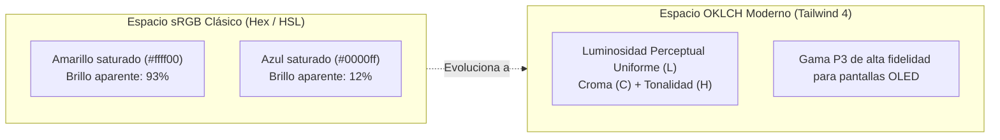

# 03. Configuración CSS-First y la Directiva @theme

La gran seña de identidad de **Tailwind CSS 4.0** es su arquitectura **CSS-First**. Olvídate de configurar objetos JavaScript en `tailwind.config.js`: el sistema de diseño se declara directamente en CSS utilizando variables estándar mediante la directiva `@theme`.

---

## 🎨 La Directiva @theme: Anatomía y Funcionamiento

En Tailwind 4, para añadir tus propios colores, fuentes, espaciados o breakpoints, basta con declararlos dentro de un bloque `@theme` justo debajo de la importación inicial:

```css title="src/styles.css"
@import "tailwindcss";

@theme {
  /* 1. Colores de marca */
  --color-brand-primary: #0284c7;
  --color-brand-accent: #06b6d4;

  /* 2. Tipografías corporativas */
  --font-display: "Cabinet Grotesk", sans-serif;
  --font-body: "Inter", system-ui, sans-serif;

  /* 3. Escalas personalizadas */
  --spacing-18: 4.5rem;    /* 72px */
  --radius-xl: 1.25rem;

  /* 4. Breakpoints específicos */
  --breakpoint-3xl: 1920px;
}
```

Al compilar, Tailwind detecta automáticamente estas variables y genera todas las clases correspondientes:

- `bg-brand-primary`, `text-brand-primary`, `border-brand-primary`
- `font-display`, `font-body`
- `p-18`, `m-18`, `w-18`, `h-18`
- `rounded-xl`
- `3xl:grid-cols-6`

---

## 🌈 El Espacio de Color OKLCH en Tailwind 4

En versiones previas, los colores se expresaban en hexadecimal o HSL. Tailwind 4 adopta por defecto el espacio de color moderno **OKLCH** (*Oklab Lightness Chroma Hue*):



!!! tip "¿Por qué OKLCH es superior para diseño UI?"
    En HSL, dos colores con `luminosidad = 50%` (como un amarillo y un azul) tienen en realidad brillos percibidos por el ojo humano completamente distintos. En OKLCH, la coordenada `L` (Lightness) mide la **luminosidad perceptual real**: un texto blanco sobre cualquier color con `L = 0.5` cumplirá siempre las mismas garantías de contraste y legibilidad.

### Definición de una Escala Cromática Completa

Podemos definir una paleta institucional completa de 50 a 950 en `@theme`:

```css title="src/styles.css"
@theme {
  --color-corporate-50:  oklch(0.97 0.01 240);
  --color-corporate-100: oklch(0.93 0.03 240);
  --color-corporate-200: oklch(0.86 0.06 240);
  --color-corporate-300: oklch(0.76 0.10 240);
  --color-corporate-400: oklch(0.66 0.15 240);
  --color-corporate-500: oklch(0.58 0.19 240);  /* Color base */
  --color-corporate-600: oklch(0.50 0.18 240);
  --color-corporate-700: oklch(0.42 0.15 240);
  --color-corporate-800: oklch(0.32 0.11 240);
  --color-corporate-900: oklch(0.24 0.08 240);
  --color-corporate-950: oklch(0.16 0.05 240);
}
```

---

## 🔀 Extender vs Sobrescribir el Tema

En Tailwind 4 existen dos modos de usar `@theme`:

### 1. Extender el tema por defecto (Comportamiento habitual)
Si usas `@theme`, tus valores se **suman** a la paleta oficial (Slate, Gray, Red, Amber, Emerald, Sky, Indigo, etc.):

```css
@theme {
  --color-neon: #39ff14; /* Tienes neon Y sigues teniendo red-500, blue-600, etc. */
}
```

### 2. Sobrescribir completamente el tema (`@theme static`)
Si estás construyendo una aplicación corporativa estricta y quieres impedir que los programadores usen colores no autorizados:

```css
@theme static {
  --color-primary: #0284c7;
  --color-white: #ffffff;
  --color-black: #000000;
  /* SOLO existirán primary, white y black; los colores por defecto quedan deshabilitados */
}
```

---

## 🧮 Valores Arbitrarios y Cálculo Dinámico

A pesar de contar con un sistema de diseño estricto, en situaciones reales surgen requisitos visuales específicos (como un banner publicitario de 342px de ancho o un gradiente angular). Para ello, Tailwind ofrece los **valores arbitrarios** mediante corchetes `[...]`:

```html
<!-- Ancho arbitrario exacto -->
<div class="w-[342px] max-w-[calc(100vw-2rem)]">...</div>

<!-- Color hexadecimal puntual de una marca externa -->
<button class="bg-[#1da1f2] hover:bg-[#0c85d0] text-white">
  Compartir en X
</button>

<!-- Grid con anchos de columna milimétricos -->
<div class="grid grid-cols-[180px_1fr_240px] gap-6">...</div>

<!-- Z-index específico para solapamientos de modales -->
<div class="z-[9999]">...</div>
```

### Desambiguación con tipos de datos

Si un valor entre corchetes resulta ambiguo para el compilador Oxide (por ejemplo, una variable CSS que puede ser un color o una longitud), puedes indicar el tipo explícitamente:

```html
<!-- Indica que la variable representa un color -->
<div class="bg-[color:var(--mi-fondo-dinamico)]">...</div>

<!-- Indica que el valor representa una longitud -->
<div class="h-[length:var(--header-height)]">...</div>
```
