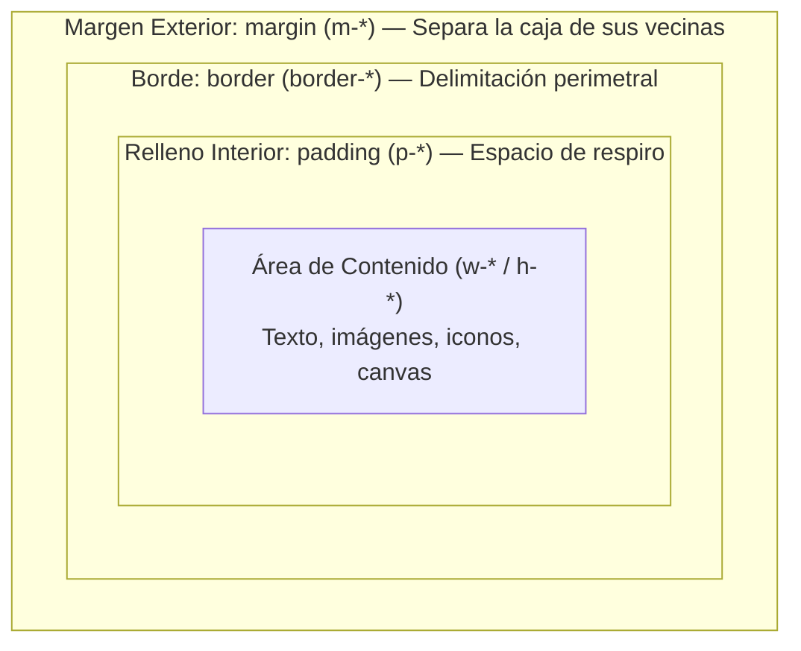
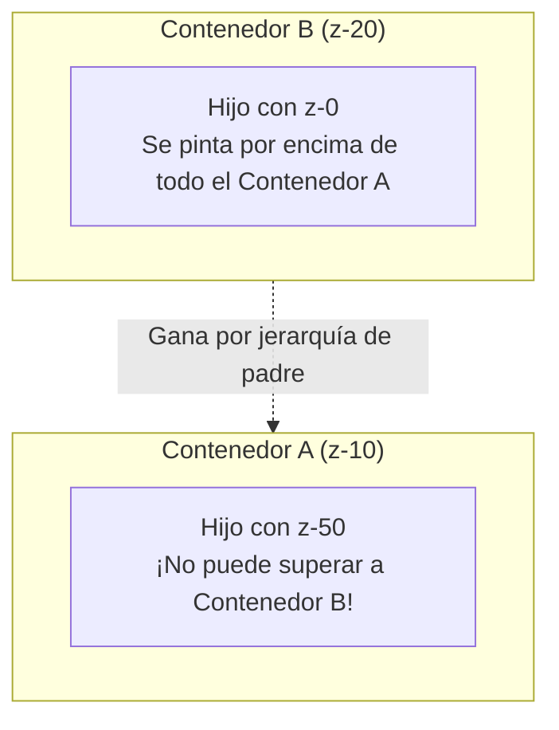
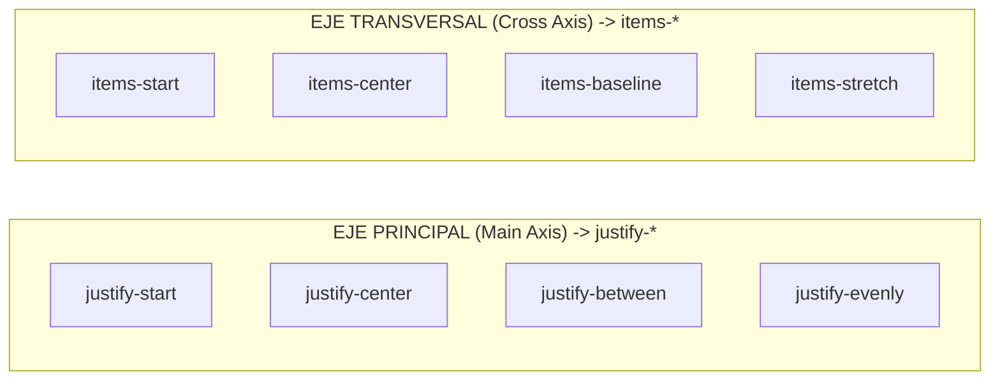
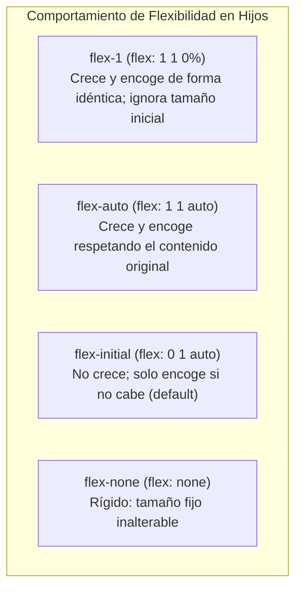
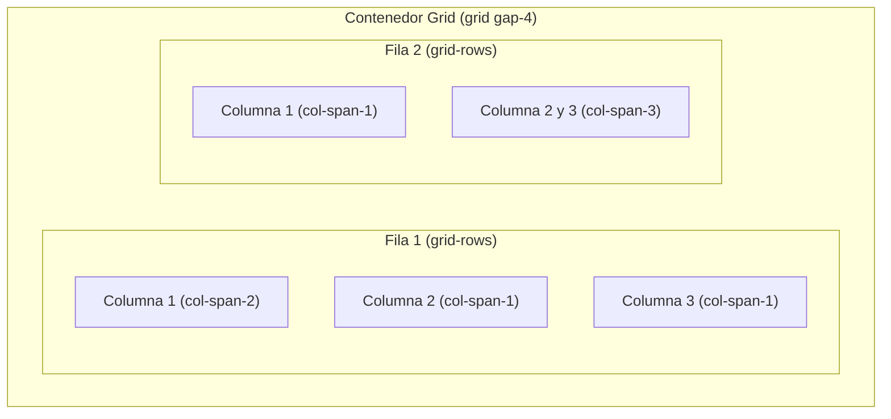
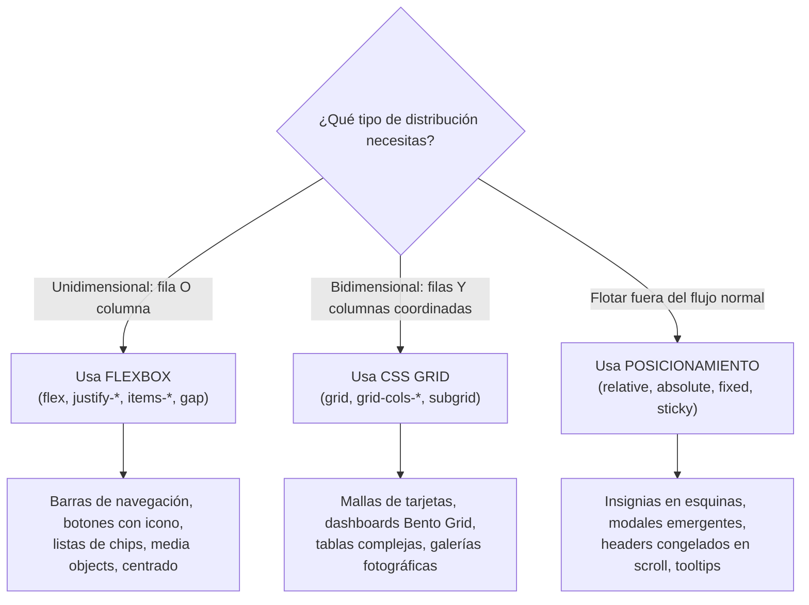

# 04. Modelo de Caja, Posicionamiento, Flexbox y Grid Moderno

<div class="badges">
  <span class="badge badge-v4">Tailwind v4.0</span>
  <span class="badge badge-oxide">Layout Core</span>
  <span class="badge badge-theme">Flexbox & Grid</span>
  <span class="badge badge-oklch">DAW / DAM</span>
</div>

El layout es el andamiaje sobre el que se apoya cualquier aplicación moderna. En los ciclos formativos de **DAW** (módulo *Diseño de Interfaces Web*) y **DAM** (módulo *Desarrollo de Interfaces*), dominar la arquitectura espacial de los elementos es la competencia que diferencia a un desarrollador novato de un profesional capaz de construir aplicaciones web, móviles o de escritorio que no se desmoronan al cambiar de pantalla o al cargar datos dinámicos.

Tailwind CSS 4.0 proporciona un juego completo de utilidades atómicas que trasladan toda la potencia de las especificaciones más modernas de CSS (modelo de caja, propiedades lógicas, coordenadas de anclaje, flexión dimensional, mallas bidimensionales y **Subgrid**) a clases legibles y composables en el propio marcado HTML.

---

## 📦 1. El Modelo de Caja: Dimensiones, Espaciados y Desbordamiento

Todo elemento renderizado en el navegador es, en su raíz física, una caja rectangular. El modelo de caja define cómo interactúan entre sí las cuatro capas concéntricas que la componen: **contenido**, **relleno interior (padding)**, **borde perimetral (border)** y **margen exterior (margin)**.



### 1.1 Preflight y el Estándar `box-sizing: border-box`

En CSS tradicional sin reset, la propiedad `box-sizing` tenía el valor `content-box`. Bajo este modelo, si declarabas una caja de `width: 300px`, `padding: 20px` y `border: 2px`, el ancho exterior real acababa siendo de `344px` (300 + 40 + 4), provocando desbordamientos horizontales inesperados.

Tailwind CSS aplica en su hoja de estilos base (*Preflight*) la regla universal de la industria:

```css
*, *::before, *::after {
  box-sizing: border-box;
}
```

Bajo `box-sizing: border-box` (controlado con la utilidad `box-border`):

- El valor asignado a `width` y `height` representa el **tamaño exterior total** de la caja (contenido + padding + border).
- Al incrementar el padding o el borde, el área de contenido se comprime automáticamente hacia el interior, garantizando que el elemento **nunca exceda el ancho reservado en la cuadrícula**.
- Si necesitas puntualmente el comportamiento antiguo (por ejemplo, en elementos de dibujo SVG o canvas de precisión matemática), puedes forzarlo con `box-content`.

### 1.2 La Escala Proporcional de Espaciado (Regla de los 4 Píxeles)

Tailwind CSS no utiliza números mágicos ni valores arbitrarios desordenados. Todas las utilidades de padding, margin, ancho, alto y gap se asientan sobre una **escala armónica basada en múltiplos de 4 píxeles** (`1 unidad = 0.25rem = 4px`, asumiendo una raíz de navegador estándar de `16px`).

| Token | Equivalente en `rem` | Píxeles | Propósito Arquitectónico en la Interfaz |
| :---: | :---: | :---: | :--- |
| `0.5` | `0.125rem` | 2px | Micro-ajustes de bordes, indicadores y separadores mínimos. |
| `1` | `0.25rem` | 4px | Padding interior en badges, chips o botones ultracompactos. |
| `2` | `0.5rem` | 8px | Separación entre iconos y etiquetas de texto; espaciado en inputs. |
| `3` | `0.75rem` | 12px | Relleno vertical en botones estándar; hueco entre elementos de formulario. |
| `4` | `1rem` | 16px | El paso base de la escala tipográfica; padding estándar de tarjetas móviles. |
| `6` | `1.5rem` | 24px | Padding cómodo en tarjetas de escritorio; separación entre párrafos. |
| `8` | `2rem` | 32px | Separación entre bloques funcionales dentro de un panel. |
| `12` | `3rem` | 48px | Espaciado entre secciones de una vista o cabeceras principales. |
| `16` | `4rem` | 64px | Separación macro en páginas de aterrizaje (*Landing Pages*). |

!!! info "Valores arbitrarios y cálculos dinámicos"
    Si un diseño estricto de Figma requiere una medida que no coincide con la escala oficial (por ejemplo, `18px`), Tailwind permite usar corchetes sin coste en tiempo de compilación: `p-[18px]` o cálculos con CSS nativo como `m-[calc(2rem-4px)]`.

### 1.3 Direccionalidad, Propiedades Físicas y Propiedades Lógicas

El control del espaciado se realiza mediante prefijos intuitivos que indican sobre qué lado o eje actúa la utilidad:

```html
<!-- 1. Todos los lados por igual -->
<div class="p-4 m-2">...</div>

<!-- 2. Ejes: Horizontal (X: izquierda + derecha) y Vertical (Y: arriba + abajo) -->
<div class="px-6 py-3 my-4">...</div>

<!-- 3. Lados físicos individuales -->
<div class="pt-8 pr-4 pb-2 pl-6 mt-1 mb-6">...</div>

<!-- 4. Propiedades Lógicas Modernas (i18n): Start y End -->
<!-- En español (LTR), ps-* aplica a la izquierda y pe-* a la derecha;
     en árabe o hebreo (RTL), invierten su orientación de forma automática -->
<div class="ps-6 pe-4 ms-auto">...</div>
```

#### Centrado Horizontal con Margen Automático

Para centrar un elemento de bloque dentro de un contenedor padre, la técnica estándar en CSS es `margin-left: auto; margin-right: auto;`. En Tailwind se aplica con la clase `mx-auto`, combinada siempre con una anchura definida o un ancho máximo:

```html
<!-- Centrado perfecto de un contenedor de lectura -->
<div class="w-full max-w-3xl mx-auto">
  <article>Contenido centrado ergonómicamente</article>
</div>
```

#### Márgenes Negativos para Solapamientos de Diseño

Anteponiendo un guion (`-`) a cualquier clase de margen, se aplica un valor negativo. Es una técnica clave para:

- Solapar avatares apilados en listas de usuarios (`-space-x-2` o `-ml-3`).
- Hacer que una tarjeta principal flote visualmente sobre la imagen de una cabecera (*Hero Banner*): `-mt-16`.

```html
<!-- Lista de usuarios con avatares solapados -->
<div class="flex items-center">
  
  
  
  <span class="flex size-10 items-center justify-center rounded-full border-2 border-white bg-slate-200 text-xs font-bold text-slate-700 -ml-3">
    +5
  </span>
</div>
```

### 1.4 Control Dimensional Integral (Width, Height, Size y Aspect-Ratio)

#### Dimensiones de Anchura (`w-*`)

- **Valores fijos de escala:** `w-16` (64px), `w-64` (256px), `w-80` (320px).
- **Valores relativos y fraccionales:** `w-full` (`100%`), `w-1/2` (`50%`), `w-1/3` (`33.333%`), `w-3/4` (`75%`).
- **Anchos intrínsecos de CSS:**
  - `w-min` (`width: min-content`): La caja se comprime hasta el ancho de su palabra más larga.
  - `w-max` (`width: max-content`): La caja se expande para mostrar todo el texto en una sola línea continua.
  - `w-fit` (`width: fit-content`): Ocupa estrictamente el espacio que necesita el contenido, sin extenderse al 100% del padre.
- **Ancho del viewport:** `w-screen` (`100vw`).

#### Dimensiones de Altura (`h-*`)

- **Valores fijos:** `h-10` (40px), `h-48` (192px), `h-96` (384px).
- **Valores relativos:** `h-full` (`100%` del padre con altura explícita).
- **Alturas del viewport contemporáneas:**
  - `h-screen`: `100vh` tradicional. En navegadores móviles puede sufrir saltos cuando la barra de direcciones del navegador aparece o desaparece.
  - `h-dvh` (*Dynamic Viewport Height*): `100dvh`. **Recomendado en Tailwind 4 para layouts móviles**. Se adapta dinámicamente en tiempo real al expandirse o contraerse la barra del navegador.
  - `h-svh` (*Small Viewport Height*) y `h-lvh` (*Large Viewport Height*).

#### La Utilidad Unificada `size-*`

En Tailwind 4, para elementos con proporciones idénticas en anchura y altura (iconos SVG, avatares, spinners de carga, botones cuadrados), la utilidad `size-*` asigna simultáneamente `width` y `height`:

```html
<!-- En lugar de escribir 'w-8 h-8', escribe: -->
<div class="size-8 rounded-full bg-sky-500"></div>
```

#### Límites Dimensionales y Prevención de Desbordamiento

| Utilidad | Equivalente CSS | Importancia en Interfaces (DAW / DAM) |
| :--- | :--- | :--- |
| `min-w-0` | `min-width: 0px` | **Imprescindible en Flexbox y Grid.** Los elementos flexibles tienen por defecto `min-width: auto`, lo que impide que los textos largos se trunquen con `truncate`. Aplicar `min-w-0` desbloquea la contracción. |
| `max-w-prose` | `max-width: 65ch` | **Ergonomía de lectura.** Limita el ancho del texto a aproximadamente 65 caracteres por línea, eliminando la fatiga en los saltos de línea sacádicos del ojo. |
| `max-w-md` / `max-w-2xl` | `max-width: 28rem` / `42rem` | Contención de tarjetas, modales y formularios. |
| `min-h-screen` | `min-height: 100vh` | Garantiza que una página ocupe al menos toda la ventana aunque tenga poco contenido. |

#### Relación de Aspecto (`aspect-*`) y Erradicación del CLS

El **Cumulative Layout Shift (CLS)** es una métrica de rendimiento web fundamental en las *Core Web Vitals* de Google. Ocurre cuando una imagen o un reproductor de vídeo se descarga por la red y empuja repentinamente todo el contenido hacia abajo porque el navegador no sabía qué altura iba a tener.

Con la propiedad `aspect-ratio` de CSS moderno, Tailwind reserva el espacio exacto en pantalla antes de que el recurso termine de descargarse:

- `aspect-square`: Proporción 1:1 (cuadrada).
- `aspect-video`: Proporción panorámica 16:9.
- `aspect-[4/3]`: Proporción clásica fotográfica.

### 1.5 Control de Desbordamiento (`overflow`) y Truncado de Texto

Cuando el contenido de un elemento supera el espacio físico disponible, la propiedad `overflow` determina qué ocurre:

- `overflow-visible` (por defecto): El contenido rebasa los límites e invade los componentes contiguos.
- `overflow-hidden`: Corta tajantemente el sobrante sin proporcionar mecanismos de desplazamiento.
- `overflow-auto`: Comportamiento óptimo. El navegador añade barras de scroll únicamente si el contenido desborda en ese eje.
- `overflow-x-auto`: Ideal para **tablas de datos en pantallas móviles**: la página no se rompe horizontalmente y la tabla se desplaza de forma fluida.
- `overflow-clip`: Alternativa moderna a `hidden` con menor coste de memoria, ya que no inicializa un contexto de scroll.

Para truncar textos largos en una sola línea (evitando que rompan el diseño), Tailwind incluye la utilidad compuesta `truncate`:

```html
<!-- Aplica: overflow: hidden; text-overflow: ellipsis; white-space: nowrap; -->
<p class="truncate max-w-xs text-sm text-slate-600">
  https://mi-dominio-educativo.es/recursos/daw/interfaces/modulo-0615/tema-04/apuntes.html
</p>
```

### 1.6 Ejemplo Práctico: Tarjeta de Perfil Profesional con Geometría de Caja

Analicemos cómo se combinan la escala de espaciado, márgenes negativos, `size-*`, `aspect-video` y contención elástica en un componente real de UI:

```html
<article class="w-full max-w-sm mx-auto bg-white rounded-2xl shadow-md border border-slate-200 overflow-hidden">
  <!-- Cabecera con aspect-ratio 16:9 para evitar saltos visuales -->
  <div class="relative aspect-video w-full bg-gradient-to-r from-sky-600 to-indigo-600">
    <span class="absolute top-3 right-3 px-2.5 py-1 text-xs font-bold bg-white/20 text-white rounded-full backdrop-blur-sm">
      Docente
    </span>
  </div>

  <!-- Cuerpo de la tarjeta -->
  <div class="px-6 pb-6">
    <!-- Avatar circular solapado con margen negativo superior -->
    <div class="relative -mt-10 mb-4">
      
    </div>

    <h3 class="text-lg font-bold text-slate-900">Elena Beltrán</h3>
    <p class="text-xs font-medium text-sky-600">Profesora de Desarrollo Web (DAW)</p>
    
    <p class="mt-3 text-sm text-slate-600 leading-relaxed text-pretty">
      Especialista en interfaces accesibles y sistemas de diseño con Tailwind CSS y componentes web modulares.
    </p>

    <!-- Botón de ancho completo con padding armónico -->
    <button class="mt-5 w-full py-2.5 px-4 rounded-xl bg-slate-900 text-white text-sm font-semibold hover:bg-slate-800 transition-colors">
      Ver proyectos de clase
    </button>
  </div>
</article>
```

!!! tip "Disección técnica paso a paso"

    1. **Contención con `w-full max-w-sm mx-auto`:** La tarjeta se adapta al ancho de dispositivos pequeños pero nunca supera los `24rem` (384px) en pantallas grandes, manteniéndose centrada gracias al margen automático horizontal.
    2. **Estabilidad CLS con `aspect-video`:** El marco de cabecera mantiene de forma estricta la proporción 16:9 tanto antes como después de cargar los recursos gráficos, protegiendo las métricas de rendimiento.
    3. **Solapamiento elegante con `-mt-10`:** El contenedor del avatar utiliza un margen negativo vertical de 40px para elevarse exactamente por encima del corte entre la cabecera degradada y el cuerpo blanco.
    4. **Geometría simétrica con `size-20`:** Asigna simultáneamente 80px de ancho y alto, evitando discrepancias dimensionales en el avatar.
    5. **Confinamiento con `overflow-hidden`:** En la tarjeta exterior, garantiza que el fondo degradado de la cabecera quede recortado con las mismas esquinas redondeadas (`rounded-2xl`).

---

## 📍 2. Posicionamiento y Contexto de Apilamiento (Z-Index)

La propiedad `position` de CSS define las reglas bajo las cuales un elemento calcula su ubicación en el lienzo y cómo interactúa con el flujo natural del documento.

### 2.1 Los Cinco Esquemas de Posicionamiento

| Utilidad | Modo CSS | Comportamiento en el Flujo | Contenedor de Referencia | Casos de Uso Habituales |
| :--- | :--- | :--- | :--- | :--- |
| `static` | `position: static` | Flujo normal por defecto. Las coordenadas `top/left` no tienen efecto. | El propio flujo del documento. | Elementos convencionales de texto, listas y bloques. |
| `relative` | `position: relative` | Permanece en el flujo (reserva su espacio original). Sirve de **ancla o marco contextual** para sus descendientes absolutos. | Su propia posición original en el flujo. | Contenedores de tarjetas, badges sobre iconos, bases para tooltips. |
| `absolute` | `position: absolute` | **Sale completamente del flujo.** No ocupa espacio; los elementos contiguos actúan como si no existiese. | El ancestro más cercano que tenga `relative`, `absolute`, `fixed` o `sticky`. Si no hay ninguno, el `<html>`. | Insignias en esquinas, menús desplegables (*dropdowns*), iconos de cierre. |
| `fixed` | `position: fixed` | **Sale del flujo.** Queda anclado de forma invariable a la ventana gráfica (*viewport*), resistiendo el desplazamiento por scroll. | La ventana gráfica del navegador (*viewport*). | Modales emergentes, barras de navegación permanentes, botones flotantes de acción (FAB). |
| `sticky` | `position: sticky` | **Comportamiento híbrido.** Se comporta como `relative` hasta que el scroll del usuario alcanza un umbral definido (`top-*`), momento en el que se "congela" como `fixed` mientras su contenedor padre esté visible. | El contenedor padre inmediato que genera el área de scroll. | Cabeceras de tablas de datos largas, barras de navegación secundarias, índices de contenidos laterales. |

### 2.2 Coordenadas de Anclaje e Insets

Cuando un elemento tiene una posición distinta de `static`, se activan las utilidades de coordenadas:

- `inset-0`: Asigna simultáneamente `top: 0; right: 0; bottom: 0; left: 0;`.
- `inset-x-*` (izquierda y derecha) e `inset-y-*` (arriba y abajo).
- `top-*`, `right-*`, `bottom-*`, `left-*` (ej.: `top-4`, `right-2`).
- Valores porcentuales: `top-1/2`, `left-1/2`, `top-full`.
- Valores negativos: `-top-2`, `-right-2`.

#### Técnicas de Centrado Absoluto en Tailwind

```html
<!-- TÉCNICA A: Inset Cero con Margen Automático (La más limpia y moderna) -->
<!-- Requiere que el elemento hijo tenga un tamaño intrínseco o explícito (w-fit h-fit) -->
<div class="relative h-64 bg-slate-100 rounded-xl">
  <div class="absolute inset-0 m-auto size-fit p-4 bg-sky-600 text-white rounded-lg font-bold">
    Centrado perfecto bidireccional
  </div>
</div>

<!-- TÉCNICA B: Coordenada al 50% con Traslación Negativa (Clásica para modales) -->
<div class="relative h-64 bg-slate-100 rounded-xl">
  <div class="absolute top-1/2 left-1/2 -translate-x-1/2 -translate-y-1/2 bg-indigo-600 text-white p-4 rounded-lg font-bold">
    Centrado por transformación
  </div>
</div>
```

### 2.3 Z-Index, Capas de Profundidad y la Trampa del *Stacking Context*

La tercera dimensión visual del navegador (el eje perpendicular hacia los ojos del usuario) se controla con `z-index`. En Tailwind se gestiona mediante una escala semántica:

```text
z-0 (0)  |  z-10 (10)  |  z-20 (20)  |  z-30 (30)  |  z-40 (40)  |  z-50 (50)  |  z-auto
```

#### Buenas Prácticas para la Estratificación de Capas

En proyectos de software reales, alterar z-index de forma arbitraria con valores gigantescos como `z-[99999]` genera deuda técnica instantánea. Se recomienda una escala arquitectónica estricta:

1. **Capa Base (`z-0`):** Contenido ordinario en el flujo de la página.
2. **Capa Elevada (`z-10`):** Tarjetas en hover, avatares flotantes, insignias decorativas.
3. **Capa Flotante (`z-20`):** Menús desplegables (*dropdowns*), calendarios emergentes (*datepickers*), tooltips.
4. **Capa Fija de Navegación (`z-30`):** Barras superiores permanentes (`sticky` / `fixed navbar`).
5. **Capa de Telón / Backdrop (`z-40`):** Capa oscura que oscurece el fondo al abrir un cuadro de diálogo.
6. **Capa Modal y Notificaciones (`z-50`):** Ventanas modales activas, cajones laterales (*drawers*) y mensajes toast.

#### La Trampa del Contexto de Apilamiento (*Stacking Context*) y la Solución `isolate`

Un error común entre alumnos de interfaces es comprobar que un modal o tooltip con `z-50` queda tapado por una barra lateral vecina que solo tiene `z-20`. Esto ocurre porque **el z-index de un hijo está subordinado al contexto de apilamiento de su padre**:



Para evitar que los efectos internos de un componente (sombras, pseudo-elementos, desenfoques o transformaciones 3D) interfieran con el resto de la interfaz, Tailwind ofrece la utilidad `isolate` (`isolation: isolate`). Declara un nuevo contexto de apilamiento independiente y hermético:

```html
<!-- Contenedor blindado: ningún z-index interno escapará a la jerarquía exterior -->
<div class="isolate relative rounded-xl bg-white shadow-xl">
  <!-- Efectos de luz o elementos decorativos internos -->
  <div class="absolute -inset-2 bg-gradient-to-r from-sky-500 to-indigo-500 -z-10 blur-xl"></div>
  <div class="p-6">Contenido protegido</div>
</div>
```

### 2.4 Ejemplo Práctico: Modal de Confirmación Accesible con Backdrop

Observemos un diálogo modal completo donde conviven posicionamiento `fixed`, `sticky`, `absolute`, `z-index` escalonado y control de foco visual:

```html
<!-- 1. Telón de fondo (Backdrop) que cubre todo el viewport -->
<div class="fixed inset-0 z-40 bg-slate-900/60 backdrop-blur-sm transition-opacity flex items-center justify-center p-4">
  
  <!-- 2. Ventana Modal centrada -->
  <div
    role="dialog"
    aria-modal="true"
    class="relative z-50 w-full max-w-md rounded-2xl bg-white p-6 shadow-2xl border border-slate-100"
  >
    <!-- Botón de cierre posicionado absolutamente en la esquina superior derecha -->
    <button
      type="button"
      class="absolute top-4 right-4 size-8 flex items-center justify-center rounded-lg text-slate-400 hover:text-slate-600 hover:bg-slate-100 transition-colors"
      aria-label="Cerrar ventana"
    >
      <svg class="size-4" fill="none" stroke="currentColor" viewBox="0 0 24 24">
        <path stroke-linecap="round" stroke-linejoin="round" stroke-width="2" d="M6 18L18 6M6 6l12 12" />
      </svg>
    </button>

    <!-- Icono de advertencia en cabecera -->
    <div class="size-12 rounded-full bg-amber-100 text-amber-600 flex items-center justify-center mb-4">
      <svg class="size-6" fill="none" stroke="currentColor" viewBox="0 0 24 24">
        <path stroke-linecap="round" stroke-linejoin="round" stroke-width="2" d="M12 9v2m0 4h.01m-6.938 4h13.856c1.54 0 2.502-1.667 1.732-3L13.732 4c-.77-1.333-2.694-1.333-3.464 0L3.34 16c-.77 1.333.192 3 1.732 3z" />
      </svg>
    </div>

    <h3 class="text-lg font-bold text-slate-900">¿Eliminar registro de matrícula?</h3>
    <p class="mt-2 text-sm text-slate-600 leading-relaxed">
      Esta acción cancelará la solicitud del alumno en el ciclo DAW. La operación es irreversible y se registrará en el log de auditoría.
    </p>

    <!-- Acciones en el pie del modal -->
    <div class="mt-6 flex flex-col-reverse sm:flex-row sm:justify-end gap-3">
      <button class="px-4 py-2 text-sm font-semibold text-slate-700 bg-slate-100 hover:bg-slate-200 rounded-xl transition-colors">
        Cancelar
      </button>
      <button class="px-4 py-2 text-sm font-semibold text-white bg-rose-600 hover:bg-rose-500 rounded-xl shadow-sm transition-colors">
        Confirmar baja
      </button>
    </div>
  </div>
</div>
```

!!! tip "Disección técnica paso a paso"

    1. **Contención Global con `fixed inset-0`:** La capa exterior se ancla a las 4 esquinas del viewport con `top: 0; right: 0; bottom: 0; left: 0;`, garantizando que el usuario no pueda interactuar accidentalmente con la página subyacente.
    2. **Estratificación con `z-40` y `z-50`:** El telón semitransparente con desenfoque (`bg-slate-900/60 backdrop-blur-sm`) se sitúa en la capa `z-40`, mientras que la tarjeta modal se eleva explícitamente a `z-50`.
    3. **Centrado elástico:** En lugar de coordenadas rígidas, el contenedor padre utiliza `flex items-center justify-center p-4`, lo que asegura que si la pantalla del móvil es baja, el modal mantenga 16px de margen de seguridad contra los bordes.
    4. **Botón con `absolute top-4 right-4`:** Se posiciona exactamente a 16px del margen superior y derecho de la tarjeta modal gracias a que esta tiene declarado `relative`.

---

## 🧭 3. Flexbox Exhaustivo: Ejes, Alineación y Flexibilidad

Flexbox (CSS Flexible Box Layout) es el estándar de la industria para maquetar elementos en una **única dimensión** (sea en una fila horizontal o en una columna vertical). Es el motor de barras de herramientas, filas de navegación, listas de opciones y tarjetas con distribución proporcional.



### 3.1 Dirección y Salto de Línea

- **Activación:** La clase `flex` convierte al elemento en un contenedor flexible (`display: flex`) y habilita el contexto flex para sus hijos directos. Para comportamientos en línea, usa `inline-flex`.
- **Dirección del Eje:**
  - `flex-row` (por defecto): Los hijos se organizan de izquierda a derecha en una fila.
  - `flex-col`: Los hijos se apilan verticalmente de arriba hacia abajo en una columna.
  - `flex-row-reverse` y `flex-col-reverse`: Invierten el orden de lectura visual.
- **Multilínea (*Wrapping*):**
  - `flex-nowrap` (por defecto): Todos los hijos intentan convivir en una única línea, contrayéndose hasta donde sea posible o desbordando.
  - `flex-wrap`: Si los hijos no caben en una fila, saltan de forma armónica a la siguiente línea (esencial en listas de etiquetas, chips o galerías de botones).
  - `flex-wrap-reverse`: Salta hacia arriba en lugar de hacia abajo.

### 3.2 Alineación en el Eje Principal (`justify-*`)

El eje principal discurre en horizontal bajo `flex-row` y en vertical bajo `flex-col`:

| Utilidad | Equivalente CSS | Distribución de los Hijos |
| :--- | :--- | :--- |
| `justify-start` | `justify-content: flex-start` | Agrupados al inicio del eje. |
| `justify-center` | `justify-content: center` | Agrupados en el centro del eje. |
| `justify-end` | `justify-content: flex-end` | Agrupados al final del eje. |
| `justify-between` | `justify-content: space-between` | Primer elemento al inicio, último al final, y espacio sobrante repartido uniformemente entre ellos (el patrón rey de las barras de navegación). |
| `justify-around` | `justify-content: space-around` | Espacio repartido a ambos lados de cada elemento (los extremos tienen la mitad de espacio que el hueco central). |
| `justify-evenly` | `justify-content: space-evenly` | Todo el espacio libre se distribuye de forma estrictamente igual entre elementos y extremos. |

### 3.3 Alineación en el Eje Transversal (`items-*` y `self-*`)

El eje transversal discurre perpendicularmente al eje principal (en vertical bajo `flex-row`):

- `items-stretch` (por defecto): Los hijos se estiran para ocupar toda la altura del contenedor flexible.
- `items-start`: Alineados al inicio del eje transversal.
- `items-center`: Centrados verticalmente (el truco más codiciado de CSS resuelto con una sola clase).
- `items-baseline`: Alinea los elementos según la línea base tipográfica de sus textos interiores (vital al combinar textos de distinto tamaño con iconos).
- `items-end`: Alineados a la parte inferior.

#### Sobrescritura Individual con `self-*`

Si un elemento hijo específico necesita apartarse de la regla general de su padre, puede utilizar: `self-auto`, `self-start`, `self-center`, `self-end` o `self-stretch`.

### 3.4 Dimensionamiento y Factores de Flexibilidad (`flex-*`, `grow`, `shrink`)

Controlar cómo responden los elementos cuando sobra o falta espacio en el contenedor es fundamental para construir interfaces dinámicas:



#### El Salvavidas de la UI: `shrink-0`

Por defecto, los hijos de un contenedor Flex tienen `flex-shrink: 1`. Esto significa que si el texto contiguo es largo, el navegador intentará "aplastar" los elementos vecinos.

Si tienes un avatar circular de 48px o un icono SVG, **debes añadirle siempre `shrink-0`** (`flex-shrink: 0`) para garantizar que nunca se deforme ni se comprima cuando el texto se expanda.

### 3.5 Espaciado Moderno con `gap` frente al Obsoleto `space-*`

En versiones antiguas de Tailwind se utilizaba el truco de márgenes adyacentes `space-x-*`. En Tailwind 4 y CSS moderno, se utiliza la propiedad nativa del motor de maquetación: **`gap-*`**.

- `gap-4` (16px en ambos ejes).
- `gap-x-6` (separación horizontal entre columnas).
- `gap-y-3` (separación vertical entre filas multilínea).

Ventajas de `gap` sobre los márgenes:

1. No requiere selectores complejos en cascada.
2. Funciona de forma impecable con `flex-wrap` (los márgenes adyacentes se rompían al saltar de línea).
3. No deja márgenes residuales cuando un elemento se oculta condicionalmente con `hidden`.

### 3.6 Ejemplo Práctico: Media Object Profesional (Tarjeta de Feedback en DAM/DAW)

El patrón *Media Object* (popularizado por redes sociales y paneles de mensajería) combina un avatar que no debe encogerse jamás, un cuerpo central elástico con truncado y una botonera de acciones:

```html
<div class="flex items-start gap-4 p-5 bg-white rounded-xl border border-slate-200 shadow-sm max-w-xl mx-auto">
  <!-- 1. Avatar rígido: shrink-0 previene deformación -->
  

  <!-- 2. Cuerpo flexible: flex-1 ocupa todo el espacio sobrante;
          min-w-0 es OBLIGATORIO para permitir que los hijos truncados funcionen -->
  <div class="flex-1 min-w-0">
    <div class="flex items-center justify-between gap-2">
      <h4 class="text-sm font-bold text-slate-900 truncate">
        Lucía Moreno (Coordinadora Dual)
      </h4>
      <span class="text-xs text-slate-400 whitespace-nowrap">Hace 12 min</span>
    </div>

    <!-- Párrafo que se acorta elegantemente -->
    <p class="mt-1 text-sm text-slate-600 line-clamp-2 leading-relaxed">
      Hemos revisado el cuaderno de prácticas del módulo de Desarrollo de Interfaces (DAM). Las evidencias sobre Flexbox y Grid superan con creces los criterios de evaluación exigidos por la normativa.
    </p>

    <!-- Acciones con gap -->
    <div class="mt-3 flex items-center gap-3 text-xs font-semibold text-slate-500">
      <button class="hover:text-sky-600 transition-colors">Responder</button>
      <span>•</span>
      <button class="hover:text-slate-900 transition-colors">Ver rúbrica</button>
    </div>
  </div>

  <!-- 3. Indicador de estado alineado al inicio -->
  <span class="size-2.5 shrink-0 rounded-full bg-emerald-500 mt-1.5" title="Activa ahora"></span>
</div>
```

!!! tip "Disección técnica paso a paso"

    1. **Resistencia con `shrink-0`:** En el avatar y en el punto verde de estado, `shrink-0` garantiza que su geometría (`size-12` y `size-2.5`) permanezca inalterada incluso si el comentario de texto tiene miles de palabras.
    2. **Desbloqueo de truncado con `flex-1 min-w-0`:** Sin `min-w-0`, un contenedor flex tiene `min-width: auto`. Esto provocaría que el nombre largo de la profesora desbordara la tarjeta empujando el diseño hacia la derecha. Con `min-w-0`, `truncate` funciona a la perfección.
    3. **Distribución de cabecera con `justify-between`:** Separa al extremo izquierdo el nombre del usuario y al extremo derecho la marca de tiempo («Hace 12 min»).

---

## 📐 4. CSS Grid Moderno: Mallas, Pistas, Subgrid y Patrones

Mientras que Flexbox trabaja en un solo eje, **CSS Grid es el sistema bidimensional definitivo**. Permite controlar filas y columnas simultáneamente, definiendo mallas precisas donde los elementos pueden alinearse, expandirse y reorganizarse con total libertad arquitectónica.



### 4.1 Definición de Pistas Explícitas (`grid-cols-*` y `grid-rows-*`)

Para activar el contexto de rejilla, se declara la clase `grid`:

- **Columnas explícitas:** `grid-cols-1` hasta `grid-cols-12`. Cada columna recibe por defecto una fracción idéntica del espacio disponible (`1fr`).
- **Filas explícitas:** `grid-rows-1` hasta `grid-rows-6`.
- **Huecos entre celdas:** `gap-4`, `gap-x-6`, `gap-y-8`.

```html
<!-- Rejilla clásica de 12 columnas (estándar de Bootstrap / Tailwind) -->
<div class="grid grid-cols-12 gap-4">
  <aside class="col-span-12 md:col-span-3 bg-slate-100 p-4">Barra lateral (3 cols)</aside>
  <main class="col-span-12 md:col-span-9 bg-white p-4">Contenido principal (9 cols)</main>
</div>
```

### 4.2 Expansión y Posicionamiento de Celdas (`col-span-*` y `row-span-*`)

Cada elemento hijo de una cuadrícula ocupa por defecto una sola celda (1 fila × 1 columna). Podemos alterar este comportamiento mediante utilidades de expansión:

- `col-span-2`, `col-span-3`, ..., `col-span-12`.
- `col-span-full`: Hace que la celda abarque **todo el ancho de la cuadrícula**, sin importar cuántas columnas tenga declaradas el contenedor padre (ideal para cabeceras o banners dentro de un grid).
- `row-span-2`, `row-span-3`, `row-span-full`: Expande la celda en sentido vertical ocupando múltiples filas.
- `col-start-*` y `col-end-*`: Fija de forma explícita en qué línea de columna comienza o termina un elemento.

### 4.3 Cuadrículas Auto-Adaptables sin Media Queries (`repeat(auto-fit, ...)`)

El enfoque tradicional para hacer una cuadrícula responsiva consiste en concatenar breakpoints:

```html
<!-- Enfoque con breakpoints manuales -->
<div class="grid grid-cols-1 sm:grid-cols-2 md:grid-cols-3 lg:grid-cols-4 gap-6">...</div>
```

Sin embargo, CSS Grid cuenta con una función matemática nativa superior: `repeat(auto-fit, minmax(ancho_minimo, 1fr))`. Permite que el navegador calcule cuántas columnas caben en la pantalla de forma automática, sin necesidad de definir un solo breakpoint por media queries.

En Tailwind se escribe mediante corchetes arbitrarios:

```html
<!-- Cada tarjeta mide como mínimo 260px;
     si sobran píxeles en la fila, se expanden proporcionalmente hasta llenar el 100% -->
<div class="grid grid-cols-[repeat(auto-fit,minmax(260px,1fr))] gap-6">
  <div class="p-6 bg-white rounded-xl border border-slate-200">Tarjeta 1</div>
  <div class="p-6 bg-white rounded-xl border border-slate-200">Tarjeta 2</div>
  <div class="p-6 bg-white rounded-xl border border-slate-200">Tarjeta 3</div>
  <div class="p-6 bg-white rounded-xl border border-slate-200">Tarjeta 4</div>
</div>
```

| Función CSS | Comportamiento cuando sobran columnas vacías |
| :--- | :--- |
| `auto-fit` | **Recomendado en UI:** Colapsa las pistas vacías a 0px y permite que las tarjetas existentes se estiren para ocupar todo el ancho disponible de la fila. |
| `auto-fill` | Mantiene el espacio reservado para las pistas vacías como columnas invisibles, sin ensanchar las tarjetas existentes. |

### 4.4 Empaquetado Inteligente con `grid-flow-dense`

Cuando en una cuadrícula conviven elementos de diferentes tamaños (`col-span-1` mezclados con `col-span-2` y `row-span-2`), el navegador suele dejar incómodos huecos en blanco vacíos si una tarjeta grande no cabe en la fila actual.

Al añadir la utilidad `grid-flow-dense` (o `grid-flow-row-dense`), el motor de renderizado de CSS activa el **algoritmo de empaquetado denso**: retrocede en el orden del DOM y busca elementos posteriores más pequeños para rellenar los huecos vacíos antes de continuar, logrando una composición compacta sin espacios muertos (estilo *Bento Box* o *Pinterest*).

### 4.5 Subgrid Nativo en Tailwind 4

Uno de los problemas históricos más frustrantes de la maquetación web ocurría al alinear tarjetas en una cuadrícula:

```text
┌────────────────┐  ┌────────────────┐  ┌────────────────┐
│ Título Corto   │  │ Título Muy     │  │ Título Corto   │
│                │  │ Largo de 3 Lin │  │                │
├────────────────┤  ├────────────────┤  ├────────────────┤
│ Descripción... │  │ Descripción... │  │ Descripción... │
├────────────────┤  │                │  ├────────────────┤
│ [ Botón ]      │  ├────────────────┤  │ [ Botón ]      │
└────────────────┘  │ [ Botón ]      │  └────────────────┘
                    └────────────────┘  <- ¡Botones desalineados!
```

Aunque las tarjetas exteriores tuviesen la misma altura gracias a CSS Grid, **sus contenidos internos (título, descripción, botón de compra) no se alineaban entre tarjetas contiguas** porque cada tarjeta creaba su propio contexto de formato independiente.

**CSS Subgrid** resuelve esto permitiendo que una tarjeta hija herede las pistas de fila o columna definidas en la rejilla abuela:

```html
<!-- Rejilla padre con columnas automáticas -->
<div class="grid grid-cols-1 md:grid-cols-3 gap-6">
  
  <!-- Tarjeta 1: Se declara como celda que abarca 3 filas y activa subgrid -->
  <article class="grid grid-rows-subgrid row-span-3 p-6 bg-white rounded-2xl border border-slate-200 shadow-sm">
    <h3 class="text-xl font-bold text-slate-900">Plan Básico</h3>
    <p class="text-slate-600 text-sm">Ideal para proyectos personales de aula.</p>
    <button class="w-full py-2 bg-slate-900 text-white font-semibold rounded-xl">Contratar</button>
  </article>

  <!-- Tarjeta 2: Con título largo de múltiples líneas -->
  <article class="grid grid-rows-subgrid row-span-3 p-6 bg-white rounded-2xl border border-slate-200 shadow-sm">
    <h3 class="text-xl font-bold text-slate-900">Plan Profesional Avanzado para Empresas Tecnológicas</h3>
    <p class="text-slate-600 text-sm">Infraestructura de alta disponibilidad con soporte continuo.</p>
    <button class="w-full py-2 bg-sky-600 text-white font-semibold rounded-xl">Contratar</button>
  </article>

  <!-- Tarjeta 3 -->
  <article class="grid grid-rows-subgrid row-span-3 p-6 bg-white rounded-2xl border border-slate-200 shadow-sm">
    <h3 class="text-xl font-bold text-slate-900">Plan Enterprise</h3>
    <p class="text-slate-600 text-sm">Servidores dedicados con despliegue geográfico global.</p>
    <button class="w-full py-2 bg-slate-900 text-white font-semibold rounded-xl">Contratar</button>
  </article>

</div>
```

Gracias a `grid-rows-subgrid row-span-3`:

1. La fila 1 (los tres títulos) comparte la misma altura calculada por el título más largo.
2. La fila 2 (las tres descripciones) comparte la misma altura.
3. La fila 3 (los tres botones) queda **matemáticamente alineada en la misma cota horizontal en todas las tarjetas**, sin necesidad de cálculos con JavaScript ni hacks con `min-height`.

### 4.6 El Patrón Arquitectónico Bento Grid

El estilo *Bento Grid* (inspirado en las fiambreras compartimentadas japonesas) se ha convertido en el patrón de referencia para dashboards ejecutivos y páginas de producto de empresas como Apple, Vercel, Linear y GitHub. Combina celdas asimétricas de alta densidad visual:

```html
<section class="max-w-6xl mx-auto p-6">
  <div class="grid grid-cols-1 md:grid-cols-3 lg:grid-cols-4 gap-4 auto-rows-[160px]">
    
    <!-- Widget 1: Celda Gigante Destacada (2 cols x 2 filas) -->
    <div class="col-span-1 md:col-span-2 row-span-2 p-6 rounded-2xl bg-gradient-to-br from-slate-900 to-slate-800 text-white flex flex-col justify-between">
      <div>
        <span class="px-2.5 py-1 text-xs font-bold bg-sky-500/20 text-sky-300 rounded-full border border-sky-400/30">
          Métrica Principal
        </span>
        <h3 class="text-2xl font-black mt-3">Rendimiento del Compilador Oxide</h3>
        <p class="text-slate-400 text-sm mt-2 max-w-md">
          Tailwind 4 procesa más de 100.000 clases CSS en menos de 35 milisegundos sin generar archivos temporales.
        </p>
      </div>
      <div class="text-4xl font-black text-sky-400 tracking-tight">35 ms</div>
    </div>

    <!-- Widget 2: Tarjeta Regular (1 col x 1 fila) -->
    <div class="p-5 rounded-2xl bg-white border border-slate-200 shadow-sm flex flex-col justify-between">
      <span class="text-xs font-semibold text-slate-400 uppercase tracking-wider">Alumnos Matriculados</span>
      <p class="text-3xl font-black text-slate-900">58</p>
      <span class="text-xs font-semibold text-emerald-600">+12% respecto al curso anterior</span>
    </div>

    <!-- Widget 3: Tarjeta Regular (1 col x 1 fila) -->
    <div class="p-5 rounded-2xl bg-white border border-slate-200 shadow-sm flex flex-col justify-between">
      <span class="text-xs font-semibold text-slate-400 uppercase tracking-wider">Aptos en Primera Convocatoria</span>
      <p class="text-3xl font-black text-sky-600">94.8%</p>
      <span class="text-xs font-semibold text-slate-500">Módulos DIW y DI</span>
    </div>

    <!-- Widget 4: Tarjeta Ancha Horizontal (2 cols x 1 fila) -->
    <div class="col-span-1 md:col-span-2 p-5 rounded-2xl bg-white border border-slate-200 shadow-sm flex items-center justify-between gap-4">
      <div>
        <h4 class="font-bold text-slate-900">Integración con Vite y Frameworks</h4>
        <p class="text-xs text-slate-500 mt-1">Compatible de forma nativa con Angular 19, React 19 y Svelte 5.</p>
      </div>
      <div class="size-10 rounded-xl bg-indigo-50 text-indigo-600 flex items-center justify-center font-black">
        ⚡
      </div>
    </div>

  </div>
</section>
```

!!! tip "Disección técnica paso a paso"

    1. **Pistas de fila uniformes con `auto-rows-[160px]`:** Garantiza que cada fila base de la rejilla mida exactamente 160 píxeles de altura. Las tarjetas de `row-span-2` medirán exactamente 320px + el gap de 16px (336px en total).
    2. **Jerarquía visual con `col-span-2 row-span-2`:** La tarjeta de métrica principal duplica su presencia tanto en ancho como en alto, guiando la mirada del usuario en primer lugar.
    3. **Distribución interna con `flex flex-col justify-between`:** Cada celda del Grid opera internamente con Flexbox para empujar el título hacia arriba y los datos cuantitativos hacia el fondo de la caja de forma armónica.

---

## ⚖️ 5. Matriz de Decisión: ¿Flexbox, Grid o Posicionamiento?

Una de las dudas más recurrentes en el alumnado de desarrollo de interfaces es saber qué mecanismo utilizar en cada situación:



| Criterio de Selección | Flexbox (`flex`) | CSS Grid (`grid`) | Posicionamiento (`absolute`/`fixed`) |
| :--- | :--- | :--- | :--- |
| **Dimensión de control** | 1D (Eje horizontal **o** vertical). | 2D (Filas **y** columnas a la vez). | Fuera del flujo dimensional. |
| **Poder de adaptación** | Guiado por el contenido (`content-first`). Los elementos reclaman su propio tamaño. | Guiado por la estructura (`layout-first`). El contenedor impone la malla. | Guiado por coordenadas exactas (`top/left/inset`). |
| **Alineación cruzada** | Excelente entre hermanos de una misma fila. | Excelente en toda la matriz con **Subgrid**. | Manual mediante offsets y transforms. |
| **Casos desaconsejados** | Cuadrículas donde las filas adyacentes deben mantener anchos idénticos. | Barras de botones simples de 2 elementos. | Estructurar el cuerpo general de una página. |

---

## 🛠️ 6. Retos Prácticos de Aula (DAW / DAM)

Pon a prueba los conceptos asimilados con tres retos de dificultad progresiva:

### Reto 1: Barra de Estado de Aplicación Desktop (Nivel DAW/DAM Inicial)
- **Requisito:** Construye una barra inferior (`h-8 bg-slate-800 text-white text-xs`) anclada a la parte inferior de una ventana.
- **Estructura:** Debe tener 3 zonas:
  - Izquierda: Nombre de la rama Git actual (`main`) con icono de terminal.
  - Centro: Estado del servidor («Conectado - BD Producción») centrado con precisión.
  - Derecha: Contador de errores («0 errores, 2 avisos») e idioma (`UTF-8`).
- **Pista:** Utiliza `flex items-center justify-between px-3`.

### Reto 2: Modal Centrado con Backdrop Blur y Botón Flotante (Nivel Medio)
- **Requisito:** Diseña un cuadro de diálogo centrado en pantalla utilizando la técnica moderna `fixed inset-0` con `flex items-center justify-center`.
- **Efectos:** El fondo debe desenfocar el contenido subyacente (`backdrop-blur-sm bg-slate-900/50`).
- **Geometría:** La tarjeta debe tener `max-w-md w-full p-6 bg-white rounded-2xl` y un botón de cierre en la esquina superior con `absolute top-4 right-4 size-8`.

### Reto 3: Malla de Tarjetas de Planes con Subgrid (Nivel Avanzado)
- **Requisito:** Maqueta 3 tarjetas de precios en una rejilla `grid grid-cols-1 md:grid-cols-3 gap-6`.
- **Condición crítica:** Una de las tarjetas debe tener un título de 3 líneas y las otras dos de 1 sola línea. Utiliza `grid-rows-subgrid row-span-3` para demostrar que los botones de compra inferiores quedan exactamente en la misma cota horizontal en las tres columnas.

---

## ✅ 7. Checklist de Verificación de Competencias

Comprueba si has alcanzado los criterios de evaluación vinculados a la maquetación en el módulo correspondiente:

- [ ] **Modelo de caja:** Sé explicar por qué `box-sizing: border-box` evita que el padding y el borde ensanchen el tamaño exterior de una caja.
- [ ] **Escala de espaciado:** Calculo de cabeza que `p-4` son 16px, `p-6` son 24px y `size-10` son 40px por 40px.
- [ ] **Márgenes negativos:** He aplicado `-mt-*` o `-ml-*` para solapar avatares apilados o elevar tarjetas sobre cabeceras.
- [ ] **Posicionamiento relativo vs absoluto:** Entiendo que para que un hijo `absolute` se quede dentro de su tarjeta, el padre debe tener declared `relative`.
- [ ] **Estratificación z-index:** Domino la escala de capas (`z-10` a `z-50`) y utilizo `isolate` para encapsular contextos de apilamiento sin contaminar la aplicación.
- [ ] **Flexbox y ejes:** Diferencio sin dudar el eje principal (`justify-*`) del eje transversal (`items-*`) en `flex-row` y `flex-col`.
- [ ] **Prevención de deformaciones:** Aplico sistemáticamente `shrink-0` a iconos y avatares, y `min-w-0` a los contenedores flexibles con textos truncados.
- [ ] **CSS Grid y Auto-Fit:** Sé escribir `grid-cols-[repeat(auto-fit,minmax(280px,1fr))]` para crear cuadrículas adaptables sin escribir media queries.
- [ ] **Subgrid:** Comprendo cómo `grid-rows-subgrid` sincroniza filas internas entre tarjetas hermanas en una rejilla.
