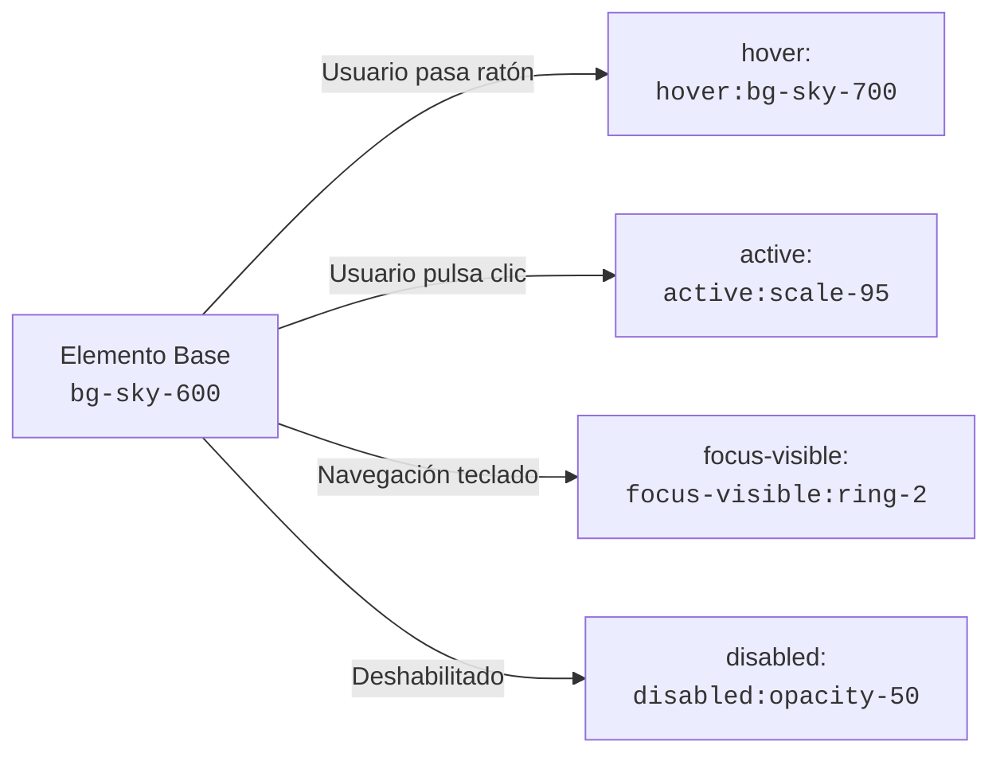
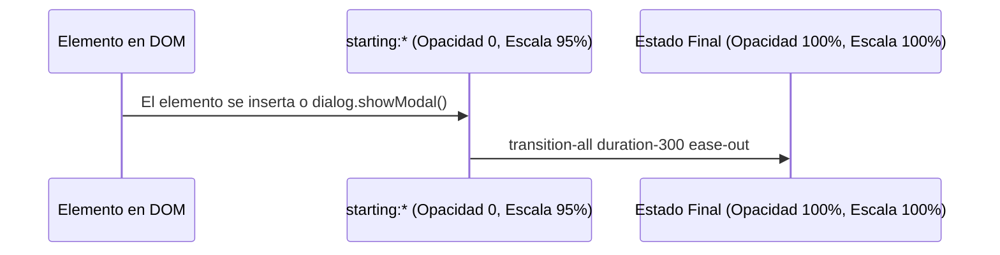

# 06. Estados Interactivos y Variantes Avanzadas

<div class="badges">
  <span class="badge badge-v4">Tailwind v4.0</span>
  <span class="badge badge-oxide">CSS Moderno</span>
  <span class="badge badge-theme">Interactividad</span>
</div>

En el desarrollo de interfaces de usuario modernas (**DAW** / **DAM**), el diseño no es estático: responde a las acciones del usuario (ratón, teclado, foco, gestos táctiles) y al estado de los datos (formularios validados, elementos deshabilitados, modales que se abren).

Tailwind CSS resuelve esto mediante **variantes de prefijo** (`hover:`, `focus:`, `group-hover:`, etc.). En Tailwind v4, este sistema se potencia gracias al motor Oxide y a la compatibilidad nativa con las especificaciones más punteras de CSS: `:has()`, `:is()`, subárboles de hijos con `*:`, y la revolucionaria variante de animación de entrada `starting:*` basada en `@starting-style`.

---

## 1. Pseudoclases Fundamentales de Interacción

Las pseudoclases se aplican anteponiendo el nombre del estado seguido de dos puntos (`:`) a cualquier clase de utilidad.



### Tabla de Pseudoclases Esenciales

| Variante | Pseudoclase CSS | Caso de uso principal en UI |
| :--- | :--- | :--- |
| `hover:` | `:hover` | Retroalimentación al pasar el cursor sobre enlaces, botones y tarjetas. |
| `focus:` | `:focus` | Resaltado de inputs, textareas y elementos interactivos al recibir foco. |
| `focus-visible:` | `:focus-visible` | **Requisito de Accesibilidad (WCAG):** Muestra el anillo de foco solo cuando se navega con teclado (Tab), evitando molestos contornos en clics de ratón. |
| `focus-within:` | `:focus-within` | Se activa en un contenedor padre si cualquiera de sus hijos tiene el foco (ej.: barra de búsqueda con icono interactivo). |
| `active:` | `:active` | Efecto de pulsación táctil o clic presionado (animación de compresión o cambio de elevación). |
| `visited:` | `:visited` | Enlaces ya visitados en el historial de navegación. |
| `disabled:` | `:disabled` | Botones o inputs deshabilitados por lógica de negocio (`cursor-not-allowed`, reducción de opacidad). |

!!! example "Botón resiliente con todos los estados de interacción"
    Observa cómo se combinan transición fluida, hover, compresión active, anillo de foco accesible y estado disabled en un único elemento:

    ```html
    <button
      type="button"
      class="inline-flex items-center gap-2 rounded-xl bg-sky-600 px-5 py-2.5 text-sm font-semibold text-white shadow-md transition-all duration-200 hover:bg-sky-500 hover:shadow-lg active:scale-95 focus-visible:outline-none focus-visible:ring-2 focus-visible:ring-sky-500 focus-visible:ring-offset-2 disabled:pointer-events-none disabled:opacity-50 disabled:shadow-none"
    >
      <svg class="size-4" fill="none" stroke="currentColor" viewBox="0 0 24 24">
        <path stroke-linecap="round" stroke-linejoin="round" stroke-width="2" d="M5 13l4 4L19 7" />
      </svg>
      <span>Guardar cambios</span>
    </button>
    ```

---

## 2. Coordinación Contenedor-Hijo con `group`

Frecuentemente necesitamos que al interactuar con un **contenedor padre** (como una tarjeta de producto), cambie el estilo de un **elemento hijo** específico (el título cambia de color, el icono se desplaza, o un badge se hace visible).

En CSS tradicional esto requería selectores anidados complejos (`.card:hover .card-title { ... }`). En Tailwind se logra marcando el padre con la clase `group` y usando el prefijo `group-*:` en los descendientes.

```html
<article class="group relative flex flex-col overflow-hidden rounded-2xl border border-slate-200 bg-white p-6 shadow-sm transition-all duration-300 hover:-translate-y-1 hover:shadow-xl dark:border-slate-800 dark:bg-slate-900">
  <!-- Badge superior que cambia de color al hover de la tarjeta -->
  <span class="w-fit rounded-full bg-slate-100 px-3 py-1 text-xs font-medium text-slate-600 transition-colors duration-200 group-hover:bg-sky-100 group-hover:text-sky-700 dark:bg-slate-800 dark:text-slate-400 dark:group-hover:bg-sky-950 dark:group-hover:text-sky-300">
    Tutorial
  </span>

  <!-- Título principal -->
  <h3 class="mt-4 text-lg font-bold text-slate-900 transition-colors group-hover:text-sky-600 dark:text-white dark:group-hover:text-sky-400">
    Arquitectura de Componentes en Tailwind 4
  </h3>

  <p class="mt-2 text-sm text-slate-500 dark:text-slate-400">
    Aprende a coordinar estados reactivos sin escribir una sola línea de JavaScript.
  </p>

  <!-- Flecha que se desliza hacia la derecha con animación elástica -->
  <div class="mt-6 flex items-center gap-2 text-sm font-semibold text-sky-600 dark:text-sky-400">
    <span>Leer artículo</span>
    <svg class="size-4 transition-transform duration-300 group-hover:translate-x-2" fill="none" stroke="currentColor" viewBox="0 0 24 24">
      <path stroke-linecap="round" stroke-linejoin="round" stroke-width="2" d="M17 8l4 4m0 0l-4 4m4-4H3" />
    </svg>
  </div>
</article>
```

### Grupos Anidados con Nombre: `group/{name}`

¿Qué ocurre si tienes una lista de tarjetas (padre) y dentro de cada tarjeta hay un botón de favoritos (hijo) que también tiene sus propios sub-elementos? Para evitar colisiones de contexto, se asigna un identificador semántico al grupo:

```html
<!-- Grupo principal: Tarjeta de Producto -->
<div class="group/card rounded-2xl border border-slate-200 p-5 hover:border-sky-500">
  
  <h4 class="font-bold text-slate-800 group-hover/card:text-sky-600">
    Monitor 4K UltraWide
  </h4>

  <!-- Sub-grupo: Botón de Favorito anidado -->
  <button class="group/fav mt-4 flex items-center gap-1.5 rounded-lg bg-slate-100 px-3 py-1.5 text-xs font-medium hover:bg-rose-50">
    <!-- El icono responde solo al hover de SU botón, no de la tarjeta completa -->
    <svg class="size-4 text-slate-400 transition-transform group-hover/fav:scale-125 group-hover/fav:text-rose-500" fill="currentColor" viewBox="0 0 20 20">
      <path d="M3.172 5.172a4 4 0 015.656 0L10 6.343l1.172-1.171a4 4 0 115.656 5.656L10 17.657l-6.828-6.829a4 4 0 010-5.656z"/>
    </svg>
    <span class="group-hover/fav:text-rose-600">Favorito</span>
  </button>

</div>
```

---

## 3. Elementos Hermanos con `peer`

El modificador `peer` permite condicionar el estilo de un elemento hermano posterior en función del estado del elemento anterior (`+` o `~` en CSS). Es el mecanismo estrella para construir **switches de activación**, **inputs flotantes (floating labels)** y **validaciones en tiempo real sin JS**.

```mermaid
flowchart LR
    Input["<input class='peer' />"] -->|Cambia su estado :checked| Sibling["<div class='peer-checked:bg-sky-600'></div>"]
```



### Ejemplo Práctico: Interruptor Toggle Accesible

```html
<label class="relative inline-flex cursor-pointer items-center gap-3">
  <!-- 1. Input oculto pero accesible, marcado como peer -->
  <input type="checkbox" class="peer sr-only" />

  <!-- 2. Carril del switch: cambia de color cuando el peer está checked -->
  <div class="h-6 w-11 rounded-full bg-slate-300 transition-colors duration-300 peer-checked:bg-sky-600 peer-focus-visible:ring-2 peer-focus-visible:ring-sky-500 peer-focus-visible:ring-offset-2 dark:bg-slate-700"></div>

  <!-- 3. Bolita deslizante: se traslada 20px a la derecha al activarse -->
  <div class="absolute left-0.5 top-0.5 size-5 rounded-full bg-white shadow-md transition-transform duration-300 peer-checked:translate-x-5"></div>

  <!-- 4. Etiqueta de texto -->
  <span class="text-sm font-medium text-slate-700 select-none dark:text-slate-300">
    Notificaciones push
  </span>
</label>
```

### Ejemplo Práctico: Floating Label (Label Flotante)

El label se eleva y reduce de tamaño cuando el input recibe el foco o tiene contenido:

```html
<div class="relative">
  <input
    type="text"
    id="username"
    placeholder=" "
    class="peer block w-full rounded-xl border border-slate-300 bg-transparent px-4 pb-2.5 pt-5 text-sm text-slate-900 focus:border-sky-600 focus:outline-none focus:ring-1 focus:ring-sky-600 dark:border-slate-700 dark:text-white"
  />
  <label
    for="username"
    class="pointer-events-none absolute left-4 top-4 z-10 origin-[0] -translate-y-3 scale-75 transform text-sm text-slate-500 duration-200 peer-placeholder-shown:translate-y-0 peer-placeholder-shown:scale-100 peer-focus:-translate-y-3 peer-focus:scale-75 peer-focus:text-sky-600 dark:text-slate-400 dark:peer-focus:text-sky-400"
  >
    Nombre de usuario
  </label>
</div>
```

---

## 4. Variantes de Selección Relacional: `has-*`

La pseudoclase `:has()` es una de las mayores revoluciones de la historia de CSS: **permite a un elemento padre cambiar de estilo según el contenido o estado de sus hijos**.

En Tailwind v4, la variante `has-*` está completamente integrada y optimizada por el compilador:

| Expresión Tailwind | Selector CSS resultante | Explicación |
| :--- | :--- | :--- |
| `has-[:checked]:border-sky-500` | `:has(:checked)` | El contenedor cambia de borde si tiene un checkbox hijo marcado. |
| `has-[:focus]:ring-2` | `:has(:focus)` | Aplica foco a toda la fila o tarjeta si algún input interior tiene foco. |
| `has-[img]:grid-cols-2` | `:has(img)` | Aplica 2 columnas solo si el componente contiene una imagen. |

### Selector de Planes / Radio Card con `has-[:checked]`

Al marcar el radio button, es la **tarjeta completa** la que resalta, sin necesidad de librerías ni scripts:

```html
<fieldset class="grid grid-cols-1 gap-4 sm:grid-cols-2">
  <legend class="sr-only">Selecciona un plan de suscripción</legend>

  <!-- Opción 1: Básico -->
  <label class="flex cursor-pointer flex-col rounded-2xl border-2 border-slate-200 p-5 transition-all duration-200 hover:border-slate-300 has-[:checked]:border-sky-600 has-[:checked]:bg-sky-50/50 has-[:checked]:shadow-md dark:border-slate-800 dark:has-[:checked]:border-sky-500 dark:has-[:checked]:bg-sky-950/20">
    <div class="flex items-center justify-between">
      <span class="font-bold text-slate-900 dark:text-white">Plan Estudiante</span>
      <input type="radio" name="plan" value="student" class="size-4 text-sky-600 focus:ring-sky-500" checked />
    </div>
    <span class="mt-2 text-2xl font-extrabold text-slate-900 dark:text-white">0 €<span class="text-xs font-normal text-slate-500">/mes</span></span>
    <p class="mt-2 text-xs text-slate-500 dark:text-slate-400">Acceso completo a todos los repositorios educativos.</p>
  </label>

  <!-- Opción 2: Pro -->
  <label class="flex cursor-pointer flex-col rounded-2xl border-2 border-slate-200 p-5 transition-all duration-200 hover:border-slate-300 has-[:checked]:border-sky-600 has-[:checked]:bg-sky-50/50 has-[:checked]:shadow-md dark:border-slate-800 dark:has-[:checked]:border-sky-500 dark:has-[:checked]:bg-sky-950/20">
    <div class="flex items-center justify-between">
      <span class="font-bold text-slate-900 dark:text-white">Plan Profesional</span>
      <input type="radio" name="plan" value="pro" class="size-4 text-sky-600 focus:ring-sky-500" />
    </div>
    <span class="mt-2 text-2xl font-extrabold text-slate-900 dark:text-white">9.99 €<span class="text-xs font-normal text-slate-500">/mes</span></span>
    <p class="mt-2 text-xs text-slate-500 dark:text-slate-400">Soporte directo, despliegues ilimitados y base de datos cloud.</p>
  </label>
</fieldset>
```

---

## 5. Selectores de Descendencia Directa con `*:`

En ocasiones queremos aplicar una regla a **todos los elementos hijos inmediatos** de un contenedor (evitando repetir clases en 10 elementos idénticos). En Tailwind v4 disponemos del comodín `*:`:

```html
<!-- Todos los hijos inmediatos tendrán padding, bordes redondeados y fondo interactivo -->
<ul class="flex flex-col gap-2 *:flex *:items-center *:justify-between *:rounded-xl *:p-3 *:transition-colors *:hover:bg-slate-100 dark:*:hover:bg-slate-800">
  <li>
    <span>Configuración de cuenta</span>
    <span class="text-xs text-slate-400">Editar</span>
  </li>
  <li>
    <span>Seguridad y 2FA</span>
    <span class="text-xs text-emerald-600 font-semibold">Activado</span>
  </li>
  <li>
    <span>Sesiones activas</span>
    <span class="text-xs text-slate-400">2 dispositivos</span>
  </li>
</ul>
```

---

## 6. Novedad Tailwind v4: Animaciones de Entrada con `starting:*`

Una limitación histórica de CSS era animar elementos que pasaban de `display: none` a `display: block` (como ventanas modales `<dialog>`, menús desplegables o popovers). Para resolverlo, los navegadores introdujeron la regla CSS `@starting-style`.

Tailwind 4.0 incorpora soporte nativo mediante la variante `starting:*`. Define el estado inicial desde el que se transiciona cuando el elemento se monta en el DOM o pasa a visible:



### Diálogo Modal con Transición Suave Nativa

```html
<!-- Modal HTML5 dialog con Tailwind v4 y starting-style -->
<dialog
  id="modalConfirm"
  class="backdrop:bg-slate-950/60 backdrop:backdrop-blur-sm rounded-2xl bg-white p-6 shadow-2xl transition-all duration-300 ease-out open:flex open:flex-col open:gap-4 starting:open:opacity-0 starting:open:scale-95 starting:open:-translate-y-4 dark:bg-slate-900"
>
  <div class="flex items-center gap-3">
    <div class="rounded-full bg-rose-100 p-2 text-rose-600 dark:bg-rose-950 dark:text-rose-400">
      <svg class="size-6" fill="none" stroke="currentColor" viewBox="0 0 24 24">
        <path stroke-linecap="round" stroke-linejoin="round" stroke-width="2" d="M12 9v2m0 4h.01m-6.938 4h13.856c1.54 0 2.502-1.667 1.732-3L13.732 4c-.77-1.333-2.694-1.333-3.464 0L3.34 16c-.77 1.333.192 3 1.732 3z"/>
      </svg>
    </div>
    <h3 class="text-lg font-bold text-slate-900 dark:text-white">¿Eliminar registro?</h3>
  </div>

  <p class="text-sm text-slate-600 dark:text-slate-300">
    Esta acción no se puede deshacer. Se eliminarán permanentemente los datos del servidor.
  </p>

  <div class="flex justify-end gap-3 pt-2">
    <button onclick="document.getElementById('modalConfirm').close()" class="rounded-lg px-4 py-2 text-sm font-semibold text-slate-600 hover:bg-slate-100 dark:text-slate-300 dark:hover:bg-slate-800">
      Cancelar
    </button>
    <button class="rounded-lg bg-rose-600 px-4 py-2 text-sm font-semibold text-white hover:bg-rose-500">
      Confirmar eliminación
    </button>
  </div>
</dialog>
```

!!! tip "¿Por qué es revolucionario `starting:*`?"
    Antes de Tailwind 4 y `@starting-style`, abrir un diálogo con animación requería manipular clases mediante `setTimeout` en JavaScript o recurrir a librerías externas de animación como Framer Motion o Headless UI. Ahora es **100% CSS nativo**.

---

## 7. Variantes de Validación de Formularios

Para el desarrollo de interfaces en aplicaciones de gestión empresarial (**DAM** / **DAW**), la retroalimentación inmediata al rellenar formularios es crítica para la experiencia de usuario:

| Variante | Se activa cuando... |
| :--- | :--- |
| `required:` | El campo tiene el atributo `required`. |
| `valid:` | El valor introducido cumple todas las restricciones de validación HTML5 (`type="email"`, `pattern`, `minlength`). |
| `invalid:` | El valor viola alguna regla de validación. |
| `in-range:` / `out-of-range:` | En inputs numéricos o de fecha, el valor se encuentra dentro o fuera de `min` y `max`. |

```html
<form class="space-y-4 max-w-md">
  <div>
    <label for="correo" class="block text-sm font-medium text-slate-700 dark:text-slate-300">
      Correo electrónico corporativo
    </label>
    <input
      type="email"
      id="correo"
      required
      placeholder="usuario@dominio.com"
      class="mt-1 block w-full rounded-xl border border-slate-300 px-4 py-2.5 text-sm text-slate-900 shadow-sm transition-colors focus:outline-none valid:border-emerald-500 valid:focus:ring-2 valid:focus:ring-emerald-500 invalid:border-slate-300 focus:invalid:border-rose-500 focus:invalid:ring-2 focus:invalid:ring-rose-500 dark:border-slate-700 dark:bg-slate-900 dark:text-white"
    />
    <!-- Mensaje de error condicional que aparece solo si el campo es inválido y no está vacío -->
    <p class="mt-1.5 hidden text-xs text-rose-600 peer-invalid:block">
      Por favor, introduce un correo electrónico válido.
    </p>
  </div>
</form>
```

---

## 8. Resumen de Buenas Prácticas

1. **Prioriza `focus-visible:` frente a `focus:`:** Los usuarios de ratón no quieren contornos toscos al hacer clic, pero los usuarios de teclado los necesitan imperativamente por accesibilidad (WCAG 2.2 AA).
2. **Utiliza nombres de grupo semánticos (`group/card`, `group/menu`):** Si anidas contenedores interactivos, nombrar los grupos evita comportamientos fantasma en los que el hover del padre dispara estilos no deseados en el hijo.
3. **Aprovecha `has-*` para evitar dependencias innecesarias de JS:** El estado de selección de tarjetas, acordeones y pestañas puede resolverse directamente en CSS.
4. **Combina estados con `transition-all duration-200`:** Los cambios abruptos de color o escala generan fatiga visual; una microinteracción sutil transmite calidad y dinamismo profesional.
