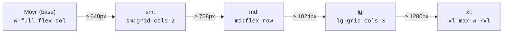
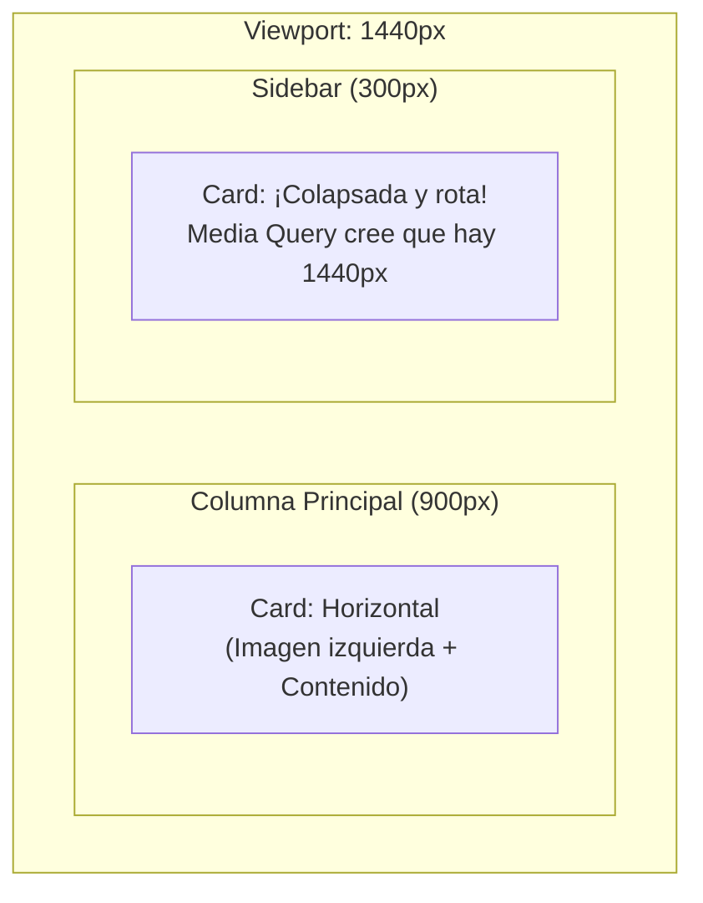
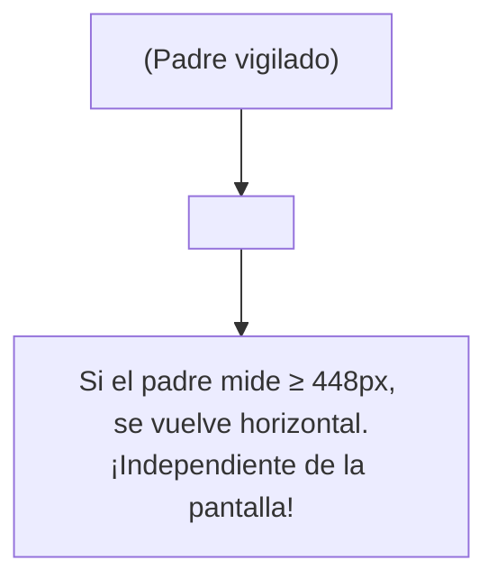
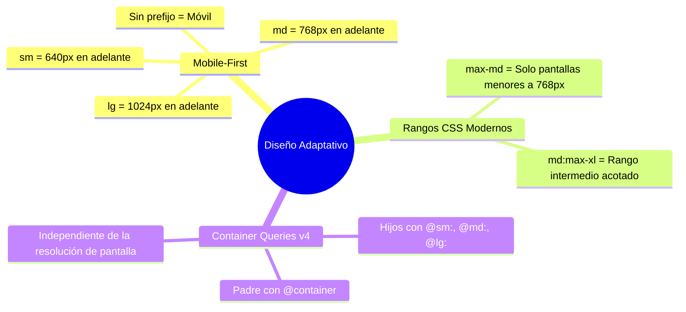

# 07. Responsive Design y Container Queries

<div class="badges">
  <span class="badge badge-v4">Tailwind v4.0</span>
  <span class="badge badge-oxide">Core Nativo</span>
  <span class="badge badge-theme">Adaptabilidad</span>
</div>

En el diseño de interfaces web modernas (**DAW** / **DAM**), una aplicación debe verse y funcionar a la perfección tanto en la pantalla de un smartphone de 375 píxeles como en un monitor de escritorio 4K UltraWide.

Tailwind CSS v4 ofrece dos mecanismos complementarios para lograrlo:
1. **Media Queries (Viewport Breakpoints):** Adaptan la interfaz completa según el ancho de la ventana del navegador. Siguen el principio **Mobile-First**.
2. **Container Queries (Novedad nativa en v4):** Adaptan un componente individual según el ancho de su **contenedor padre**, permitiendo crear componentes verdaderamente modulares y reutilizables en cualquier zona de la pantalla (sidebar, columna central o grid).

---

## 1. Filosofía Mobile-First

El principio fundamental que debes interiorizar es: **las utilidades sin prefijo definen el estilo en dispositivos móviles**. Las variantes responsivas (`sm:`, `md:`, `lg:`, etc.) solo se activan cuando el ancho de la pantalla **alcanza o supera** dicho punto de ruptura (`min-width`).



> [!CAUTION] Error común de principiante
> **Nunca uses `sm:` para indicar "solo para pantallas pequeñas"**.
> En Tailwind, `sm:text-sm` significa *"a partir de 640px en adelante (incluyendo tabletas y escritorio), usa tamaño pequeño"*.
> La regla correcta es:
> - Base (sin prefijo): Móvil
> - `md:`: Tablet y superior
> - `lg:`: Escritorio y superior

```html
<!-- CORRECTO (Mobile-First) -->
<!-- Móvil: 1 columna, Tablet: 2 columnas, Escritorio: 4 columnas -->
<div class="grid grid-cols-1 gap-4 sm:grid-cols-2 lg:grid-cols-4">
  <div>Tarjeta 1</div>
  <div>Tarjeta 2</div>
  <div>Tarjeta 3</div>
  <div>Tarjeta 4</div>
</div>
```

---

## 2. Puntos de Ruptura Estándar

Tailwind v4 incluye cinco breakpoints predeterminados basados en las dimensiones de dispositivos más extendidas:

| Prefijo | Min-width (CSS) | Dispositivos típicos |
| :--- | :--- | :--- |
| *(sin prefijo)* | `0px` | Teléfonos móviles en orientación vertical (iPhone, Galaxy, etc.). |
| `sm:` | `@media (width >= 640px)` | Teléfonos grandes en horizontal, phablets. |
| `md:` | `@media (width >= 768px)` | Tabletas en vertical (iPad), pantallas pequeñas. |
| `lg:` | `@media (width >= 1024px)` | Tabletas en horizontal, portátiles ligeros (laptops). |
| `xl:` | `@media (width >= 1280px)` | Monitores de escritorio convencionales. |
| `2xl:` | `@media (width >= 1536px)` | Pantallas de escritorio grandes y monitores QHD/4K. |

---

## 3. Rangos y Modificadores `max-*`

A partir de las especificaciones modernas de CSS de rango (`@media (width < 768px)`), Tailwind permite aplicar estilos **exclusivamente por debajo** de un punto o **dentro de un rango acotado**:

### Estilos dirigidos a móviles exclusivamente (`max-md:`)

Si necesitas que un botón o menú solo exista en móvil/tablet y desaparezca en escritorio:

```html
<!-- Visible solo en pantallas con ancho menor a 768px -->
<button class="flex items-center gap-2 rounded-lg bg-slate-900 p-2 text-white md:hidden">
  <svg class="size-6" fill="none" stroke="currentColor" viewBox="0 0 24 24">
    <path stroke-linecap="round" stroke-linejoin="round" stroke-width="2" d="M4 6h16M4 12h16M4 18h16" />
  </svg>
  <span class="sr-only">Abrir menú de navegación</span>
</button>
```

### Estilos acotados a un rango exacto (`md:max-lg:`)

Aplica una regla únicamente cuando la pantalla se encuentra entre tablet y escritorio:

```html
<!-- Solo activo en pantallas entre 768px y 1023px -->
<div class="hidden md:max-lg:block bg-amber-100 p-4 text-amber-800">
  Estás visualizando la interfaz en modo tableta.
</div>
```

---

## 4. Personalización de Breakpoints en `@theme` (Tailwind 4)

En Tailwind 4, no existe `tailwind.config.js`. Si tu proyecto o cliente requiere puntos de ruptura corporativos específicos (por ejemplo, para adaptar a dispositivos táctiles industriales o quioscos), se definen directamente en tu CSS mediante la directiva `@theme`:

```css
@import "tailwindcss";

@theme {
  /* Añadir un breakpoint ultra-compacto para smartwatches o terminales */
  --breakpoint-xs: 480px;

  /* Redefinir o ampliar breakpoints existentes */
  --breakpoint-3xl: 1920px;
}
```

Una vez definido, ya puedes usar `xs:p-2` o `3xl:max-w-(--spacing-container)` directamente en tu HTML.

---

## 5. Container Queries: La Gran Novedad Nativa de v4

### El Problema de las Media Queries Tradicionales

Imagina un componente `<ArticleCard />`. Si lo colocamos en la **zona principal** de la pantalla, tiene 800px de espacio disponible y debería mostrarse en horizontal (imagen a la izquierda, texto a la derecha). 

Pero si ese mismo componente se reutiliza dentro de la **barra lateral (sidebar)**, solo dispone de 280px de espacio. Sin embargo, la **pantalla (viewport)** sigue midiendo 1440px.

Con Media Queries, el componente se rompería porque la ventana es grande, aunque su contenedor sea diminuto.



### La Solución: `@container`

En Tailwind 4, las **Container Queries vienen integradas en el core sin plugins externos**.

Para utilizarlas se siguen dos sencillos pasos:
1. Marca el contenedor padre con la clase `@container`.
2. En los elementos hijos, usa variantes con prefijo `@` (`@sm:`, `@md:`, `@lg:`, etc.).



### Tabla de Puntos de Ruptura de Contenedor

| Prefijo de Contenedor | Ancho mínimo del contenedor padre |
| :--- | :--- |
| `@xs:` | `20rem` (320px) |
| `@sm:` | `24rem` (384px) |
| `@md:` | `28rem` (448px) |
| `@lg:` | `32rem` (512px) |
| `@xl:` | `36rem` (576px) |
| `@2xl:` | `42rem` (672px) |
| `@3xl:` | `48rem` (768px) |

---

## 6. Caso Práctico: Tarjeta de Producto Adaptable con `@container`

Observa cómo este componente se auto-organiza en vertical u horizontal según el ancho exacto del espacio en el que lo incrustes:

```html
<!-- 1. El envoltorio padre define el contexto de contenedor -->
<div class="@container w-full">
  
  <!-- 2. La tarjeta reacciona al ancho de su padre (@md: >= 448px) -->
  <article class="flex flex-col overflow-hidden rounded-2xl border border-slate-200 bg-white shadow-sm transition-all duration-300 hover:shadow-md @md:flex-row dark:border-slate-800 dark:bg-slate-900">
    
    <!-- Imagen del producto: ocupa altura fija en vertical, o ancho fijo en horizontal -->
    <div class="relative h-48 w-full shrink-0 overflow-hidden bg-slate-100 @md:h-auto @md:w-56 dark:bg-slate-800">
      
      <span class="absolute left-3 top-3 rounded-full bg-emerald-500/90 px-2.5 py-0.5 text-xs font-bold text-white backdrop-blur-xs">
        Nuevo
      </span>
    </div>

    <!-- Contenido y acciones -->
    <div class="flex flex-1 flex-col justify-between p-5 @lg:p-6">
      <div>
        <div class="flex items-center justify-between text-xs font-medium text-slate-500 dark:text-slate-400">
          <span>Tecnología</span>
          <span class="flex items-center gap-1 text-amber-500 font-semibold">★ 4.9</span>
        </div>
        <h4 class="mt-2 text-base font-bold text-slate-900 @md:text-lg dark:text-white">
          Smartwatch Apex Pro GPS
        </h4>
        <p class="mt-2 line-clamp-2 text-xs text-slate-500 @md:text-sm dark:text-slate-400">
          Monitorización cardíaca continua, resistencia al agua hasta 50m y batería de larga duración con carga solar.
        </p>
      </div>

      <div class="mt-5 flex items-center justify-between border-t border-slate-100 pt-4 dark:border-slate-800">
        <div>
          <span class="text-xs text-slate-400 block">Precio especial</span>
          <span class="text-lg font-black text-slate-900 @md:text-xl dark:text-white">189.90 €</span>
        </div>
        <button class="inline-flex items-center gap-1.5 rounded-xl bg-sky-600 px-4 py-2 text-xs font-semibold text-white shadow-sm transition-colors hover:bg-sky-500 @md:text-sm">
          Añadir al carrito
        </button>
      </div>
    </div>

  </article>

</div>
```

---

## 7. Patrón de Arquitectura: Tabla de Datos Responsiva a Tarjetas

Uno de los mayores desafíos en el desarrollo de paneles administrativos empresariales (**DAM/DAW**) es mostrar tablas de datos en pantallas móviles. La mejor solución de UX consiste en mostrar una **tabla clásica en escritorio** y transformarla automáticamente en **tarjetas modulares en móvil**:

```html
<div class="w-full overflow-hidden rounded-2xl border border-slate-200 bg-white shadow-sm dark:border-slate-800 dark:bg-slate-900">
  
  <!-- Vista de Tabla (Escritorio: md en adelante) -->
  <table class="hidden w-full text-left text-sm md:table">
    <thead class="border-b border-slate-200 bg-slate-50 text-xs font-semibold uppercase text-slate-500 dark:border-slate-800 dark:bg-slate-800/50 dark:text-slate-400">
      <tr>
        <th class="px-6 py-4">Alumno</th>
        <th class="px-6 py-4">Ciclo</th>
        <th class="px-6 py-4">Proyecto</th>
        <th class="px-6 py-4">Calificación</th>
      </tr>
    </thead>
    <tbody class="divide-y divide-slate-200 dark:divide-slate-800">
      <tr class="hover:bg-slate-50/50 dark:hover:bg-slate-800/30">
        <td class="px-6 py-4 font-medium text-slate-900 dark:text-white">Carlos Martínez</td>
        <td class="px-6 py-4 text-slate-500">2º DAW</td>
        <td class="px-6 py-4 text-slate-500">API GraphQL con Tailwind 4</td>
        <td class="px-6 py-4"><span class="rounded-full bg-emerald-100 px-2.5 py-1 text-xs font-bold text-emerald-700 dark:bg-emerald-950 dark:text-emerald-300">9.5 Sobresaliente</span></td>
      </tr>
    </tbody>
  </table>

  <!-- Vista en Tarjetas (Móvil: menor a md) -->
  <div class="divide-y divide-slate-200 p-4 md:hidden dark:divide-slate-800">
    <div class="flex flex-col gap-2 py-3 first:pt-0 last:pb-0">
      <div class="flex items-center justify-between">
        <span class="font-bold text-slate-900 dark:text-white">Carlos Martínez</span>
        <span class="rounded-full bg-emerald-100 px-2.5 py-0.5 text-xs font-bold text-emerald-700 dark:bg-emerald-950 dark:text-emerald-300">9.5</span>
      </div>
      <div class="flex items-center justify-between text-xs text-slate-500">
        <span>Ciclo formativo:</span>
        <span class="font-medium text-slate-700 dark:text-slate-300">2º DAW</span>
      </div>
      <div class="flex items-center justify-between text-xs text-slate-500">
        <span>Proyecto fin de trimestre:</span>
        <span class="font-medium text-slate-700 dark:text-slate-300">API GraphQL con Tailwind 4</span>
      </div>
    </div>
  </div>

</div>
```

---

## 8. Guía Resumida para el Alumno


