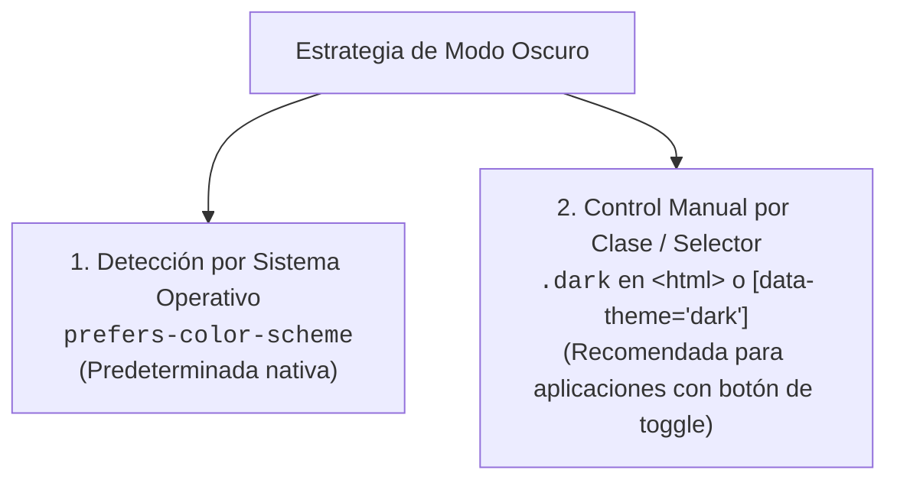
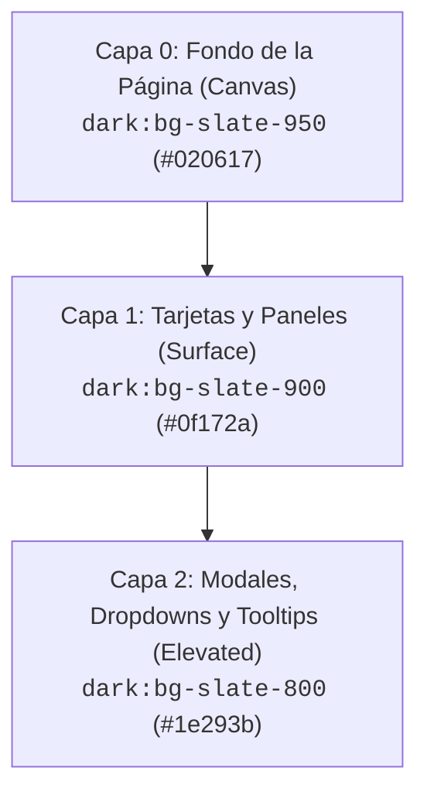

# 08. Modo Oscuro, Temas y Accesibilidad

<div class="badges">
  <span class="badge badge-v4">Tailwind v4.0</span>
  <span class="badge badge-oxide">Accesibilidad WCAG</span>
  <span class="badge badge-theme">Dark Mode</span>
</div>

El soporte para modo oscuro ya no es una característica opcional en el desarrollo de software profesional (**DAW** / **DAM**): es una expectativa universal de los usuarios por ergonomía visual en entornos de baja luminosidad y ahorro energético en pantallas OLED.

Además, una interfaz profesional debe cumplir los estándares internacionales de accesibilidad (**WCAG 2.2 nivel AA**), respetando las preferencias de contraste elevado (`contrast-more:`), reducción de movimiento (`motion-reduce:`) y navegación para personas con discapacidad visual (`sr-only`).

---

## 1. La Variante `dark:*`

Tailwind proporciona la variante `dark:*` para condicionar cualquier utilidad al modo oscuro:

```html
<div class="bg-white text-slate-900 border border-slate-200 dark:bg-slate-900 dark:text-white dark:border-slate-800">
  <h2 class="text-xl font-bold">Panel de Control</h2>
  <p class="text-slate-600 dark:text-slate-400">
    Bienvenido al entorno de desarrollo.
  </p>
</div>
```

---

## 2. Estrategias de Modo Oscuro en Tailwind 4

En versiones previas (v3) la estrategia de modo oscuro se definía en `tailwind.config.js`. En **Tailwind v4**, todo se gestiona directamente en tu archivo CSS:



### Configuración de la Estrategia en CSS

=== "1. Manual por Clase `.dark` (Recomendada)"
    Si quieres que el usuario pueda alternar entre modo claro y oscuro pulsando un botón en la barra superior, define la variante en tu `src/app.css`:

    ```css
    @import "tailwindcss";

    /* Define que dark: se active cuando un ancestro (típicamente <html>) tenga la clase .dark */
    @custom-variant dark (&:where(.dark, .dark *));
    ```

=== "2. Detección Automática por Sistema"
    Si prefieres que la web se adapte 100% de forma transparente a la preferencia del sistema operativo del usuario, no necesitas añadir ninguna línea: **es el comportamiento por defecto de Tailwind v4** mediante `@media (prefers-color-scheme: dark)`.

=== "3. Por atributo `data-theme`"
    Ideal si tu arquitectura de aplicación soporta múltiples temas (oscuro, claro, alto contraste, corporativo):

    ```css
    @import "tailwindcss";

    @custom-variant dark (&:where([data-theme="dark"], [data-theme="dark"] *));
    ```

---

## 3. Script de Alternancia (Toggle) sin FOUC

El principal error de implementación en aplicaciones web es el **FOUC (Flash of Unstyled Content)**: la pantalla parpadea en blanco un milisegundo antes de leer `localStorage` en JavaScript.

Para evitarlo, se ejecuta un pequeño script síncrono en el `<head>` del documento HTML antes de renderizar el `<body>`:

### Código Completo: HTML + JavaScript Antiparapadeo

```html
<!DOCTYPE html>
<html lang="es">
<head>
  <meta charset="UTF-8" />
  <meta name="viewport" content="width=device-width, initial-scale=1.0" />
  <title>Mi Aplicación con Modo Oscuro</title>

  <!-- SCRIPT ANTIPARPADEO (Bloqueante en HEAD para evitar FOUC) -->
  <script>
    if (
      localStorage.getItem('theme') === 'dark' ||
      (!('theme' in localStorage) && window.matchMedia('(prefers-color-scheme: dark)').matches)
    ) {
      document.documentElement.classList.add('dark');
    } else {
      document.documentElement.classList.remove('dark');
    }
  </script>

  <link rel="stylesheet" href="./src/app.css" />
</head>
<body class="bg-slate-50 text-slate-900 transition-colors duration-300 dark:bg-slate-950 dark:text-slate-100">

  <!-- Botón de Alternancia de Tema -->
  <button
    id="themeToggleBtn"
    type="button"
    class="fixed right-6 top-6 flex size-11 items-center justify-center rounded-2xl border border-slate-200 bg-white p-2.5 shadow-md transition-all hover:bg-slate-100 focus-visible:outline-none focus-visible:ring-2 focus-visible:ring-sky-500 active:scale-90 dark:border-slate-800 dark:bg-slate-900 dark:hover:bg-slate-800"
    aria-label="Alternar modo oscuro"
  >
    <!-- Icono Sol (se muestra en modo oscuro para volver a claro) -->
    <svg class="hidden size-5 text-amber-400 dark:block" fill="none" stroke="currentColor" viewBox="0 0 24 24">
      <path stroke-linecap="round" stroke-linejoin="round" stroke-width="2" d="M12 3v1m0 16v1m9-9h-1M4 9H3m15.364 6.364l-.707-.707M6.343 6.343l-.707-.707m12.728 0l-.707.707M6.343 17.657l-.707.707M16 12a4 4 0 11-8 0 4 4 0 018 0z" />
    </svg>
    <!-- Icono Luna (se muestra en modo claro para pasar a oscuro) -->
    <svg class="block size-5 text-slate-700 dark:hidden" fill="none" stroke="currentColor" viewBox="0 0 24 24">
      <path stroke-linecap="round" stroke-linejoin="round" stroke-width="2" d="M20.354 15.354A9 9 0 018.646 3.646 9.003 9.003 0 0012 21a9.003 9.003 0 008.354-5.646z" />
    </svg>
  </button>

  <!-- Lógica interactiva del botón -->
  <script>
    const toggleBtn = document.getElementById('themeToggleBtn');
    
    toggleBtn.addEventListener('click', () => {
      const isDark = document.documentElement.classList.toggle('dark');
      localStorage.setItem('theme', isDark ? 'dark' : 'light');
    });
  </script>
</body>
</html>
```

---

## 4. Arquitectura de Color y Capas de Elevación

En modo oscuro profesional, **nunca se usa negro puro (`#000000`) de forma uniforme para todos los fondos**. Si todo es negro puro, los elementos pierden su jerarquía de profundidad.

El principio correcto es el **sistema de capas con escala de brillo gradual**:



### Reglas de Diseño de UI en Modo Oscuro

1. **Evita contrastes extremos en textos largos:** En lugar de `dark:text-white` para párrafos extensos, usa `dark:text-slate-300` o `dark:text-slate-400`. El blanco puro genera fatiga ocular (*halo effect*).
2. **Atenúa las sombras:** Las sombras estándar (`shadow-lg`) son casi invisibles sobre fondos oscuros. En su lugar, usa **bordes sutiles con opacidad** (`dark:border-slate-800` o `dark:border-white/10`) para delimitar las superficies.
3. **Colores de acento menos saturados:** Un color muy chillón en modo claro puede deslumbrar en modo oscuro. Si usas `bg-sky-600` en claro, en oscuro un `bg-sky-500` con textos blancos suele ofrecer mejor legibilidad.

---

## 5. Tokenización Semántica de Temas con Variables CSS

Para proyectos medianos y grandes (**DAM/DAW**), escribir manualmente `bg-white dark:bg-slate-900 text-slate-900 dark:text-slate-100` en cada elemento resulta tedioso.

La arquitectura recomendada consiste en definir **tokens semánticos** en tu CSS que mutan automáticamente:

```css
@import "tailwindcss";

:root {
  --color-canvas: var(--color-slate-50);
  --color-surface: #ffffff;
  --color-surface-hover: var(--color-slate-100);
  --color-content: var(--color-slate-900);
  --color-content-muted: var(--color-slate-500);
  --color-border: var(--color-slate-200);
}

.dark {
  --color-canvas: var(--color-slate-950);
  --color-surface: var(--color-slate-900);
  --color-surface-hover: var(--color-slate-800);
  --color-content: var(--color-slate-50);
  --color-content-muted: var(--color-slate-400);
  --color-border: var(--color-slate-800);
}
```

```html
<!-- Componente limpio sin necesidad de prefijos dark: repetitivos -->
<div class="rounded-2xl border border-[var(--color-border)] bg-[var(--color-surface)] p-6 text-[var(--color-content)] transition-colors">
  <h3 class="font-bold">Factura emitida</h3>
  <p class="text-sm text-[var(--color-content-muted)]">Pendiente de cobro en 30 días.</p>
</div>
```

---

## 6. Accesibilidad (a11y) y Estándares WCAG 2.2

La accesibilidad web no es un extra: es una exigencia legal y ética en el desarrollo de software.

### 1. Elementos solo para lectores de pantalla: `sr-only`

A menudo diseñamos botones que solo contienen un icono (ej.: una lupa para buscar o una 'X' para cerrar). Los usuarios videntes entienden el símbolo, pero una persona con ceguera total que use lector de pantalla (como NVDA o VoiceOver) escuchará *"botón vacío"*.

La utilidad `sr-only` oculta visualmente el elemento pero lo mantiene legible para tecnologías de asistencia:

```html
<button type="button" class="rounded-lg p-2 text-slate-500 hover:bg-slate-100 dark:hover:bg-slate-800">
  <svg class="size-5" fill="none" stroke="currentColor" viewBox="0 0 24 24">
    <path stroke-linecap="round" stroke-linejoin="round" stroke-width="2" d="M6 18L18 6M6 6l12 12" />
  </svg>
  <!-- Texto accesible invisible a la vista -->
  <span class="sr-only">Cerrar ventana emergente</span>
</button>
```

### 2. Respeto al Movimiento Reducido: `motion-reduce:`

Muchos usuarios con trastornos vestibulares sufren mareos ante animaciones agresivas o desplazamientos continuos. En su sistema operativo activan la opción *"Reducir movimiento"*.

Tailwind permite desactivar o suavizar las animaciones automáticamente con `motion-reduce:` o condicionarlas con `motion-safe:`:

```html
<!-- Animación de pulso solo si el usuario no tiene activada la reducción de movimiento -->
<div class="motion-safe:animate-bounce motion-reduce:transform-none">
  🎉 ¡Enhorabuena! Has completado el módulo.
</div>
```

### 3. Modo de Alto Contraste: `contrast-more:`

Para personas con baja visión o daltonismo severo:

```html
<button class="border border-sky-600 bg-sky-600 text-white contrast-more:border-2 contrast-more:border-black contrast-more:font-bold">
  Confirmar matrícula
</button>
```

---

## 7. Rúbrica de Validación de Accesibilidad en Interfaces

Antes de entregar una interfaz web en clase o en un entorno profesional, comprueba esta lista de control:

- [ ] **Contraste de Texto:** Ratio mínimo de **4.5:1** para texto normal y **3:1** para texto grande (≥ 18px en negrita o 24px regular).
- [ ] **Navegación con Tabulador:** Todos los elementos interactivos tienen un anillo `focus-visible:` nítido y distinguible.
- [ ] **Iconos Informativos:** Cada botón con solo icono incluye una etiqueta descriptiva con `sr-only`.
- [ ] **Formularios Etiquetados:** Cada `<input>` cuenta con su correspondiente `<label for="...">` asociado por `id`.
- [ ] **Respeto a Preferencias:** Modo oscuro funcional y soporte para `motion-reduce:`.
