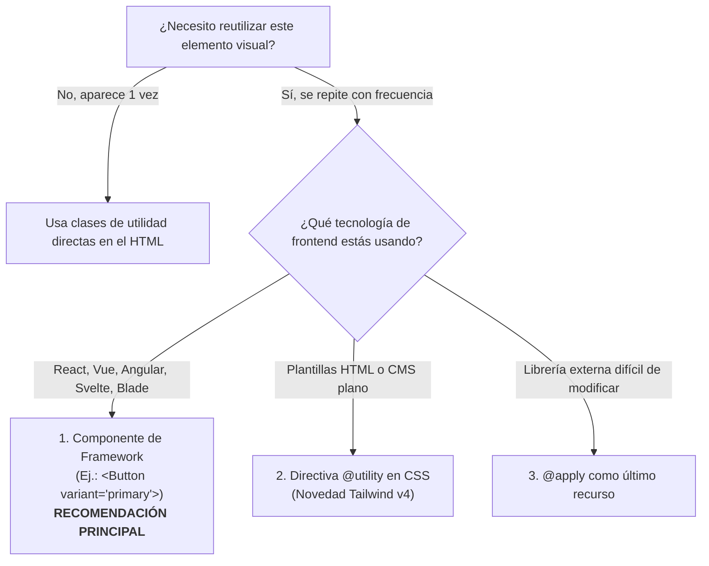
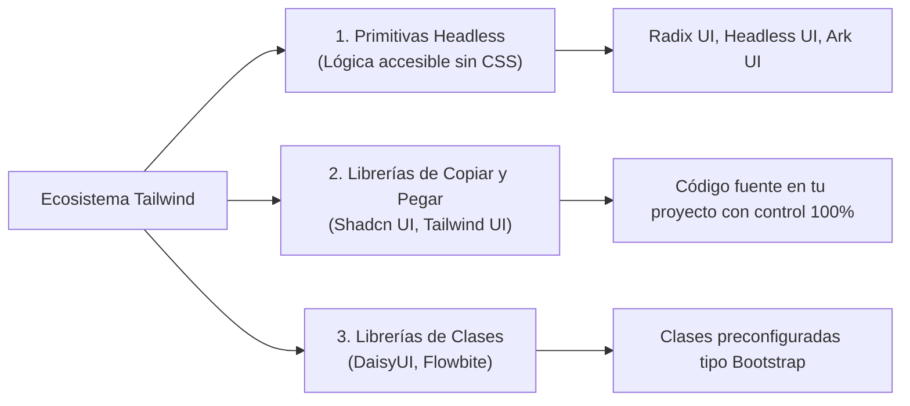

# 09. Componentes, @utility y Frameworks

<div class="badges">
  <span class="badge badge-v4">Tailwind v4.0</span>
  <span class="badge badge-oxide">Arquitectura</span>
  <span class="badge badge-theme">Reutilización</span>
</div>

Una de las primeras preguntas que surgen en el aula de **DAW** y **DAM** al trabajar con Tailwind CSS es:

> *"¿Tengo que repetir las mismas 15 clases en cada botón de mi aplicación?"*

La respuesta rotunda es **NO**. El ecosistema moderno de desarrollo de software ofrece estrategias de reutilización potentes y limpias. En este tema aprenderás a estructurar componentes modulares, dominar la nueva directiva `@utility` de Tailwind 4.0 y entender cuándo tiene sentido (y cuándo no) recurrir a `@apply`.

---

## 1. El Árbol de Decisiones de Reutilización

Antes de apresurarte a escribir clases CSS personalizadas, sigue esta jerarquía arquitectónica:



---

## 2. La Vía Maestra: Componentes de Framework

En la industria profesional (**DAW/DAM**), el 90% de los proyectos utilizan frameworks de interfaz (React, Vue, Angular, Svelte) o motores de plantillas en backend (Laravel Blade, Django, Thymeleaf). 

En estos entornos, **la abstracción se hace a nivel de componente de software**, no creando nombres de clases CSS abstractos:

=== "Angular (2º DAM / DAW)"
    ```typescript
    // button.component.ts
    import { Component, Input } from '@angular/core';
    import { CommonModule } from '@angular/common';

    @Component({
      selector: 'app-button',
      standalone: true,
      imports: [CommonModule],
      template: `
        <button
          [class]="baseClasses + ' ' + variantClasses[variant] + ' ' + sizeClasses[size]"
          [disabled]="disabled"
        >
          <ng-content></ng-content>
        </button>
      `
    })
    export class ButtonComponent {
      @Input() variant: 'primary' | 'secondary' | 'danger' = 'primary';
      @Input() size: 'sm' | 'md' | 'lg' = 'md';
      @Input() disabled: boolean = false;

      baseClasses = 'inline-flex items-center justify-center font-semibold rounded-xl transition-all duration-200 active:scale-95 focus-visible:outline-none focus-visible:ring-2 focus-visible:ring-offset-2 disabled:opacity-50 disabled:pointer-events-none';

      variantClasses = {
        primary: 'bg-sky-600 text-white hover:bg-sky-500 focus-visible:ring-sky-500 shadow-sm',
        secondary: 'bg-slate-100 text-slate-800 hover:bg-slate-200 dark:bg-slate-800 dark:text-slate-200 dark:hover:bg-slate-700',
        danger: 'bg-rose-600 text-white hover:bg-rose-500 focus-visible:ring-rose-500'
      };

      sizeClasses = {
        sm: 'px-3 py-1.5 text-xs',
        md: 'px-4 py-2.5 text-sm',
        lg: 'px-6 py-3.5 text-base'
      };
    }
    ```

=== "React / Next.js (2º DAW)"
    ```tsx
    // Button.tsx
    import React from 'react';

    interface ButtonProps extends React.ButtonHTMLAttributes<HTMLButtonElement> {
      variant?: 'primary' | 'secondary' | 'danger';
      size?: 'sm' | 'md' | 'lg';
    }

    export const Button: React.FC<ButtonProps> = ({
      variant = 'primary',
      size = 'md',
      className = '',
      children,
      ...props
    }) => {
      const base = "inline-flex items-center justify-center font-semibold rounded-xl transition-all duration-200 active:scale-95 focus-visible:outline-none focus-visible:ring-2 focus-visible:ring-offset-2 disabled:opacity-50 disabled:pointer-events-none";
      
      const variants = {
        primary: "bg-sky-600 text-white hover:bg-sky-500 focus-visible:ring-sky-500 shadow-sm",
        secondary: "bg-slate-100 text-slate-800 hover:bg-slate-200 dark:bg-slate-800 dark:text-slate-200 dark:hover:bg-slate-700",
        danger: "bg-rose-600 text-white hover:bg-rose-500 focus-visible:ring-rose-500"
      };

      const sizes = {
        sm: "px-3 py-1.5 text-xs",
        md: "px-4 py-2.5 text-sm",
        lg: "px-6 py-3.5 text-base"
      };

      return (
        <button
          className={`${base} ${variants[variant]} ${sizes[size]} ${className}`}
          {...props}
        >
          {children}
        </button>
      );
    };
    ```

---

## 3. Novedad Tailwind v4: La Directiva `@utility`

En Tailwind v3, para registrar una utilidad personalizada se utilizaba `@layer utilities` o se escribía un plugin en JavaScript.

En **Tailwind 4.0**, existe una directiva nativa y formal: **`@utility`**.

### ¿Qué hace `@utility` tan especial?
Cualquier clase definida con `@utility` se convierte en una **utilidad de pleno derecho del compilador**, lo que significa que **acepta automáticamente todas las variantes de Tailwind** (`hover:`, `focus:`, `dark:`, `sm:`, `md:`, `group-hover:`, etc.) sin que tengas que programarlas:

```css
@import "tailwindcss";

/* Definición de una utilidad personalizada para tarjetas glassmorphism */
@utility card-glass {
  background-color: rgb(255 255 255 / 0.15);
  backdrop-filter: blur(12px);
  border: 1px solid rgb(255 255 255 / 0.2);
  box-shadow: 0 8px 32px 0 rgb(0 0 0 / 0.1);
}

/* Utilidad para simular relieve 3D en botones pulsables */
@utility btn-elevated {
  border-bottom-width: 4px;
  transform: translateY(0);
  transition: all 150ms cubic-bezier(0.4, 0, 0.2, 1);

  &:active {
    border-bottom-width: 1px;
    transform: translateY(3px);
  }
}
```

### Uso en el HTML

Observa cómo se le pueden añadir prefijos libremente:

```html
<!-- La clase card-glass funciona con dark:, hover:, sm:, etc. -->
<div class="card-glass hover:card-glass-hover p-6 rounded-2xl dark:bg-slate-900/40">
  <h3 class="text-lg font-bold">Tarjeta Traslúcida</h3>
  <button class="btn-elevated border-sky-800 bg-sky-600 px-4 py-2 text-white font-bold rounded-lg hover:bg-sky-500">
    Púlsame
  </button>
</div>
```

---

## 4. La Verdad sobre `@apply`

La directiva `@apply` permite agrupar utilidades de Tailwind en una clase CSS personalizada:

```css
/* USO CLÁSICO DE @APPLY */
.btn-primary {
  @apply inline-flex items-center px-4 py-2 bg-sky-600 text-white rounded-xl font-semibold hover:bg-sky-500;
}
```

### ¿Por qué NO debes abusar de `@apply`?

Los estudiantes que vienen de CSS tradicional suelen sentir la tentación de meter **todas** las utilidades dentro de `@apply` para tener nombres de clase tradicionales (`.header`, `.nav-item`, `.card-footer`). Esto destruye las mayores ventajas de Tailwind:

| Con `@apply` excesivo | Con Utility-First y Componentes |
| :--- | :--- |
| **Parálisis de nombres:** Vuelves a tener que inventar nombres abstractos como `.sidebar-inner-card-wrapper-v2`. | No pierdes tiempo inventando nombres arbitrarios. |
| **CSS inflado:** Si creas 50 clases con `@apply`, generas CSS duplicado y redundante. | El archivo final de CSS pesa menos de 10-15 KB porque las utilidades se reutilizan. |
| **Pérdida de contexto:** Tienes que saltar constantemente entre el archivo HTML y el CSS para ver qué hace cada clase. | Todo el diseño se lee de un vistazo en la propia plantilla. |

> [!TIP] ¿Cuándo SÍ está justificado usar `@apply`?
> 1. **Estilos de contenido enriquecido (Markdown/WYSIWYG):** Cuando recibes HTML dinámico de una base de datos o CMS (como WordPress o Strapi) y no puedes añadir clases a cada `<h2>` o `<p>`.
> 2. **Integración con librerías externas cerradas:** Como calendarios (`FullCalendar`), sliders o selectores que inyectan sus propias clases fijas en el DOM.

---

## 5. El Ecosistema de Librerías de Componentes

No tienes que empezar todas tus interfaces desde cero. El ecosistema de Tailwind CSS cuenta con soluciones probadas en producción:



### El Modelo Shadcn UI (El estándar actual de la industria)

En la actualidad, el paradigma dominante en proyectos de gran envergadura (especialmente con Next.js, Vite o Astro) no es instalar una librería como paquete opaco de `npm`, sino **copiar los componentes a tu propia carpeta `components/ui/`**.

De este modo:
- El componente es 100% tuyo y lo puedes editar.
- Utiliza las clases exactas de Tailwind que aprendes en clase.
- Cumple todas las normas de accesibilidad por defecto.

---

## 6. Práctica Guiada: Crear un Sistema de Botones Reutilizable

Para afianzar este tema, crearemos un módulo de estilos modular para botones profesionales en `src/styles/buttons.css`:

```css
@import "tailwindcss";

@utility btn {
  display: inline-flex;
  align-items: center;
  justify-content: center;
  gap: 0.5rem;
  font-weight: 600;
  border-radius: 0.75rem;
  transition: all 200ms cubic-bezier(0.4, 0, 0.2, 1);
  user-select: none;

  &:focus-visible {
    outline: none;
    outline-offset: 2px;
  }

  &:active {
    transform: scale(0.96);
  }

  &:disabled {
    opacity: 0.5;
    pointer-events: none;
  }
}

@utility btn-primary {
  background-color: var(--color-sky-600);
  color: #ffffff;
  box-shadow: 0 1px 2px 0 rgb(0 0 0 / 0.05);

  &:hover {
    background-color: var(--color-sky-500);
  }

  &:focus-visible {
    box-shadow: 0 0 0 2px var(--color-sky-500);
  }
}

@utility btn-danger {
  background-color: var(--color-rose-600);
  color: #ffffff;

  &:hover {
    background-color: var(--color-rose-500);
  }

  &:focus-visible {
    box-shadow: 0 0 0 2px var(--color-rose-500);
  }
}
```

```html
<!-- Uso limpio en la vista -->
<div class="flex flex-wrap gap-4 p-8">
  <button class="btn btn-primary px-5 py-2.5 text-sm">
    Guardar cambios
  </button>
  <button class="btn btn-danger px-5 py-2.5 text-sm">
    Eliminar cuenta
  </button>
  <button class="btn btn-primary px-5 py-2.5 text-sm" disabled>
    Procesando...
  </button>
</div>
```
