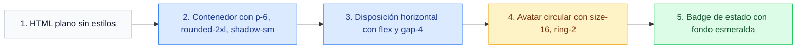
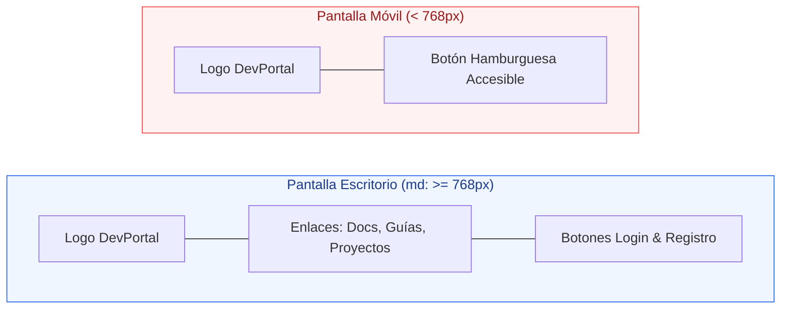
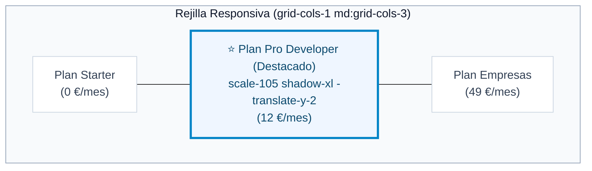
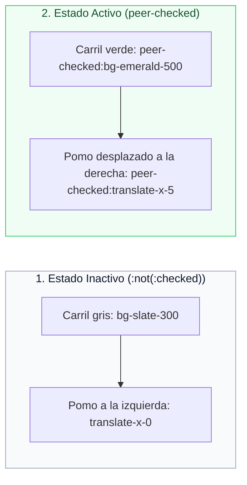
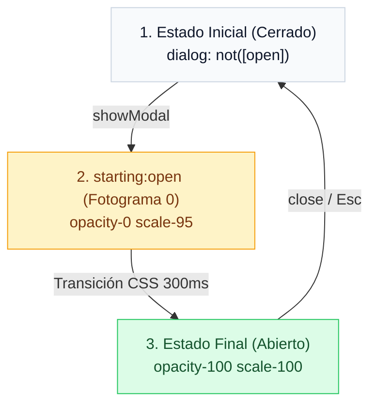
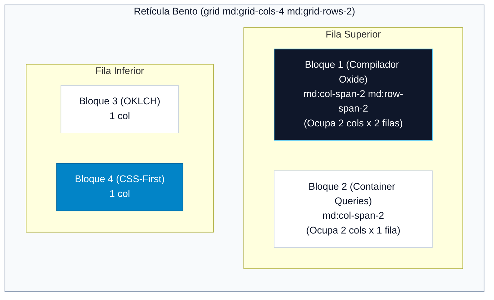

# 10. Banco de Ejercicios Guiados Paso a Paso

<div class="badges">
  <span class="badge badge-v4">Tailwind v4.0</span>
  <span class="badge badge-oxide">Práctica de Aula</span>
  <span class="badge badge-theme">Ejercicios Guiados</span>
  <span class="badge badge-ra">RA 2 / RA 3 / RA 4</span>
</div>

Este banco de ejercicios está diseñado específicamente para las sesiones prácticas de los módulos de **Diseño de Interfaces Web (DAW)** y **Desarrollo de Interfaces (DAM)**. 

Cada ejercicio propone un **reto real de maquetación**, desglosando el flujo de trabajo en cuatro fases pedagógicas:

1. **El Problema a Resolver:** Escenario de diseño profesional y contexto funcional del componente.
2. **Aspectos Técnicos a Trabajar:** Competencias curriculares, utilidades de Tailwind 4 implicadas y accesibilidad.
3. **Código de Partida e Instrucciones Guiadas:** Esqueleto HTML limpio y lista de requisitos paso a paso.
4. **Solución Completa:** Código optimizado con pestañas interactivas y disección de utilidades.

---

## Ejercicio 1: Tarjeta de Perfil de Alumno (Nivel Básico)

### 1. El Problema a Resolver

En la plataforma interna de gestión de bolsa de empleo y Formación en Centros de Trabajo (FCT), se requiere maquetar una **tarjeta de presentación de perfil de estudiante**. La tarjeta debe mostrar la fotografía del alumno, sus datos académicos y un distintivo visual (*badge*) que indique con claridad su estado de disponibilidad para incorporarse a las empresas colaboradoras.



### 2. Aspectos Técnicos a Trabajar

* **Modelo de caja y superficies:** Relleno interior (`p-6`), bordes sutiles (`border border-slate-200`), esquinas redondeadas (`rounded-2xl`) y sombras de elevación (`shadow-sm`, `hover:shadow-md`).
* **Alineación con Flexbox:** Disposición en fila centrada verticalmente (`flex items-center gap-4`).
* **Tratamiento de avatares:** Dimensiones cuadradas simultáneas con `size-16`, recorte circular (`rounded-full`), encuadre fotográfico (`object-cover`) y anillo decorativo (`ring-2 ring-slate-100`).
* **Soporte de Modo Oscuro:** Clases duales con el prefijo `dark:` (`dark:bg-slate-900`, `dark:border-slate-800`, `dark:text-white`).

### 3. Código de Partida (HTML sin estilos)

```html title="ejercicio-01-partida.html"
<article class="tarjeta-alumno">
  
  <div class="info-alumno">
    <div>
      <h3>Elena Morales</h3>
      <span>FCT</span>
    </div>
    <p>Desarrolladora Full Stack — 2º DAW</p>
  </div>
</article>
```

### 4. Instrucciones Guiadas Paso a Paso

1. **Superficie del contenedor:** Añade al elemento `<article>` fondo blanco (`bg-white` y `dark:bg-slate-900`), borde perimetral (`border border-slate-200 dark:border-slate-800`), radio de esquina pronunciado (`rounded-2xl`), sombra ligera (`shadow-sm`) y relleno de 24px (`p-6`). Incorpora una transición suave para que la sombra se eleve al pasar el ratón (`transition-shadow hover:shadow-md`).
2. **Disposición interna:** Transforma el `<article>` en contenedor flex horizontal con alineación vertical centrada y separación entre el avatar y el texto (`flex items-center gap-4`).
3. **Fotografía del alumno:** Fija la imagen a un tamaño exacto de 64px × 64px con la macro `size-16`, evita que se comprima si el texto crece (`shrink-0`), dale forma circular (`rounded-full`), asegura que no se deforme (`object-cover`) y rodéala con un anillo sutil (`ring-2 ring-slate-100 dark:ring-slate-800`).
4. **Jerarquía tipográfica:** Aplica al nombre tamaño destacado y peso en negrita (`text-lg font-bold text-slate-900 dark:text-white`). Dale al subtítulo del ciclo un tono atenuado (`text-sm text-slate-500 dark:text-slate-400`).
5. **Badge de disponibilidad:** Convierte el `<span>` de FCT en una píldora verde esmeralda (`inline-flex items-center gap-1.5 rounded-full bg-emerald-100 px-2.5 py-0.5 text-xs font-semibold text-emerald-700 dark:bg-emerald-950 dark:text-emerald-300`). Agrega en su interior un pequeño punto circular verde vivo (`size-1.5 rounded-full bg-emerald-500`) a modo de indicador LED de estado.

### 5. Solución Completa

=== "HTML con Tailwind CSS 4"

    ```html title="ejercicio-01-solucion.html"
    <article class="flex items-center gap-4 rounded-2xl border border-slate-200 bg-white p-6 shadow-sm transition-shadow hover:shadow-md dark:border-slate-800 dark:bg-slate-900">
      <!-- Avatar con dimensiones controladas y anillo -->
      

      <!-- Bloque textual con espaciado vertical -->
      <div class="space-y-1">
        <div class="flex items-center gap-2">
          <h3 class="text-lg font-bold text-slate-900 dark:text-white">Elena Morales</h3>
          <span class="inline-flex items-center gap-1.5 rounded-full bg-emerald-100 px-2.5 py-0.5 text-xs font-semibold text-emerald-700 dark:bg-emerald-950 dark:text-emerald-300">
            <span class="size-1.5 rounded-full bg-emerald-500"></span>
            FCT
          </span>
        </div>
        <p class="text-sm text-slate-500 dark:text-slate-400">Desarrolladora Full Stack — 2º DAW</p>
      </div>
    </article>
    ```

=== "Claves de Implementación"

    * **`size-16`:** En Tailwind 4 define simultáneamente `width: 4rem` y `height: 4rem` (64px), evitando escribir `w-16 h-16`.
    * **`shrink-0`:** Imprescindible en avatares para evitar que Flexbox aplaste la imagen si el nombre del alumno es muy largo.
    * **`ring-2`:** Dibuja un aro decorativo mediante `box-shadow` interior sin alterar las medidas de la caja.

---

## Ejercicio 2: Barra de Navegación Responsiva con Efecto Cristal (Nivel Básico-Intermedio)

### 1. El Problema a Resolver

Se necesita maquetar la **cabecera de navegación principal de un portal de documentación técnica**. La cabecera debe permanecer visible al hacer scroll (*sticky header*), tener un acabado de cristal translúcido con desenfoque de fondo (*Glassmorphism*) y adaptar su contenido: en pantallas de escritorio muestra los enlaces y botones de sesión; en smartphones oculta los enlaces y despliega un botón de menú accesible.



### 2. Aspectos Técnicos a Trabajar

* **Posicionamiento fijo relativo:** Fijación en el techo con `sticky top-0 z-50`.
* **Efecto Glassmorphism:** Fondo con canal alfa y filtro de desenfoque (`bg-white/80 backdrop-blur-md`).
* **Flexbox de extremos:** Reparto simétrico con `justify-between items-center`.
* **Diseño Responsivo Mobile-First:** Alternancia de visualización con `hidden md:flex` para el menú de escritorio y `md:hidden` para el botón móvil.
* **Microinteracciones:** Transición de color en enlaces con `hover:bg-slate-100` y anillos de foco accesible con `focus-visible:ring-2`.

### 3. Código de Partida (HTML sin estilos)

```html title="ejercicio-02-partida.html"
<header>
  <div>
    <!-- Logo -->
    <a href="#">
      <span>T4</span>
      <span>DevPortal</span>
    </a>

    <!-- Enlaces de navegación -->
    <nav>
      <a href="#">Documentación</a>
      <a href="#">Guías</a>
      <a href="#">Proyectos</a>
      <a href="#">Recursos</a>
    </nav>

    <!-- Botones de acción y móvil -->
    <div>
      <button>Iniciar Sesión</button>
      <button>Registrarse</button>
      <button aria-label="Abrir menú">
        <svg viewBox="0 0 24 24"><path d="M4 6h16M4 12h16M4 18h16" /></svg>
      </button>
    </div>
  </div>
</header>
```

### 4. Instrucciones Guiadas Paso a Paso

1. **Fijación y cristal de la cabecera:** En el `<header>`, aplica `sticky top-0 z-50 w-full border-b border-slate-200/80 bg-white/80 backdrop-blur-md dark:border-slate-800/80 dark:bg-slate-950/80`.
2. **Contenedor centrado:** Envuelve el contenido en un `<div>` con ancho máximo de lectura y centrado automático (`mx-auto max-w-7xl px-6 py-4 flex items-center justify-between`).
3. **Logotipo:** Diseña el isotipo como un cuadro azul de esquinas redondeadas (`flex size-9 items-center justify-center rounded-xl bg-sky-600 text-white font-bold shadow-md shadow-sky-500/20`) y el texto con tipografía gruesa (`text-xl font-black tracking-tight`).
4. **Menú de navegación:** En el `<nav>`, oculta la lista en móviles y muéstrala solo a partir de tablets (`hidden md:flex items-center gap-1`). Añade a los enlaces interactividad con `rounded-lg px-3 py-2 text-sm font-medium transition-colors hover:bg-slate-100 dark:hover:bg-slate-800`.
5. **Botones y menú hamburguesa:** Configura el botón "Iniciar Sesión" para que se oculte en móviles (`hidden sm:inline-flex`), el botón "Registrarse" con estilo primario llamativo (`bg-sky-600 text-white font-semibold rounded-xl px-4 py-2 hover:bg-sky-500`), y el icono SVG del botón hamburguesa para que solo sea visible en pantallas pequeñas (`flex size-9 items-center justify-center rounded-lg md:hidden`).

### 5. Solución Completa

=== "HTML con Tailwind CSS 4"

    ```html title="ejercicio-02-solucion.html"
    <header class="sticky top-0 z-50 w-full border-b border-slate-200/80 bg-white/80 backdrop-blur-md dark:border-slate-800/80 dark:bg-slate-950/80">
      <div class="mx-auto flex max-w-7xl items-center justify-between px-6 py-4">
        <!-- Logotipo / Identidad -->
        <a href="#" class="flex items-center gap-2 font-black text-xl tracking-tight text-slate-900 dark:text-white">
          <span class="flex size-9 items-center justify-center rounded-xl bg-sky-600 text-white font-bold shadow-md shadow-sky-500/20">T4</span>
          <span>DevPortal</span>
        </a>

        <!-- Enlaces (Ocultos en móvil, visibles con md:flex) -->
        <nav class="hidden md:flex items-center gap-1 text-sm font-medium text-slate-600 dark:text-slate-300">
          <a href="#" class="rounded-lg px-3 py-2 transition-colors hover:bg-slate-100 hover:text-slate-900 dark:hover:bg-slate-800 dark:hover:text-white">Documentación</a>
          <a href="#" class="rounded-lg px-3 py-2 transition-colors hover:bg-slate-100 hover:text-slate-900 dark:hover:bg-slate-800 dark:hover:text-white">Guías</a>
          <a href="#" class="rounded-lg px-3 py-2 transition-colors hover:bg-slate-100 hover:text-slate-900 dark:hover:bg-slate-800 dark:hover:text-white">Proyectos</a>
          <a href="#" class="rounded-lg px-3 py-2 text-sky-600 font-semibold dark:text-sky-400">Recursos</a>
        </nav>

        <!-- Botones de Acción -->
        <div class="flex items-center gap-3">
          <button class="hidden sm:inline-flex rounded-xl border border-slate-200 px-4 py-2 text-xs font-semibold text-slate-700 hover:bg-slate-50 dark:border-slate-800 dark:text-slate-200 dark:hover:bg-slate-800">
            Iniciar Sesión
          </button>
          <button class="rounded-xl bg-sky-600 px-4 py-2 text-xs font-semibold text-white shadow-sm hover:bg-sky-500 focus-visible:outline-none focus-visible:ring-2 focus-visible:ring-sky-500">
            Registrarse
          </button>
          <!-- Botón Hamburguesa Móvil (Visible solo por debajo de md) -->
          <button class="flex size-9 items-center justify-center rounded-lg p-1 text-slate-600 hover:bg-slate-100 md:hidden dark:text-slate-300 dark:hover:bg-slate-800" aria-label="Abrir navegación móvil">
            <svg class="size-6" fill="none" stroke="currentColor" viewBox="0 0 24 24">
              <path stroke-linecap="round" stroke-linejoin="round" stroke-width="2" d="M4 6h16M4 12h16M4 18h16" />
            </svg>
          </button>
        </div>
      </div>
    </header>
    ```

=== "Claves de Implementación"

    * **`bg-white/80 backdrop-blur-md`:** Aplica una transparencia del 80% y un desenfoque gaussiano de 12px sobre el contenido que pasa por debajo al deslizar la página.
    * **`md:hidden` vs `md:flex`:** Patrón estándar en diseño responsivo: el botón de hamburguesa desaparece en pantallas mayores a 768px mientras que el `<nav>` pasa de `display: none` (`hidden`) a `display: flex`.

---

## Ejercicio 3: Cuadrícula de Tarjetas de Precios con Plan Destacado (Nivel Intermedio)

### 1. El Problema a Resolver

Para la comercialización de servicios de despliegue en la nube (*hosting* y bases de datos para proyectos de DAW y DAM), se debe maquetar una **sección comparativa de tres planes de precios** (Starter, Pro Developer y Empresas). El plan intermedio ("Pro Developer") debe captar la atención del usuario de forma inmediata destacando sobre sus vecinos mediante mayor elevación, relieve tridimensional y una insignia superior flotante.



### 2. Aspectos Técnicos a Trabajar

* **Cuadrícula CSS Grid:** Distribución adaptable de 1 columna en móvil a 3 columnas en escritorio (`grid grid-cols-1 md:grid-cols-3 gap-8`).
* **Jerarquía visual y relieve óptico:** Elevación y escalado de la tarjeta central con `md:-translate-y-2 md:scale-105 shadow-xl border-2 border-sky-600`.
* **Insignia flotante centrada:** Posicionamiento absoluto respecto a la tarjeta con `absolute -top-3.5 left-1/2 -translate-x-1/2`.
* **Tipografía monetaria:** Alineación por línea base de moneda y periodicidad con `flex items-baseline gap-1`.
* **Listas de características:** Listado vertical estructurado con iconos SVG coloreados (`text-emerald-500` para incluidas, tachado y `text-slate-400` para excluidas).

### 3. Código de Partida (HTML sin estilos)

```html title="ejercicio-03-partida.html"
<section>
  <div>
    <!-- Plan 1 -->
    <div>
      <h3>Starter</h3>
      <p>Para estudiantes y proyectos individuales.</p>
      <div><span>0 €</span><span>/mes</span></div>
      <ul>
        <li>1 Base de datos MySQL</li>
        <li>Despliegues ilimitados en Git</li>
        <li>Dominio personalizado</li>
      </ul>
      <button>Comenzar gratis</button>
    </div>

    <!-- Plan 2 (Recomendado) -->
    <div>
      <span>Más Popular</span>
      <h3>Pro Developer</h3>
      <p>Para desarrolladores y freelancers activos.</p>
      <div><span>12 €</span><span>/mes</span></div>
      <ul>
        <li>5 Bases de datos PostgreSQL</li>
        <li>Dominio personalizado SSL</li>
        <li>Copias de seguridad automáticas</li>
      </ul>
      <button>Suscribirme ahora</button>
    </div>

    <!-- Plan 3 -->
    <div>
      <h3>Empresas</h3>
      <p>Para equipos y centros educativos.</p>
      <div><span>49 €</span><span>/mes</span></div>
      <ul>
        <li>Todo lo del plan Pro</li>
        <li>SLA de soporte 99.9% 24/7</li>
        <li>Auditoría de seguridad</li>
      </ul>
      <button>Contactar soporte</button>
    </div>
  </div>
</section>
```

### 4. Instrucciones Guiadas Paso a Paso

1. **Rejilla principal:** Envuelve las tres tarjetas en un contenedor centrado con `mx-auto max-w-7xl px-4 py-12` y activa la cuadrícula con `grid grid-cols-1 gap-8 md:grid-cols-3 md:items-center`.
2. **Tarjetas base (Planes 1 y 3):** Aplica fondo blanco, bordes redondeados pronunciados, bordes suaves y relleno amplio (`rounded-3xl border border-slate-200 bg-white p-8 shadow-sm dark:border-slate-800 dark:bg-slate-900`).
3. **Efecto protagonista en la tarjeta central (Plan 2):** Declara `relative` en el contenedor para anclar la insignia. Añade borde azul brillante de 2px (`border-2 border-sky-600`), sombra intensa (`shadow-xl`) y en pantallas medianas elévala con `md:-translate-y-2 md:scale-105`.
4. **Insignia "Más Popular":** Posiciona el `<span>` superior flotando sobre el borde superior con `absolute -top-3.5 left-1/2 -translate-x-1/2 rounded-full bg-sky-600 px-4 py-1 text-xs font-bold uppercase tracking-wider text-white shadow-md`.
5. **Precios y listas:** Fija la cifra con `text-4xl font-extrabold` y la periodicidad con `text-sm text-slate-500` alineados con `flex items-baseline`. Estiliza las listas con `space-y-3` y añade iconos SVG de check verde (`text-emerald-500`) en cada ítem.
6. **Botón primario de llamada a la acción (CTA):** En la tarjeta central, dota al botón de fondo azul con sombra coloreada y microinteracción de brillo (`bg-sky-600 text-white font-semibold py-3 rounded-xl shadow-lg shadow-sky-600/30 hover:bg-sky-500`).

### 5. Solución Completa

=== "HTML con Tailwind CSS 4"

    ```html title="ejercicio-03-solucion.html"
    <section class="mx-auto max-w-7xl px-4 py-12 font-sans">
      <div class="grid grid-cols-1 gap-8 md:grid-cols-3 md:items-center">
        
        <!-- Plan Básico (Starter) -->
        <div class="rounded-3xl border border-slate-200 bg-white p-8 shadow-sm dark:border-slate-800 dark:bg-slate-900">
          <h3 class="text-lg font-bold text-slate-900 dark:text-white">Starter</h3>
          <p class="mt-2 text-sm text-slate-500">Para estudiantes y proyectos individuales.</p>
          <div class="mt-6 flex items-baseline gap-1">
            <span class="text-4xl font-extrabold text-slate-900 dark:text-white">0 €</span>
            <span class="text-sm text-slate-500">/mes</span>
          </div>
          <ul class="mt-8 space-y-3 text-sm text-slate-600 dark:text-slate-300">
            <li class="flex items-center gap-2"><svg class="size-4 text-emerald-500" fill="none" stroke="currentColor" viewBox="0 0 24 24"><path stroke-linecap="round" stroke-linejoin="round" stroke-width="2" d="M5 13l4 4L19 7"/></svg> 1 Base de datos MySQL</li>
            <li class="flex items-center gap-2"><svg class="size-4 text-emerald-500" fill="none" stroke="currentColor" viewBox="0 0 24 24"><path stroke-linecap="round" stroke-linejoin="round" stroke-width="2" d="M5 13l4 4L19 7"/></svg> Despliegues ilimitados en Git</li>
            <li class="flex items-center gap-2 text-slate-400 line-through"><svg class="size-4 text-slate-400" fill="none" stroke="currentColor" viewBox="0 0 24 24"><path stroke-linecap="round" stroke-linejoin="round" stroke-width="2" d="M6 18L18 6M6 6l12 12"/></svg> Dominio personalizado</li>
          </ul>
          <button class="mt-8 w-full rounded-xl border border-slate-300 py-3 text-sm font-semibold text-slate-700 hover:bg-slate-50 dark:border-slate-700 dark:text-slate-200 dark:hover:bg-slate-800">
            Comenzar gratis
          </button>
        </div>

        <!-- Plan Pro (Destacado: escala ampliada, borde coloreado y sombra intensa) -->
        <div class="relative rounded-3xl border-2 border-sky-600 bg-white p-8 shadow-xl md:-translate-y-2 md:scale-105 dark:bg-slate-900">
          <span class="absolute -top-3.5 left-1/2 -translate-x-1/2 rounded-full bg-sky-600 px-4 py-1 text-xs font-bold uppercase tracking-wider text-white shadow-md">
            Más Popular
          </span>
          <h3 class="text-lg font-bold text-slate-900 dark:text-white">Pro Developer</h3>
          <p class="mt-2 text-sm text-slate-500">Para desarrolladores y freelancers activos.</p>
          <div class="mt-6 flex items-baseline gap-1">
            <span class="text-4xl font-extrabold text-slate-900 dark:text-white">12 €</span>
            <span class="text-sm text-slate-500">/mes</span>
          </div>
          <ul class="mt-8 space-y-3 text-sm text-slate-600 dark:text-slate-300">
            <li class="flex items-center gap-2"><svg class="size-4 text-emerald-500" fill="none" stroke="currentColor" viewBox="0 0 24 24"><path stroke-linecap="round" stroke-linejoin="round" stroke-width="2" d="M5 13l4 4L19 7"/></svg> 5 Bases de datos PostgreSQL</li>
            <li class="flex items-center gap-2"><svg class="size-4 text-emerald-500" fill="none" stroke="currentColor" viewBox="0 0 24 24"><path stroke-linecap="round" stroke-linejoin="round" stroke-width="2" d="M5 13l4 4L19 7"/></svg> Dominio personalizado SSL</li>
            <li class="flex items-center gap-2"><svg class="size-4 text-emerald-500" fill="none" stroke="currentColor" viewBox="0 0 24 24"><path stroke-linecap="round" stroke-linejoin="round" stroke-width="2" d="M5 13l4 4L19 7"/></svg> Copias de seguridad automáticas</li>
          </ul>
          <button class="mt-8 w-full rounded-xl bg-sky-600 py-3 text-sm font-semibold text-white shadow-lg shadow-sky-600/30 transition-all hover:bg-sky-500 hover:shadow-sky-600/50">
            Suscribirme ahora
          </button>
        </div>

        <!-- Plan Enterprise -->
        <div class="rounded-3xl border border-slate-200 bg-white p-8 shadow-sm dark:border-slate-800 dark:bg-slate-900">
          <h3 class="text-lg font-bold text-slate-900 dark:text-white">Empresas</h3>
          <p class="mt-2 text-sm text-slate-500">Para equipos y centros educativos.</p>
          <div class="mt-6 flex items-baseline gap-1">
            <span class="text-4xl font-extrabold text-slate-900 dark:text-white">49 €</span>
            <span class="text-sm text-slate-500">/mes</span>
          </div>
          <ul class="mt-8 space-y-3 text-sm text-slate-600 dark:text-slate-300">
            <li class="flex items-center gap-2"><svg class="size-4 text-emerald-500" fill="none" stroke="currentColor" viewBox="0 0 24 24"><path stroke-linecap="round" stroke-linejoin="round" stroke-width="2" d="M5 13l4 4L19 7"/></svg> Todo lo del plan Pro</li>
            <li class="flex items-center gap-2"><svg class="size-4 text-emerald-500" fill="none" stroke="currentColor" viewBox="0 0 24 24"><path stroke-linecap="round" stroke-linejoin="round" stroke-width="2" d="M5 13l4 4L19 7"/></svg> SLA de soporte 99.9% 24/7</li>
            <li class="flex items-center gap-2"><svg class="size-4 text-emerald-500" fill="none" stroke="currentColor" viewBox="0 0 24 24"><path stroke-linecap="round" stroke-linejoin="round" stroke-width="2" d="M5 13l4 4L19 7"/></svg> Auditoría de seguridad</li>
          </ul>
          <button class="mt-8 w-full rounded-xl border border-slate-300 py-3 text-sm font-semibold text-slate-700 hover:bg-slate-50 dark:border-slate-700 dark:text-slate-200 dark:hover:bg-slate-800">
            Contactar soporte
          </button>
        </div>

      </div>
    </section>
    ```

=== "Claves de Implementación"

    * **`md:-translate-y-2 md:scale-105`:** Truco visual muy utilizado en diseño de conversión: rompe la monotonía horizontal levantando la tarjeta 8px y aumentando su tamaño un 5% sobre sus vecinas.
    * **`shadow-sky-600/30`:** Sombras coloreadas que proyectan un sutil halo azul concordante con la identidad del botón.

---

## Ejercicio 4: Interruptor Switch 100% CSS con `peer` (Nivel Intermedio)

### 1. El Problema a Resolver

En un formulario de configuración de cuenta, se solicita crear un **control interactivo tipo interruptor (*toggle switch*)** para activar la función de *"Autoguardado en la nube"*. 

El reto principal radica en que el componente debe ser **100% interactivo exclusivamente mediante CSS** (sin recurrir a JavaScript), reaccionar al clic del ratón y al teclado (tecla espacio), e incluir un anillo de foco visible que cumpla con los estándares de accesibilidad WCAG.



### 2. Aspectos Técnicos a Trabajar

* **Accesibilidad sin renunciar al estilo:** Ocultar visualmente el `<input type="checkbox">` con `sr-only` pero manteniéndolo completamente funcional para lectores de pantalla y navegación por teclado.
* **El Selector de Hermanos `peer`:** Marcar el checkbox con la clase `peer` para transmitir sus cambios de estado (`:checked`, `:focus-visible`) a los elementos hermanos adyacentes.
* **Transiciones de posición y color:** Desplazamiento animado del pomo con `peer-checked:translate-x-5` y cambio de carril con `peer-checked:bg-emerald-500` con `duration-200 ease-in-out`.
* **Anillos de Foco Accesible:** Resaltar el contorno con `peer-focus-visible:ring-2 peer-focus-visible:ring-emerald-500`.

### 3. Código de Partida (HTML sin estilos)

```html title="ejercicio-04-partida.html"
<label>
  <input type="checkbox">
  <div>
    <div></div>
  </div>
  <span>Autoguardado en la nube</span>
</label>
```

### 4. Instrucciones Guiadas Paso a Paso

1. **Etiqueta envolvente accesible:** En el `<label>`, añade cursor de mano, alineación en fila y evita selecciones accidentales de texto (`group inline-flex cursor-pointer items-center gap-4 select-none`).
2. **Checkbox invisible pero operable:** En el `<input type="checkbox">`, asigna `class="peer sr-only"`. Esto lo oculta de la pantalla sin sacarlo del flujo de accesibilidad.
3. **Carril exterior:** En el primer `<div>`, define dimensiones fijas de píldora (`relative h-7 w-12 rounded-full p-1 bg-slate-300 dark:bg-slate-700`). Añade las variantes que escucharán al checkbox hermano: cuando esté marcado debe teñirse de verde (`peer-checked:bg-emerald-500`) y al recibir foco con el tabulador debe proyectar un anillo de ayuda (`peer-focus-visible:ring-2 peer-focus-visible:ring-emerald-500 peer-focus-visible:ring-offset-2`).
4. **Pomo deslizante interior:** En el `<div>` interior, crea una bola blanca circular con sombra (`size-5 rounded-full bg-white shadow-md`). Configura su animación elástica: al activarse el checkbox hermano, debe desplazarse 20px a la derecha (`transition-transform duration-200 ease-in-out peer-checked:translate-x-5`).
5. **Etiqueta textual:** Dale al `<span>` tipografía seminegrita (`text-sm font-semibold text-slate-700 dark:text-slate-300`) y haz que cambie de color cuando el cursor pase sobre cualquier parte del control (`group-hover:text-slate-900 dark:group-hover:text-white`).

### 5. Solución Completa

=== "HTML con Tailwind CSS 4"

    ```html title="ejercicio-04-solucion.html"
    <label class="group inline-flex cursor-pointer items-center gap-4 select-none font-sans">
      <!-- Checkbox accesible oculto pero operable con teclado (Tab y Espacio) -->
      <input type="checkbox" class="peer sr-only" />

      <!-- Carril base que reacciona a peer-checked -->
      <div class="relative h-7 w-12 rounded-full bg-slate-300 p-1 transition-colors duration-200 ease-in-out peer-checked:bg-emerald-500 peer-focus-visible:ring-2 peer-focus-visible:ring-emerald-500 peer-focus-visible:ring-offset-2 dark:bg-slate-700">
        <!-- Pomo móvil que se desplaza con translate-x-5 -->
        <div class="size-5 rounded-full bg-white shadow-md transition-transform duration-200 ease-in-out peer-checked:translate-x-5"></div>
      </div>

      <!-- Texto descriptivo interactivo -->
      <span class="text-sm font-semibold text-slate-700 transition-colors group-hover:text-slate-900 dark:text-slate-300 dark:group-hover:text-white">
        Autoguardado en la nube
      </span>
    </label>
    ```

=== "Claves de Implementación"

    * **`sr-only`:** *Screen Reader Only*. Oculta el elemento visualmente pero preserva su presencia física para que los usuarios ciegos o de teclado puedan interactuar sin fricción.
    * **`peer` y `peer-checked:`:** La clase `peer` se coloca en el input emisor, y cualquier elemento hermano posterior puede reaccionar con el prefijo `peer-checked:`, logrando interactividad compleja sin JavaScript.

---

## Ejercicio 5: Diálogo Modal con Animación Nativa `starting:*` (Nivel Avanzado)

### 1. El Problema a Resolver

En un gestor de proyectos educativos, se necesita mostrar una **ventana modal para confirmar la publicación de una nueva práctica de aula**. 

Se debe utilizar el elemento nativo HTML5 `<dialog>` (que gestiona de forma automática el foco del teclado y la tecla Esc), aplicar un fondo oscuro con desenfoque de cristal al resto de la página (`::backdrop`), y animar su aparición de forma suave utilizando la nueva funcionalidad `@starting-style` integrada de forma nativa en **Tailwind CSS 4.0**.



### 2. Aspectos Técnicos a Trabajar

* **Elemento semántico `<dialog>`:** Apertura y cierre nativos con `showModal()` y `close()`.
* **Estilizado de fondos con `backdrop:*`:** Uso del pseudo-elemento de fondo con oscurecimiento y desenfoque (`backdrop:bg-slate-950/50 backdrop:backdrop-blur-xs`).
* **Animaciones de entrada con `starting:*`:** Aprovechar la directiva `@starting-style` de CSS moderno soportada en Tailwind 4 mediante `starting:open:scale-95 starting:open:opacity-0`.
* **Centrado matemático de modales:** Aplicar `m-auto` para centrar el cuadro de diálogo en ambos ejes cartesianos sin hacks de transform.

### 3. Código de Partida (HTML sin estilos)

```html title="ejercicio-05-partida.html"
<!-- Botón disparador -->
<button onclick="document.getElementById('modalTarea').showModal()">
  Abrir Diálogo Modal
</button>

<!-- Diálogo modal nativo -->
<dialog id="modalTarea">
  <div>
    <h3>Nueva Tarea de DAW</h3>
    <button onclick="document.getElementById('modalTarea').close()">&times;</button>
  </div>
  <p>Configura los parámetros para la entrega de la práctica en la plataforma Moodle del centro educativo.</p>
  <div>
    <button onclick="document.getElementById('modalTarea').close()">Cancelar</button>
    <button onclick="document.getElementById('modalTarea').close()">Publicar Tarea</button>
  </div>
</dialog>
```

### 4. Instrucciones Guiadas Paso a Paso

1. **Botón disparador:** Dale un acabado profesional oscuro con esquinas redondeadas y microinteracción (`rounded-xl bg-slate-900 px-5 py-2.5 text-sm font-semibold text-white shadow-md hover:bg-slate-800 dark:bg-sky-600 dark:hover:bg-sky-500`).
2. **Contenedor del diálogo `<dialog>`:** Centra la caja con `m-auto`, fija un ancho máximo ergonómico (`w-full max-w-lg rounded-3xl bg-white p-6 shadow-2xl dark:bg-slate-900 dark:border dark:border-slate-800`).
3. **Filtro Backdrop:** Añade la regla para el fondo oscuro translúcido que cubrirá la página al abrirse (`backdrop:bg-slate-950/50 backdrop:backdrop-blur-xs`).
4. **Animación de entrada fluida:** Declara `transition-all duration-300 ease-out open:flex open:flex-col open:gap-4`. A continuación, añade las utilidades de inicio fotográfico de Tailwind 4: `starting:open:scale-95 starting:open:opacity-0`. Esto instruye al navegador a arrancar el modal desde un 95% de tamaño y opacidad cero hacia su estado final al 100%.
5. **Cabecera y botones de acción:** Maqueta la barra superior con `flex items-center justify-between border-b pb-3` y los botones inferiores alineados a la derecha (`flex justify-end gap-3 pt-4`).

### 5. Solución Completa

=== "HTML con Tailwind CSS 4"

    ```html title="ejercicio-05-solucion.html"
    <!-- Botón disparador -->
    <button
      onclick="document.getElementById('dialogoEjercicio').showModal()"
      class="rounded-xl bg-slate-900 px-5 py-2.5 text-sm font-semibold text-white shadow-md hover:bg-slate-800 dark:bg-sky-600 dark:hover:bg-sky-500"
    >
      Abrir Diálogo Modal
    </button>

    <!-- Modal nativo dialog con animación starting:* de Tailwind 4 -->
    <dialog
      id="dialogoEjercicio"
      class="m-auto w-full max-w-lg rounded-3xl bg-white p-6 shadow-2xl backdrop:bg-slate-950/50 backdrop:backdrop-blur-xs transition-all duration-300 ease-out open:flex open:flex-col open:gap-4 starting:open:scale-95 starting:open:opacity-0 dark:bg-slate-900 dark:border dark:border-slate-800"
    >
      <!-- Cabecera del modal -->
      <div class="flex items-center justify-between border-b border-slate-100 pb-3 dark:border-slate-800">
        <h3 class="text-lg font-bold text-slate-900 dark:text-white">Nueva Tarea de DAW</h3>
        <button
          onclick="document.getElementById('dialogoEjercicio').close()"
          class="rounded-lg p-1 text-slate-400 hover:bg-slate-100 hover:text-slate-600 dark:hover:bg-slate-800"
          aria-label="Cerrar modal"
        >
          <svg class="size-5" fill="none" stroke="currentColor" viewBox="0 0 24 24"><path stroke-linecap="round" stroke-linejoin="round" stroke-width="2" d="M6 18L18 6M6 6l12 12"/></svg>
        </button>
      </div>

      <!-- Contenido textual -->
      <p class="text-sm text-slate-600 dark:text-slate-300 leading-relaxed">
        Configura los parámetros para la entrega de la práctica en la plataforma Moodle del centro educativo. Todos los cambios se sincronizarán en tiempo real.
      </p>

      <!-- Botones de pie -->
      <div class="flex justify-end gap-3 pt-4">
        <button
          onclick="document.getElementById('dialogoEjercicio').close()"
          class="rounded-xl border border-slate-200 px-4 py-2 text-sm font-semibold text-slate-600 hover:bg-slate-50 dark:border-slate-700 dark:text-slate-300 dark:hover:bg-slate-800"
        >
          Cancelar
        </button>
        <button
          onclick="document.getElementById('dialogoEjercicio').close()"
          class="rounded-xl bg-sky-600 px-4 py-2 text-sm font-semibold text-white shadow-sm hover:bg-sky-500"
        >
          Publicar Tarea
        </button>
      </div>
    </dialog>
    ```

=== "Claves de Implementación"

    * **`starting:open:*`:** Novedad absoluta de Tailwind 4. Implementa el estándar CSS `@starting-style`, permitiendo por primera vez animar elementos que pasan de `display: none` a `display: flex/block` de forma nativa sin trucos con JavaScript.
    * **`backdrop:backdrop-blur-xs`:** Aplica estilos directamente a la capa de fondo generada por el navegador detrás del diálogo modal.

---

## Ejercicio 6: Bento Grid Moderno (Nivel Avanzado)

### 1. El Problema a Resolver

Para la página principal de una consultora tecnológica, se solicita maquetar una **sección de características estilo "Bento Grid"** (el patrón de diseño modular popularizado por Apple, Vercel y GitHub). 

La sección debe constar de 4 bloques que presenten las innovaciones de Tailwind 4: una tarjeta destacada de gran tamaño (que ocupa 2 columnas y 2 filas), una tarjeta horizontal superior de 2 columnas, y dos tarjetas compactas cuadradas en la parte inferior.



### 2. Aspectos Técnicos a Trabajar

* **Matriz CSS Grid asimétrica:** Declaración explícita de filas y columnas con `grid grid-cols-1 md:grid-cols-4 md:grid-rows-2 gap-4`.
* **Expansión multidimensional de celdas:** Asignación de espacio con `md:col-span-2 md:row-span-2` para la tarjeta principal y `md:col-span-2` para la secundaria.
* **Gradientes direccionales en Tailwind 4:** Aplicación de `bg-linear-to-br from-slate-900 to-slate-950`.
* **Consistencia visual y contraste:** Mezcla armónica de tarjetas oscuras, claras y de acento de marca con esquinas homogéneas (`rounded-3xl`).

### 3. Código de Partida (HTML sin estilos)

```html title="ejercicio-06-partida.html"
<section>
  <div>
    <!-- Bloque 1: Grande -->
    <div>
      <span>Rendimiento Extremo</span>
      <h3>Compilador Oxide en Rust</h3>
      <p>Hasta 10 veces más rápido que Tailwind v3. Tiempos de compilación de milisegundos.</p>
      <div>$ vite build <br> ✓ built in 42ms</div>
    </div>

    <!-- Bloque 2: Ancho -->
    <div>
      <h4>Container Queries Nativas</h4>
      <p>Diseña componentes autónomos que responden al ancho de su padre sin media queries.</p>
      <div>
        <span>@container</span>
        <span>@md:flex-row</span>
      </div>
    </div>

    <!-- Bloque 3: Pequeño -->
    <div>
      <h4>Espacio OKLCH</h4>
      <p>Gama cromática P3 más viva y natural para monitores modernos.</p>
    </div>

    <!-- Bloque 4: Pequeño acento -->
    <div>
      <h4>CSS-First</h4>
      <p>Configuración completa con @theme directamente en tu hoja de estilos.</p>
    </div>
  </div>
</section>
```

### 4. Instrucciones Guiadas Paso a Paso

1. **Estructura de la retícula Bento:** En el contenedor principal, activa la cuadrícula responsiva: en móvil una sola columna y en escritorio 4 columnas con 2 filas (`grid grid-cols-1 gap-4 md:grid-cols-4 md:grid-rows-2`).
2. **Tarjeta 1 (Hero Principal):** Haz que ocupe 2 columnas y 2 filas con `md:col-span-2 md:row-span-2`. Dale fondo gradiente oscuro con `bg-linear-to-br from-slate-900 to-slate-950 text-white rounded-3xl p-8`. Añade un badge azul cian (`rounded-full bg-sky-500/20 px-3 py-1 text-xs font-bold text-sky-400`) y un bloque de terminal con tipografía monoespaciada (`font-mono text-xs text-sky-300 bg-white/5 p-4 rounded-2xl border border-white/10`).
3. **Tarjeta 2 (Horizontal Superior):** Haz que ocupe las 2 columnas restantes de la fila 1 con `md:col-span-2`. Aplica fondo blanco con esquinas redondeadas (`rounded-3xl border border-slate-200 bg-white p-6 shadow-sm dark:border-slate-800 dark:bg-slate-900`). Añade píldoras con código en fuente mono (`font-mono text-xs bg-slate-100 px-2.5 py-1 rounded-lg`).
4. **Tarjeta 3 (Compacta Clara):** Deja que ocupe 1 columna automática en la fila inferior. Aplica fondo blanco limpio con tipografía cuidada.
5. **Tarjeta 4 (Compacta con Acento):** Dale protagonismo con fondo azul institucional de Tailwind (`bg-sky-600 text-white p-6 rounded-3xl shadow-md shadow-sky-600/20`).

### 5. Solución Completa

=== "HTML con Tailwind CSS 4"

    ```html title="ejercicio-06-solucion.html"
    <section class="mx-auto max-w-7xl px-4 py-8 font-sans">
      <div class="grid grid-cols-1 gap-4 md:grid-cols-4 md:grid-rows-2">
        
        <!-- Bloque 1: Grande (2 columnas, 2 filas) -->
        <div class="relative overflow-hidden rounded-3xl border border-slate-200 bg-linear-to-br from-slate-900 to-slate-950 p-8 text-white md:col-span-2 md:row-span-2 shadow-sm">
          <span class="rounded-full bg-sky-500/20 px-3 py-1 text-xs font-bold text-sky-400">Rendimiento Extremo</span>
          <h3 class="mt-4 text-2xl font-black">Compilador Oxide en Rust</h3>
          <p class="mt-2 text-sm text-slate-400 max-w-md leading-relaxed">
            Hasta 10 veces más rápido que Tailwind v3. Tiempos de compilación de milisegundos incluso en aplicaciones con miles de componentes.
          </p>
          <div class="mt-8 rounded-2xl border border-white/10 bg-white/5 p-4 font-mono text-xs text-sky-300">
            $ vite build<br />
            ✓ built in 42ms
          </div>
        </div>

        <!-- Bloque 2: Ancho superior (2 columnas, 1 fila) -->
        <div class="rounded-3xl border border-slate-200 bg-white p-6 shadow-sm md:col-span-2 dark:border-slate-800 dark:bg-slate-900">
          <h4 class="font-bold text-slate-900 dark:text-white">Container Queries Nativas</h4>
          <p class="mt-1 text-xs text-slate-500 dark:text-slate-400 leading-relaxed">
            Diseña componentes autónomos que responden al ancho de su padre sin media queries.
          </p>
          <div class="mt-4 flex gap-2">
            <span class="rounded-lg bg-slate-100 px-2.5 py-1 text-xs font-mono text-slate-700 dark:bg-slate-800 dark:text-slate-300">@container</span>
            <span class="rounded-lg bg-slate-100 px-2.5 py-1 text-xs font-mono text-slate-700 dark:bg-slate-800 dark:text-slate-300">@md:flex-row</span>
          </div>
        </div>

        <!-- Bloque 3: Compacto inferior izquierdo (1 columna) -->
        <div class="rounded-3xl border border-slate-200 bg-white p-6 shadow-sm dark:border-slate-800 dark:bg-slate-900 flex flex-col justify-center">
          <h4 class="font-bold text-slate-900 dark:text-white">Espacio OKLCH</h4>
          <p class="mt-1 text-xs text-slate-500 dark:text-slate-400 leading-relaxed">
            Gama cromática P3 más viva y natural para monitores modernos.
          </p>
        </div>

        <!-- Bloque 4: Compacto inferior derecho con acento de marca (1 columna) -->
        <div class="rounded-3xl border border-slate-200 bg-sky-600 p-6 text-white shadow-md shadow-sky-600/20 flex flex-col justify-center">
          <h4 class="font-bold">CSS-First</h4>
          <p class="mt-1 text-xs text-sky-100 leading-relaxed">
            Configuración completa con <code>@theme</code> directamente en tu hoja de estilos.
          </p>
        </div>

      </div>
    </section>
    ```

=== "Claves de Implementación"

    * **`md:col-span-2 md:row-span-2`:** Permite a la tarjeta principal gobernar el 50% de la superficie total del Bento Grid, captando el foco del usuario antes de pasar a los detalles técnicos adyacentes.
    * **`bg-linear-to-br`:** Sintaxis oficial de degradados de Tailwind 4 para crear gradientes diagonales con ángulo natural de iluminación.
