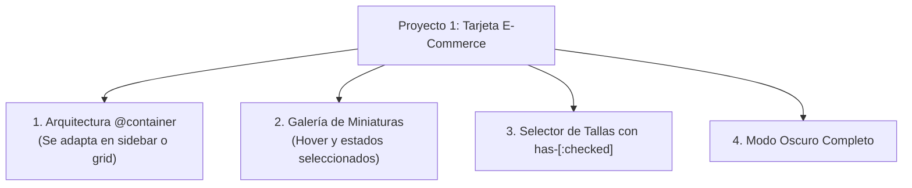
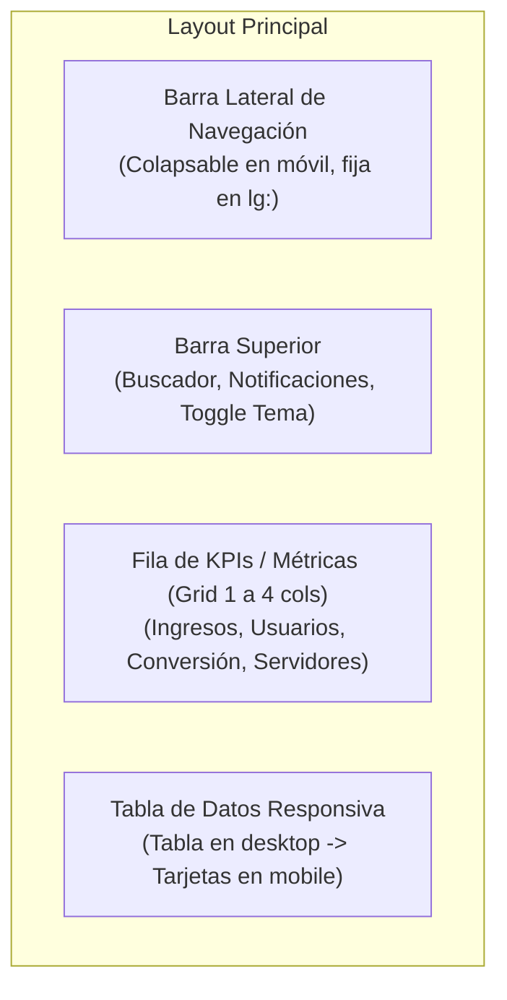
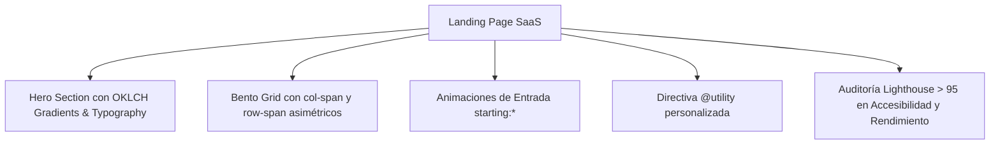
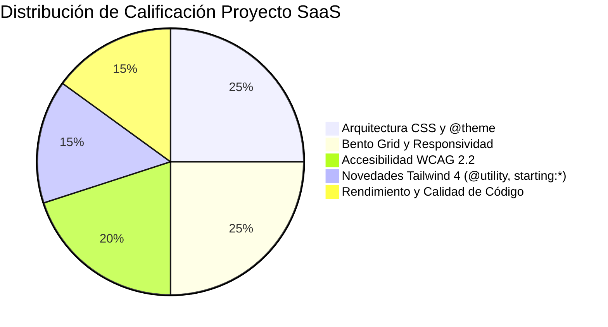

# 11. Proyectos de Aula y Rúbricas de Evaluación

  Tailwind v4.0
  Evaluación Sumativa
  Proyectos Reales

Esta unidad contiene **tres proyectos prácticos evaluables** diseñados para certificar las competencias técnicas y profesionales de los módulos de **Diseño de Interfaces Web (DAW)** y **Desarrollo de Interfaces (DAM)**.

Cada proyecto simula un encargo real de la industria, con especificaciones de diseño, requerimientos funcionales, arquitectura de carpetas y una **rúbrica de evaluación objetiva de 0 a 10 puntos**.

---

## Proyecto 1: Tarjeta E-Commerce de Producto y Carrito Rápido

**Ciclos recomendados:** 2º DAW / 2º DAM  
**Duración estimada:** 4 a 6 horas lectivas  
**Dificultad:** Inicial - Intermedia  

### Especificaciones Técnicas y Requisitos
1. **Contenedor Responsivo (`@container`):** El componente debe marcarse como contenedor de consulta. Si el contenedor padre mide menos de `448px` se muestra en vertical (imagen arriba, información abajo). Si mide `448px` o más (`@md:`), se transforma en disposición horizontal de dos columnas.
2. **Selector de Tallas con `has-[:checked]`:** 
   - Cuadrícula de opciones (XS, S, M, L, XL) utilizando `<input type="radio">` visualmente oculto pero accesible.
   - La caja que envuelve la opción seleccionada debe cambiar automáticamente a borde azul intenso (`border-sky-600`), fondo suave (`bg-sky-50 dark:bg-sky-950/30`) y texto en negrita mediante la variante `has-[:checked]:`.
3. **Microinteracciones y Feedback:**
   - Botón de "Añadir a la cesta" con microanimación de pulsación (`active:scale-95`).
   - Botón de "Lista de deseos" (icono de corazón) con grupo anidado `group/wishlist` y efecto elástico al pasar el cursor.
4. **Modo Oscuro:** Soporte integral para tema oscuro mediante `dark:*` con elevación de superficies (`dark:bg-slate-900` sobre lienzo `dark:bg-slate-950`).

### Rúbrica de Evaluación (10 Puntos)

| Criterio | Ponderación | Excelente (10 - 9) | Adecuado (8 - 6) | Insuficiente (5 - 0) |
| :--- | :---: | :--- | :--- | :--- |
| **Adaptabilidad con `@container`** | **25%** | La tarjeta cambia fluidamente entre vertical y horizontal según el ancho de su padre sin usar media queries de ventana. | Usa breakpoints de ventana convencionales (`md:`) en lugar de container queries nativas. | El componente no es responsivo o se desborda en anchos reducidos. |
| **Estados Interactivos y `has-*`** | **25%** | El selector de tallas y botones resuelven sus estados con pseudoclases (`has-[:checked]`, `active:scale-95`, `group`) sin JavaScript innecesario. | Funciona pero recurre a manipulación manual de clases mediante JavaScript. | No hay respuesta visual clara a la interacción del usuario. |
| **Tokens y Paleta OKLCH** | **20%** | Utiliza la paleta nativa OKLCH de Tailwind v4 y escalas semánticas de espaciado y tipografía sin magic numbers. | Mezcla colores hex directos con utilidades de Tailwind. | No respeta el sistema de diseño ni la coherencia de estilos. |
| **Accesibilidad (a11y)** | **15%** | Todos los inputs y botones cuentan con etiquetas descriptivas (`sr-only`), y los anillos de foco (`focus-visible:ring-2`) son visibles por teclado. | Los elementos interactivos funcionan pero carecen de anillos de foco para teclado. | Elementos interactivos inaccesibles por teclado o sin etiquetas para lectores de pantalla. |
| **Modo Oscuro** | **15%** | Transición impecable entre claro y oscuro con suficiente contraste cromático según WCAG 2.2 AA. | El modo oscuro funciona pero con textos de contraste insuficiente o fondos planos. | No implementa modo oscuro o la interfaz es ilegible. |

---

## Proyecto 2: Dashboard Administrativo de Analítica

**Ciclos recomendados:** 2º DAW (DIW) / 2º DAM (DI)  
**Duración estimada:** 10 a 14 horas lectivas  
**Dificultad:** Intermedia - Avanzada  

### Especificaciones Técnicas y Requisitos
1. **Layout Shell Responsivo:**
   - Disposición general con CSS Grid o Flexbox moderno.
   - En pantallas grandes (`lg:` en adelante), la barra lateral (Sidebar) es fija a la izquierda con ancho de `16rem` (`w-64`) y altura completa (`h-screen`).
   - En pantallas móviles y tablets (`< lg:`), la barra lateral se oculta y se abre mediante un cajón deslizante (*drawer*) o botón hamburguesa.
2. **Barra Superior con `backdrop-blur`:**
   - Barra pegajosa (`sticky top-0 z-40`) con fondo traslúcido y desenfoque (`bg-white/80 dark:bg-slate-900/80 backdrop-blur-md`).
   - Buscador con icono integrado y variante `focus-within:ring-2`.
   - Botón de alternancia de modo oscuro con almacenamiento persistente en `localStorage`.
3. **Tarjetas KPI con Tendencias:**
   - Cuatro tarjetas con métricas (ej.: *Ingresos Totales*, *Nuevas Matrículas*, *Tasa de Retención*, *Tiempo de Respuesta*).
   - Indicadores de tendencia en verde (`text-emerald-600 bg-emerald-50`) o rojo (`text-rose-600 bg-rose-50`) con iconos de flecha.
4. **Tabla de Datos Dual (Tabla en Escritorio / Tarjetas en Móvil):**
   - Una tabla con al menos 6 registros de clientes o alumnos.
   - En pantallas pequeñas (`< md:`), la tabla tradicional desaparece (`hidden md:table`) y se renderiza una lista de tarjetas individuales limpias (`md:hidden`).

### Rúbrica de Evaluación (10 Puntos)

| Criterio | Ponderación | Excelente (10 - 9) | Adecuado (8 - 6) | Insuficiente (5 - 0) |
| :--- | :---: | :--- | :--- | :--- |
| **Estructura y Shell del Dashboard** | **25%** | Arquitectura limpia con CSS Grid/Flexbox, barra lateral responsiva y encabezado sticky con efecto de vidrio (*glassmorphism*). | El layout funciona pero presenta desalineaciones menores o barras de desplazamiento dobles indeseadas. | Layout roto o incapaz de adaptarse a diferentes resoluciones. |
| **Tabla de Datos Dual** | **25%** | Implementa con maestría la transformación de tabla tabular en escritorio a tarjetas modulares en móvil sin desbordamiento horizontal. | Mantiene la tabla en móvil añadiendo simplemente un scroll horizontal con `overflow-x-auto`. | La tabla desborda la pantalla en móvil e inutiliza la interfaz. |
| **Consistencia de Tokens y `@theme`** | **20%** | Configuración de colores corporativos mediante `@theme` en CSS y tipografía escalada semánticamente. | Estilos correctos pero sin uso de variables o directiva `@theme`. | Estilos caóticos con tamaños de fuente y colores arbitrarios desordenados. |
| **Interactividad y Microinteracciones** | **15%** | Transiciones suaves en todos los botones, hover en filas de tabla y foco de alta precisión. | Estados hover presentes pero sin transiciones temporizadas (`transition-all`). | Interfaz estática sin respuesta visual al usuario. |
| **Organización de Código y Git** | **15%** | Repositorio Git profesional con commits atómicos (`feat:`, `fix:`, `style:`), ramas limpias y README detallado. | Repositorio entregado con pocos commits genéricos ("cambios", "actualización"). | Entrega sin control de versiones o con estructura de archivos desorganizada. |

---

## Proyecto 3: Landing Page SaaS con Bento Grid y Directivas v4

**Ciclos recomendados:** Proyecto Final de Evaluación / Trimestral (DAW/DAM)  
**Duración estimada:** 16 a 20 horas lectivas  
**Dificultad:** Avanzada  

### Secciones Obligatorias del Proyecto
1. **Hero Section de Alto Impacto:**
   - Titular con gradiente de texto moderno (`bg-linear-to-r from-sky-400 via-teal-400 to-indigo-500 bg-clip-text text-transparent`).
   - Subtítulo equilibrado con la utilidad tipográfica `text-balance`.
   - Botón de llamada a la acción (*Call to Action*) con efecto de brillo o anillo pulsante.
   - Píldora de anuncio superior (*Announcement Badge*) con grupo interactivo.
2. **Bento Grid Asimétrico de Características:**
   - Cuadrícula de 4 columnas en escritorio que combina bloques de `col-span-2 row-span-2`, `col-span-2 row-span-1` y `col-span-1`.
   - Efectos de desenfoque e iluminación ambiental en las tarjetas.
3. **Uso de la Directiva `@utility` de Tailwind 4:**
   - Crear en `src/app.css` al menos dos utilidades formales con `@utility` (por ejemplo, para efectos de iluminación holográfica o sombras de texto con profundidad).
4. **Modal de Registro con `@starting-style` (`starting:*`):**
   - Modal emergente nativo `<dialog>` que transiciona suavemente de escala y opacidad al abrirse.

### Rúbrica Oficial de Calificación (10 Puntos)

- **[2.5 Pts] Arquitectura CSS y Diseño Visual:** Jerarquía tipográfica impecable, escala armónica de espaciados y paleta de colores coherente en claro y oscuro.
- **[2.5 Pts] Maquetación Avanzada con Bento Grid:** Uso correcto de CSS Grid con cuadrículas asimétricas que se colapsan elegantemente en móvil sin romper la jerarquía visual.
- **[2.0 Pts] Accesibilidad Universal (WCAG 2.2 AA):** Contraste cromático comprobado, navegación completa por teclado, atributos ARIA y etiquetas `sr-only`.
- **[1.5 Pts] Dominio de Tailwind 4.0:** Integración exitosa de `@theme`, `@utility`, `starting:*` y variantes relacionales `has-*`.
- **[1.5 Pts] Entrega Profesional:** Proyecto compilado con Vite sin errores ni advertencias, README con capturas de pantalla e instrucciones de despliegue, y commits semánticos en Git.
