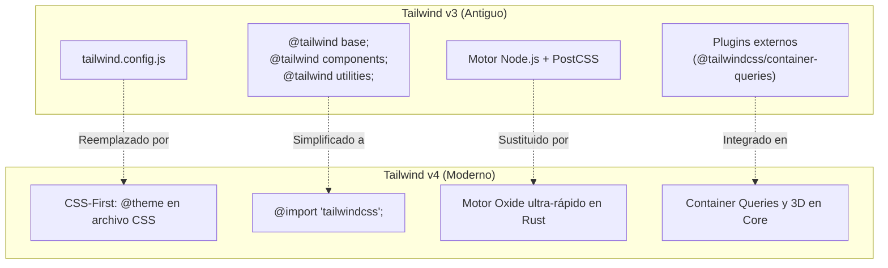

# 12. Cheat Sheet y Guía de Migración v3 a v4

<div class="badges">
  <span class="badge badge-v4">Tailwind v4.0</span>
  <span class="badge badge-oxide">Referencia Rápida</span>
  <span class="badge badge-theme">Migración v3 → v4</span>
</div>

Esta guía sirve como **hoja de referencia rápida (*cheat sheet*)** para el día a día en el aula de desarrollo (**DAW/DAM**), junto con las pautas completas para actualizar proyectos existentes de Tailwind v3 a Tailwind v4.

---

## 1. Cheat Sheet de Consulta Rápida

### Layout y Modelo de Caja

| Utilidad | Equivalente CSS | Descripción |
| :--- | :--- | :--- |
| `block` / `inline-block` / `inline` | `display: block;` etc. | Comportamiento en el flujo del documento. |
| `hidden` | `display: none;` | Oculta completamente el elemento del DOM visual. |
| `relative` / `absolute` / `fixed` / `sticky` | `position: ...;` | Esquema de posicionamiento espacial. |
| `inset-0` | `top: 0; right: 0; bottom: 0; left: 0;` | Cubre todo el área de su contenedor padre relativo. |
| `z-10` / `z-50` | `z-index: 10;` | Control de elevación en el eje Z. |
| `overflow-hidden` / `overflow-auto` | `overflow: hidden;` etc. | Control de desbordamiento de contenido. |

### Flexbox y Grid

| Utilidad | Equivalente CSS | Caso de uso común |
| :--- | :--- | :--- |
| `flex` | `display: flex;` | Activa el modelo unidimensional flexible. |
| `flex-col` / `flex-row` | `flex-direction: column / row;` | Orientación de los elementos hijos. |
| `items-center` / `items-start` | `align-items: center / flex-start;` | Alineación en el eje transversal. |
| `justify-between` / `justify-center` | `justify-content: space-between / center;` | Distribución en el eje principal. |
| `gap-4` | `gap: 1rem;` (16px) | Espacio uniforme entre filas y columnas. |
| `grid` | `display: grid;` | Activa el modelo bidimensional en cuadrícula. |
| `grid-cols-1 md:grid-cols-3` | `grid-template-columns: ...;` | Cuadrícula de 1 columna en móvil y 3 en tablet/PC. |
| `col-span-2` | `grid-column: span 2 / span 2;` | El elemento abarca dos columnas contiguas. |

### Espaciado y Dimensiones

| Utilidad | Valor | Utilidad | Valor |
| :--- | :--- | :--- | :--- |
| `p-2` / `m-2` | `0.5rem` (8px) | `w-full` / `h-full` | `100%` |
| `p-4` / `m-4` | `1rem` (16px) | `w-screen` / `h-screen` | `100vw` / `100vh` |
| `p-6` / `m-6` | `1.5rem` (24px) | `size-10` | `width: 2.5rem; height: 2.5rem;` |
| `px-4` / `py-2` | Padding horizontal y vertical | `max-w-7xl` | Ancho máximo contenedor estándar (1280px) |

### Tipografía y Color

| Utilidad | Equivalente CSS |
| :--- | :--- |
| `text-xs` / `text-sm` / `text-base` / `text-lg` | Tamaños de fuente: 12px, 14px, 16px, 18px |
| `text-xl` / `text-2xl` / `text-4xl` | Títulos grandes: 20px, 24px, 36px |
| `font-normal` / `font-medium` / `font-bold` | Pesos de fuente: 400, 500, 700 |
| `text-balance` / `text-pretty` | Distribución estética de líneas de texto |
| `line-clamp-2` | Corta el texto con puntos suspensivos a las 2 líneas |
| `text-sky-600` / `bg-slate-900` | Colores de texto y fondo en espacio OKLCH |
| `bg-black/50` / `border-white/20` | Modificador de opacidad mediante barra inclinada (`/`) |

### Variantes de Estado e Interacción

| Prefijo | Evento disparador |
| :--- | :--- |
| `hover:` | Cursor del ratón sobre el elemento. |
| `focus-visible:` | El elemento recibe el foco por navegación de teclado. |
| `active:` | Clic presionado o pulsación táctil. |
| `disabled:` | Atributo `disabled` presente. |
| `group-hover:` | El contenedor padre con clase `group` recibe hover. |
| `peer-checked:` | El elemento hermano anterior con clase `peer` está marcado. |
| `has-[:checked]:` | El contenedor tiene al menos un descendiente marcado. |
| `starting:*` | **Novedad v4:** Estado inicial para animaciones de entrada con `@starting-style`. |
| `dark:` | Modo oscuro activado (por sistema o por clase `.dark`). |
| `@md:` | **Novedad v4:** El contenedor padre con `@container` mide ≥ 448px. |

---

## 2. Guía Completa de Migración: Tailwind v3 a Tailwind v4

Tailwind CSS v4 representa el mayor salto arquitectónico en la historia del framework. Si tienes proyectos desarrollados con Tailwind v3 en cursos anteriores o en repositorios de prácticas, esta sección detalla los cambios críticos que debes aplicar.



---

### Resumen de Cambios Clave

#### 1. Adiós a `tailwind.config.js` → Hola a la configuración CSS-First
En Tailwind v3, toda personalización de colores, fuentes o espaciados se declaraba en un objeto de JavaScript en `tailwind.config.js`. En Tailwind v4, **el archivo JavaScript desaparece por completo** y todo se configura mediante la directiva `@theme` en tu archivo CSS principal (`src/app.css`):

=== "Antes (Tailwind v3 - JavaScript)"
    ```javascript
    // tailwind.config.js (OBSOLETO EN V4)
    module.exports = {
      content: ["./index.html", "./src/**/*.{js,ts,jsx,tsx}"],
      theme: {
        extend: {
          colors: {
            brand: '#0284c7',
          },
          fontFamily: {
            sans: ['Inter', 'sans-serif'],
          }
        }
      }
    }
    ```

=== "Ahora (Tailwind v4 - CSS Nativo)"
    ```css
    /* src/app.css (ESTÁNDAR V4) */
    @import "tailwindcss";

    @theme {
      --color-brand: #0284c7;
      --font-sans: 'Inter', sans-serif;
    }
    ```

#### 2. Directiva de importación única
En v3 se requerían tres directivas `@tailwind`:
```css
/* OBSOLETO EN V4 */
@tailwind base;
@tailwind components;
@tailwind utilities;
```
En v4 se sustituyen por una única sentencia estándar CSS:
```css
/* ESTÁNDAR V4 */
@import "tailwindcss";
```

#### 3. Plugins obsoletos ahora incluidos en el Core
En v3, para usar Container Queries debías instalar `@tailwindcss/container-queries`. En Tailwind v4, las clases `@container`, `@sm:`, `@md:`, etc., **vienen preinstaladas y activadas por defecto**.

#### 4. Cambios de sintaxis en nombres de utilidades

| Utilidad en Tailwind v3 | Nueva Utilidad en Tailwind v4 | Motivo del cambio |
| :--- | :--- | :--- |
| `bg-gradient-to-r` | `bg-linear-to-r` | Alineación con la especificación moderna CSS `linear-gradient`. |
| `bg-gradient-to-br` | `bg-linear-to-br` | Alineación con la especificación moderna CSS. |
| `shadow-sm` / `shadow` | `shadow-xs` / `shadow-sm` | Ajuste de escala más armónico en resoluciones de alta densidad. |
| `backdrop-blur-none` | `backdrop-blur-none` | Se mantiene, pero se añade soporte para micro-desenfoque `backdrop-blur-xs`. |

---

### Herramienta Oficial de Actualización Automática

El equipo de Tailwind ha desarrollado una herramienta CLI que analiza tu proyecto v3, migra tus clases, convierte tu `tailwind.config.js` en variables `@theme` y actualiza tus dependencias de `package.json`:

```bash
# Ejecuta la herramienta de migración en la raíz de tu proyecto
npx @tailwindcss/upgrade
```

---

## 3. Glosario Técnico Esencial para Alumnos de DAW y DAM

Atomic CSS (CSS Atómico)
: Enfoque de arquitectura CSS donde cada clase realiza una única función atómica e indivisible (ej.: `flex`, `p-4`, `text-center`), favoreciendo la máxima reutilización de código.

Container Query (Consulta de Contenedor)
: Especificación moderna de CSS que permite evaluar el ancho o alto del elemento contenedor en lugar del tamaño global de la ventana (*viewport*), permitiendo componentes modulares 100% autónomos.

FOUC (Flash of Unstyled Content)
: Parpadeo visual que ocurre cuando el contenido HTML se renderiza brevemente con el estilo o tema incorrecto antes de que se apliquen las reglas o scripts de tema oscuro.

Motor Oxide
: El nuevo compilador de alto rendimiento de Tailwind CSS 4.0 desarrollado en Rust, responsable de que los tiempos de compilación pasen de cientos de milisegundos a apenas decenas de milisegundos.

OKLCH
: Espacio de color cilíndrico perceptual que permite generar paletas cromáticas matemáticamente equilibradas en brillo y contraste, con compatibilidad nativa con la gama amplia P3 de monitores y dispositivos móviles modernos.

Responsive Design Mobile-First
: Metodología de diseño web donde la maquetación se proyecta inicialmente para dispositivos móviles (pantallas reducidas) y se añaden capas progresivas de complejidad para tabletas y ordenadores mediante `min-width`.

Screen Reader Utility (`sr-only`)
: Clase de accesibilidad que oculta visualmente un elemento gráfico pero lo preserva intacto en el árbol de accesibilidad del navegador para que sea leído por programas de asistencia visual.

Tree-shaking (Purga de CSS)
: Proceso automático por el cual el compilador analiza todo el código HTML, JS o plantillas del proyecto y descarta del paquete final de producción cualquier regla CSS que no esté en uso, resultando en archivos de apenas unos pocos kilobytes.

Utility-First
: Paradigma que propone diseñar interfaces combinando utilidades de bajo nivel directamente en las plantillas, en lugar de escribir hojas de estilo desacopladas con nombres de clases semánticos inventados.
