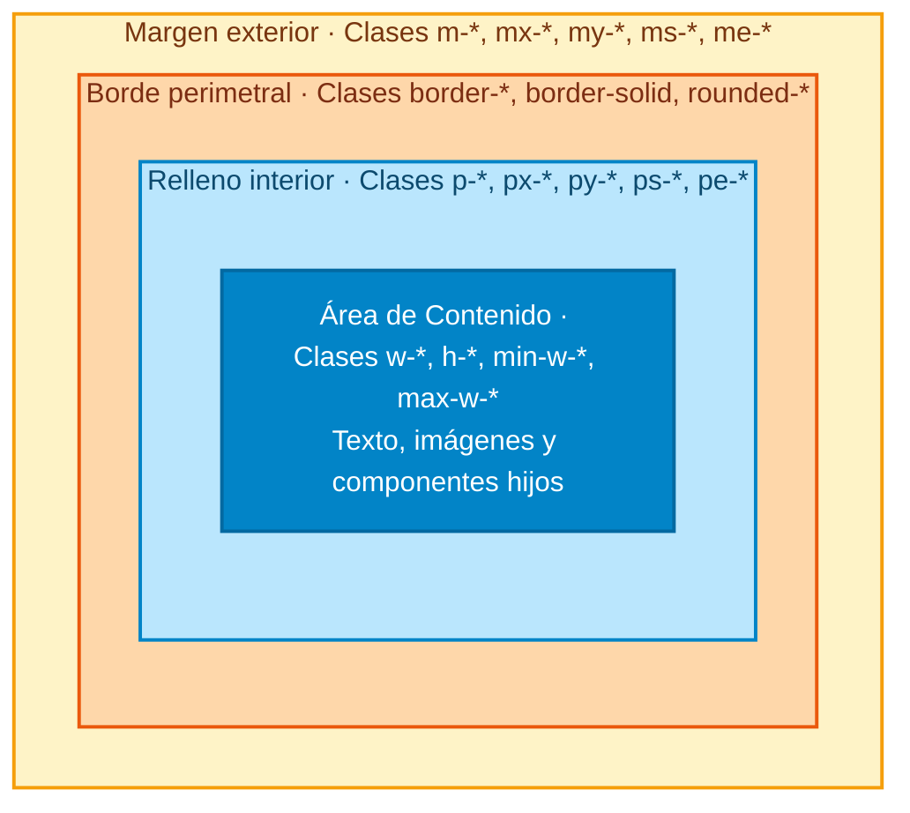
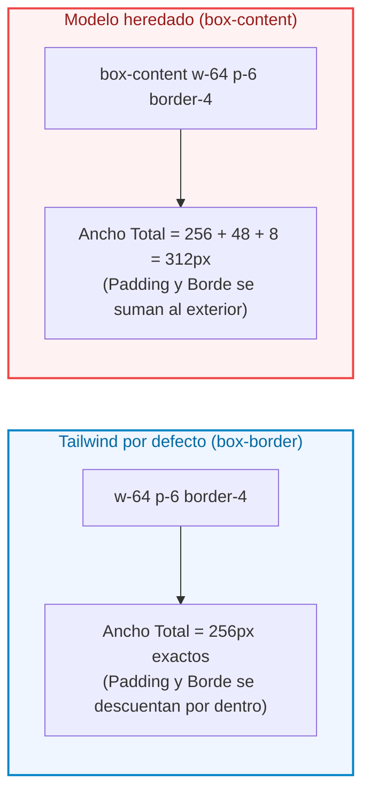
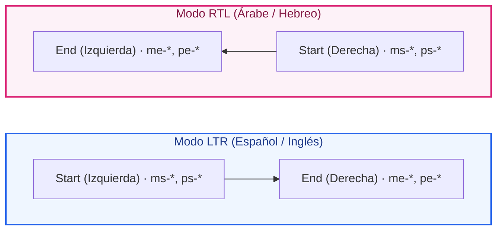

# Ejemplos de Código · Unidad 03: Modelo de Caja en Tailwind CSS

<div class="badges">
  <span class="badge badge-v4">Tailwind CSS 4.0</span>
  <span class="badge badge-blue">Utility-First</span>
  <span class="badge badge-theme">Modelo de Caja</span>
  <span class="badge badge-ra">RA 2 / RA 3</span>
</div>

En este documento se desarrollan **ejemplos completos y funcionales maquetados con Tailwind CSS 4.0** que reproducen y modernizan cada uno de los conceptos del ==modelo de caja== estudiados en CSS nativo. 

!!! info "Estructura de cada sección"
    Cada apartado está estructurado de manera didáctica con:
    
    1. **Fundamento conceptual y mentalidad Utility-First:** Cómo traduce Tailwind 4 el motor de renderizado a clases atómicas.
    2. **Código interactivo en pestañas:** Código HTML semántico con clases de Tailwind 4 junto a su **equivalencia en CSS nativo**.
    3. **Disección técnica paso a paso:** Explicación detallada de las utilidades empleadas, escalas de espaciado y directivas modernas.

---

## 1. Anatomía de la Caja: Las Cuatro Capas Concéntricas

### Fundamento Conceptual

En Tailwind CSS, el modelo de caja se manipula directamente en el HTML mediante utilidades compuestas que controlan cada capa concéntrica:



Contenido (`w-*`, `h-*`)
:   Zona nuclear de la caja. En Tailwind, utilidades como `w-64` (16rem = 256px) o `h-32` controlan el ancho y alto del área de dibujo.

Relleno (`p-*`, `px-*`, `py-*`)
:   Espacio interior que separa el contenido del borde. Adopta el color de fondo definido por `bg-*`.

Borde (`border-*`, `border-[color]`, `rounded-*`)
:   Contorno perimetral con grosor (`border-2`, `border-4`), estilo (`border-solid`, `border-dashed`) y radio de curvatura (`rounded-xl`).

Margen exterior (`m-*`, `mx-*`, `my-*`)
:   Espacio transparente que separa la caja de sus elementos vecinos en el flujo.

Capas cosméticas sin impacto en layout (`outline-*`, `shadow-*`)
:   **`outline-*`:** Dibuja un contorno exterior accesible sin desplazar a los elementos adyacentes (`outline-2 outline-sky-500 outline-offset-2`).  
    **`shadow-*`:** Añade sombras de elevación dimensional (`shadow-lg`).

### Código de Ejemplo

=== "HTML con Tailwind CSS"

    ```html title="01-anatomia-caja-tailwind.html"
    <main class="max-w-2xl mx-auto p-8 font-sans bg-slate-50 text-slate-900">
      <!-- Elemento vecino previo -->
      <p class="p-3 bg-slate-200 text-slate-600 rounded-md text-sm text-center">
        Elemento vecino anterior (referencia de separación exterior)
      </p>

      <!-- Caja de inspección con todas las capas visualizadas -->
      <article class="m-8 p-6 border-4 border-amber-500 bg-sky-100 rounded-xl shadow-md outline-2 outline-dashed outline-sky-500 outline-offset-4">
        <div class="w-full h-32 bg-sky-600 text-white p-4 rounded-lg flex flex-col justify-center items-center text-center">
          <h3 class="font-bold text-lg">Área de Contenido (Content Box)</h3>
          <p class="text-sm text-sky-100 mt-1">
            Espacio interno delimitado donde reside la información directa.
          </p>
        </div>
      </article>

      <!-- Elemento vecino posterior -->
      <p class="p-3 bg-slate-200 text-slate-600 rounded-md text-sm text-center">
        Elemento vecino posterior (referencia de separación exterior)
      </p>
    </main>
    ```

=== "HTML Limpio (sin Tailwind)"

    ```html title="01-anatomia-caja-limpio.html"
    <main class="contenedor-padre">
      <!-- Elemento vecino previo -->
      <p class="vecino">
        Elemento vecino anterior (referencia de separación exterior)
      </p>

      <!-- Caja de inspección con todas las capas visualizadas -->
      <article class="caja-inspeccion">
        <div class="area-contenido">
          <h3>Área de Contenido (Content Box)</h3>
          <p>
            Espacio interno delimitado donde reside la información directa.
          </p>
        </div>
      </article>

      <!-- Elemento vecino posterior -->
      <p class="vecino">
        Elemento vecino posterior (referencia de separación exterior)
      </p>
    </main>
    ```

=== "CSS Nativo Equivalente"

    ```css title="equivalencia-anatomia.css"
    /* Reglas subyacentes que aplica Tailwind CSS */
    .caja-inspeccion {
      margin: 2rem;                       /* m-8 (32px) */
      padding: 1.5rem;                    /* p-6 (24px) */
      border: 4px solid #f59e0b;          /* border-4 border-amber-500 */
      background-color: #e0f2fe;          /* bg-sky-100 */
      border-radius: 0.75rem;             /* rounded-xl */
      box-shadow: 0 4px 6px -1px #0000001a;/* shadow-md */
      outline: 2px dashed #0284c7;        /* outline-2 outline-dashed outline-sky-500 */
      outline-offset: 4px;                /* outline-offset-4 */
    }

    .area-contenido {
      width: 100%;                        /* w-full */
      height: 8rem;                       /* h-32 (128px) */
      background-color: #0284c7;          /* bg-sky-600 */
      color: #ffffff;
    }
    ```

### Disección técnica paso a paso

1. **Escala de espaciado en Tailwind 4:** `m-8` aplica `2rem` (32px) y `p-6` aplica `1.5rem` (24px). En Tailwind, 1 unidad = 0.25rem = 4px.
2. **Sintaxis de bordes atómicos:** `border-4` define el `border-width: 4px` y `border-amber-500` colorea el trazo con la paleta OKLCH moderna de Tailwind 4.
3. **El rol de `outline-offset-4`:** Separa el anillo exterior 4px del borde físico de la caja, garantizando visibilidad sin interferir en las dimensiones físicas del layout.

---

## 2. `box-sizing`: Comparativa `border-box` vs `content-box`

### Fundamento Conceptual

Por defecto, **el Preflight de Tailwind CSS normaliza todos los elementos del DOM a `box-sizing: border-box`**:



* **`box-border` (Por defecto en Tailwind):** Si declaras `w-64`, el elemento medirá exactamente `256px` en el navegador, sin importar cuánto padding o borde añadas.
* **`box-content` (Excepción explícita):** Restaura el comportamiento antiguo del estándar W3C, donde el padding y el borde aumentan el tamaño exterior total.

### Código de Ejemplo

=== "HTML con Tailwind CSS"

    ```html title="02-box-sizing-tailwind.html"
    <div class="grid grid-cols-1 md:grid-cols-2 gap-8 max-w-4xl mx-auto p-6 font-sans">
      <!-- Tarjeta 1: box-border (Estándar Tailwind) -->
      <div class="box-border w-72 p-8 border-8 border-indigo-600 bg-indigo-50 rounded-lg text-center shadow">
        <span class="inline-block px-2.5 py-1 bg-indigo-600 text-white text-xs font-bold rounded mb-2">
          box-border (Recomendado)
        </span>
        <h4 class="font-bold text-slate-800">Ancho final = 288px</h4>
        <p class="text-xs text-slate-600 mt-2">
          w-72 (288px) absorbe internamente los 64px de padding y los 16px de borde.
        </p>
      </div>

      <!-- Tarjeta 2: box-content (Caja inflada) -->
      <div class="box-content w-72 p-8 border-8 border-rose-600 bg-rose-50 rounded-lg text-center shadow">
        <span class="inline-block px-2.5 py-1 bg-rose-600 text-white text-xs font-bold rounded mb-2">
          box-content (Modelo Antiguo)
        </span>
        <h4 class="font-bold text-slate-800">Ancho final = 368px</h4>
        <p class="text-xs text-slate-600 mt-2">
          288px base + 64px de padding + 16px de borde = ¡80px más ancha!
        </p>
      </div>
    </div>
    ```

=== "HTML Limpio (sin Tailwind)"

    ```html title="02-box-sizing-limpio.html"
    <div class="contenedor-comparativa">
      <!-- Tarjeta 1: box-border (Estándar Tailwind) -->
      <div class="tarjeta-border-box">
        <span class="insignia insignia--recomendado">
          box-border (Recomendado)
        </span>
        <h4>Ancho final = 288px</h4>
        <p>
          w-72 (288px) absorbe internamente los 64px de padding y los 16px de borde.
        </p>
      </div>

      <!-- Tarjeta 2: box-content (Caja inflada) -->
      <div class="tarjeta-content-box">
        <span class="insignia insignia--antiguo">
          box-content (Modelo Antiguo)
        </span>
        <h4>Ancho final = 368px</h4>
        <p>
          288px base + 64px de padding + 16px de borde = ¡80px más ancha!
        </p>
      </div>
    </div>
    ```

=== "CSS Nativo Equivalente"

    ```css title="equivalencia-box-sizing.css"
    .tarjeta-border-box {
      box-sizing: border-box;    /* Utilidad: box-border */
      width: 18rem;              /* w-72 (288px) */
      padding: 2rem;             /* p-8 (32px por lado = 64px) */
      border-width: 8px;         /* border-8 (8px por lado = 16px) */
    }

    .tarjeta-content-box {
      box-sizing: content-box;   /* Utilidad: box-content */
      width: 18rem;              /* w-72 (288px) */
      padding: 2rem;
      border-width: 8px;
    }
    ```

### Disección técnica paso a paso

1. **Inmunidad contra desbordamientos:** Con `box-border`, puedes definir maquetaciones fluidas como `w-1/2 p-6` sin temer que el padding rompa la fila y desplace al vecino hacia abajo.
2. **Utilidad de rescate:** La clase `box-content` se reserva únicamente para librerías de terceros o componentes matemáticos (como lienzos Canvas) que exijan que el área interna mida exactamente una cifra fija.

---

## 3. Dimensiones Intrínsecas: `w-min`, `w-max` y `w-fit`

### Fundamento Conceptual

Tailwind 4 proporciona clases directas para calcular las dimensiones en función del contenido textual sin fijar píxeles rígidos:

| Utilidad Tailwind | Propiedad CSS | Comportamiento Intrínseco |
| :--- | :--- | :--- |
| **`w-min`** | `width: min-content` | Se encoge al tamaño de la palabra o elemento indivisible más largo. |
| **`w-max`** | `width: max-content` | Se ensancha tanto como necesite para mostrar todo el texto en una sola línea sin saltos. |
| **`w-fit`** | `width: fit-content` | Se expande con el texto pero respeta el límite máximo del contenedor padre. |

### Código de Ejemplo

=== "HTML con Tailwind CSS"

    ```html title="03-dimensiones-intrinsecas-tailwind.html"
    <div class="space-y-6 max-w-xl mx-auto p-6 bg-white rounded-xl shadow border border-slate-200 font-sans">
      <!-- 1. w-min -->
      <div>
        <span class="text-xs font-bold text-slate-500 uppercase tracking-wider">1. w-min (min-content)</span>
        <div class="w-min p-3 bg-amber-100 border border-amber-400 text-amber-900 rounded font-medium mt-1">
          LaArquitecturaDeInterfacesResponsivas es fundamental.
        </div>
      </div>

      <!-- 2. w-max -->
      <div class="overflow-x-auto pb-2">
        <span class="text-xs font-bold text-slate-500 uppercase tracking-wider">2. w-max (max-content)</span>
        <div class="w-max p-3 bg-emerald-100 border border-emerald-400 text-emerald-900 rounded font-medium mt-1">
          Este texto se mantiene estrictamente en una única línea infinita sin quebrar jamás.
        </div>
      </div>

      <!-- 3. w-fit -->
      <div>
        <span class="text-xs font-bold text-slate-500 uppercase tracking-wider">3. w-fit (fit-content) · Recomendado</span>
        <div class="w-fit p-3 bg-sky-100 border border-sky-400 text-sky-900 rounded font-medium mt-1">
          Se ajusta al texto cómodamente sin forzar el 100% del contenedor padre.
        </div>
      </div>
    </div>
    ```

=== "HTML Limpio (sin Tailwind)"

    ```html title="03-dimensiones-intrinsecas-limpio.html"
    <div class="contenedor-intrinseco">
      <!-- 1. min-content -->
      <div class="caso-dimension">
        <span class="etiqueta">1. w-min (min-content)</span>
        <div class="caja-min">
          LaArquitecturaDeInterfacesResponsivas es fundamental.
        </div>
      </div>

      <!-- 2. max-content -->
      <div class="caso-dimension contenedor-scroll">
        <span class="etiqueta">2. w-max (max-content)</span>
        <div class="caja-max">
          Este texto se mantiene estrictamente en una única línea infinita sin quebrar jamás.
        </div>
      </div>

      <!-- 3. fit-content -->
      <div class="caso-dimension">
        <span class="etiqueta">3. w-fit (fit-content) · Recomendado</span>
        <div class="caja-fit">
          Se ajusta al texto cómodamente sin forzar el 100% del contenedor padre.
        </div>
      </div>
    </div>
    ```

=== "CSS Nativo Equivalente"

    ```css title="equivalencia-intrinsecas.css"
    .caja-min { width: min-content; } /* Utilidad: w-min */
    .caja-max { width: max-content; } /* Utilidad: w-max */
    .caja-fit { width: fit-content; } /* Utilidad: w-fit */
    ```

---

## 4. Proporción y Límites: `aspect-video`, `aspect-square` y `max-w-*`

### Fundamento Conceptual

Mantener proporciones geométricas perfectas sin recurrir al antiguo "hack de padding" es nativo en Tailwind mediante la familia `aspect-*`:

* **`aspect-video`:** Forja una relación de aspecto panorámica estándar de **16:9** (ideal para reproductores de vídeo y tarjetas multimedia).
* **`aspect-square`:** Fuerza una proporción cuadrada perfecta **1:1** (imprescindible para avatares y miniaturas de galerías).
* **`aspect-[4/3]`:** Sintaxis de valor arbitrario en Tailwind para proporciones fotográficas clásicas.

### Código de Ejemplo

=== "HTML con Tailwind CSS"

    ```html title="04-aspect-ratio-tailwind.html"
    <div class="grid grid-cols-1 md:grid-cols-2 gap-6 max-w-3xl mx-auto p-6 font-sans">
      <!-- Tarjeta 16:9 Panorámica -->
      <div class="border border-slate-200 rounded-xl overflow-hidden shadow-sm bg-white">
        <div class="w-full aspect-video bg-slate-800 flex items-center justify-center text-white">
          <span class="font-bold flex items-center gap-2">
            <svg class="size-6 text-red-500 fill-current" viewBox="0 0 24 24"><path d="M8 5v14l11-7z"/></svg>
            Vídeo 16:9 (aspect-video)
          </span>
        </div>
        <div class="p-4">
          <h4 class="font-bold text-slate-800">Reproductor Adaptable</h4>
          <p class="text-sm text-slate-500 mt-1">Escala proporcionalmente en cualquier resolución.</p>
        </div>
      </div>

      <!-- Tarjeta 1:1 Cuadrada -->
      <div class="border border-slate-200 rounded-xl overflow-hidden shadow-sm bg-white">
        <div class="w-full aspect-square bg-sky-700 flex items-center justify-center text-white">
          <span class="font-bold">Avatar 1:1 (aspect-square)</span>
        </div>
        <div class="p-4">
          <h4 class="font-bold text-slate-800">Miniatura Cuadrada</h4>
          <p class="text-sm text-slate-500 mt-1">Mantiene siempre la misma anchura que altura.</p>
        </div>
      </div>
    </div>
    ```

=== "HTML Limpio (sin Tailwind)"

    ```html title="04-aspect-ratio-limpio.html"
    <div class="rejilla-proporcion">
      <!-- Tarjeta 16:9 Panorámica -->
      <div class="tarjeta-proporcion">
        <div class="contenedor-video">
          <span class="etiqueta-icono">
            <svg class="icono-reproductor" viewBox="0 0 24 24"><path d="M8 5v14l11-7z"/></svg>
            Vídeo 16:9 (aspect-video)
          </span>
        </div>
        <div class="tarjeta-cuerpo">
          <h4>Reproductor Adaptable</h4>
          <p>Escala proporcionalmente en cualquier resolución.</p>
        </div>
      </div>

      <!-- Tarjeta 1:1 Cuadrada -->
      <div class="tarjeta-proporcion">
        <div class="contenedor-cuadrado">
          <span class="etiqueta-icono">Avatar 1:1 (aspect-square)</span>
        </div>
        <div class="tarjeta-cuerpo">
          <h4>Miniatura Cuadrada</h4>
          <p>Mantiene siempre la misma anchura que altura.</p>
        </div>
      </div>
    </div>
    ```

=== "CSS Nativo Equivalente"

    ```css title="equivalencia-aspect.css"
    .contenedor-video {
      width: 100%;
      aspect-ratio: 16 / 9; /* aspect-video */
    }

    .contenedor-cuadrado {
      width: 100%;
      aspect-ratio: 1 / 1;  /* aspect-square */
    }
    ```

---

## 5. Márgenes y Propiedades Lógicas Modernas (`ms-*`, `me-*`, `ps-*`, `pe-*`)

### Fundamento Conceptual

Las interfaces internacionales deben adaptarse fluidamente a idiomas que se leen de izquierda a derecha (LTR como español o inglés) y de derecha a izquierda (RTL como árabe o hebreo). En Tailwind 4, las **propiedades lógicas** sustituyen a los tradicionales `left` y `right`:



### Código de Ejemplo

=== "HTML con Tailwind CSS"

    ```html title="05-propiedades-logicas-tailwind.html"
    <div class="space-y-6 max-w-xl mx-auto p-6 font-sans">
      <!-- Mensaje en LTR con botón alineado mediante margen lógico -->
      <div dir="ltr" class="p-4 bg-white border border-slate-200 rounded-xl shadow-sm flex items-center">
        <div class="size-10 bg-sky-500 rounded-full flex items-center justify-center text-white font-bold me-3">
          ES
        </div>
        <div>
          <h4 class="font-bold text-slate-800 text-sm">Español (Lectura LTR)</h4>
          <p class="text-xs text-slate-500">me-3 añade separación a la derecha.</p>
        </div>
        <button class="ms-auto px-3 py-1.5 bg-slate-900 text-white rounded text-xs font-semibold hover:bg-slate-800">
          Acción
        </button>
      </div>

      <!-- Mismo componente en RTL (Árabe): El icono y el botón se invierten automáticamente -->
      <div dir="rtl" class="p-4 bg-white border border-slate-200 rounded-xl shadow-sm flex items-center">
        <div class="size-10 bg-emerald-500 rounded-full flex items-center justify-center text-white font-bold me-3">
          AR
        </div>
        <div>
          <h4 class="font-bold text-slate-800 text-sm">العربية (Lectura RTL)</h4>
          <p class="text-xs text-slate-500">me-3 añade separación a la izquierda automáticamente.</p>
        </div>
        <button class="ms-auto px-3 py-1.5 bg-slate-900 text-white rounded text-xs font-semibold hover:bg-slate-800">
          إجراء
        </button>
      </div>
    </div>
    ```

=== "HTML Limpio (sin Tailwind)"

    ```html title="05-propiedades-logicas-limpio.html"
    <div class="contenedor-mensajes">
      <!-- Mensaje en LTR con botón alineado mediante margen lógico -->
      <div dir="ltr" class="tarjeta-mensaje">
        <div class="icono-avatar avatar--es">
          ES
        </div>
        <div class="mensaje-info">
          <h4>Español (Lectura LTR)</h4>
          <p>me-3 añade separación a la derecha.</p>
        </div>
        <button type="button" class="boton-empujado">
          Acción
        </button>
      </div>

      <!-- Mismo componente en RTL (Árabe): El icono y el botón se invierten automáticamente -->
      <div dir="rtl" class="tarjeta-mensaje">
        <div class="icono-avatar avatar--ar">
          AR
        </div>
        <div class="mensaje-info">
          <h4>العربية (Lectura RTL)</h4>
          <p>me-3 añade separación a la izquierda automáticamente.</p>
        </div>
        <button type="button" class="boton-empujado">
          إجراء
        </button>
      </div>
    </div>
    ```

=== "CSS Nativo Equivalente"

    ```css title="equivalencia-logicas.css"
    .icono-avatar {
      margin-inline-end: 0.75rem; /* me-3 */
    }

    .boton-empujado {
      margin-inline-start: auto;  /* ms-auto (Efecto Push bidireccional) */
    }
    ```

---

## 6. Control de Desbordamiento: `overflow` y Truncado Multilínea

### Fundamento Conceptual

Tailwind 4 condensa complejos patrones de recorte de texto y barras de scroll en utilidades directas:

* **`overflow-auto`:** Muestra barras de scroll dinámicas únicamente cuando el contenido excede las dimensiones físicas del contenedor.
* **`truncate`:** Macro-utilidad que agrupa tres propiedades CSS: `overflow: hidden`, `text-overflow: ellipsis` y `white-space: nowrap`.
* **`line-clamp-{n}`:** Truncado elegante a n líneas con puntos suspensivos mediante WebKit Box (`line-clamp-2`, `line-clamp-3`).

### Código de Ejemplo

=== "HTML con Tailwind CSS"

    ```html title="06-overflow-truncado-tailwind.html"
    <div class="grid grid-cols-1 md:grid-cols-3 gap-6 max-w-4xl mx-auto p-6 font-sans">
      <!-- 1. Scroll Interno con overflow-auto -->
      <div class="p-4 bg-white border border-slate-200 rounded-xl shadow-sm">
        <h4 class="font-bold text-xs uppercase text-slate-500 mb-2">overflow-y-auto (h-32)</h4>
        <div class="h-32 overflow-y-auto p-2 bg-slate-50 rounded text-xs text-slate-700 leading-relaxed border border-slate-100">
          Lorem ipsum dolor sit amet, consectetur adipiscing elit. Sed do eiusmod tempor incididunt ut labore et dolore magna aliqua. Ut enim ad minim veniam, quis nostrud exercitation ullamco laboris nisi ut aliquip ex ea commodo consequat. Duis aute irure dolor in reprehenderit.
        </div>
      </div>

      <!-- 2. Truncado de una línea con truncate -->
      <div class="p-4 bg-white border border-slate-200 rounded-xl shadow-sm flex flex-col justify-between">
        <div>
          <h4 class="font-bold text-xs uppercase text-slate-500 mb-2">truncate (Una sola línea)</h4>
          <p class="truncate text-sm font-semibold text-sky-600 bg-sky-50 p-2 rounded">
            https://midominio.educacion.es/recursos/2026/interfaces-web-daw-dam/unidad-03-modelo-caja-completo.html
          </p>
        </div>
        <p class="text-xs text-slate-400 mt-2">Pasa puntos suspensivos si excede el ancho.</p>
      </div>

      <!-- 3. Truncado multilínea con line-clamp-2 -->
      <div class="p-4 bg-white border border-slate-200 rounded-xl shadow-sm flex flex-col justify-between">
        <div>
          <h4 class="font-bold text-xs uppercase text-slate-500 mb-2">line-clamp-2 (Titular 2 líneas)</h4>
          <p class="line-clamp-2 text-sm text-slate-800 font-medium">
            Tailwind CSS 4.0 introduce el motor Oxide escrito en Rust, eliminando el archivo tailwind.config.js e integrando la directiva @theme directamente en el CSS nativo.
          </p>
        </div>
        <p class="text-xs text-slate-400 mt-2">Corta estrictamente al final de la 2ª línea.</p>
      </div>
    </div>
    ```

=== "HTML Limpio (sin Tailwind)"

    ```html title="06-overflow-truncado-limpio.html"
    <div class="rejilla-overflow">
      <!-- 1. Scroll Interno con overflow-auto -->
      <div class="tarjeta-overflow">
        <span class="etiqueta-tecnica">overflow-y-auto (h-32)</span>
        <div class="caja-scroll">
          <p>
            Este contenedor dispone de un alto restringido fijo. Cuando el texto interior excede las dimensiones físicas asignadas, el motor activa automáticamente barras de desplazamiento internas sin distorsionar el diseño perimetral ni provocar solapamientos con elementos hermanos en el DOM.
          </p>
        </div>
      </div>

      <!-- 2. Truncado a 1 línea con elipsis -->
      <div class="tarjeta-overflow">
        <span class="etiqueta-tecnica">truncate (1 sola línea)</span>
        <p class="un-renglon">
          Este titular excesivamente largo será cortado de forma fulminante y rematado con puntos suspensivos sin partirse jamás en dos renglones.
        </p>
      </div>

      <!-- 3. Truncado Multilínea con line-clamp -->
      <div class="tarjeta-overflow">
        <span class="etiqueta-tecnica">line-clamp-2 (Multilínea)</span>
        <p class="dos-renglones">
          El motor de recorte multilínea moderno calcula la caja de dibujo visual para permitir exactamente dos líneas completas de lectura antes de estampar la elipsis tipográfica de seguridad.
        </p>
      </div>
    </div>
    ```

=== "CSS Nativo Equivalente"

    ```css title="equivalencia-overflow.css"
    /* Truncado clásico de 1 línea: truncate */
    .un-renglon {
      overflow: hidden;
      text-overflow: ellipsis;
      white-space: nowrap;
    }

    /* Truncado multilínea moderno: line-clamp-2 */
    .dos-renglones {
      overflow: hidden;
      display: -webkit-box;
      -webkit-box-orient: vertical;
      -webkit-line-clamp: 2;
    }
    ```

---

## 7. Redimensionamiento Interactivo: `resize` y `resize-x/y`

### Fundamento Conceptual

Para que un elemento no editable (como un `<div>`) permita que el usuario lo redimensione arrastrando la esquina inferior derecha, **es obligatorio combinar la propiedad `resize` con un valor de `overflow` distinto de `visible`**:

* **`resize`:** Redimensionamiento libre horizontal y vertical.
* **`resize-x` / `resize-y`:** Restringe el arrastre a un solo eje dimensional.
* **`resize-none`:** Desactiva el tirador en áreas de texto (`<textarea>`).

### Código de Ejemplo

=== "HTML con Tailwind CSS"

    ```html title="07-resize-tailwind.html"
    <div class="max-w-xl mx-auto p-6 font-sans">
      <div class="resize overflow-auto min-w-48 max-w-full min-h-32 p-5 bg-amber-50 border-2 border-dashed border-amber-400 rounded-xl shadow">
        <div class="flex items-center gap-2 text-amber-900 font-bold text-sm mb-2">
          <svg class="size-5" fill="none" stroke="currentColor" stroke-width="2" viewBox="0 0 24 24"><path stroke-linecap="round" stroke-linejoin="round" d="M4 8V4m0 0h4M4 4l5 5m11-1V4m0 0h-4m4 0l-5 5M4 16v4m0 0h4m-4 0l5-5m11 5l-5-5m5 5v-4m0 4h-4"/></svg>
          Caja Redimensionable (resize overflow-auto)
        </div>
        <p class="text-xs text-amber-800 leading-relaxed">
          Arrastra el tirador de la esquina inferior derecha. Gracias a <code>min-w-48</code> y <code>min-h-32</code> la caja nunca colapsará por debajo de los límites ergonómicos.
        </p>
      </div>
    </div>
    ```

=== "HTML Limpio (sin Tailwind)"

    ```html title="07-resize-limpio.html"
    <div class="contenedor-resize">
      <div class="caja-arrastrable">
        <div class="cabecera-resize">
          <svg class="icono-resize" fill="none" stroke="currentColor" stroke-width="2" viewBox="0 0 24 24"><path stroke-linecap="round" stroke-linejoin="round" d="M4 8V4m0 0h4M4 4l5 5m11-1V4m0 0h-4m4 0l-5 5M4 16v4m0 0h4m-4 0l5-5m11 5l-5-5m5 5v-4m0 4h-4"/></svg>
          <span>Caja Redimensionable (resize)</span>
        </div>
        <p>
          Haz clic y arrastra desde el tirador táctil situado en la esquina inferior derecha. Requiere <code>overflow: auto</code> para funcionar.
        </p>
      </div>
    </div>
    ```

=== "CSS Nativo Equivalente"

    ```css title="equivalencia-resize.css"
    .caja-arrastrable {
      resize: both;        /* Utilidad: resize */
      overflow: auto;      /* Imprescindible para activar resize en divs */
      min-width: 12rem;    /* min-w-48 (192px) */
      min-height: 8rem;    /* min-h-32 (128px) */
    }
    ```

---

## 8. Patrones de Producción: Centrado Ergonómico con `mx-auto` y `max-w-prose`

### Fundamento Conceptual

Uno de los principios de diseño web más respaldados por la ergonomía visual es el control de la longitud de línea: los bloques de texto con más de 75-80 caracteres por renglón causan fatiga visual y pérdida de salto de línea en los lectores.

En Tailwind CSS, este estándar se implementa de forma instantánea combinando:

* **`max-w-prose`:** Fija el ancho máximo óptimo de lectura (~65ch).
* **`mx-auto`:** Centra matemáticamente la columna en el viewport aplicando `margin-inline: auto`.

### Código de Ejemplo

=== "HTML con Tailwind CSS"

    ```html title="08-patron-lectura-ergonomica.html"
    <article class="max-w-prose mx-auto px-6 py-12 font-sans text-slate-800">
      <header class="mb-8">
        <span class="text-xs font-bold uppercase tracking-wider text-sky-600">Patrón de Maquetación</span>
        <h1 class="text-3xl font-extrabold text-slate-900 mt-2 tracking-tight">
          Lectura Óptima y Centrado Matemático
        </h1>
        <p class="text-slate-500 text-sm mt-1">
          Implementado con clases semánticas de Tailwind 4.
        </p>
      </header>

      <div class="space-y-4 text-base leading-relaxed text-slate-700">
        <p>
          Al fijar <code>max-w-prose</code>, garantizamos que el ancho del bloque de lectura no supere los 65 caracteres por renglón. Esto permite al ojo humano retornar con suavidad y precisión al inicio de la línea siguiente sin perder el hilo conductor del párrafo.
        </p>
        <p>
          La utilidad <code>mx-auto</code> calcula automáticamente el espacio sobrante en la pantalla y lo reparte equitativamente entre los márgenes izquierdo y derecho, manteniendo el documento perfectamente centrado tanto en portátiles como en monitores panorámicos de 4K.
        </p>
      </div>

      <footer class="mt-8 pt-4 border-t border-slate-200 flex justify-between items-center text-xs text-slate-500">
        <span>Longitud recomendada: 60-75ch</span>
        <span class="font-semibold text-slate-700">Diseño Responsivo Ergonómico</span>
      </footer>
    </article>
    ```

=== "HTML Limpio (sin Tailwind)"

    ```html title="08-patron-lectura-ergonomica-limpio.html"
    <article class="articulo-centrado">
      <header class="cabecera-articulo">
        <span class="antetitulo">Patrón de Maquetación</span>
        <h1 class="titular">
          Lectura Óptima y Centrado Matemático
        </h1>
        <p class="entradilla">
          Estructura calibrada a 65 caracteres por línea (<code>max-w-prose</code>) para prevenir fatiga visual en pantallas de alta resolución.
        </p>
      </header>

      <div class="cuerpo-articulo">
        <p>
          El ancho de línea es uno de los factores más críticos en la experiencia de usuario (UX) tipográfica. Líneas excesivamente largas obligan al ojo a realizar saltos de retorno forzados, provocando extravío del hilo de lectura.
        </p>
        <p>
          Al restringir el contenedor a una escala ergonómica e inyectar <code>margin-inline: auto</code>, el contenido permanece simétricamente aplomado en el centro del viewport sin importar si se visualiza en un monitor ultra panorámico 4K.
        </p>
      </div>
    </article>
    ```

=== "CSS Nativo Equivalente"

    ```css title="equivalencia-prose.css"
    .articulo-centrado {
      max-width: 65ch;           /* max-w-prose */
      margin-inline: auto;       /* mx-auto */
      padding-inline: 1.5rem;    /* px-6 */
      line-height: 1.625;        /* leading-relaxed */
    }
    ```

---

## 9. Checklist de Verificación de Competencias

Al completar el estudio de estos ejemplos prácticos, el alumno debe ser capaz de:

- [x] **Dominar las capas de la caja:** Aplicar márgenes (`m-*`), rellenos (`p-*`), bordes (`border-*`) y contornos (`outline-*`) con precisión atómica.
- [x] **Comprender el Preflight de Tailwind:** Conocer por qué todos los elementos operan en `box-border` y cuándo emplear `box-content`.
- [x] **Utilizar dimensiones intrínsecas:** Seleccionar adecuadamente entre `w-min`, `w-max` y `w-fit` para componentes dinámicos.
- [x] **Controlar relaciones de aspecto:** Emplear `aspect-video` y `aspect-square` para medios multimedia libres de saltos de maquetación (CLS).
- [x] **Diseñar para interfaces globales:** Utilizar márgenes lógicos (`ms-*`, `me-*`, `ps-*`, `pe-*`) compatibles con layouts LTR y RTL.
- [x] **Sanear desbordamientos:** Gestionar textos largos mediante `truncate` y `line-clamp-*` sin alterar la geometría de la cuadrícula.
