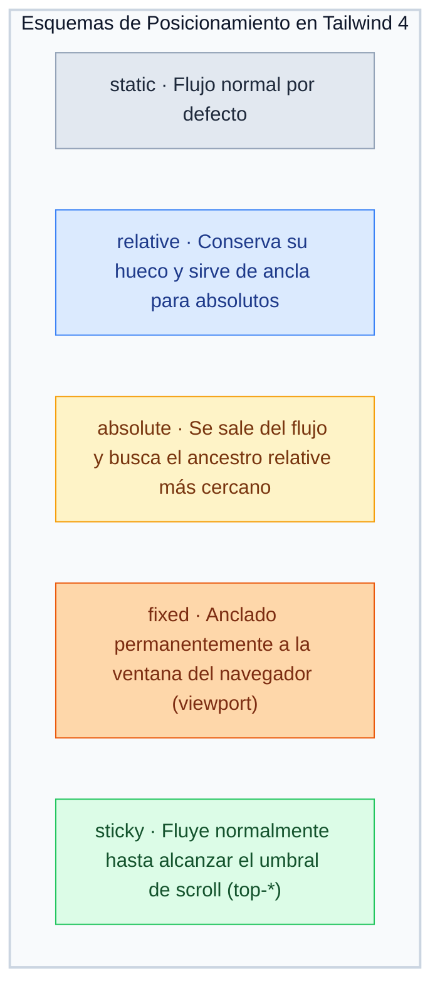
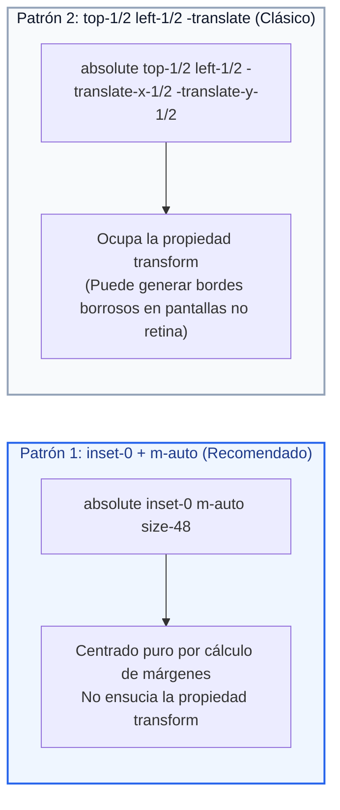
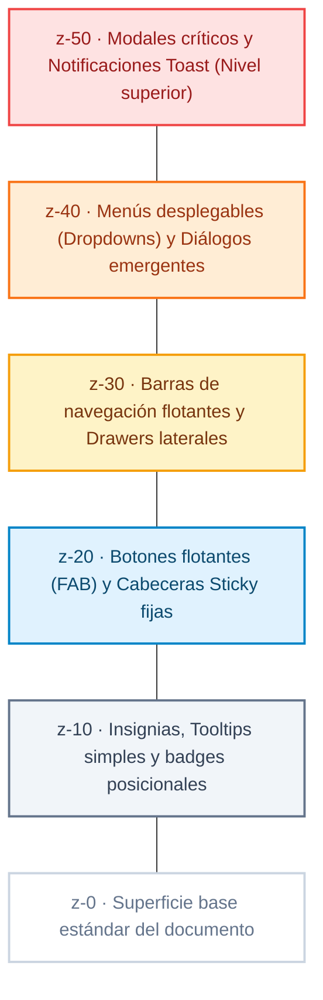
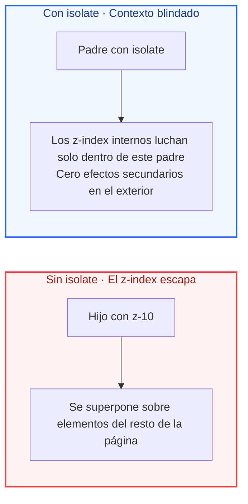

# Ejemplos de Código · Unidad 04: Posicionamiento y z-index en Tailwind CSS

<div class="badges">
  <span class="badge badge-v4">Tailwind CSS 4.0</span>
  <span class="badge badge-blue">Utility-First</span>
  <span class="badge badge-theme">Posicionamiento & Capas</span>
  <span class="badge badge-ra">RA 2 / RA 3</span>
</div>

En este documento se desarrollan **ejemplos completos y funcionales maquetados con Tailwind CSS 4.0** que reproducen y modernizan cada uno de los esquemas de ==posicionamiento== y control de profundidad espacial (`z-index`) estudiados en CSS nativo.

!!! info "Estructura de cada sección"
    Cada apartado está estructurado de manera didáctica con:
    
    1. **Fundamento conceptual:** Cómo traslada Tailwind 4 las coordenadas cartesianas y los contextos de apilamiento a clases de utilidad.
    2. **Código interactivo en pestañas:** Código HTML semántico con clases de Tailwind 4 junto a su **equivalencia en CSS nativo**.
    3. **Disección técnica paso a paso:** Análisis de las utilidades de coordenadas (`inset-*`), trampas habituales de renderizado y buenas prácticas.

---

## 1. Los Cinco Esquemas de Posicionamiento: Comparativa en Vivo

### Fundamento Conceptual

En Tailwind CSS, el tipo de posicionamiento se define mediante cinco utilidades atómicas que alteran el flujo del documento:



| Clase Tailwind | Propiedad CSS | Impacto en el Flujo Documental | ¿Admite Coordenadas? |
| :--- | :--- | :--- | :---: |
| **`static`** | `position: static` | Flujo estándar por defecto. Ocupa espacio físico normal. | ❌ No |
| **`relative`** | `position: relative` | Permanece en el flujo (reserva su hueco) y sirve de bloque contenedor para hijos absolutos. | ✅ Sí |
| **`absolute`** | `position: absolute` | **Sale del flujo**. Se posiciona relativo al ancestro posicionado más cercano. | ✅ Sí |
| **`fixed`** | `position: fixed` | **Sale del flujo**. Anclado a las cuatro esquinas de la pantalla del usuario. | ✅ Sí |
| **`sticky`** | `position: sticky` | Comportamiento híbrido: fluye como `relative` hasta que la pantalla llega a `top-*`. | ✅ Sí |

### Código de Ejemplo

=== "HTML con Tailwind CSS"

    ```html title="01-esquemas-posicionamiento-tailwind.html"
    <div class="space-y-6 max-w-2xl mx-auto p-6 font-sans bg-slate-50 rounded-2xl border border-slate-200">
      <!-- 1. position: relative con desplazamiento cosmético -->
      <div class="p-4 bg-white border border-slate-200 rounded-xl">
        <h4 class="font-bold text-xs uppercase text-slate-500 mb-2">1. relative con top-2 y left-4</h4>
        <div class="bg-slate-100 p-3 rounded text-xs text-slate-600">
          Caja base en el flujo.
          <span class="relative top-2 left-4 inline-block bg-sky-500 text-white px-2 py-1 rounded font-semibold shadow">
            relative (desplazada visualmente)
          </span>
          El texto siguiente respeta el hueco original.
        </div>
      </div>

      <!-- 2. position: absolute anclado a contenedor relative -->
      <div class="relative p-6 bg-white border-2 border-indigo-200 rounded-xl h-44 overflow-hidden">
        <span class="text-xs font-bold text-indigo-500 uppercase tracking-wider">2. Bloque Contenedor (relative)</span>
        <p class="text-xs text-slate-500 mt-1">Este contenedor sirve de sistema de referencia.</p>
        
        <!-- Insignia absoluta en la esquina superior derecha -->
        <span class="absolute top-4 right-4 bg-indigo-600 text-white text-xs font-bold px-3 py-1 rounded-full shadow">
          absolute top-4 right-4
        </span>

        <!-- Insignia absoluta en la esquina inferior izquierda -->
        <span class="absolute bottom-4 left-4 bg-amber-500 text-white text-xs font-bold px-3 py-1 rounded-full shadow">
          absolute bottom-4 left-4
        </span>
      </div>
    </div>
    ```

=== "HTML Limpio (sin Tailwind)"

    ```html title="01-esquemas-posicionamiento-limpio.html"
    <div class="contenedor-demostracion">
      <!-- 1. position: relative con desplazamiento cosmético -->
      <div class="caso-posicion">
        <span class="etiqueta-tecnica">1. relative con top y left</span>
        <div class="referencia-flujo">
          Caja vecina estática previa
        </div>
        <div class="elemento-relativo">
          Caja con position: relative (desplazada visualmente sin alterar a sus vecinos)
        </div>
        <div class="referencia-flujo">
          Caja vecina estática posterior (conserva su posición original)
        </div>
      </div>

      <!-- 2. position: absolute con bloque contenedor padre -->
      <div class="caso-posicion">
        <span class="etiqueta-tecnica">2. absolute anclado a contenedor relative</span>
        <div class="bloque-contenedor">
          <h4>Tarjeta de Notificación</h4>
          <p>El contenedor padre establece el sistema de coordenadas cartesianas.</p>
          <span class="badge-arriba-derecha">Novedad</span>
        </div>
      </div>
    </div>
    ```

=== "CSS Nativo Equivalente"

    ```css title="equivalencia-esquemas.css"
    .elemento-relativo {
      position: relative;  /* relative */
      top: 0.5rem;         /* top-2 (8px) */
      left: 1rem;          /* left-4 (16px) */
    }

    .bloque-contenedor {
      position: relative;  /* relative (Crea el Containing Block) */
    }

    .badge-arriba-derecha {
      position: absolute;  /* absolute */
      top: 1rem;           /* top-4 */
      right: 1rem;         /* right-4 */
    }
    ```

---

## 2. El Bloque Contenedor y la Familia de Atajos `inset-*`

### Fundamento Conceptual

En CSS tradicional, maquetar capas que cubran todo el espacio requería escribir cuatro propiedades: `top: 0; right: 0; bottom: 0; left: 0;`. 

En Tailwind 4, la propiedad moderna `inset` se gestiona con clases ultra-concisas:

* **`inset-0`:** Equivale a `top: 0; right: 0; bottom: 0; left: 0;` (cubre el 100% del área).
* **`inset-x-0`:** Cubre todo el ancho horizontal de borde a borde (`left: 0; right: 0;`).
* **`inset-y-0`:** Cubre toda la altura vertical de techo a suelo (`top: 0; bottom: 0;`).
* **`start-*` / `end-*`:** Coordenadas lógicas internacionales adaptables a LTR y RTL.

### Código de Ejemplo

=== "HTML con Tailwind CSS"

    ```html title="02-atajo-inset-tailwind.html"
    <div class="max-w-md mx-auto p-6 font-sans">
      <!-- Tarjeta con imagen de fondo y máscara overlay absoluta con inset-0 -->
      <article class="relative h-64 rounded-2xl overflow-hidden shadow-lg group">
        <!-- Imagen de fondo -->
        

        <!-- Capa Overlay que cubre el 100% con inset-0 -->
        <div class="absolute inset-0 bg-linear-to-t from-slate-950/90 via-slate-950/40 to-transparent flex flex-col justify-end p-6 text-white">
          <span class="text-xs font-bold uppercase tracking-wider text-sky-400">inset-0 Overlay</span>
          <h3 class="text-xl font-bold mt-1">Superficie Absoluta de Cobertura Total</h3>
          <p class="text-xs text-slate-300 mt-2">
            La clase inset-0 expande la capa sobre todo el bloque contenedor sin declarar cuatro coordenadas manuales.
          </p>
        </div>
      </article>
    </div>
    ```

=== "HTML Limpio (sin Tailwind)"

    ```html title="02-atajo-inset-limpio.html"
    <div class="contenedor-tarjeta">
      <!-- Tarjeta con imagen de fondo y máscara overlay absoluta con inset: 0 -->
      <article class="tarjeta-hero">
        <!-- Imagen de fondo -->
        
        <!-- Overlay oscuro que cubre el 100% mediante inset: 0 -->
        <div class="overlay-cobertura">
          <span class="badge-categoria">Arquitectura CSS</span>
          <h3 class="titular-hero">Cobertura Total Instantánea</h3>
          <p class="descripcion-hero">El atajo inset sustituye cuatro líneas de coordenadas clásicas.</p>
        </div>
      </article>
    </div>
    ```

=== "CSS Nativo Equivalente"

    ```css title="equivalencia-inset.css"
    .overlay-cobertura {
      position: absolute;
      inset: 0; /* top: 0; right: 0; bottom: 0; left: 0; */
    }
    ```

---

## 3. Centrado Absoluto Matemático: `inset-0` + `m-auto`

### Fundamento Conceptual

Existen dos maneras estándar de centrar un elemento absoluto en Tailwind:



### Código de Ejemplo

=== "HTML con Tailwind CSS"

    ```html title="03-centrado-absoluto-tailwind.html"
    <div class="max-w-xl mx-auto p-6 font-sans">
      <!-- Contenedor ancla relative -->
      <div class="relative h-64 bg-slate-100 border-2 border-dashed border-slate-300 rounded-2xl">
        <span class="absolute top-3 left-4 text-xs font-bold text-slate-400">Contenedor Padre (relative)</span>

        <!-- Tarjeta centrada matemáticamente con inset-0 y m-auto -->
        <div class="absolute inset-0 m-auto size-48 p-4 bg-white border border-slate-200 rounded-xl shadow-lg flex flex-col justify-center items-center text-center">
          <div class="size-8 bg-sky-500 rounded-full flex items-center justify-center text-white mb-2">
            <svg class="size-4" fill="none" stroke="currentColor" stroke-width="2" viewBox="0 0 24 24"><path stroke-linecap="round" stroke-linejoin="round" d="M5 13l4 4L19 7"/></svg>
          </div>
          <h4 class="font-bold text-sm text-slate-800">Centrado Perfecto</h4>
          <p class="text-[11px] text-slate-500 mt-1">inset-0 m-auto size-48</p>
        </div>
      </div>
    </div>
    ```

=== "HTML Limpio (sin Tailwind)"

    ```html title="03-centrado-absoluto-limpio.html"
    <div class="contenedor-escenario">
      <!-- Contenedor ancla relative -->
      <div class="marco-referencia">
        <span class="etiqueta-padre">Contenedor Padre (relative)</span>

        <!-- Tarjeta centrada matemáticamente con inset: 0 y margin: auto -->
        <div class="caja-centrada">
          <h4>Centrado Puro</h4>
          <p>inset: 0 + margin: auto</p>
        </div>
      </div>
    </div>
    ```

=== "CSS Nativo Equivalente"

    ```css title="equivalencia-centrado.css"
    .caja-centrada {
      position: absolute;
      inset: 0;
      margin: auto;   /* m-auto absorbe todo el espacio libre en X e Y */
      width: 12rem;   /* size-48 */
      height: 12rem;
    }
    ```

---

## 4. `sticky top-0`: Cabeceras Pegajosas y la Trampa de `overflow`

### Fundamento Conceptual

El posicionamiento pegajoso (`sticky`) es una de las soluciones más elegantes de UI para mantener cabeceras y menús visibles durante el desplazamiento largo de una página:

!!! warning "La Gran Trampa de position: sticky"
    Para que `sticky` funcione, se deben cumplir **dos condiciones obligatorias**:
    
    1. **Debe tener un umbral declarado:** Clases como `top-0`, `top-4`, etc. Sin umbral, el elemento no sabrá cuándo fijarse.
    2. **Ningún ancestro debe tener `overflow: hidden`, `auto` o `scroll`:** Si un contenedor padre tiene `overflow-hidden`, el elemento pegajoso queda atrapado en el scroll interno de ese padre y nunca se fijará respecto a la página.

### Código de Ejemplo

=== "HTML con Tailwind CSS"

    ```html title="04-sticky-header-tailwind.html"
    <div class="max-w-md mx-auto h-72 overflow-y-auto border border-slate-200 rounded-2xl bg-white shadow-sm font-sans">
      <!-- 1. Cabecera Pegajosa de la Sección A -->
      <div class="sticky top-0 z-10 bg-slate-900/90 backdrop-blur-sm text-white px-4 py-2 font-bold text-xs uppercase tracking-wider flex justify-between items-center">
        <span>Módulo A: Fundamentos</span>
        <span class="text-sky-400 font-mono text-[10px]">sticky top-0</span>
      </div>
      <div class="p-4 space-y-2 text-xs text-slate-600">
        <p>01. Introducción a HTML5 y estándares W3C.</p>
        <p>02. Semántica estructural y accesibilidad web.</p>
        <p>03. Enlaces, medios multimedia y formatos modernos.</p>
        <p>04. Formularios accesibles y validación nativa.</p>
      </div>

      <!-- 2. Cabecera Pegajosa de la Sección B (empuja a la Sección A) -->
      <div class="sticky top-0 z-10 bg-sky-700/90 backdrop-blur-sm text-white px-4 py-2 font-bold text-xs uppercase tracking-wider flex justify-between items-center">
        <span>Módulo B: Tailwind CSS 4.0</span>
        <span class="text-sky-200 font-mono text-[10px]">sticky top-0</span>
      </div>
      <div class="p-4 space-y-2 text-xs text-slate-600">
        <p>01. De CSS clásico al paradigma Utility-First.</p>
        <p>02. El nuevo motor Oxide y la directiva @theme.</p>
        <p>03. Flexbox, Grid y diseño responsivo sin media queries.</p>
        <p>04. Container Queries y componentes autónomos.</p>
      </div>
    </div>
    ```

=== "HTML Limpio (sin Tailwind)"

    ```html title="04-sticky-header-limpio.html"
    <div class="contenedor-scrollable">
      <!-- 1. Cabecera Pegajosa de la Sección A -->
      <div class="cabecera-pegajosa">
        <span>Módulo A: Fundamentos</span>
        <span class="badge-contador">04 Lecciones</span>
      </div>
      <div class="cuerpo-seccion">
        <p>Contenido explicativo de la primera unidad. Al hacer scroll vertical, la cabecera anterior se ancla al borde superior del contenedor hasta que la siguiente sección la empuja.</p>
      </div>

      <!-- 2. Cabecera Pegajosa de la Sección B -->
      <div class="cabecera-pegajosa">
        <span>Módulo B: Layout Moderno</span>
        <span class="badge-contador">06 Lecciones</span>
      </div>
      <div class="cuerpo-seccion">
        <p>Contenido detallado sobre cuadrículas bidimensionales y Flexbox elástico.</p>
      </div>
    </div>
    ```

=== "CSS Nativo Equivalente"

    ```css title="equivalencia-sticky.css"
    .cabecera-pegajosa {
      position: sticky;              /* sticky */
      top: 0;                        /* top-0 (Umbral de anclaje) */
      z-index: 10;                   /* z-10 (Evita que el contenido fluya por encima) */
      backdrop-filter: blur(4px);    /* backdrop-blur-sm */
    }
    ```

---

## 5. `position: fixed`: Botón Flotante de Acción (FAB)

### Fundamento Conceptual

A diferencia de `absolute`, **`fixed` se desvincula por completo del contenedor padre** y se posiciona directamente respecto al viewport (la pantalla del navegador). 

El caso de uso más extendido es el **FAB (*Floating Action Button*)**: botones de ayuda, WhatsApp o retorno al principio que permanecen anclados en una esquina fija mientras el usuario navega.

### Código de Ejemplo

=== "HTML con Tailwind CSS"

    ```html title="05-fab-fixed-tailwind.html"
    <div class="relative h-64 max-w-xl mx-auto p-6 bg-slate-100 border border-slate-200 rounded-2xl overflow-hidden font-sans">
      <h4 class="font-bold text-sm text-slate-800">Simulador de Pantalla</h4>
      <p class="text-xs text-slate-500 mt-1">
        Haz scroll imaginario; el botón inferior derecho permanece impertérrito.
      </p>

      <!-- Botón Flotante FAB anclado con absolute/fixed -->
      <button class="absolute bottom-6 right-6 z-20 flex items-center gap-2 bg-emerald-600 hover:bg-emerald-500 text-white font-bold text-xs px-4 py-3 rounded-full shadow-lg shadow-emerald-600/30 transition-all duration-200 hover:scale-105 active:scale-95">
        <svg class="size-4" fill="none" stroke="currentColor" stroke-width="2" viewBox="0 0 24 24"><path stroke-linecap="round" stroke-linejoin="round" d="M8 10h.01M12 10h.01M16 10h.01M9 16H5a2 2 0 01-2-2V6a2 2 0 012-2h14a2 2 0 012 2v8a2 2 0 01-2 2h-5l-5 5v-5z"/></svg>
        <span>Soporte 24/7</span>
      </button>
    </div>
    ```

=== "HTML Limpio (sin Tailwind)"

    ```html title="05-fab-fixed-limpio.html"
    <div class="simulador-pantalla">
      <h4>Simulador de Pantalla</h4>
      <p>
        Haz scroll imaginario; el botón inferior derecho permanece impertérrito.
      </p>

      <!-- Botón Flotante FAB anclado -->
      <button type="button" class="boton-flotante" aria-label="Nuevo mensaje">
        <svg class="icono-fab" fill="none" stroke="currentColor" stroke-width="2" viewBox="0 0 24 24"><path stroke-linecap="round" stroke-linejoin="round" d="M12 4v16m8-8H4"/></svg>
      </button>
    </div>
    ```

=== "CSS Nativo Equivalente"

    ```css title="equivalencia-fab.css"
    .boton-flotante {
      position: fixed;               /* fixed (o absolute en demo anidada) */
      bottom: 1.5rem;                /* bottom-6 (24px) */
      right: 1.5rem;                 /* right-6 (24px) */
      z-index: 20;                   /* z-20 */
    }
    ```

---

## 6. Contexto de Apilamiento y la Escala de `z-index` en Tailwind 4

### Fundamento Conceptual

Tailwind proporciona una escala semántica escalonada de profundidades para evitar el descontrol de valores arbitrarios como `z-[999999]`:



!!! tip "La Regla de Oro del Stacking Context"
    `z-index` **solo surte efecto en elementos que tengan una posición distinta de `static`** (`relative`, `absolute`, `fixed` o `sticky`). Si un elemento tiene `z-50` pero carece de clase posicional, el navegador ignorará por completo el índice.

---

## 7. Aislamiento Moderno con `isolate`

### Fundamento Conceptual

Cuando maquetas componentes complejos con pseudo-elementos, degradados o sombras oscuras, es muy frecuente que un `z-index` negativo (`-z-10`) o positivo altere accidentalmente los elementos externos del resto de la página web.

La utilidad **`isolate`** aplica la propiedad CSS `isolation: isolate`, forzando al navegador a crear un **nuevo Contexto de Apilamiento local cerrado**:



### Código de Ejemplo

=== "HTML con Tailwind CSS"

    ```html title="07-isolate-tailwind.html"
    <div class="max-w-md mx-auto p-6 font-sans">
      <!-- Componente blindado con isolate -->
      <div class="isolate relative p-6 bg-white border border-slate-200 rounded-2xl shadow-sm overflow-hidden">
        <!-- Mancha de degradado de fondo que usa z negativo local sin romper la página -->
        <div class="-z-10 absolute -top-12 -right-12 size-40 bg-sky-400/20 rounded-full blur-2xl"></div>
        <div class="-z-10 absolute -bottom-12 -left-12 size-40 bg-indigo-400/20 rounded-full blur-2xl"></div>

        <span class="inline-block px-2.5 py-1 bg-sky-100 text-sky-800 text-xs font-bold rounded mb-2">
          isolate (Stacking Context Seguro)
        </span>
        <h4 class="font-bold text-slate-800 text-base">Efecto Decorativo Confinado</h4>
        <p class="text-xs text-slate-600 mt-2 leading-relaxed">
          Las manchas de color usan <code>-z-10</code> para colocarse detrás del texto. Gracias a <code>isolate</code> en el contenedor padre, no se cuelan por detrás del fondo general de la página web.
        </p>
      </div>
    </div>
    ```

=== "HTML Limpio (sin Tailwind)"

    ```html title="07-isolate-limpio.html"
    <div class="contenedor-aislado">
      <!-- Componente blindado con isolation: isolate -->
      <div class="tarjeta-aislada">
        <!-- Mancha de degradado de fondo que usa z-index negativo local sin romper la página -->
        <div class="mancha-decorativa-fondo"></div>

        <div class="contenido-tarjeta">
          <h4>Contexto Aislado</h4>
          <p>
            El fondo decorativo utiliza z-index: -1 para colocarse tras este texto, pero gracias a <code>isolation: isolate</code> no desaparece detrás del fondo de la página.
          </p>
        </div>
      </div>
    </div>
    ```

=== "CSS Nativo Equivalente"

    ```css title="equivalencia-isolate.css"
    .tarjeta-aislada {
      isolation: isolate;  /* Crea una frontera de apilamiento infranqueable */
      position: relative;
    }
    ```

---

## 8. Patrón de Producción Real: Modal Accesible con Overlay y Backdrop Blur

### Fundamento Conceptual

La maquetación de una ventana modal en Tailwind 4 combina de forma magistral las utilidades de posicionamiento, capas y efectos modernos:

* **`fixed inset-0`:** Extiende la pantalla oscura a la totalidad de la ventana gráfica.
* **`z-50`:** Garantiza que el diálogo se dibuje por encima de cualquier cabecera o botón existente.
* **`bg-slate-950/60`:** Color oscuro translúcido con opacidad del 60% mediante sintaxis de barra (`/60`).
* **`backdrop-blur-sm`:** Desenfoca sutilmente el contenido web situado por debajo.
* **`flex items-center justify-center`:** Centrado perfecto bidimensional del cuadro de diálogo.

### Código de Ejemplo

=== "HTML con Tailwind CSS"

    ```html title="08-modal-accesible-tailwind.html"
    <!-- Capa Overlay Fixed con Cobertura Total y Desenfoque -->
    <div class="fixed inset-0 z-50 bg-slate-950/60 backdrop-blur-sm flex items-center justify-center p-4 font-sans" role="dialog" aria-modal="true">
      
      <!-- Ventana Modal Centrada -->
      <div class="relative w-full max-w-lg bg-white rounded-2xl shadow-2xl border border-slate-100 overflow-hidden animate-in fade-in zoom-in-95 duration-200">
        
        <!-- Botón de Cierre Absoluto (top-4 right-4) -->
        <button class="absolute top-4 right-4 text-slate-400 hover:text-slate-600 p-1 rounded-lg hover:bg-slate-100 transition-colors" aria-label="Cerrar modal">
          <svg class="size-5" fill="none" stroke="currentColor" stroke-width="2" viewBox="0 0 24 24"><path stroke-linecap="round" stroke-linejoin="round" d="M6 18L18 6M6 6l12 12"/></svg>
        </button>

        <!-- Cabecera del Modal -->
        <div class="p-6 pb-0 flex items-start gap-4">
          <div class="size-10 rounded-full bg-sky-100 text-sky-600 flex items-center justify-center shrink-0">
            <svg class="size-5" fill="none" stroke="currentColor" stroke-width="2" viewBox="0 0 24 24"><path stroke-linecap="round" stroke-linejoin="round" d="M13 16h-1v-4h-1m1-4h.01M21 12a9 9 0 11-18 0 9 9 0 0118 0z"/></svg>
          </div>
          <div>
            <h3 class="text-lg font-bold text-slate-900">Confirmación de Despliegue</h3>
            <p class="text-xs text-slate-500 mt-1">El proyecto se publicará en el clúster de producción.</p>
          </div>
        </div>

        <!-- Cuerpo del Modal -->
        <div class="p-6 text-sm text-slate-600 leading-relaxed">
          Estás a punto de sincronizar las hojas de estilo de <strong>Tailwind CSS 4.0</strong>. Todos los componentes de la interfaz adoptarán el nuevo motor gráfico con cero tiempo de inactividad.
        </div>

        <!-- Pie de Botones de Acción -->
        <div class="p-4 bg-slate-50 border-t border-slate-100 flex justify-end gap-3">
          <button class="px-4 py-2 text-xs font-semibold text-slate-600 hover:bg-slate-200 rounded-lg transition-colors">
            Cancelar
          </button>
          <button class="px-4 py-2 text-xs font-semibold text-white bg-sky-600 hover:bg-sky-500 rounded-lg shadow-sm shadow-sky-600/30 transition-colors">
            Confirmar y Desplegar
          </button>
        </div>
      </div>
    </div>
    ```

=== "HTML Limpio (sin Tailwind)"

    ```html title="08-modal-accesible-limpio.html"
    <!-- Capa Overlay Fixed con Cobertura Total y Desenfoque -->
    <div class="modal-overlay" role="dialog" aria-modal="true">
      
      <!-- Ventana Modal Centrada -->
      <div class="modal-caja">
        <!-- Botón de Cierre Absoluto -->
        <button type="button" class="modal-cerrar" aria-label="Cerrar modal">
          <svg class="icono-cerrar" fill="none" stroke="currentColor" stroke-width="2" viewBox="0 0 24 24"><path stroke-linecap="round" stroke-linejoin="round" d="M6 18L18 6M6 6l12 12"/></svg>
        </button>

        <div class="modal-cuerpo">
          <div class="modal-icono-alerta">
            <svg class="icono-peligro" fill="none" stroke="currentColor" stroke-width="2" viewBox="0 0 24 24"><path stroke-linecap="round" stroke-linejoin="round" d="M12 9v2m0 4h.01m-6.938 4h13.856c1.54 0 2.502-1.667 1.732-3L13.732 4c-.77-1.333-2.694-1.333-3.464 0L3.34 16c-.77 1.333.192 3 1.732 3z"/></svg>
          </div>
          <h3>Confirmar Eliminación</h3>
          <p>
            ¿Estás completamente seguro de que deseas eliminar este componente? Esta acción no se puede deshacer y destruirá la instancia en cascada.
          </p>
        </div>

        <div class="modal-acciones">
          <button type="button" class="btn btn--secundario">Cancelar</button>
          <button type="button" class="btn btn--peligro">Eliminar Definitivamente</button>
        </div>
      </div>
    </div>
    ```

=== "CSS Nativo Equivalente"

    ```css title="equivalencia-modal.css"
    .modal-overlay {
      position: fixed;
      inset: 0;
      z-index: 50;
      background-color: rgba(2, 6, 23, 0.6);
      backdrop-filter: blur(4px);
      display: flex;
      align-items: center;
      justify-content: center;
    }

    .modal-cerrar {
      position: absolute;
      top: 1rem;
      right: 1rem;
    }
    ```

---

## 9. Checklist de Verificación de Competencias

Al completar el estudio de estos ejemplos prácticos, el alumno debe ser capaz de:

- [x] **Seleccionar el esquema posicional adecuado:** Distinguir los casos de uso específicos de `static`, `relative`, `absolute`, `fixed` y `sticky`.
- [x] **Dominar el atajo `inset-*`:** Maquetar overlays y capas de cobertura total con `inset-0` sin declarar coordenadas aisladas.
- [x] **Centrar en coordenadas absolutas:** Aplicar la fórmula `absolute inset-0 m-auto` para centrar tarjetas sin ensuciar la propiedad `transform`.
- [x] **Configurar cabeceras pegajosas:** Declarar `sticky top-0 z-10` y detectar la trampa de ancestros con `overflow-hidden`.
- [x] **Respetar la jerarquía de apilamiento:** Utilizar la escala controlada de `z-index` (`z-0` a `z-50`) en lugar de cifras astronómicas arbitrarias.
- [x] **Blindar componentes complejos:** Emplear `isolate` para evitar fugas de `z-index` en interfaces multicapa.
