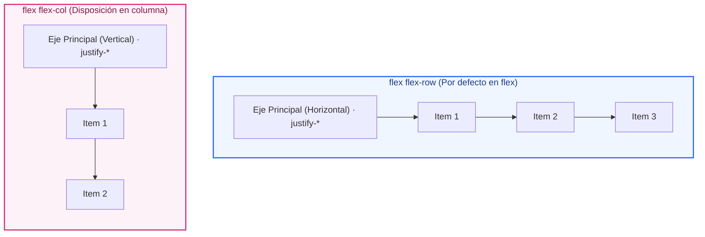
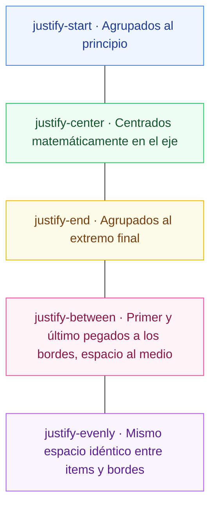
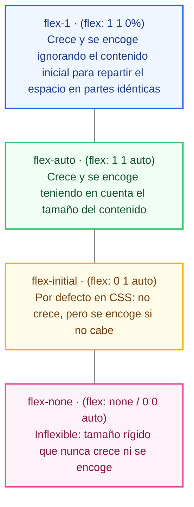
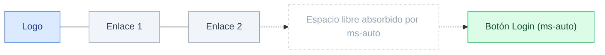

# Ejemplos de Código · Unidad 05: Flexbox en Tailwind CSS

<div class="badges">
  <span class="badge badge-v4">Tailwind CSS 4.0</span>
  <span class="badge badge-blue">Utility-First</span>
  <span class="badge badge-theme">Flexbox Unidimensional</span>
  <span class="badge badge-ra">RA 2 / RA 3</span>
</div>

En este documento se desarrollan **ejemplos completos y funcionales maquetados con Tailwind CSS 4.0** que reproducen y modernizan cada uno de los conceptos de ==Flexbox== estudiados en CSS nativo.

!!! info "Estructura de cada sección"
    Cada apartado está estructurado de manera didáctica con:
    
    1. **Fundamento conceptual y mentalidad de ejes:** Orientación del eje principal (*main axis*) y transversal (*cross axis*).
    2. **Código interactivo en pestañas:** Código HTML semántico con clases de Tailwind 4 junto a su **equivalencia en CSS nativo**.
    3. **Disección técnica paso a paso:** Análisis de las utilidades de distribución, flexión y resolución de trampas habituales.

---

## 1. Anatomía del Flex Container y Orientación de los Ejes

### Fundamento Conceptual

Flexbox es un motor de diseño **unidimensional**: maqueta elementos a lo largo de un eje principal (*main axis*), mientras que el eje secundario o transversal (*cross axis*) corre de forma perpendicular:



| Clase Tailwind | Propiedad CSS | Eje Principal (*Main Axis*) | Eje Transversal (*Cross Axis*) |
| :--- | :--- | :--- | :--- |
| **`flex flex-row`** | `display: flex; flex-direction: row` | Horizontal → (De izquierda a derecha) | Vertical ↓ (De arriba a abajo) |
| **`flex flex-row-reverse`** | `flex-direction: row-reverse` | Horizontal ← (De derecha a izquierda) | Vertical ↓ |
| **`flex flex-col`** | `flex-direction: column` | Vertical ↓ (De arriba a abajo) | Horizontal → |
| **`flex flex-col-reverse`** | `flex-direction: column-reverse` | Vertical ↑ (De abajo hacia arriba) | Horizontal → |

### Código de Ejemplo

=== "HTML con Tailwind CSS"

    ```html title="01-anatomia-flex-tailwind.html"
    <div class="grid grid-cols-1 md:grid-cols-2 gap-8 max-w-4xl mx-auto p-6 font-sans">
      <!-- 1. flex-row horizontal -->
      <div class="p-4 bg-white border border-slate-200 rounded-xl shadow-sm">
        <span class="text-xs font-bold text-sky-600 uppercase">1. flex flex-row (Horizontal)</span>
        <div class="flex flex-row gap-3 mt-3 p-3 bg-slate-100 rounded-lg">
          <div class="size-14 bg-sky-600 text-white rounded font-bold flex items-center justify-center">1</div>
          <div class="size-14 bg-sky-600 text-white rounded font-bold flex items-center justify-center">2</div>
          <div class="size-14 bg-sky-600 text-white rounded font-bold flex items-center justify-center">3</div>
        </div>
      </div>

      <!-- 2. flex-col vertical -->
      <div class="p-4 bg-white border border-slate-200 rounded-xl shadow-sm">
        <span class="text-xs font-bold text-indigo-600 uppercase">2. flex flex-col (Vertical)</span>
        <div class="flex flex-col gap-3 mt-3 p-3 bg-slate-100 rounded-lg">
          <div class="h-10 bg-indigo-600 text-white rounded font-bold flex items-center justify-center">Fila A</div>
          <div class="h-10 bg-indigo-600 text-white rounded font-bold flex items-center justify-center">Fila B</div>
        </div>
      </div>
    </div>
    ```

=== "HTML Limpio (sin Tailwind)"

    ```html title="01-anatomia-flex-limpio.html"
    <div class="contenedor-comparativa-ejes">
      <!-- 1. flex-row horizontal -->
      <div class="caso-eje">
        <span class="etiqueta-eje">1. flex flex-row (Horizontal)</span>
        <div class="contenedor-fila">
          <div class="caja-muestra">1</div>
          <div class="caja-muestra">2</div>
          <div class="caja-muestra">3</div>
        </div>
      </div>

      <!-- 2. flex-col vertical -->
      <div class="caso-eje">
        <span class="etiqueta-eje">2. flex flex-col (Vertical)</span>
        <div class="contenedor-columna">
          <div class="caja-muestra">1</div>
          <div class="caja-muestra">2</div>
          <div class="caja-muestra">3</div>
        </div>
      </div>
    </div>
    ```

=== "CSS Nativo Equivalente"

    ```css title="equivalencia-anatomia-flex.css"
    .contenedor-fila {
      display: flex;
      flex-direction: row; /* flex flex-row */
      gap: 0.75rem;        /* gap-3 */
    }

    .contenedor-columna {
      display: flex;
      flex-direction: column; /* flex flex-col */
      gap: 0.75rem;
    }
    ```

---

## 2. Distribución en el Eje Principal con `justify-*`

### Fundamento Conceptual

Las utilidades `justify-*` gobiernan el reparto del espacio libre a lo largo del **eje principal**:



### Código de Ejemplo

=== "HTML con Tailwind CSS"

    ```html title="02-justify-content-tailwind.html"
    <div class="space-y-4 max-w-2xl mx-auto p-6 font-sans bg-white border border-slate-200 rounded-2xl shadow-sm">
      <!-- justify-between -->
      <div>
        <span class="text-xs font-bold text-slate-500 uppercase">justify-between (Patrón de Tarjetas y Headers)</span>
        <div class="flex justify-between items-center p-3 bg-slate-100 rounded-lg mt-1">
          <span class="font-bold text-sm text-slate-800">Mi Panel</span>
          <button class="px-3 py-1 bg-sky-600 text-white rounded text-xs font-semibold">Configuración</button>
        </div>
      </div>

      <!-- justify-center -->
      <div>
        <span class="text-xs font-bold text-slate-500 uppercase">justify-center (Paginaciones)</span>
        <div class="flex justify-center gap-2 p-3 bg-slate-100 rounded-lg mt-1">
          <button class="size-8 bg-white border rounded font-semibold text-xs shadow-sm">1</button>
          <button class="size-8 bg-sky-600 text-white rounded font-semibold text-xs shadow-sm">2</button>
          <button class="size-8 bg-white border rounded font-semibold text-xs shadow-sm">3</button>
        </div>
      </div>

      <!-- justify-evenly -->
      <div>
        <span class="text-xs font-bold text-slate-500 uppercase">justify-evenly (Barras de Herramientas)</span>
        <div class="flex justify-evenly p-3 bg-slate-100 rounded-lg mt-1 text-xs font-bold text-slate-700">
          <span>Inicio</span>
          <span>Catálogo</span>
          <span>Noticias</span>
          <span>Contacto</span>
        </div>
      </div>
    </div>
    ```

=== "HTML Limpio (sin Tailwind)"

    ```html title="02-justify-content-limpio.html"
    <div class="contenedor-distribucion">
      <!-- justify-between -->
      <div class="caso-distribucion">
        <span class="etiqueta-tecnica">justify-between (Patrón de Tarjetas y Headers)</span>
        <div class="fila-between">
          <span class="texto-destacado">Título</span>
          <span class="badge">Acción</span>
        </div>
      </div>

      <!-- justify-center -->
      <div class="caso-distribucion">
        <span class="etiqueta-tecnica">justify-center (Agrupación Centrada)</span>
        <div class="fila-center">
          <button type="button" class="btn">Atrás</button>
          <button type="button" class="btn btn--primario">Siguiente</button>
        </div>
      </div>

      <!-- justify-evenly -->
      <div class="caso-distribucion">
        <span class="etiqueta-tecnica">justify-evenly (Espaciado Perimetral Equitativo)</span>
        <div class="fila-evenly">
          <span class="icono-muestra">A</span>
          <span class="icono-muestra">B</span>
          <span class="icono-muestra">C</span>
        </div>
      </div>
    </div>
    ```

=== "CSS Nativo Equivalente"

    ```css title="equivalencia-justify.css"
    .fila-between { justify-content: space-between; } /* justify-between */
    .fila-center  { justify-content: center; }        /* justify-center */
    .fila-evenly  { justify-content: space-evenly; }  /* justify-evenly */
    ```

---

## 3. Alineación Transversal: `items-*` y `self-*`

### Fundamento Conceptual

Mientras que `justify-*` opera en el eje principal, la familia **`items-*`** gestiona la alineación en el eje transversal:

* **`items-stretch` (Por defecto en CSS):** Los items se estiran verticalmente para igualar la altura del hermano más alto.
* **`items-center`:** Centra verticalmente los elementos en la fila.
* **`items-baseline`:** Alinea los textos por su línea de base tipográfica, crucial cuando se combinan distintos tamaños de fuente (`text-3xl` junto a `text-sm`).
* **`self-*`:** Permite a un flex item individual romper la regla general del padre y alinearse por su cuenta (`self-start`, `self-end`, `self-center`).

### Código de Ejemplo

=== "HTML con Tailwind CSS"

    ```html title="03-alineacion-items-tailwind.html"
    <div class="max-w-2xl mx-auto p-6 font-sans bg-white border border-slate-200 rounded-2xl shadow-sm space-y-6">
      <!-- 1. items-center -->
      <div>
        <span class="text-xs font-bold text-slate-500 uppercase">items-center (Centrado vertical armónico)</span>
        <div class="flex items-center gap-4 p-4 bg-slate-50 rounded-xl mt-1 border border-slate-100">
          <div class="size-12 bg-sky-500 rounded-full flex items-center justify-center text-white font-bold shrink-0">
            UI
          </div>
          <div>
            <h4 class="font-bold text-sm text-slate-800">Alineación Equilibrada</h4>
            <p class="text-xs text-slate-500">El avatar y el texto quedan centrados sin calcular márgenes.</p>
          </div>
        </div>
      </div>

      <!-- 2. items-baseline -->
      <div>
        <span class="text-xs font-bold text-slate-500 uppercase">items-baseline (Alineación por línea base del texto)</span>
        <div class="flex items-baseline gap-2 p-4 bg-slate-50 rounded-xl mt-1 border border-slate-100">
          <span class="text-4xl font-extrabold text-slate-900 tracking-tight">29€</span>
          <span class="text-sm font-semibold text-slate-500">/ mes</span>
          <span class="ms-auto text-xs text-emerald-600 font-bold bg-emerald-50 px-2 py-1 rounded">IVA incluido</span>
        </div>
      </div>
    </div>
    ```

=== "HTML Limpio (sin Tailwind)"

    ```html title="03-alineacion-items-limpio.html"
    <div class="contenedor-alineacion">
      <!-- 1. items-center -->
      <div class="caso-alineacion">
        <span class="etiqueta-tecnica">items-center (Centrado vertical armónico)</span>
        <div class="fila-centrada">
          <div class="avatar-circular">JD</div>
          <div class="info-usuario">
            <h4>Juan Desarrollador</h4>
            <p>Ingeniero Front-End</p>
          </div>
          <button type="button" class="btn-perfil">Ver Perfil</button>
        </div>
      </div>

      <!-- 2. items-baseline -->
      <div class="caso-alineacion">
        <span class="etiqueta-tecnica">items-baseline (Alineación tipográfica perfecta de precios)</span>
        <div class="fila-precio">
          <span class="moneda">€</span>
          <span class="precio-entero">49</span>
          <span class="precio-decimal">.99</span>
          <span class="periodo">/mes</span>
        </div>
      </div>
    </div>
    ```

=== "CSS Nativo Equivalente"

    ```css title="equivalencia-items.css"
    .fila-centrada {
      display: flex;
      align-items: center;   /* items-center */
    }

    .fila-precio {
      display: flex;
      align-items: baseline; /* items-baseline (Las fuentes reposan en la misma línea) */
    }
    ```

---

## 4. Salto de Línea con `flex-wrap` y la Escala `gap-*`

### Fundamento Conceptual

Por defecto, los contenedores flex intentan empaquetar todos los elementos en una única línea (`flex-nowrap`), comprimiéndolos hasta deformarlos. Al activar **`flex-wrap`**, los items que no caben saltan elegantemente a la siguiente línea:

* **`flex-wrap`:** Permite que los elementos generen nuevas filas según el espacio disponible.
* **`gap-4`:** Separa los items 1rem (16px) de forma bidimensional sin necesidad de trucos con márgenes negativos.

### Código de Ejemplo

=== "HTML con Tailwind CSS"

    ```html title="04-flex-wrap-badges-tailwind.html"
    <div class="max-w-xl mx-auto p-6 font-sans bg-white border border-slate-200 rounded-2xl shadow-sm">
      <h4 class="font-bold text-sm text-slate-800 mb-2">Nube de Etiquetas Adaptable (flex-wrap gap-2)</h4>
      
      <!-- Contenedor con salto de línea dinámico -->
      <div class="flex flex-wrap gap-2 p-4 bg-slate-50 rounded-xl border border-slate-100">
        <span class="px-3 py-1.5 bg-sky-100 text-sky-800 text-xs font-semibold rounded-lg">Tailwind 4</span>
        <span class="px-3 py-1.5 bg-indigo-100 text-indigo-800 text-xs font-semibold rounded-lg">Flexbox</span>
        <span class="px-3 py-1.5 bg-emerald-100 text-emerald-800 text-xs font-semibold rounded-lg">CSS Grid</span>
        <span class="px-3 py-1.5 bg-amber-100 text-amber-800 text-xs font-semibold rounded-lg">Container Queries</span>
        <span class="px-3 py-1.5 bg-rose-100 text-rose-800 text-xs font-semibold rounded-lg">Subgrid</span>
        <span class="px-3 py-1.5 bg-purple-100 text-purple-800 text-xs font-semibold rounded-lg">Diseño Responsivo</span>
        <span class="px-3 py-1.5 bg-cyan-100 text-cyan-800 text-xs font-semibold rounded-lg">Vite</span>
      </div>
    </div>
    ```

=== "HTML Limpio (sin Tailwind)"

    ```html title="04-flex-wrap-badges-limpio.html"
    <div class="contenedor-etiquetas">
      <h4 class="titular-etiquetas">Nube de Etiquetas Adaptable (flex-wrap gap-2)</h4>
      
      <!-- Contenedor con salto de línea dinámico -->
      <div class="nube-etiquetas">
        <span class="badge-tag">JavaScript</span>
        <span class="badge-tag">TypeScript</span>
        <span class="badge-tag">Tailwind CSS 4.0</span>
        <span class="badge-tag">React</span>
        <span class="badge-tag">Next.js</span>
        <span class="badge-tag">Node.js</span>
        <span class="badge-tag">PostgreSQL</span>
        <span class="badge-tag">Docker</span>
        <span class="badge-tag">Figma</span>
      </div>
    </div>
    ```

=== "CSS Nativo Equivalente"

    ```css title="equivalencia-wrap.css"
    .nube-etiquetas {
      display: flex;
      flex-wrap: wrap; /* flex-wrap */
      gap: 0.5rem;     /* gap-2 */
    }
    ```

---

## 5. La Tríada del Flex Item: `grow`, `shrink` y las Macros `flex-1` / `flex-initial`

### Fundamento Conceptual

El comportamiento elástico de un hijo flex está determinado por tres factores: **`flex-grow`**, **`flex-shrink`** y **`flex-basis`**. Tailwind ofrece utilidades individuales y macros compuestas de alta productividad:



### Código de Ejemplo

=== "HTML con Tailwind CSS"

    ```html title="05-triada-flex-tailwind.html"
    <div class="max-w-2xl mx-auto p-6 font-sans space-y-6">
      <!-- Caso A: Columnas simétricas con flex-1 -->
      <div class="p-4 bg-white border border-slate-200 rounded-xl shadow-sm">
        <span class="text-xs font-bold text-slate-500 uppercase">Tres columnas simétricas exactas con flex-1</span>
        <div class="flex gap-4 mt-2">
          <div class="flex-1 p-3 bg-sky-100 text-sky-900 rounded text-center text-xs font-bold">Columna A</div>
          <div class="flex-1 p-3 bg-sky-100 text-sky-900 rounded text-center text-xs font-bold">Columna B (Más texto aquí)</div>
          <div class="flex-1 p-3 bg-sky-100 text-sky-900 rounded text-center text-xs font-bold">Columna C</div>
        </div>
      </div>

      <!-- Caso B: Barra lateral fija (flex-none) y cuerpo elástico (grow) -->
      <div class="p-4 bg-white border border-slate-200 rounded-xl shadow-sm">
        <span class="text-xs font-bold text-slate-500 uppercase">Sidebar fija (w-48 flex-none) + Contenido elástico (grow)</span>
        <div class="flex gap-4 mt-2">
          <div class="w-44 flex-none p-3 bg-slate-800 text-white rounded text-center text-xs font-bold">
            Sidebar (flex-none)
          </div>
          <div class="grow p-3 bg-emerald-100 text-emerald-900 rounded text-center text-xs font-bold">
            Cuerpo Principal (grow absorbe el resto)
          </div>
        </div>
      </div>
    </div>
    ```

=== "HTML Limpio (sin Tailwind)"

    ```html title="05-triada-flex-limpio.html"
    <div class="contenedor-triada">
      <!-- Caso A: Columnas simétricas con flex-1 -->
      <div class="caso-triada">
        <span class="etiqueta-tecnica">Tres columnas simétricas exactas con flex: 1 1 0%</span>
        <div class="fila-triada">
          <div class="columna-simetrica">Columna A</div>
          <div class="columna-simetrica">Columna B (Con más contenido textual de prueba)</div>
          <div class="columna-simetrica">Columna C</div>
        </div>
      </div>

      <!-- Caso B: Sidebar fijo + Contenido elástico -->
      <div class="caso-triada">
        <span class="etiqueta-tecnica">Sidebar fijo (11rem) + Cuerpo elástico que absorbe el resto</span>
        <div class="fila-triada">
          <aside class="lateral-fijo">Sidebar Fijo</aside>
          <main class="cuerpo-elastico">Contenido Principal (grow)</main>
        </div>
      </div>
    </div>
    ```

=== "CSS Nativo Equivalente"

    ```css title="equivalencia-triada.css"
    .columna-simetrica {
      flex: 1 1 0%; /* flex-1 */
    }

    .lateral-fijo {
      flex: none;   /* flex-none */
      width: 11rem; /* w-44 */
    }

    .cuerpo-elastico {
      flex-grow: 1; /* grow */
    }
    ```

---

## 6. La Gran Trampa de Flexbox: `min-w-0` y Textos Desbordantes

### Fundamento Conceptual

Por especificación CSS, **todos los flex items tienen `min-width: auto` por defecto**. 

Esto significa que un elemento hijo **nunca se encogerá por debajo del tamaño de su texto interior**, rompiendo el truncado (`truncate`) y desbordando el contenedor en pantallas móviles:

!!! danger "Solución Obligatoria de Producción"
    Para que las utilidades `truncate` o `line-clamp-*` funcionen dentro de un contenedor `flex`, **es obligatorio declarar `min-w-0` en el flex item que aloja el texto**:
    
    ```html
    <div class="flex items-center">
      <div class="min-w-0 flex-1"> <!-- min-w-0 desarma el bloqueo de min-width: auto -->
        <p class="truncate">Texto largo que ahora sí se truncará correctamente...</p>
      </div>
    </div>
    ```

### Código de Ejemplo

=== "HTML con Tailwind CSS"

    ```html title="06-min-w-0-tailwind.html"
    <div class="max-w-md mx-auto p-6 font-sans space-y-6">
      <!-- Tarjeta protegida contra desbordamientos con min-w-0 -->
      <div class="p-4 bg-white border border-slate-200 rounded-2xl shadow-sm flex items-center gap-4">
        <div class="size-12 bg-indigo-600 rounded-full flex items-center justify-center text-white font-bold shrink-0">
          DOC
        </div>
        
        <!-- Contenedor con min-w-0 que permite al texto truncar con puntos suspensivos -->
        <div class="min-w-0 flex-1">
          <h4 class="font-bold text-sm text-slate-800">Archivo Adjunto</h4>
          <p class="truncate text-xs text-slate-500 mt-0.5">
            memoria-final-proyecto-integrado-desarrollo-aplicaciones-web-v4-definitiva-aprobada.pdf
          </p>
        </div>

        <button class="shrink-0 p-2 text-slate-400 hover:text-indigo-600 hover:bg-slate-100 rounded-lg">
          <svg class="size-5" fill="none" stroke="currentColor" stroke-width="2" viewBox="0 0 24 24"><path stroke-linecap="round" stroke-linejoin="round" d="M4 16v1a3 3 0 003 3h10a3 3 0 003-3v-1m-4-4l-4 4m0 0l-4-4m4 4V4"/></svg>
        </button>
      </div>
    </div>
    ```

=== "HTML Limpio (sin Tailwind)"

    ```html title="06-min-w-0-limpio.html"
    <div class="contenedor-trampa">
      <!-- Tarjeta protegida contra desbordamientos con min-width: 0 -->
      <div class="tarjeta-min-w">
        <div class="avatar-doc">
          DOC
        </div>
        
        <!-- Contenedor textual blindado con min-width: 0 -->
        <div class="flex-item-textual">
          <h4 class="nombre-archivo-truncado">
            informe_anual_metricas_q4_revision_final_aprobada_definitiva_v2_completa.pdf
          </h4>
          <p class="metadatos-archivo">
            PDF · 4.2 MB · Subido hace 2 horas
          </p>
        </div>

        <button type="button" class="btn-descarga">
          Descargar
        </button>
      </div>
    </div>
    ```

=== "CSS Nativo Equivalente"

    ```css title="equivalencia-min-w-0.css"
    .flex-item-textual {
      flex: 1 1 0%;
      min-width: 0; /* min-w-0 (Desactiva min-width: auto para habilitar text-overflow) */
    }
    ```

---

## 7. El Poder de `margin: auto` en Flexbox (Efecto Push)

### Fundamento Conceptual

En Flexbox, aplicar `margin-left: auto` o `margin-inline-start: auto` (`ms-auto`) absorbe **todo el espacio libre disponible**, empujando a ese elemento y a los posteriores hacia el extremo opuesto sin necesidad de crear contenedores intermedios:



### Código de Ejemplo

=== "HTML con Tailwind CSS"

    ```html title="07-margin-auto-push-tailwind.html"
    <nav class="max-w-3xl mx-auto p-4 bg-slate-900 text-white rounded-2xl flex items-center font-sans">
      <!-- Marca / Logo -->
      <a href="#" class="font-extrabold text-lg tracking-tight text-sky-400 me-6">
        DevSpace
      </a>

      <!-- Enlaces primarios -->
      <div class="flex items-center gap-4 text-xs font-semibold text-slate-300">
        <a href="#" class="hover:text-white transition-colors">Cursos</a>
        <a href="#" class="hover:text-white transition-colors">Comunidad</a>
        <a href="#" class="hover:text-white transition-colors">Blog</a>
      </div>

      <!-- Efecto PUSH: ms-auto empuja los botones de usuario al extremo derecho -->
      <div class="ms-auto flex items-center gap-3">
        <a href="#" class="text-xs font-semibold text-slate-300 hover:text-white">Iniciar Sesión</a>
        <a href="#" class="px-3 py-1.5 bg-sky-500 hover:bg-sky-400 text-white text-xs font-bold rounded-lg shadow-sm transition-colors">
          Registrarse
        </a>
      </div>
    </nav>
    ```

=== "HTML Limpio (sin Tailwind)"

    ```html title="07-margin-auto-push-limpio.html"
    <nav class="barra-navegacion">
      <!-- Marca / Logo -->
      <a href="#" class="logo-marca">
        DevSpace
      </a>

      <!-- Enlaces primarios -->
      <div class="enlaces-primarios">
        <a href="#">Dashboard</a>
        <a href="#">Proyectos</a>
        <a href="#">Equipo</a>
      </div>

      <!-- Elemento empujado al extremo derecho con margin-inline-start: auto -->
      <div class="bloque-usuario">
        <span class="usuario-estado"></span>
        <span class="usuario-nombre">Carlos Dev</span>
      </div>
    </nav>
    ```

=== "CSS Nativo Equivalente"

    ```css title="equivalencia-push.css"
    .bloque-usuario {
      margin-inline-start: auto; /* ms-auto (Efecto Push hacia el final) */
    }
    ```

---

## 8. Patrones de Producción Reales con Flexbox

### Tarjeta de Producto con Botón Anclado al Fondo (`mt-auto`)

Un problema habitual en interfaces es cuando varias tarjetas situadas en una misma fila tienen contenidos de texto de longitud dispar: los botones de compra quedan desalineados a alturas distintas. Con `flex flex-col` y **`mt-auto`**, el botón se ancla automáticamente a la base de la tarjeta:

=== "HTML con Tailwind CSS"

    ```html title="08-tarjeta-boton-alineado-tailwind.html"
    <div class="grid grid-cols-1 md:grid-cols-2 gap-6 max-w-2xl mx-auto p-6 font-sans">
      <!-- Tarjeta con texto breve -->
      <article class="p-6 bg-white border border-slate-200 rounded-2xl shadow-sm flex flex-col">
        <span class="text-xs font-bold text-sky-600 uppercase">Plan Básico</span>
        <h3 class="text-xl font-bold text-slate-900 mt-1">Starter</h3>
        <p class="text-xs text-slate-500 mt-2 leading-relaxed">
          Acceso completo a apuntes y ejercicios guiados.
        </p>
        
        <!-- mt-auto ancla el botón al fondo de la tarjeta -->
        <button class="mt-auto w-full py-2 bg-slate-900 hover:bg-slate-800 text-white text-xs font-bold rounded-xl transition-colors">
          Elegir Plan
        </button>
      </article>

      <!-- Tarjeta con texto extenso -->
      <article class="p-6 bg-white border border-slate-200 rounded-2xl shadow-sm flex flex-col">
        <span class="text-xs font-bold text-indigo-600 uppercase">Plan Avanzado</span>
        <h3 class="text-xl font-bold text-slate-900 mt-1">Pro Developer</h3>
        <p class="text-xs text-slate-500 mt-2 leading-relaxed">
          Acceso a apuntes, tutorías personalizadas, proyectos de aula calificados con rúbrica oficial y banco de exámenes resueltos en directo.
        </p>
        
        <!-- mt-auto alinea este botón con el del plan vecino -->
        <button class="mt-auto w-full py-2 bg-indigo-600 hover:bg-indigo-500 text-white text-xs font-bold rounded-xl transition-colors shadow-sm shadow-indigo-600/30">
          Elegir Plan
        </button>
      </article>
    </div>
    ```

=== "HTML Limpio (sin Tailwind)"

    ```html title="08-tarjeta-boton-alineado-limpio.html"
    <div class="rejilla-planes">
      <!-- Tarjeta con texto breve -->
      <article class="tarjeta-flex">
        <span class="etiqueta-plan">Plan Básico</span>
        <h3 class="titular-plan">Starter</h3>
        <p class="descripcion-plan">
          Ideal para desarrolladores independientes y proyectos individuales.
        </p>
        <!-- Botón anclado automáticamente al fondo -->
        <button type="button" class="boton-fondo">
          Comenzar Gratis
        </button>
      </article>

      <!-- Tarjeta con texto extenso -->
      <article class="tarjeta-flex tarjeta--destacada">
        <span class="etiqueta-plan">Plan Empresa</span>
        <h3 class="titular-plan">Enterprise Pro</h3>
        <p class="descripcion-plan">
          Infraestructura de alto rendimiento con soporte dedicado 24/7, clústeres aislados, auditoría de seguridad y despliegues ilimitados en edge computing global para equipos grandes.
        </p>
        <!-- Botón que queda milimétricamente alineado con el botón vecino -->
        <button type="button" class="boton-fondo">
          Contactar Ventas
        </button>
      </article>
    </div>
    ```

=== "CSS Nativo Equivalente"

    ```css title="equivalencia-tarjetas-flex.css"
    .tarjeta-flex {
      display: flex;
      flex-direction: column;
    }

    .boton-fondo {
      margin-top: auto; /* mt-auto (Absorbe el espacio vertical y se ancla al fondo) */
    }
    ```

---

## 9. Checklist de Verificación de Competencias

Al completar el estudio de estos ejemplos prácticos, el alumno debe ser capaz de:

- [x] **Dominar los ejes unidimensionales:** Manipular el eje principal con `flex-row` / `flex-col` y `justify-*`.
- [x] **Alinear en el eje transversal:** Controlar el centrado vertical con `items-center` y la alineación tipográfica con `items-baseline`.
- [x] **Gestionar listas fluidas:** Implementar nubes de tags y galerías dinámicas con `flex-wrap` y `gap-*`.
- [x] **Dominar la tríada elástica:** Configurar repartos simétricos con `flex-1` o columnas fijas con `flex-none`.
- [x] **Erradicar desbordamientos:** Aplicar sistemáticamente `min-w-0` antes de usar `truncate` en flex items.
- [x] **Aprovechar el efecto Push:** Usar `ms-auto` y `mt-auto` para anclar barras de navegación y pies de tarjetas.
