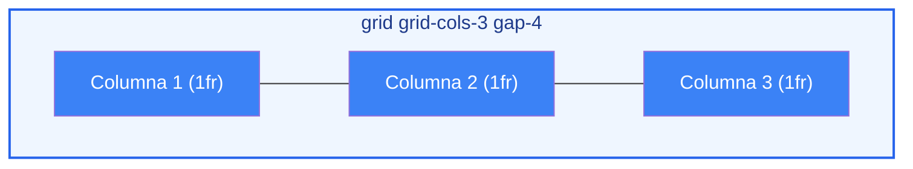
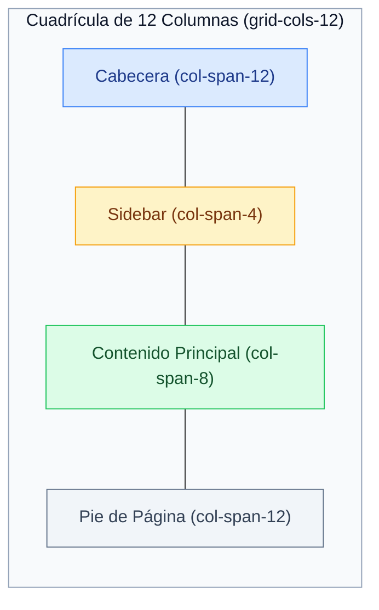
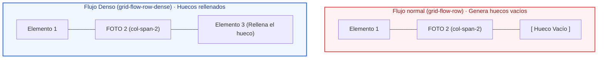
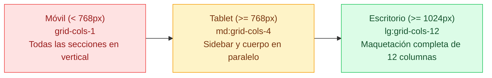
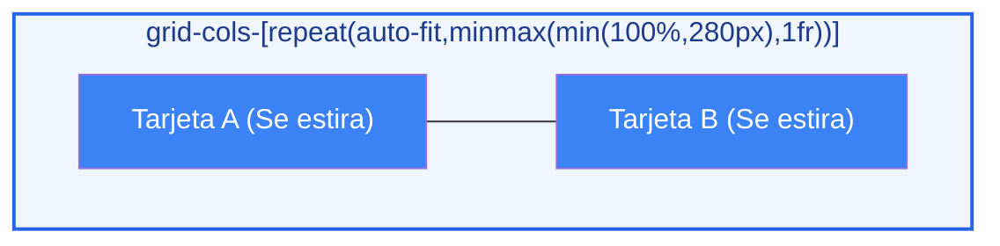
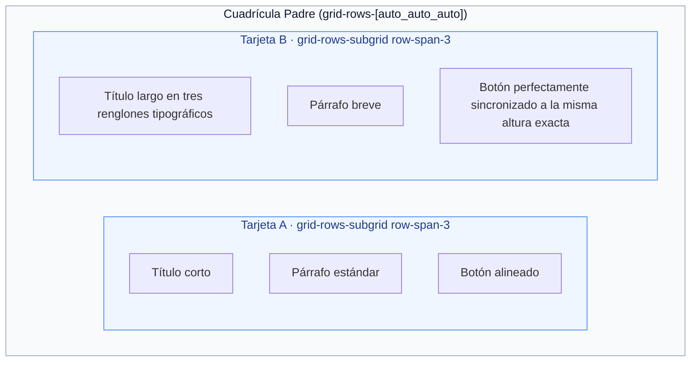

# Ejemplos de Código · Unidad 06: CSS Grid y Subgrid en Tailwind CSS

<div class="badges">
  <span class="badge badge-v4">Tailwind CSS 4.0</span>
  <span class="badge badge-blue">Utility-First</span>
  <span class="badge badge-theme">Grid Bidimensional</span>
  <span class="badge badge-ra">RA 2 / RA 3</span>
</div>

En este documento se desarrollan **ejemplos completos y funcionales maquetados con Tailwind CSS 4.0** que reproducen y modernizan cada uno de los conceptos de ==CSS Grid== y ==Subgrid== estudiados en CSS nativo.

!!! info "Estructura de cada sección"
    Cada apartado está estructurado de manera didáctica con:
    
    1. **Fundamento conceptual:** Cómo traslada Tailwind 4 las pistas (*tracks*), líneas y áreas a clases de cuadrícula.
    2. **Código interactivo en pestañas:** Código HTML semántico con clases de Tailwind 4 junto a su **equivalencia en CSS nativo**.
    3. **Disección técnica paso a paso:** Análisis de las utilidades de cuadrícula, valores arbitrarios modernos (`grid-cols-[...]`) y el nuevo soporte de `subgrid`.

---

## 1. Anatomía del Grid Container: Pistas, Líneas y la Unidad `fr`

### Fundamento Conceptual

A diferencia de Flexbox, CSS Grid es un motor **bidimensional**: gestiona simultáneamente filas (*rows*) y columnas (*columns*). En Tailwind CSS, el contenedor se activa con la utilidad `grid` y se divide en columnas con la familia `grid-cols-{n}`:



* **`grid`:** Activa el contexto de formato de cuadrícula (`display: grid`).
* **`grid-cols-3`:** Genera 3 pistas de columnas de tamaño proporcional idéntico (`repeat(3, minmax(0, 1fr))`).
* **`gap-4`:** Espacio entre celdas (16px).

### Código de Ejemplo

=== "HTML con Tailwind CSS"

    ```html title="01-anatomia-grid-tailwind.html"
    <div class="max-w-3xl mx-auto p-6 font-sans">
      <div class="grid grid-cols-1 md:grid-cols-3 gap-4 p-4 bg-slate-50 border border-slate-200 rounded-2xl">
        <div class="p-6 bg-sky-600 text-white font-bold rounded-xl text-center shadow-sm">
          Columna 1 (1fr)
        </div>
        <div class="p-6 bg-sky-600 text-white font-bold rounded-xl text-center shadow-sm">
          Columna 2 (1fr)
        </div>
        <div class="p-6 bg-sky-600 text-white font-bold rounded-xl text-center shadow-sm">
          Columna 3 (1fr)
        </div>
      </div>
    </div>
    ```

=== "HTML Limpio (sin Tailwind)"

    ```html title="01-anatomia-grid-limpio.html"
    <div class="contenedor-grid-muestra">
      <div class="cuadricula-base">
        <div class="columna-kpi">
          Columna 1 (1fr)
        </div>
        <div class="columna-kpi">
          Columna 2 (1fr)
        </div>
        <div class="columna-kpi">
          Columna 3 (1fr)
        </div>
      </div>
    </div>
    ```

=== "CSS Nativo Equivalente"

    ```css title="equivalencia-grid-base.css"
    .cuadricula-base {
      display: grid;
      grid-template-columns: repeat(3, minmax(0, 1fr)); /* grid-cols-3 */
      gap: 1rem;                                       /* gap-4 */
    }
    ```

---

## 2. Posicionamiento por Líneas: `col-span-*`, `row-span-*` y `col-start-*`

### Fundamento Conceptual

En Tailwind, las celdas individuales pueden abarcar varias pistas horizontales o verticales mediante utilidades de expansión (*span*) y anclaje por líneas:



| Clase Tailwind | Propiedad CSS Equivalente | Función en el Layout |
| :--- | :--- | :--- |
| **`col-span-4`** | `grid-column: span 4 / span 4` | La celda se expande a lo ancho de 4 columnas. |
| **`col-span-full`** | `grid-column: 1 / -1` | Ocupa todo el ancho completo de la fila de punta a punta. |
| **`row-span-2`** | `grid-row: span 2 / span 2` | La celda se extiende verticalmente a lo largo de 2 filas. |
| **`col-start-2`** | `grid-column-start: 2` | Fuerza a la celda a iniciar su dibujo en la línea de rejilla 2. |

### Código de Ejemplo

=== "HTML con Tailwind CSS"

    ```html title="02-grid-spans-tailwind.html"
    <div class="max-w-4xl mx-auto p-6 font-sans">
      <div class="grid grid-cols-12 gap-4 p-4 bg-slate-100 rounded-2xl border border-slate-200 text-xs font-bold text-center">
        <!-- Cabecera completa (12 columnas) -->
        <header class="col-span-12 p-4 bg-slate-900 text-white rounded-xl shadow">
          Cabecera (col-span-12)
        </header>

        <!-- Barra lateral (4 columnas) -->
        <aside class="col-span-12 md:col-span-4 p-6 bg-amber-500 text-white rounded-xl shadow flex items-center justify-center">
          Barra Lateral (col-span-4)
        </aside>

        <!-- Contenido principal (8 columnas) -->
        <main class="col-span-12 md:col-span-8 p-6 bg-emerald-600 text-white rounded-xl shadow min-h-40 flex items-center justify-center">
          Área de Contenido Principal (col-span-8)
        </main>

        <!-- Pie completo (12 columnas) -->
        <footer class="col-span-12 p-3 bg-slate-400 text-white rounded-xl shadow">
          Pie de Página (col-span-12)
        </footer>
      </div>
    </div>
    ```

=== "HTML Limpio (sin Tailwind)"

    ```html title="02-grid-spans-limpio.html"
    <div class="contenedor-spans">
      <div class="rejilla-12-columnas">
        <!-- Cabecera completa (12 columnas) -->
        <header class="columna-completa">
          Cabecera (col-span-12)
        </header>

        <!-- Barra lateral (4 columnas) -->
        <aside class="sidebar-ancho">
          Sidebar (col-span-4)
        </aside>

        <!-- Contenido principal (8 columnas) -->
        <main class="cuerpo-ancho">
          Contenido Principal (col-span-8)
        </main>

        <!-- Tres tarjetas inferiores iguales (4 columnas cada una) -->
        <div class="sidebar-ancho">Tarjeta A (col-span-4)</div>
        <div class="sidebar-ancho">Tarjeta B (col-span-4)</div>
        <div class="sidebar-ancho">Tarjeta C (col-span-4)</div>

        <!-- Pie completo (12 columnas) -->
        <footer class="columna-completa">
          Pie de Página (col-span-12)
        </footer>
      </div>
    </div>
    ```

=== "CSS Nativo Equivalente"

    ```css title="equivalencia-spans.css"
    .columna-completa { grid-column: span 12 / span 12; }
    .sidebar-ancho     { grid-column: span 4 / span 4; }
    .cuerpo-ancho      { grid-column: span 8 / span 8; }
    ```

---

## 3. Cuadrícula Implícita y Flujo Denso: `grid-flow-row-dense`

### Fundamento Conceptual

Cuando colocamos elementos de diferentes tamaños en una rejilla (por ejemplo, tarjetas cuadradas y fotos panorámicas), el navegador suele dejar huecos vacíos si el siguiente elemento en el DOM es demasiado ancho para caber en el espacio sobrante de la fila.

Al activar **`grid-flow-row-dense`**, el algoritmo de empaquetado de CSS Grid **rellena hacia atrás los huecos vacíos** con elementos posteriores más pequeños:



### Código de Ejemplo

=== "HTML con Tailwind CSS"

    ```html title="03-grid-dense-tailwind.html"
    <div class="max-w-3xl mx-auto p-6 font-sans">
      <h4 class="font-bold text-sm text-slate-800 mb-3">Galería Asimétrica con Rellenado Denso</h4>
      
      <!-- Cuadrícula con grid-flow-dense -->
      <div class="grid grid-cols-3 grid-flow-row-dense gap-3 p-4 bg-slate-50 border border-slate-200 rounded-2xl text-xs font-bold text-white text-center">
        <div class="p-4 bg-sky-500 rounded-xl">1. Estándar</div>
        
        <!-- Elemento panorámico que salta a la fila 2 si no cabe -->
        <div class="col-span-2 p-4 bg-indigo-600 rounded-xl">2. Panorámico (col-span-2)</div>
        
        <!-- Este elemento 3 rellenará el hueco de la fila 1 gracias a dense -->
        <div class="p-4 bg-emerald-500 rounded-xl">3. Pequeño (Rellena)</div>
        <div class="p-4 bg-amber-500 rounded-xl">4. Estándar</div>
        <div class="p-4 bg-purple-500 rounded-xl">5. Estándar</div>
      </div>
    </div>
    ```

=== "HTML Limpio (sin Tailwind)"

    ```html title="03-grid-dense-limpio.html"
    <div class="contenedor-galeria">
      <h4 class="titular-galeria">Galería Asimétrica con Rellenado Denso</h4>
      
      <!-- Cuadrícula con grid-auto-flow: row dense -->
      <div class="galeria-densa">
        <div class="item-normal">1 (1x1)</div>
        <div class="item-ancho">2 (2x1) Destacado</div>
        <div class="item-normal">3 (1x1)</div>
        <div class="item-alto">4 (1x2) Vertical</div>
        <div class="item-normal">5 (1x1 - Rellena el hueco gracias a dense)</div>
        <div class="item-normal">6 (1x1)</div>
      </div>
    </div>
    ```

=== "CSS Nativo Equivalente"

    ```css title="equivalencia-dense.css"
    .galeria-densa {
      display: grid;
      grid-template-columns: repeat(3, minmax(0, 1fr));
      grid-auto-flow: row dense; /* grid-flow-row-dense */
      gap: 0.75rem;
    }
    ```

---

## 4. Maquetación Completa: Enfoque Mobile-First vs Desktop-First

### Fundamento Conceptual

En la industria moderna de interfaces, maquetar con CSS Grid sigue la filosofía **Mobile-First**: el código base sin prefijos define la vista vertical para smartphones (`grid-cols-1`), y los prefijos responsivos van expandiendo la cuadrícula a medida que la pantalla crece (`md:grid-cols-4`, `lg:grid-cols-12`):



### Código de Ejemplo

=== "HTML con Tailwind CSS"

    ```html title="04-layout-mobile-first-tailwind.html"
    <div class="max-w-5xl mx-auto p-4 font-sans">
      <!-- Contenedor Responsivo Mobile-First -->
      <div class="grid grid-cols-1 md:grid-cols-4 lg:grid-cols-12 gap-4 text-xs font-bold text-center">
        <!-- Cabecera -->
        <header class="col-span-1 md:col-span-4 lg:col-span-12 p-4 bg-slate-900 text-white rounded-xl shadow">
          Cabecera (Mobile: 1 col | Tablet: 4 cols | Desktop: 12 cols)
        </header>

        <!-- Barra lateral -->
        <aside class="col-span-1 md:col-span-1 lg:col-span-3 p-6 bg-sky-600 text-white rounded-xl shadow">
          Barra Lateral
        </aside>

        <!-- Contenido central -->
        <main class="col-span-1 md:col-span-3 lg:col-span-6 p-6 bg-white border border-slate-200 text-slate-800 rounded-xl shadow min-h-36">
          Contenido Principal
        </main>

        <!-- Widgets complementarios -->
        <aside class="col-span-1 md:col-span-4 lg:col-span-3 p-6 bg-slate-100 border border-slate-200 text-slate-700 rounded-xl shadow">
          Widgets y Notificaciones
        </aside>

        <!-- Pie de página -->
        <footer class="col-span-1 md:col-span-4 lg:col-span-12 p-3 bg-slate-200 text-slate-600 rounded-xl">
          Pie de Página
        </footer>
      </div>
    </div>
    ```

=== "HTML Limpio (sin Tailwind)"

    ```html title="04-layout-mobile-first-limpio.html"
    <div class="contenedor-pagina-adaptable">
      <!-- Contenedor Responsivo Mobile-First -->
      <div class="layout-responsivo">
        <!-- Cabecera -->
        <header class="area-cabecera">
          Cabecera (Mobile: 1 col | Tablet: 4 cols | Desktop: 12 cols)
        </header>

        <!-- Menú de Navegación Lateral -->
        <nav class="area-nav">
          Navegación
        </nav>

        <!-- Área de Contenido Principal -->
        <main class="area-principal">
          Área de Trabajo Principal (8 columnas en escritorio)
        </main>

        <!-- Panel Auxiliar -->
        <aside class="area-auxiliar">
          Auxiliar
        </aside>

        <!-- Pie de página -->
        <footer class="area-pie">
          Pie de Página Unificado
        </footer>
      </div>
    </div>
    ```

=== "CSS Nativo Equivalente"

    ```css title="equivalencia-mobile-first.css"
    /* Móvil Base */
    .layout-responsivo {
      display: grid;
      grid-template-columns: 1fr;
      gap: 1rem;
    }

    /* Tablet (>= 768px) */
    @media (min-width: 768px) {
      .layout-responsivo { grid-template-columns: repeat(4, 1fr); }
    }

    /* Escritorio (>= 1024px) */
    @media (min-width: 1024px) {
      .layout-responsivo { grid-template-columns: repeat(12, 1fr); }
    }
    ```

---

## 5. Alineación Bidimensional: `place-items`, `place-content` y `place-self`

### Fundamento Conceptual

En CSS nativo, centrar un elemento en ambos ejes requería combinar `justify-items` y `align-items`. En Tailwind CSS, las utilidades **`place-*`** unifican ambos comandos en una única clase:

* **`place-items-center`:** Centra todos los elementos hijos horizontal y verticalmente dentro de cada una de sus celdas.
* **`place-content-center`:** Centra toda la cuadrícula en bloque dentro de un contenedor padre que dispone de espacio sobrante.
* **`place-self-center`:** Permite a una celda individual anular la regla del padre y autocentrarse de forma bidimensional.

### Código de Ejemplo

=== "HTML con Tailwind CSS"

    ```html title="05-place-items-tailwind.html"
    <div class="max-w-xl mx-auto p-6 font-sans">
      <!-- Rejilla con place-items-center: Centrado bidimensional total -->
      <div class="h-64 grid grid-cols-2 gap-4 place-items-center p-6 bg-slate-100 border-2 border-dashed border-slate-300 rounded-2xl">
        <div class="size-20 bg-sky-500 text-white font-bold rounded-2xl shadow flex items-center justify-center">
          1
        </div>
        <div class="size-20 bg-indigo-500 text-white font-bold rounded-2xl shadow flex items-center justify-center">
          2
        </div>
      </div>
    </div>
    ```

=== "HTML Limpio (sin Tailwind)"

    ```html title="05-place-items-limpio.html"
    <div class="contenedor-place">
      <!-- Rejilla con place-items: center (Centrado bidimensional total) -->
      <div class="centrado-bidimensional">
        <div class="caja-centrada-grid">
          1
        </div>
        <div class="caja-centrada-grid">
          2
        </div>
      </div>
    </div>
    ```

=== "CSS Nativo Equivalente"

    ```css title="equivalencia-place.css"
    .centrado-bidimensional {
      display: grid;
      grid-template-columns: repeat(2, 1fr);
      place-items: center; /* justify-items: center + align-items: center */
    }
    ```

---

## 6. Galerías Fluidas sin Media Queries con `auto-fit` y `minmax`

### Fundamento Conceptual

Uno de los mayores atractivos de CSS Grid es crear cuadrículas que calculan el número de columnas automáticamente según el ancho de pantalla **sin escribir una sola *media query***.

En Tailwind CSS 4.0, esta fórmula se aplica mediante **sintaxis de corchetes de valor arbitrario**:



!!! tip "La Fórmula Fluida Blindada contra Desbordamientos"
    Al usar `min(100%, 280px)` como suelo dimensional dentro de `minmax()`, la tarjeta pide 280px en monitores grandes pero **se comprime al 100% de la pantalla en móviles de menos de 280px**, eliminando la barra de scroll horizontal para siempre:
    
    ```css
    grid-cols-[repeat(auto-fit,minmax(min(100%,280px),1fr))]
    ```

### Código de Ejemplo

=== "HTML con Tailwind CSS"

    ```html title="06-autofit-fluido-tailwind.html"
    <div class="max-w-6xl mx-auto p-6 font-sans">
      <!-- Galería Fluida Automática sin Media Queries -->
      <div class="grid grid-cols-[repeat(auto-fit,minmax(min(100%,280px),1fr))] gap-6">
        <!-- Tarjeta 1 -->
        <article class="p-6 bg-white border border-slate-200 rounded-2xl shadow-sm hover:shadow-md transition-shadow">
          <span class="text-xs font-bold text-sky-600 uppercase">Tecnología</span>
          <h3 class="text-base font-bold text-slate-800 mt-1">Motor Oxide en Rust</h3>
          <p class="text-xs text-slate-500 mt-2 leading-relaxed">
            Tailwind CSS 4 compila hasta 10 veces más rápido que la versión 3 gracias a su nuevo compilador unificado.
          </p>
        </article>

        <!-- Tarjeta 2 -->
        <article class="p-6 bg-white border border-slate-200 rounded-2xl shadow-sm hover:shadow-md transition-shadow">
          <span class="text-xs font-bold text-emerald-600 uppercase">Arquitectura</span>
          <h3 class="text-base font-bold text-slate-800 mt-1">Configuración CSS-First</h3>
          <p class="text-xs text-slate-500 mt-2 leading-relaxed">
            La directiva @theme traslada los tokens de diseño directamente a variables CSS nativas sin JavaScript.
          </p>
        </article>

        <!-- Tarjeta 3 -->
        <article class="p-6 bg-white border border-slate-200 rounded-2xl shadow-sm hover:shadow-md transition-shadow">
          <span class="text-xs font-bold text-indigo-600 uppercase">Soporte Nativo</span>
          <h3 class="text-base font-bold text-slate-800 mt-1">Subgrid y Container Queries</h3>
          <p class="text-xs text-slate-500 mt-2 leading-relaxed">
            Sincronización vertical de filas y consultas basadas en el tamaño del contenedor sin plugins externos.
          </p>
        </article>
      </div>
    </div>
    ```

=== "HTML Limpio (sin Tailwind)"

    ```html title="06-autofit-fluido-limpio.html"
    <div class="contenedor-catalogo">
      <!-- Galería Fluida Automática sin Media Queries -->
      <div class="galeria-fluida">
        <!-- Tarjeta 1 -->
        <article class="tarjeta-catalogo">
          <span class="badge-categoria">Componente</span>
          <h3 class="titular-producto">Cuadrícula Fluida 01</h3>
          <p class="descripcion-producto">
            Calcula dinámicamente el número de columnas disponibles sin media queries duras.
          </p>
          <div class="pie-tarjeta">
            <span class="precio-producto">€29.00</span>
            <button type="button" class="btn-comprar">Comprar</button>
          </div>
        </article>

        <!-- Tarjeta 2 -->
        <article class="tarjeta-catalogo">
          <span class="badge-categoria">Componente</span>
          <h3 class="titular-producto">Cuadrícula Fluida 02</h3>
          <p class="descripcion-producto">
            Utiliza min(100%, 280px) para blindar el contenedor en pantallas de menos de 300px.
          </p>
          <div class="pie-tarjeta">
            <span class="precio-producto">€39.00</span>
            <button type="button" class="btn-comprar">Comprar</button>
          </div>
        </article>

        <!-- Tarjeta 3 -->
        <article class="tarjeta-catalogo">
          <span class="badge-categoria">Componente</span>
          <h3 class="titular-producto">Cuadrícula Fluida 03</h3>
          <p class="descripcion-producto">
            Cada tarjeta se expande para rellenar exactamente la fracción sobrante del ancho.
          </p>
          <div class="pie-tarjeta">
            <span class="precio-producto">€49.00</span>
            <button type="button" class="btn-comprar">Comprar</button>
          </div>
        </article>
      </div>
    </div>
    ```

=== "CSS Nativo Equivalente"

    ```css title="equivalencia-autofit.css"
    .galeria-fluida {
      display: grid;
      grid-template-columns: repeat(auto-fit, minmax(min(100%, 280px), 1fr));
      gap: 1.5rem; /* gap-6 */
    }
    ```

---

## 7. Alineación Multidimensional con `subgrid` Nativo en Tailwind 4

### Fundamento Conceptual

En una cuadrícula CSS tradicional, las tarjetas hijas son cajas aisladas: si una tarjeta tiene un título de tres líneas y su vecina tiene un título de una sola línea, los botones y párrafos inferiores quedan desalineados.

**Tailwind CSS 4.0 soporta `subgrid` de forma nativa**: la tarjeta hija adopta las filas de su contenedor padre con la utilidad **`grid-rows-subgrid`**:



### Código de Ejemplo

=== "HTML con Tailwind CSS"

    ```html title="07-subgrid-tailwind.html"
    <div class="max-w-4xl mx-auto p-6 font-sans">
      <!-- Cuadrícula Padre que define 3 filas por tarjeta -->
      <div class="grid grid-cols-1 md:grid-cols-2 gap-6">
        
        <!-- Tarjeta 1: Adopta las 3 filas del padre con subgrid -->
        <article class="grid grid-rows-subgrid row-span-3 gap-3 p-6 bg-white border border-slate-200 rounded-2xl shadow-sm">
          <h3 class="text-lg font-bold text-slate-900">Curso Rápido</h3>
          <p class="text-xs text-slate-500 leading-relaxed">
            Fundamentos esenciales de Tailwind CSS en 2 semanas.
          </p>
          <button class="w-full py-2 bg-slate-900 text-white rounded-xl text-xs font-semibold">
            Inscribirse
          </button>
        </article>

        <!-- Tarjeta 2: Título largo pero el botón se sincroniza al milímetro -->
        <article class="grid grid-rows-subgrid row-span-3 gap-3 p-6 bg-white border border-slate-200 rounded-2xl shadow-sm">
          <h3 class="text-lg font-bold text-slate-900">
            Máster Profesional en Desarrollo de Interfaces Web y Aplicaciones Multiplataforma
          </h3>
          <p class="text-xs text-slate-500 leading-relaxed">
            Dominio exhaustivo de CSS Grid, Subgrid, Flexbox, Tailwind 4 y arquitecturas escalables.
          </p>
          <button class="w-full py-2 bg-sky-600 text-white rounded-xl text-xs font-semibold">
            Inscribirse
          </button>
        </article>

      </div>
    </div>
    ```

=== "HTML Limpio (sin Tailwind)"

    ```html title="07-subgrid-limpio.html"
    <div class="contenedor-comparativa-subgrid">
      <!-- Cuadrícula Padre que define 3 filas por tarjeta -->
      <div class="rejilla-padre-subgrid">
        
        <!-- Tarjeta 1: Adopta las 3 filas del padre con subgrid -->
        <article class="tarjeta-subgrid">
          <h3 class="subgrid-titulo">Título Corto</h3>
          <p class="subgrid-cuerpo">
            Descripción breve.
          </p>
          <button type="button" class="btn-subgrid">Acción 1</button>
        </article>

        <!-- Tarjeta 2: Título multilínea que expande la fila de ambas tarjetas -->
        <article class="tarjeta-subgrid">
          <h3 class="subgrid-titulo">Título Mucho Más Largo Que Rompe en Dos Renglones Claros</h3>
          <p class="subgrid-cuerpo">
            Gracias a subgrid, la fila del título crece simultáneamente en ambas tarjetas y los botones quedan milimétricamente alineados sin trucos de flexbox ni márgenes manuales.
          </p>
          <button type="button" class="btn-subgrid">Acción 2</button>
        </article>

      </div>
    </div>
    ```

=== "CSS Nativo Equivalente"

    ```css title="equivalencia-subgrid.css"
    .tarjeta-subgrid {
      grid-row: span 3 / span 3; /* row-span-3 */
      display: grid;
      grid-template-rows: subgrid; /* grid-rows-subgrid en Tailwind 4 */
    }
    ```

---

## 8. Patrón de Producción Real: Dashboard Administrativo Modular

### Fundamento Conceptual

El patrón de producción por excelencia de CSS Grid en aplicaciones del mundo real es el **Dashboard Administrativo**: una estructura híbrida que combina tarjetas de métricas (KPIs), tablas de datos y gráficos analíticos:

=== "HTML con Tailwind CSS"

    ```html title="08-dashboard-kpis-tailwind.html"
    <div class="max-w-6xl mx-auto p-6 font-sans bg-slate-50 min-h-screen">
      <!-- 1. Cuadrícula de KPIs Superiores (4 columnas) -->
      <div class="grid grid-cols-1 sm:grid-cols-2 lg:grid-cols-4 gap-4 mb-6">
        <div class="p-4 bg-white border border-slate-200 rounded-xl shadow-sm">
          <span class="text-xs font-bold text-slate-400 uppercase">Usuarios Activos</span>
          <div class="text-2xl font-extrabold text-slate-900 mt-1">14.280</div>
          <span class="text-xs font-semibold text-emerald-600">↑ 12% este mes</span>
        </div>
        <div class="p-4 bg-white border border-slate-200 rounded-xl shadow-sm">
          <span class="text-xs font-bold text-slate-400 uppercase">Ingresos Mensuales</span>
          <div class="text-2xl font-extrabold text-slate-900 mt-1">42.500€</div>
          <span class="text-xs font-semibold text-emerald-600">↑ 8.4%</span>
        </div>
        <div class="p-4 bg-white border border-slate-200 rounded-xl shadow-sm">
          <span class="text-xs font-bold text-slate-400 uppercase">Tasa de Rebote</span>
          <div class="text-2xl font-extrabold text-slate-900 mt-1">24.2%</div>
          <span class="text-xs font-semibold text-rose-600">↓ 1.2%</span>
        </div>
        <div class="p-4 bg-white border border-slate-200 rounded-xl shadow-sm">
          <span class="text-xs font-bold text-slate-400 uppercase">Satisfacción (CSAT)</span>
          <div class="text-2xl font-extrabold text-slate-900 mt-1">4.9 / 5</div>
          <span class="text-xs font-semibold text-sky-600">98% positivas</span>
        </div>
      </div>

      <!-- 2. Área Mixta: Gráfico Grande (8 cols) + Actividad Reciente (4 cols) -->
      <div class="grid grid-cols-1 lg:grid-cols-12 gap-6">
        <div class="lg:col-span-8 p-6 bg-white border border-slate-200 rounded-2xl shadow-sm">
          <h3 class="font-bold text-slate-800 text-sm mb-4">Rendimiento de Servidores y Tráfico</h3>
          <div class="h-56 bg-slate-100 rounded-xl border border-dashed border-slate-300 flex items-center justify-center text-xs text-slate-400 font-bold">
            [ Área de Visualización de Gráficos SVG / Canvas ]
          </div>
        </div>

        <div class="lg:col-span-4 p-6 bg-white border border-slate-200 rounded-2xl shadow-sm">
          <h3 class="font-bold text-slate-800 text-sm mb-4">Últimas Acciones</h3>
          <div class="space-y-3 text-xs text-slate-600">
            <div class="p-2.5 bg-slate-50 rounded-lg border border-slate-100">
              <strong>Despliegue:</strong> Servidor v4.2 actualizado con éxito.
            </div>
            <div class="p-2.5 bg-slate-50 rounded-lg border border-slate-100">
              <strong>Backup:</strong> Copia de seguridad en la nube completada.
            </div>
            <div class="p-2.5 bg-slate-50 rounded-lg border border-slate-100">
              <strong>Alerta:</strong> Pico de tráfico gestionado elásticamente.
            </div>
          </div>
        </div>
      </div>
    </div>
    ```

=== "HTML Limpio (sin Tailwind)"

    ```html title="08-dashboard-kpis-limpio.html"
    <div class="dashboard-contenedor">
      <!-- 1. Cuadrícula de KPIs Superiores (4 columnas) -->
      <div class="rejilla-kpis">
        <div class="tarjeta-kpi">
          <span class="kpi-titulo">Usuarios Activos</span>
          <div class="kpi-valor">24,582</div>
          <span class="kpi-tendencia kpi-tendencia--positiva">↑ 12% vs mes anterior</span>
        </div>
        <div class="tarjeta-kpi">
          <span class="kpi-titulo">Ingresos Recurrentes</span>
          <div class="kpi-valor">€48,290</div>
          <span class="kpi-tendencia kpi-tendencia--positiva">↑ 8.4% vs mes anterior</span>
        </div>
        <div class="tarjeta-kpi">
          <span class="kpi-titulo">Tasa de Conversión</span>
          <div class="kpi-valor">3.42%</div>
          <span class="kpi-tendencia kpi-tendencia--negativa">↓ 0.3% vs mes anterior</span>
        </div>
        <div class="tarjeta-kpi">
          <span class="kpi-titulo">Tiempo de Respuesta</span>
          <div class="kpi-valor">142ms</div>
          <span class="kpi-tendencia kpi-tendencia--positiva">Óptimo (P99)</span>
        </div>
      </div>

      <!-- 2. Rejilla Principal Asimétrica: Gráfico Analítico + Actividad -->
      <div class="rejilla-dashboard-principal">
        <!-- Panel de Gráfico Analítico (8 columnas) -->
        <section class="panel-analitica">
          <div class="panel-cabecera">
            <h3 class="panel-titulo">Tráfico en Tiempo Real</h3>
            <span class="badge badge--ok">En Vivo</span>
          </div>
          <div class="marcador-grafico">
            <span>[ Lienzo de Gráficos Analíticos / Canvas / SVG ]</span>
          </div>
        </section>

        <!-- Panel de Actividad Reciente (4 columnas) -->
        <aside class="panel-actividad">
          <h3 class="panel-titulo">Últimas Transacciones</h3>
          <ul class="lista-actividad">
            <li class="item-actividad">
              <div>
                <strong>Plan Pro Anual</strong>
                <p>hace 4 minutos · María G.</p>
              </div>
              <span class="monto-positivo">+€199</span>
            </li>
            <li class="item-actividad">
              <div>
                <strong>Suscripción Starter</strong>
                <p>hace 18 minutos · Lucas P.</p>
              </div>
              <span class="monto-positivo">+€29</span>
            </li>
            <li class="item-actividad">
              <div>
                <strong>Renovación Enterprise</strong>
                <p>hace 42 minutos · TechCorp</p>
              </div>
              <span class="monto-positivo">+€890</span>
            </li>
          </ul>
        </aside>
      </div>
    </div>
    ```

=== "CSS Nativo Equivalente"

    ```css title="equivalencia-dashboard-grid.css"
    /* 1. Rejilla de KPIs superiores responsiva */
    .rejilla-kpis {
      display: grid;
      grid-template-columns: 1fr;
      gap: 1rem;
      margin-bottom: 1.5rem;
    }

    @media (min-width: 640px) {
      .rejilla-kpis { grid-template-columns: repeat(2, 1fr); }
    }

    @media (min-width: 1024px) {
      .rejilla-kpis { grid-template-columns: repeat(4, 1fr); }
    }

    /* 2. Rejilla principal asimétrica: Analítica (8 cols) + Actividad (4 cols) */
    .rejilla-dashboard-principal {
      display: grid;
      grid-template-columns: 1fr;
      gap: 1.5rem;
    }

    @media (min-width: 1024px) {
      .rejilla-dashboard-principal {
        grid-template-columns: repeat(12, 1fr);
      }

      .panel-analitica {
        grid-column: span 8 / span 8;
      }

      .panel-actividad {
        grid-column: span 4 / span 4;
      }
    }
    ```

---

## 9. Checklist de Verificación de Competencias

Al completar el estudio de estos ejemplos prácticos, el alumno debe ser capaz de:

- [x] **Construir cuadrículas bidimensionales:** Manejar `grid`, `grid-cols-{n}` y la separación atómica con `gap-*`.
- [x] **Dominar el posicionamiento por líneas:** Expandir celdas con `col-span-*`, `row-span-*` y `col-span-full`.
- [x] **Eliminar huecos vacíos:** Aplicar `grid-flow-row-dense` para galerías asimétricas densas.
- [x] **Implementar la fórmula fluida:** Crear galerías adaptables sin media queries con `grid-cols-[repeat(auto-fit,minmax(min(100%,280px),1fr))]`.
- [x] **Centrar en dos dimensiones:** Emplear `place-items-center` para alinear horizontal y verticalmente en un solo paso.
- [x] **Sincronizar filas internas con Subgrid:** Usar `grid-rows-subgrid` nativo de Tailwind 4 para alinear botones y títulos en tarjetas dispares.
