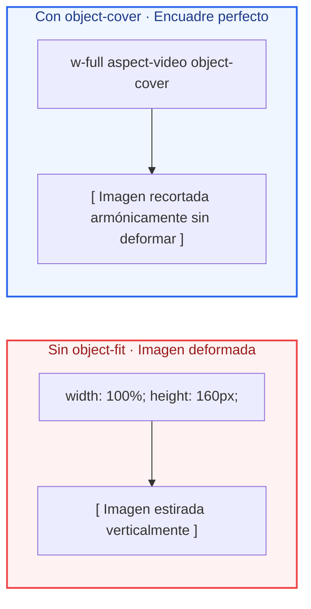

# Ejemplos de Código · Unidad 09: Fondos, Imágenes y Efectos en Tailwind CSS

<div class="badges">
  <span class="badge badge-v4">Tailwind CSS 4.0</span>
  <span class="badge badge-blue">Utility-First</span>
  <span class="badge badge-theme">Efectos & Multimedia</span>
  <span class="badge badge-ra">RA 2 / RA 3</span>
</div>

En este documento se desarrollan **ejemplos completos y funcionales maquetados con Tailwind CSS 4.0** que reproducen y modernizan cada uno de los conceptos de ==fondos, imágenes y efectos decorativos== estudiados en CSS nativo.

!!! info "Estructura de cada sección"
    Cada apartado está estructurado de manera didáctica con:
    
    1. **Fundamento conceptual:** Cómo procesa Tailwind 4 las capas gráficas, filtros y la nueva sintaxis de gradientes.
    2. **Código interactivo en pestañas:** Código HTML semántico con clases de Tailwind 4 junto a su **equivalencia en CSS nativo**.
    3. **Disección técnica paso a paso:** Análisis de filtros backdrop, encuadres fotográficos sin deformación y sombras multidimensionales.

---

## 1. La Propiedad `background` y Composición de Fondos

### Fundamento Conceptual

En Tailwind CSS, el control de fondos se divide en utilidades atómicas altamente legibles:

* **`bg-cover`:** Escala la imagen para que cubra la totalidad del contenedor sin dejar bandas vacías (`background-size: cover`).
* **`bg-center`:** Centra el punto focal de la imagen (`background-position: center`).
* **`bg-no-repeat`:** Evita que el tapiz se replique en mosaico.
* **`bg-fixed`:** Fija la imagen al viewport creando el clásico efecto visual de *Parallax*.

### Código de Ejemplo

=== "HTML con Tailwind CSS"

    ```html title="01-fondos-cobertura-tailwind.html"
    <div class="max-w-3xl mx-auto p-6 font-sans">
      <!-- Tarjeta Hero con Imagen de Cobertura y Gradiente Overlay -->
      <section class="relative h-72 rounded-3xl overflow-hidden shadow-xl bg-cover bg-center" style="background-image: url('https://images.unsplash.com/photo-1507525428034-b723cf961d3e?w=1000&auto=format&fit=crop&q=80');">
        <!-- Máscara protectora con color oscuro translúcido -->
        <div class="absolute inset-0 bg-slate-950/50 backdrop-brightness-90 flex flex-col justify-end p-8 text-white">
          <span class="text-xs font-bold uppercase tracking-widest text-sky-400">Diseño Escénico</span>
          <h2 class="text-3xl font-extrabold mt-1 tracking-tight">bg-cover & bg-center</h2>
          <p class="text-xs text-slate-200 mt-2 max-w-md leading-relaxed">
            La imagen cubre el contenedor en cualquier tamaño de pantalla sin distorsión geométrica.
          </p>
        </div>
      </section>
    </div>
    ```

=== "HTML Limpio (sin Tailwind)"

    ```html title="01-fondos-cobertura-limpio.html"
    <div class="contenedor-hero-fondo">
      <!-- Tarjeta Hero con Imagen de Cobertura y Gradiente Overlay -->
      <section class="hero-cobertura" style="background-image: url('https://images.unsplash.com/photo-1507525428034-b723cf961d3e?w=1000&auto=format&fit=crop&q=80');">
        <!-- Máscara protectora con color oscuro translúcido -->
        <div class="mascara-overlay">
          <span class="badge-tag">Destino Exclusivo</span>
          <h2 class="titular-hero">Paraísos del Mediterráneo</h2>
          <p class="descripcion-hero">Composición multicapa con background-image, overlay oscuro y tipografía legible.</p>
        </div>
      </section>
    </div>
    ```

=== "CSS Nativo Equivalente"

    ```css title="equivalencia-fondos.css"
    .hero-cobertura {
      background-size: cover;          /* bg-cover */
      background-position: center;     /* bg-center */
      background-repeat: no-repeat;   /* bg-no-repeat */
    }
    ```

---

## 2. Motores de Degradado en Tailwind 4 y Texto Gradiente

### Fundamento Conceptual

!!! tip "Novedad Arquitectónica en Tailwind CSS 4.0"
    En Tailwind v3 se utilizaba la sintaxis `bg-gradient-to-r`. En **Tailwind CSS 4.0** la directiva adopta la nomenclatura moderna del estándar CSS: **`bg-linear-to-r`**, **`bg-linear-to-t`**, **`bg-linear-to-br`**, etc.

* **`bg-linear-to-r from-sky-500 via-indigo-500 to-purple-600`:** Gradiente lineal tricolor interpolado con precisión en el espacio de color moderno OKLCH.
* **`bg-clip-text text-transparent`:** Recorta el fondo gradiente a la silueta exacta de las letras del titular tipográfico.

### Código de Ejemplo

=== "HTML con Tailwind CSS"

    ```html title="02-gradientes-tailwind-v4.html"
    <div class="max-w-2xl mx-auto p-8 font-sans bg-slate-900 rounded-3xl text-center shadow-2xl">
      <!-- Titular con Texto Degradado Espectacular -->
      <h1 class="text-4xl md:text-5xl font-black tracking-tight bg-linear-to-r from-sky-400 via-indigo-400 to-pink-500 bg-clip-text text-transparent">
        Interfaces del Futuro
      </h1>

      <p class="text-xs text-slate-400 mt-3 max-w-md mx-auto leading-relaxed">
        Creado con las nuevas utilidades <code>bg-linear-to-r</code> y <code>bg-clip-text</code> nativas de Tailwind CSS 4.0.
      </p>

      <!-- Botón con Gradiente y Resplandor Glow -->
      <div class="mt-6 flex justify-center">
        <button class="px-6 py-3 bg-linear-to-r from-sky-500 to-indigo-600 hover:from-sky-400 hover:to-indigo-500 text-white text-xs font-bold rounded-xl shadow-lg shadow-sky-500/25 transition-all duration-300 hover:scale-105 active:scale-95">
          Explorar Catálogo
        </button>
      </div>
    </div>
    ```

=== "HTML Limpio (sin Tailwind)"

    ```html title="02-gradientes-limpio.html"
    <div class="contenedor-titular-degradado">
      <!-- Titular con Texto Degradado Espectacular -->
      <h1 class="texto-degradado">
        Interfaces del Futuro
      </h1>

      <p class="subtitulo-degradado">
        El texto degradado moderno se logra aplicando un fondo con gradiente lineal y recortándolo al contorno glífico mediante background-clip: text.
      </p>

      <div class="caja-botones-degradados">
        <button type="button" class="btn-gradiente-aurora">
          Gradiente Aurora
        </button>
        <button type="button" class="btn-gradiente-sunset">
          Gradiente Sunset
        </button>
      </div>
    </div>
    ```

=== "CSS Nativo Equivalente"

    ```css title="equivalencia-gradientes.css"
    .texto-degradado {
      background-image: linear-gradient(to right, #38bdf8, #818cf8, #ec4899); /* bg-linear-to-r */
      -webkit-background-clip: text;                                           /* bg-clip-text */
      background-clip: text;
      color: transparent;                                                      /* text-transparent */
    }
    ```

---

## 3. Encuadre Fotográfico con `object-cover` y `aspect-ratio`

### Fundamento Conceptual

En la web responsiva, las imágenes subidas por los usuarios tienen dimensiones impredecibles. Si forzamos `width: 100%` y `height: 200px` sin encuadre, la imagen se aplasta o estira.

Combinar **`aspect-video`** con **`object-cover`** garantiza que la fotografía mantenga siempre sus proporciones correctas:



### Código de Ejemplo

=== "HTML con Tailwind CSS"

    ```html title="03-object-cover-tailwind.html"
    <div class="grid grid-cols-1 md:grid-cols-2 gap-6 max-w-3xl mx-auto p-6 font-sans">
      <!-- 1. Encuadre Panorámico (aspect-video) -->
      <div class="bg-white border border-slate-200 rounded-2xl overflow-hidden shadow-sm">
        
        <div class="p-4">
          <span class="text-xs font-bold text-sky-600 uppercase">object-cover</span>
          <h4 class="font-bold text-sm text-slate-800 mt-1">Encuadre 16:9 Panorámico</h4>
        </div>
      </div>

      <!-- 2. Encuadre Cuadrado con Punto Focal Superior (object-top) -->
      <div class="bg-white border border-slate-200 rounded-2xl overflow-hidden shadow-sm">
        
        <div class="p-4">
          <span class="text-xs font-bold text-indigo-600 uppercase">object-top</span>
          <h4 class="font-bold text-sm text-slate-800 mt-1">Punto Focal Fijado Arriba</h4>
        </div>
      </div>
    </div>
    ```

=== "HTML Limpio (sin Tailwind)"

    ```html title="03-object-cover-limpio.html"
    <div class="rejilla-encuadre">
      <!-- 1. Encuadre Panorámico (aspect-video) -->
      <div class="tarjeta-encuadre">
        
        <div class="pie-encuadre">
          <h4>object-fit: cover (16:9)</h4>
          <p>La imagen llena el espacio sin deformar sus proporciones.</p>
        </div>
      </div>

      <!-- 2. Encuadre Cuadrado Centrado -->
      <div class="tarjeta-encuadre">
        
        <div class="pie-encuadre">
          <h4>object-position: center (1:1)</h4>
          <p>Mantiene el encuadre centrado en el sujeto del retrato.</p>
        </div>
      </div>
    </div>
    ```

=== "CSS Nativo Equivalente"

    ```css title="equivalencia-object-fit.css"
    .foto-encuadrada {
      width: 100%;
      aspect-ratio: 16 / 9;   /* aspect-video */
      object-fit: cover;      /* object-cover */
      object-position: top;   /* object-top */
    }
    ```

---

## 4. Sombras Realistas de Elevación y Sombras Coloreadas (*Colored Glows*)

### Fundamento Conceptual

Tailwind ofrece una escala de sombras construida mediante la composición multicapa de varias luces de elevación (`elevation`):

* **`shadow-sm`** (2px de elevación): Tarjetas sutiles o botones secundarios.
* **`shadow-md`** (6px de elevación): Elementos interactivos principales.
* **`shadow-xl` / `shadow-2xl`** (20px+ de elevación): Diálogos modales y paneles flotantes.
* **Sombras de Color (`shadow-sky-500/20`):** En Tailwind 4, puedes teñir la sombra de un elemento con cualquier color de la paleta y regular su opacidad, creando un halo resplandeciente (*glow*).

### Código de Ejemplo

=== "HTML con Tailwind CSS"

    ```html title="04-sombras-coloreadas-tailwind.html"
    <div class="grid grid-cols-1 md:grid-cols-3 gap-6 max-w-4xl mx-auto p-6 font-sans">
      <!-- 1. Sombra Neutral Suave -->
      <div class="p-6 bg-white border border-slate-100 rounded-2xl shadow-md text-center">
        <span class="text-xs font-bold text-slate-400 uppercase">shadow-md</span>
        <h4 class="font-bold text-sm text-slate-800 mt-2">Elevación Clásica</h4>
      </div>

      <!-- 2. Sombra de Color Sky -->
      <div class="p-6 bg-sky-600 text-white rounded-2xl shadow-xl shadow-sky-600/30 text-center">
        <span class="text-xs font-bold text-sky-200 uppercase">shadow-sky-600/30</span>
        <h4 class="font-bold text-sm mt-2">Resplandor Azul</h4>
      </div>

      <!-- 3. Sombra de Color Violeta -->
      <div class="p-6 bg-indigo-600 text-white rounded-2xl shadow-xl shadow-indigo-600/30 text-center">
        <span class="text-xs font-bold text-indigo-200 uppercase">shadow-indigo-600/30</span>
        <h4 class="font-bold text-sm mt-2">Resplandor Violeta</h4>
      </div>
    </div>
    ```

=== "HTML Limpio (sin Tailwind)"

    ```html title="04-sombras-coloreadas-limpio.html"
    <div class="rejilla-sombras">
      <!-- 1. Sombra Neutral Suave -->
      <div class="tarjeta-sombra tarjeta-sombra--neutral">
        <span class="etiqueta-sombra">shadow-md</span>
        <h4>Elevación Clásica</h4>
      </div>

      <!-- 2. Sombra Coloreada Sky / Cyan -->
      <div class="tarjeta-sombra tarjeta-resplandor-azul">
        <span class="etiqueta-sombra etiqueta--azul">Colored Glow (Azul)</span>
        <h4>Efecto Neón Soft</h4>
      </div>

      <!-- 3. Sombra Coloreada Indigo / Púrpura -->
      <div class="tarjeta-sombra tarjeta-resplandor-purpura">
        <span class="etiqueta-sombra etiqueta--purpura">Colored Glow (Violeta)</span>
        <h4>Elevación Mística</h4>
      </div>
    </div>
    ```

=== "CSS Nativo Equivalente"

    ```css title="equivalencia-sombras.css"
    .tarjeta-resplandor-azul {
      box-shadow: 0 20px 25px -5px rgba(2, 132, 199, 0.3), 
                  0 8px 10px -6px rgba(2, 132, 199, 0.3); /* shadow-xl shadow-sky-600/30 */
    }
    ```

---

## 5. Efectos de Vidrio Esmerilado (*Glassmorphism*) con `backdrop-filter`

### Fundamento Conceptual

El *Glassmorphism* simula una placa de cristal esmerilado que desenfoca ópticamente el contenido situado por detrás. 

En Tailwind CSS 4.0, la receta perfecta de cristal se consigue combinando cuatro utilidades atómicas:

1. **`bg-white/70` (o `bg-slate-900/60` en modo oscuro):** Color de fondo con canal alfa translúcido.
2. **`backdrop-blur-md`:** Aplica un desenfoque gaussiano de 12px sobre el fondo situado detrás de la caja.
3. **`border border-white/30`:** Dibuja un fino bisel translúcido que imita el canto del cristal tallado.
4. **`shadow-xl`:** Proyecta la placa sobre el fondo.

### Código de Ejemplo

=== "HTML con Tailwind CSS"

    ```html title="05-glassmorphism-tailwind.html"
    <div class="relative max-w-xl mx-auto h-72 rounded-3xl overflow-hidden p-8 flex items-center justify-center font-sans shadow-2xl bg-cover bg-center" style="background-image: url('https://images.unsplash.com/photo-1550684848-fac1c5b4e853?w=800&auto=format&fit=crop&q=80');">
      <!-- Tarjeta Flotante de Cristal Esmerilado (Glassmorphism) -->
      <div class="bg-white/70 backdrop-blur-md border border-white/40 p-6 rounded-2xl shadow-xl max-w-sm text-center">
        <div class="size-10 bg-sky-500/20 text-sky-600 rounded-full flex items-center justify-center mx-auto mb-3">
          <svg class="size-5" fill="none" stroke="currentColor" stroke-width="2" viewBox="0 0 24 24"><path stroke-linecap="round" stroke-linejoin="round" d="M12 3v1m0 16v1m9-9h-1M4 12H3m15.364 6.364l-.707-.707M6.343 6.343l-.707-.707m12.728 0l-.707.707M6.343 17.657l-.707.707M16 12a4 4 0 11-8 0 4 4 0 018 0z"/></svg>
        </div>
        <h3 class="font-bold text-slate-900 text-base">Efecto Glassmorphism</h3>
        <p class="text-xs text-slate-700 mt-2 leading-relaxed">
          bg-white/70 backdrop-blur-md border border-white/40
        </p>
      </div>
    </div>
    ```

=== "HTML Limpio (sin Tailwind)"

    ```html title="05-glassmorphism-limpio.html"
    <div class="escenario-vidrio" style="background-image: url('https://images.unsplash.com/photo-1550684848-fac1c5b4e853?w=800&auto=format&fit=crop&q=80');">
      <!-- Tarjeta Flotante de Cristal Esmerilado (Glassmorphism) -->
      <div class="tarjeta-cristal">
        <div class="icono-cristal">✨</div>
        <h3 class="titular-cristal">Glassmorphism Puro</h3>
        <p class="descripcion-cristal">
          Fondo blanco translúcido con desenfoque de fondo (backdrop-filter: blur) y borde suave semitransparente.
        </p>
      </div>
    </div>
    ```

=== "CSS Nativo Equivalente"

    ```css title="equivalencia-glass.css"
    .tarjeta-cristal {
      background-color: rgba(255, 255, 255, 0.7); /* bg-white/70 */
      backdrop-filter: blur(12px);                  /* backdrop-blur-md */
      border: 1px solid rgba(255, 255, 255, 0.4);   /* border border-white/40 */
      box-shadow: 0 20px 25px -5px rgba(0, 0, 0, 0.1);
    }
    ```

---

## 6. Patrón de Producción Real: Tarjeta de Comercio Electrónico de Lujo

### Fundamento Conceptual

Este componente de producción reúne todos los conceptos de la unidad: encuadre fotográfico no destructivo (`object-cover`), badge flotante de cristal (`backdrop-blur`), degradados modernos, sombras coloreadas y microinteracciones de escala con `group-hover`:

=== "HTML con Tailwind CSS"

    ```html title="06-tarjeta-ecommerce-lujo-tailwind.html"
    <div class="max-w-xs mx-auto p-4 font-sans">
      <!-- Tarjeta Producto Interactiva con grupo de hover -->
      <article class="group relative bg-white border border-slate-200 rounded-3xl overflow-hidden shadow-sm hover:shadow-xl hover:shadow-slate-900/10 transition-all duration-300">
        
        <!-- Contenedor Fotográfico con Proporción 4:3 y Zoom en Hover -->
        <div class="relative w-full aspect-[4/3] overflow-hidden bg-slate-100">
          
          
          <!-- Badge Flotante de Cristal con backdrop-blur -->
          <span class="absolute top-3 left-3 bg-slate-950/60 backdrop-blur-md text-white text-[10px] font-extrabold uppercase tracking-wider px-2.5 py-1 rounded-full border border-white/20">
            Nuevo
          </span>

          <!-- Botón de Deseos Favoritos -->
          <button class="absolute top-3 right-3 size-8 bg-white/80 backdrop-blur-md rounded-full flex items-center justify-center text-slate-700 hover:text-rose-600 hover:bg-white transition-colors shadow-sm">
            <svg class="size-4" fill="none" stroke="currentColor" stroke-width="2" viewBox="0 0 24 24"><path stroke-linecap="round" stroke-linejoin="round" d="M4.318 6.318a4.5 4.5 0 000 6.364L12 20.364l7.682-7.682a4.5 4.5 0 00-6.364-6.364L12 7.636l-1.318-1.318a4.5 4.5 0 00-6.364 0z"/></svg>
          </button>
        </div>

        <!-- Información del Producto -->
        <div class="p-5">
          <span class="text-[11px] font-semibold text-slate-400 uppercase tracking-wider">Edición Limitada</span>
          <h3 class="text-base font-bold text-slate-900 mt-0.5 group-hover:text-sky-600 transition-colors">
            Aura Smartwatch Pro
          </h3>
          <p class="text-xs text-slate-500 mt-1 line-clamp-2">
            Caja de titanio de grado aeroespacial con pantalla AMOLED y autonomía de 7 días.
          </p>

          <!-- Fila de Precio y Compra -->
          <div class="mt-4 pt-4 border-t border-slate-100 flex items-center justify-between">
            <div>
              <span class="text-xs text-slate-400 block line-through">349€</span>
              <span class="text-xl font-black text-slate-900">289€</span>
            </div>
            
            <button class="px-4 py-2 bg-slate-900 hover:bg-sky-600 text-white text-xs font-bold rounded-xl shadow-sm transition-colors duration-200">
              Añadir
            </button>
          </div>
        </div>

      </article>
    </div>
    ```

=== "HTML Limpio (sin Tailwind)"

    ```html title="06-tarjeta-ecommerce-lujo-limpio.html"
    <div class="contenedor-tarjeta-ecommerce">
      <!-- Tarjeta Producto Interactiva con grupo de hover -->
      <article class="tarjeta-lujo">
        
        <!-- Contenedor Fotográfico con Proporción 4:3 y Zoom en Hover -->
        <div class="contenedor-foto">
          
          <!-- Badge Flotante de Cristal Esmerilado -->
          <span class="badge-cristal">
            Nuevo 2026
          </span>
        </div>

        <!-- Cuerpo del Producto -->
        <div class="cuerpo-producto">
          <span class="categoria-producto">Relojería Fina</span>
          <h3 class="titular-producto">Chronos Minimalist Black</h3>
          
          <!-- Valoración y Precio -->
          <div class="fila-valoracion-precio">
            <div class="estrellas">
              ★★★★★ <span class="conteo-resenas">(48)</span>
            </div>
            <div class="precio-actual">
              €249.00
            </div>
          </div>

          <!-- Botón de Compra con Efecto Glow -->
          <button type="button" class="btn-compra-lujo">
            Añadir a la Cesta
          </button>
        </div>
      </article>
    </div>
    ```

=== "CSS Nativo Equivalente"

    ```css title="equivalencia-ecommerce-lujo.css"
    /* Tarjeta interactiva con elevación suave */
    .tarjeta-lujo {
      position: relative;
      background-color: #ffffff;
      border: 1px solid #e2e8f0;
      border-radius: 1.5rem;
      overflow: hidden;
      box-shadow: 0 1px 2px 0 rgba(0, 0, 0, 0.05);
      transition: all 300ms cubic-bezier(0.4, 0, 0.2, 1);
    }

    .tarjeta-lujo:hover {
      box-shadow: 0 20px 25px -5px rgba(15, 23, 42, 0.1);
    }

    /* Encuadre 4:3 con zoom suave */
    .contenedor-foto {
      position: relative;
      aspect-ratio: 4 / 3;
      overflow: hidden;
      background-color: #f1f5f9;
    }

    .foto-producto {
      width: 100%;
      height: 100%;
      object-fit: cover;
      transition: transform 500ms ease;
    }

    .tarjeta-lujo:hover .foto-producto {
      transform: scale(1.05);
    }

    /* Badge de cristal (Glassmorphism) */
    .badge-cristal {
      position: absolute;
      top: 0.75rem;
      right: 0.75rem;
      background-color: rgba(255, 255, 255, 0.8);
      backdrop-filter: blur(12px);
      border: 1px solid rgba(255, 255, 255, 0.6);
      padding: 0.25rem 0.625rem;
      border-radius: 9999px;
      font-size: 0.75rem;
      font-weight: 700;
    }

    /* Botón de compra con sombra coloreada (Glow) */
    .btn-compra-lujo {
      width: 100%;
      padding: 0.75rem 1rem;
      background-color: #0f172a;
      color: #ffffff;
      font-weight: 700;
      border-radius: 0.75rem;
      box-shadow: 0 10px 15px -3px rgba(15, 23, 42, 0.2);
      transition: background-color 200ms ease;
    }

    .btn-compra-lujo:hover {
      background-color: #1e293b;
    }
    ```

---

## 7. Checklist de Verificación de Competencias

Al completar el estudio de estos ejemplos prácticos, el alumno debe ser capaz de:

- [x] **Dominar el encuadre con `bg-cover`:** Maquetar secciones Hero y paneles con imágenes adaptables centradas.
- [x] **Aplicar la nueva sintaxis de degradados:** Usar `bg-linear-to-*` nativo de Tailwind 4 junto a las paradas de color `from-*`, `via-*` y `to-*`.
- [x] **Crear textos impactantes:** Recortar fondos a las fuentes con `bg-clip-text text-transparent`.
- [x] **Tratar imágenes no estructuradas:** Implementar `object-cover` y fijar el punto focal con `object-top` o `object-center`.
- [x] **Construir superficies de cristal:** Combinar `bg-*/70`, `backdrop-blur-*` y bordes translúcidos para *Glassmorphism*.
- [x] **Diseñar sombras de elevación:** Teñir las sombras de caja con `shadow-[color]/[opacidad]` para crear halos de luz (*glows*).
