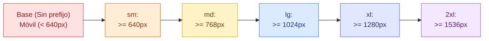
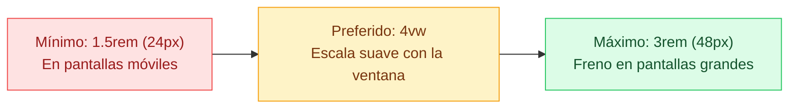
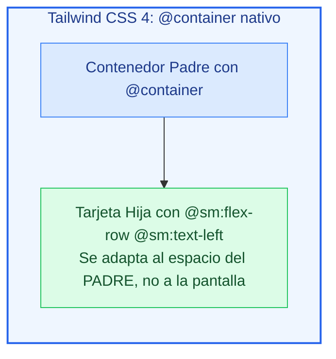

# Ejemplos de Código · Unidad 10: Diseño Responsivo y Container Queries en Tailwind CSS

<div class="badges">
  <span class="badge badge-v4">Tailwind CSS 4.0</span>
  <span class="badge badge-blue">Utility-First</span>
  <span class="badge badge-theme">Responsive & Containers</span>
  <span class="badge badge-ra">RA 2 / RA 3</span>
</div>

En este documento se desarrollan **ejemplos completos y funcionales maquetados con Tailwind CSS 4.0** que reproducen y modernizan cada uno de los conceptos de ==diseño responsivo== y ==Container Queries== estudiados en CSS nativo.

!!! info "Estructura de cada sección"
    Cada apartado está estructurado de manera didáctica con:
    
    1. **Fundamento conceptual y mentalidad Mobile-First:** Cómo organiza Tailwind 4 los prefijos responsivos y las consultas de contenedor sin media queries tradicionales.
    2. **Código interactivo en pestañas:** Código HTML semántico con clases de Tailwind 4 junto a su **equivalencia en CSS nativo**.
    3. **Disección técnica paso a paso:** Análisis de breakpoints, variantes de accesibilidad ergonómica y el nuevo estándar `@container`.

---

## 1. El Pilar Base: La Filosofía Mobile-First con Breakpoints

### Fundamento Conceptual

En Tailwind CSS, **todas las utilidades sin prefijo se aplican primero a dispositivos móviles**. Los prefijos responsivos actúan como *media queries* con condición `min-width` que se disparan conforme la pantalla se ensancha:



| Prefijo Tailwind | Breakpoint Mínimo | Dispositivo Típico |
| :--- | :--- | :--- |
| *(sin prefijo)* | `0px` | Teléfonos móviles en vertical (*Mobile-First*) |
| **`sm:`** | `640px` | Móviles en horizontal y phablets |
| **`md:`** | `768px` | Tablets estándar (iPad) |
| **`lg:`** | `1024px` | Portátiles y monitores compactos |
| **`xl:`** | `1280px` | Monitores de escritorio Full HD |
| **`2xl:`** | `1536px` | Monitores panorámicos grandes y 4K |

### Código de Ejemplo

=== "HTML con Tailwind CSS"

    ```html title="01-mobile-first-tailwind.html"
    <div class="max-w-4xl mx-auto p-6 font-sans">
      <!-- Tarjeta con layout que muta de columna móvil a fila horizontal en escritorio -->
      <article class="p-6 bg-white border border-slate-200 rounded-2xl shadow-sm flex flex-col md:flex-row items-center gap-6">
        <!-- Avatar/Icono -->
        <div class="size-20 bg-sky-500 rounded-2xl flex items-center justify-center text-white font-bold text-2xl shrink-0">
          CSS
        </div>

        <!-- Textos centrados en móvil, alineados a la izquierda en tablet/escritorio -->
        <div class="text-center md:text-left flex-1">
          <span class="text-xs font-bold uppercase tracking-wider text-sky-600">Patrón de Mutación</span>
          <h3 class="text-xl font-bold text-slate-900 mt-1">Columna en Móvil → Fila en Desktop</h3>
          <p class="text-xs text-slate-500 mt-2 leading-relaxed">
            La clase <code>flex-col</code> apila los elementos en vertical. A partir del breakpoint <code>md:</code> (768px), se activa <code>md:flex-row</code> alineando la imagen y el texto en paralelo.
          </p>
        </div>

        <!-- Botón que ocupa el 100% en móvil y tamaño automático en escritorio -->
        <button class="w-full md:w-auto px-5 py-2.5 bg-slate-900 hover:bg-slate-800 text-white text-xs font-bold rounded-xl transition-colors">
          Explorar
        </button>
      </article>
    </div>
    ```

=== "HTML Limpio (sin Tailwind)"

    ```html title="01-mobile-first-limpio.html"
    <div class="contenedor-tarjeta-responsiva">
      <!-- Tarjeta con layout que muta de columna móvil a fila horizontal en escritorio -->
      <article class="tarjeta-adaptable">
        <!-- Avatar/Icono -->
        <div class="icono-tarjeta">
          ⚡
        </div>

        <!-- Bloque de Texto -->
        <div class="contenido-tarjeta">
          <span class="badge-categoria">Mobile-First</span>
          <h3 class="titular-tarjeta">Arquitectura Adaptable</h3>
          <p class="descripcion-tarjeta">
            En smartphones se apila verticalmente con texto centrado para ergonomía táctil. Al superar los 768px (pantalla de tablet/escritorio), conmuta de forma natural a fila horizontal orientada a la izquierda.
          </p>
        </div>

        <!-- Botón de Acción -->
        <button type="button" class="btn-adaptable">
          Explorar
        </button>
      </article>
    </div>
    ```

=== "CSS Nativo Equivalente"

    ```css title="equivalencia-mobile-first.css"
    /* Móvil Base */
    .tarjeta-adaptable {
      display: flex;
      flex-direction: column;
      text-align: center;
    }

    /* md: (>= 768px) */
    @media (min-width: 768px) {
      .tarjeta-adaptable {
        flex-direction: row;
        text-align: left;
      }
    }
    ```

---

## 2. Tipografía y Ritmo Vertical Fluido con `clamp()`

### Fundamento Conceptual

En lugar de saltar abruptamente de tamaño de letra en cada breakpoint (`text-base md:text-xl lg:text-3xl`), la función matemática `clamp(mínimo, preferido, máximo)` calcula una escala suave y continua en función del ancho del viewport.

En Tailwind CSS 4.0, se aplica mediante clases arbitrarias de texto o en la directiva `@theme`:



### Código de Ejemplo

=== "HTML con Tailwind CSS"

    ```html title="02-tipografia-fluida-tailwind.html"
    <div class="max-w-3xl mx-auto p-8 font-sans bg-slate-900 text-white rounded-3xl shadow-xl text-center">
      <!-- Titular con clamp() fluido sin media queries -->
      <h1 class="text-[clamp(1.5rem,4vw,3rem)] font-black tracking-tight leading-tight text-transparent bg-clip-text bg-linear-to-r from-sky-400 to-indigo-400">
        Tipografía Continua y Fluida
      </h1>
      
      <p class="text-xs md:text-sm text-slate-400 mt-3 max-w-lg mx-auto leading-relaxed">
        Redimensiona el ancho de tu navegador. Comprobarás que el titular no da saltos bruscos; escala suavemente píxel a píxel adaptándose a cualquier viewport.
      </p>
    </div>
    ```

=== "HTML Limpio (sin Tailwind)"

    ```html title="02-tipografia-fluida-limpio.html"
    <div class="contenedor-fluido-destacado">
      <!-- Titular con clamp() fluido sin media queries -->
      <h1 class="titular-fluido">
        Tipografía Continua y Fluida
      </h1>
      
      <p class="descripcion-fluida">
        El tamaño de este titular escala matemáticamente entre 1.5rem y 3rem al redimensionar la ventana, sin saltos de media queries bruscos.
      </p>
    </div>
    ```

=== "CSS Nativo Equivalente"

    ```css title="equivalencia-clamp.css"
    .titular-fluido {
      font-size: clamp(1.5rem, 4vw, 3rem); /* text-[clamp(1.5rem,4vw,3rem)] */
    }
    ```

---

## 3. Accesibilidad Ergonómica y Preferencias del Sistema Operativo

### Fundamento Conceptual

Un diseño verdaderamente profesional debe respetar las condiciones físicas y neurológicas del usuario. Tailwind 4 incluye variantes de accesibilidad directas:

* **`motion-reduce:*`:** Desactiva animaciones y transiciones complejas para usuarios con trastornos vestibulares o epilepsia fotosensible (`prefers-reduced-motion: reduce`).
* **`motion-safe:*`:** Habilita transiciones vistosas únicamente si el usuario no ha solicitado reducir el movimiento.
* **`contrast-more:*`:** Refuerza los bordes y contraste cromático para usuarios con visión reducida (`prefers-contrast: more`).
* **`dark:*`:** Activa la paleta en modo oscuro de forma automática según la preferencia del sistema operativo.

### Código de Ejemplo

=== "HTML con Tailwind CSS"

    ```html title="03-accesibilidad-preferencias-tailwind.html"
    <div class="max-w-md mx-auto p-6 font-sans">
      <!-- Tarjeta con Transición Segura y Contraste Reforzado -->
      <article class="p-6 bg-white dark:bg-slate-900 border border-slate-200 dark:border-slate-800 contrast-more:border-2 contrast-more:border-black rounded-2xl shadow-sm motion-safe:transition-transform motion-safe:duration-300 motion-safe:hover:scale-105 motion-reduce:transform-none">
        
        <span class="inline-block px-2.5 py-1 bg-sky-100 dark:bg-sky-950 text-sky-800 dark:text-sky-300 text-xs font-bold rounded mb-2">
          motion-safe & contrast-more
        </span>
        
        <h4 class="font-bold text-base text-slate-900 dark:text-white">
          Componente Accesible Universal
        </h4>
        
        <p class="text-xs text-slate-500 dark:text-slate-400 mt-2 leading-relaxed">
          En sistemas estándar aplica zoom suave en hover. Si el usuario activa "Reducir movimiento" en Windows/macOS, el zoom se desactiva instantáneamente sin romper el diseño.
        </p>

        <button class="mt-4 w-full py-2 bg-sky-600 hover:bg-sky-500 text-white font-bold text-xs rounded-xl shadow-sm transition-colors">
          Interactuar
        </button>
      </article>
    </div>
    ```

=== "HTML Limpio (sin Tailwind)"

    ```html title="03-accesibilidad-preferencias-limpio.html"
    <div class="contenedor-accesibilidad">
      <!-- Tarjeta con Transición Segura y Contraste Reforzado -->
      <article class="tarjeta-accesible">
        <span class="badge-a11y">Accesibilidad Universal</span>
        <h3 class="titular-accesible">Diseño Resiliente y Sensible</h3>
        <p class="descripcion-accesible">
          Este elemento respeta las configuraciones del sistema operativo del usuario: desactiva transiciones y escalas en <code>prefers-reduced-motion</code> y engrosa bordes de contraste en <code>prefers-contrast</code>.
        </p>
      </article>
    </div>
    ```

=== "CSS Nativo Equivalente"

    ```css title="equivalencia-accesibilidad.css"
    @media (prefers-reduced-motion: reduce) {
      .tarjeta-accesible {
        transition: none !important;
        transform: none !important;
      }
    }

    @media (prefers-contrast: more) {
      .tarjeta-accesible {
        border: 2px solid #000000;
      }
    }
    ```

---

## 4. Tablas y Formularios Adaptables en Móviles

### Fundamento Conceptual

Las tablas de datos son históricamente los elementos que más sufren al comprimir la vista en dispositivos móviles. 

En Tailwind CSS, el patrón infalible consiste en envolver el elemento `<table>` en un contenedor con **`overflow-x-auto`** para permitir el deslizamiento táctil horizontal sin desbordar el resto de la interfaz:

=== "HTML con Tailwind CSS"

    ```html title="04-tabla-responsiva-tailwind.html"
    <div class="max-w-3xl mx-auto p-6 font-sans">
      <div class="border border-slate-200 rounded-2xl overflow-hidden shadow-sm bg-white">
        <!-- Contenedor con Scroll Táctil Horizontal -->
        <div class="overflow-x-auto">
          <table class="w-full text-left text-xs text-slate-600">
            <thead class="bg-slate-50 border-b border-slate-200 text-slate-900 font-bold uppercase tracking-wider">
              <tr>
                <th class="p-3.5">Módulo Formativo</th>
                <th class="p-3.5">Código</th>
                <th class="p-3.5">Ciclo</th>
                <th class="p-3.5 text-center">Horas</th>
                <th class="p-3.5 text-right">Estado</th>
              </tr>
            </thead>
            <tbody class="divide-y divide-slate-100">
              <tr class="hover:bg-slate-50/80">
                <td class="p-3.5 font-bold text-slate-800">Lenguajes de Marcas</td>
                <td class="p-3.5 font-mono">0373</td>
                <td class="p-3.5">DAW / DAM</td>
                <td class="p-3.5 text-center">120h</td>
                <td class="p-3.5 text-right"><span class="px-2 py-0.5 bg-emerald-100 text-emerald-800 rounded font-semibold text-[10px]">Completado</span></td>
              </tr>
              <tr class="hover:bg-slate-50/80">
                <td class="p-3.5 font-bold text-slate-800">Diseño de Interfaces Web</td>
                <td class="p-3.5 font-mono">0615</td>
                <td class="p-3.5">DAW</td>
                <td class="p-3.5 text-center">140h</td>
                <td class="p-3.5 text-right"><span class="px-2 py-0.5 bg-sky-100 text-sky-800 rounded font-semibold text-[10px]">En curso</span></td>
              </tr>
            </tbody>
          </table>
        </div>
      </div>
    </div>
    ```

=== "HTML Limpio (sin Tailwind)"

    ```html title="04-tabla-responsiva-limpio.html"
    <div class="contenedor-tabla-wrapper">
      <div class="tabla-tarjeta">
        <!-- Contenedor con Scroll Táctil Horizontal -->
        <div class="tabla-scroll-horizontal">
          <table class="tabla-datos">
            <thead>
              <tr>
                <th>Estudiante</th>
                <th>Módulo</th>
                <th>Calificación</th>
                <th>Estado</th>
                <th class="texto-derecha">Acciones</th>
              </tr>
            </thead>
            <tbody>
              <tr>
                <td class="columna-nombre">Ana Martínez</td>
                <td>Desarrollo Web (DIW)</td>
                <td>9.50</td>
                <td><span class="badge badge--completado">Aprobado</span></td>
                <td class="columna-acciones"><a href="#">Editar</a></td>
              </tr>
              <tr>
                <td class="columna-nombre">Carlos Ruiz</td>
                <td>Lenguajes de Marcas (LMSGI)</td>
                <td>8.25</td>
                <td><span class="badge badge--completado">Aprobado</span></td>
                <td class="columna-acciones"><a href="#">Editar</a></td>
              </tr>
              <tr>
                <td class="columna-nombre">Elena Gómez</td>
                <td>Diseño de Interfaces (DI)</td>
                <td>4.75</td>
                <td><span class="badge badge--pendiente">Recuperación</span></td>
                <td class="columna-acciones"><a href="#">Editar</a></td>
              </tr>
            </tbody>
          </table>
        </div>
      </div>
    </div>
    ```

=== "CSS Nativo Equivalente"

    ```css title="equivalencia-tabla-responsiva.css"
    /* Contenedor con scroll táctil en pantallas estrechas */
    .tabla-scroll-horizontal {
      overflow-x: auto;
      -webkit-overflow-scrolling: touch;
    }

    .tabla-datos {
      width: 100%;
      border-collapse: collapse;
      text-align: left;
      font-size: 0.875rem;
    }

    .tabla-datos th,
    .tabla-datos td {
      padding: 0.75rem 1rem;
      border-bottom: 1px solid #e2e8f0;
      white-space: nowrap; /* Evita que las columnas colapsen en móvil */
    }
    ```

---

## 5. Container Queries (`@container`): El Nuevo Paradigma Modular

### Fundamento Conceptual

Hasta ahora, el diseño responsivo dependía exclusivamente del tamaño total de la pantalla del usuario (*viewport*). Si colocabas una tarjeta en una barra lateral estrecha (`300px`) en una pantalla 4K (`2560px`), la tarjeta se rompía porque las media queries creían estar en un monitor gigante.

**Las Container Queries resuelven esto evaluando el ancho de su propio contenedor padre**:



!!! tip "Container Queries Nativas en Tailwind 4"
    A diferencia de Tailwind v3 que requería un plugin adicional, **en Tailwind CSS 4.0 las Container Queries son 100% nativas**:
    
    1. Marca el contenedor padre con la utilidad **`@container`**.
    2. Modifica a los hijos con las variantes de contenedor: **`@sm:*`**, **`@md:*`**, **`@lg:*`**, **`@xl:*`**.

### Código de Ejemplo

=== "HTML con Tailwind CSS"

    ```html title="05-container-queries-tailwind.html"
    <div class="grid grid-cols-1 md:grid-cols-12 gap-6 max-w-5xl mx-auto p-6 font-sans">
      
      <!-- CASO 1: Contenedor Estrecho en Sidebar (4 columnas) -->
      <div class="md:col-span-4 p-4 bg-slate-100 rounded-2xl border border-slate-200">
        <span class="text-xs font-bold text-slate-500 uppercase block mb-3">En Sidebar (Contenedor Estrecho)</span>
        
        <!-- Activamos el contexto de contenedor con @container -->
        <div class="@container">
          <!-- La tarjeta detecta que su padre mide < 400px y se muestra en columna compacta -->
          <article class="p-4 bg-white border border-slate-200 rounded-xl shadow-sm flex flex-col @sm:flex-row items-center gap-4">
            <div class="size-14 bg-indigo-600 rounded-xl flex items-center justify-center text-white font-bold shrink-0">
              CQ
            </div>
            <div class="text-center @sm:text-left">
              <h4 class="font-bold text-sm text-slate-800">Tarjeta Autónoma</h4>
              <p class="text-xs text-slate-500 mt-1">Se adapta según @container.</p>
            </div>
          </article>
        </div>
      </div>

      <!-- CASO 2: Mismo Componente en Área Amplia (8 columnas) -->
      <div class="md:col-span-8 p-4 bg-slate-100 rounded-2xl border border-slate-200">
        <span class="text-xs font-bold text-slate-500 uppercase block mb-3">En Área Principal (Contenedor Ancho)</span>
        
        <!-- Mismo código exacto con @container -->
        <div class="@container">
          <!-- Aquí su padre mide > 400px, por lo que @sm:flex-row se dispara automáticamente -->
          <article class="p-4 bg-white border border-slate-200 rounded-xl shadow-sm flex flex-col @sm:flex-row items-center gap-4">
            <div class="size-14 bg-indigo-600 rounded-xl flex items-center justify-center text-white font-bold shrink-0">
              CQ
            </div>
            <div class="text-center @sm:text-left flex-1">
              <h4 class="font-bold text-sm text-slate-800">Tarjeta Autónoma</h4>
              <p class="text-xs text-slate-500 mt-1">¡El mismo código HTML se muestra en fila porque su contenedor es amplio!</p>
            </div>
            <button class="px-4 py-2 bg-indigo-600 text-white rounded-lg text-xs font-bold">
              Ver Detalles
            </button>
          </article>
        </div>
      </div>

    </div>
    ```

=== "HTML Limpio (sin Tailwind)"

    ```html title="05-container-queries-limpio.html"
    <div class="rejilla-comparativa-contenedores">
      
      <!-- CASO 1: Contenedor Estrecho en Sidebar (4 columnas) -->
      <div class="columna-sidebar">
        <span class="etiqueta-caso">En Sidebar (Contenedor Estrecho)</span>
        
        <!-- Activamos el contexto de contenedor -->
        <div class="padre-contenedor">
          <article class="tarjeta-autonoma">
            <div class="icono-modulo">01</div>
            <div>
              <h4>Componente Inteligente</h4>
              <p>Detecta el ancho de su caja padre inmediata.</p>
            </div>
          </article>
        </div>
      </div>

      <!-- CASO 2: Mismo Componente en Área Principal Ancha (8 columnas) -->
      <div class="columna-principal">
        <span class="etiqueta-caso">En Área Principal (Contenedor Ancho)</span>

        <!-- Mismo componente reutilizado exactamente -->
        <div class="padre-contenedor">
          <article class="tarjeta-autonoma">
            <div class="icono-modulo">02</div>
            <div>
              <h4>Componente Inteligente</h4>
              <p>Muta a fila horizontal automáticamente sin media queries de viewport.</p>
            </div>
          </article>
        </div>
      </div>

    </div>
    ```

=== "CSS Nativo Equivalente"

    ```css title="equivalencia-container-queries.css"
    .padre-contenedor {
      container-type: inline-size; /* @container */
    }

    /* La regla se dispara cuando el CONTENEDOR supera 400px, sin importar la pantalla */
    @container (min-width: 24rem) {
      .tarjeta-autonoma {
        flex-direction: row;       /* @sm:flex-row */
        text-align: left;          /* @sm:text-left */
      }
    }
    ```

---

## 6. Patrón de Producción Real: Barra de Navegación Responsiva Accesible

### Fundamento Conceptual

La barra de navegación es el componente responsivo más representativo de una aplicación web: presenta un menú hamburguesa desplegable en móviles y se transforma en una barra horizontal continua en pantallas de escritorio (`md:flex`):

=== "HTML con Tailwind CSS"

    ```html title="06-navbar-responsiva-tailwind.html"
    <header class="max-w-6xl mx-auto p-4 font-sans">
      <nav class="bg-slate-900 text-white rounded-2xl px-6 py-3 flex items-center justify-between shadow-xl">
        <!-- Logo -->
        <a href="#" class="flex items-center gap-2 font-black text-lg tracking-tight text-white">
          <span class="size-7 bg-sky-500 rounded-lg flex items-center justify-center text-slate-900 font-bold text-sm">
            T4
          </span>
          TailwindNotes
        </a>

        <!-- Enlaces en Escritorio (Ocultos en móvil con hidden, visibles con md:flex) -->
        <div class="hidden md:flex items-center gap-6 text-xs font-semibold text-slate-300">
          <a href="#" class="text-white hover:text-sky-400 transition-colors">Inicio</a>
          <a href="#" class="hover:text-white transition-colors">Componentes</a>
          <a href="#" class="hover:text-white transition-colors">Documentación</a>
          <a href="#" class="hover:text-white transition-colors">Changelog</a>
        </div>

        <!-- Botones de Acción en Escritorio -->
        <div class="hidden md:flex items-center gap-3">
          <button class="px-4 py-2 bg-sky-500 hover:bg-sky-400 text-white text-xs font-bold rounded-xl shadow-sm transition-colors">
            Acceso Alumnos
          </button>
        </div>

        <!-- Botón Menú Hamburguesa para Móvil (Visible en móvil, oculto con md:hidden) -->
        <button class="md:hidden p-2 text-slate-300 hover:text-white hover:bg-slate-800 rounded-lg transition-colors" aria-label="Abrir menú de navegación">
          <svg class="size-6" fill="none" stroke="currentColor" stroke-width="2" viewBox="0 0 24 24"><path stroke-linecap="round" stroke-linejoin="round" d="M4 6h16M4 12h16M4 18h16"/></svg>
        </button>
      </nav>
    </header>
    ```

=== "HTML Limpio (sin Tailwind)"

    ```html title="06-navbar-responsiva-limpio.html"
    <header class="cabecera-global">
      <nav class="barra-navegacion-responsiva">
        <!-- Logo -->
        <a href="#" class="logo-marca">
          <span class="icono-logo">⌘</span>
          <span>ApexStudio</span>
        </a>

        <!-- Menú de Enlaces (Oculto en móvil, visible en escritorio) -->
        <ul class="menu-enlaces-desktop">
          <li><a href="#" class="enlace-activo">Inicio</a></li>
          <li><a href="#">Servicios</a></li>
          <li><a href="#">Proyectos</a></li>
          <li><a href="#">Blog</a></li>
        </ul>

        <!-- Botón CTA de Escritorio -->
        <div class="bloque-cta-desktop">
          <a href="#" class="btn-cta">Comenzar</a>
        </div>

        <!-- Botón Hamburguesa Táctil Móvil -->
        <button type="button" class="boton-hamburguesa-movil" aria-label="Abrir menú">
          <svg class="icono-hamburguesa" fill="none" stroke="currentColor" stroke-width="2" viewBox="0 0 24 24"><path stroke-linecap="round" stroke-linejoin="round" d="M4 6h16M4 12h16m-7 6h7"/></svg>
        </button>
      </nav>
    </header>
    ```

=== "CSS Nativo Equivalente"

    ```css title="equivalencia-navbar-responsiva.css"
    .barra-navegacion-responsiva {
      display: flex;
      align-items: center;
      justify-content: space-between;
      padding: 0.75rem 1.5rem;
      background-color: #0f172a;
      border-radius: 1rem;
      color: #ffffff;
    }

    /* En móvil, los enlaces y CTA de escritorio se ocultan */
    .menu-enlaces-desktop,
    .bloque-cta-desktop {
      display: none;
    }

    /* El botón hamburguesa solo es visible en móviles */
    .boton-hamburguesa-movil {
      display: block;
      background: none;
      border: none;
      color: #ffffff;
      cursor: pointer;
    }

    /* En pantallas de escritorio (>= 768px), se muestra la barra horizontal continua */
    @media (min-width: 768px) {
      .menu-enlaces-desktop {
        display: flex;
        gap: 1.5rem;
        list-style: none;
      }

      .bloque-cta-desktop {
        display: block;
      }

      .boton-hamburguesa-movil {
        display: none;
      }
    }
    ```

---

## 7. Checklist de Verificación de Competencias

Al completar el estudio de estos ejemplos prácticos, el alumno debe ser capaz de:

- [x] **Construir interfaces Mobile-First:** Diseñar la base sin prefijos y escalar hacia arriba con `sm:`, `md:`, `lg:` y `xl:`.
- [x] **Implementar tipografía fluida:** Emplear `clamp()` en utilidades arbitrarias para eliminar saltos bruscos entre resoluciones.
- [x] **Diseñar para la inclusión:** Aplicar variantes como `motion-reduce:*`, `contrast-more:*` y `dark:*`.
- [x] **Garantizar resiliencia tabular:** Usar `overflow-x-auto` en tablas de datos para permitir navegación táctil en pantallas estrechas.
- [x] **Dominar las Container Queries nativas:** Marcar padres con `@container` y modularizar componentes con `@sm:*` y `@md:*`.
- [x] **Maquetar barras de navegación responsivas:** Combinar `hidden` y `md:flex` para alternar entre menús móviles y de escritorio.
