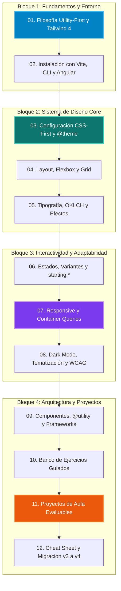

# Tailwind CSS 4.0 — Apuntes y Guía Práctica de Interfaces

Bienvenido al repositorio de materiales formativos sobre **Tailwind CSS 4.0**, diseñado específicamente para el alumnado de los ciclos formativos de grado superior en:

- **Desarrollo de Aplicaciones Web (DAW)** — Módulo profesional *Diseño de Interfaces Web* (Código 0615).
- **Desarrollo de Aplicaciones Multiplataforma (DAM)** — Módulo profesional *Desarrollo de Interfaces* (Código 0488).

Este curso parte desde **cero absoluto**, sin requerir experiencia previa con frameworks CSS, pero asumiendo los fundamentos básicos de maquetación HTML5 y CSS3. A lo largo de las unidades descubriremos cómo la nueva arquitectura **CSS-First** y el motor **Oxide** de Tailwind 4 revolucionan el desarrollo frontend moderno.

---

## 🧭 Mapa de Aprendizaje

El siguiente diagrama resume el itinerario formativo que recorreremos:

---

## ⚡ ¿Por qué Tailwind CSS 4.0 en FP Técnica?

Tailwind CSS se ha consolidado como el estándar *de facto* en la industria del software para construir interfaces rápidas, consistentes y escalables. La versión **4.0** (lanzada en 2025) introduce transformaciones radicales que los futuros desarrolladores deben dominar:

| Característica Clave | Antes (Tailwind v3) | Ahora (Tailwind v4) | Ventaja para el Alumnado |
| :--- | :--- | :--- | :--- |
| **Configuración** | Archivo JavaScript `tailwind.config.js` | Directiva `@theme` en tu archivo CSS | No requiere lidiar con sintaxis JS para definir estilos; 100% estándar CSS. |
| **Importación base** | Tres directivas: `@tailwind base; components; utilities;` | Una directiva unificada: `@import "tailwindcss";` | Compatible con cualquier bundler moderno (Vite, esbuild, Parcel). |
| **Motor de compilación** | Basado en Node.js y PostCSS | Motor **Oxide** escrito en Rust y **Lightning CSS** | Hasta 100× más rápido; recarga instantánea durante las prácticas de aula. |
| **Espacio de color** | RGB / HSL hexadecimal | Espacio de color nativo **OKLCH** y P3 | Colores con brillo perceptual constante y degradados sin tonos oscuros sucios. |
| **Container Queries** | Requería plugin `@tailwindcss/container-queries` | Integrado de serie (`@container`, `@sm:*`, `@md:*`) | Componentes que se adaptan a su padre sin depender del ancho total de pantalla. |
| **Detección de contenido** | Configurar `content: [...]` manualmente | Auto-detección inteligente en todo el proyecto | Cero errores de *"he escrito la clase pero no se aplica"*. |

---

## 🎯 Estructura de las Unidades y Presentaciones de Aula

Cada unidad didáctica cuenta con sus **apuntes de clase detallados** y su correspondiente **diapositiva interactiva Reveal.js** disponible en la suite de presentaciones del curso (`Presentaciones/Tailwind/`):

1. **[00. Marco curricular y competencias](00-marco-curricular.md)** (`unidad-00.md`): Justificación didáctica, RAs y Criterios de Evaluación oficiales en DAW y DAM.
2. **[01. De CSS tradicional a Utility-First y Tailwind 4](01-introduccion-y-filosofia.md)** (`unidad-01.md`): El cambio de paradigma, resolución del CSS muerto y motor Oxide en Rust.
3. **[02. Instalación, Vite, CLI y Entorno](02-instalacion-y-herramientas.md)** (`unidad-02.md`): Configuración en proyectos Vanilla, Vite, Angular y VS Code IntelliSense.
4. **[03. Configuración CSS-First y @theme](03-sistema-de-diseno-y-theme.md)** (`unidad-03.md`): Declaración de tokens, paletas OKLCH, escalas de espaciado y variables nativas.
5. **[04. Layout, Flexbox y Grid moderno](04-layout-y-caja.md)** (`unidad-04.md`): Control total del flujo de caja, flexbox bidireccional y grid responsive.
6. **[05. Tipografía, Colores y Efectos](05-tipografia-colores-y-efectos.md)** (`unidad-05.md`): Text balance, text pretty, gradientes, bordes, sombras y Glassmorphism.
7. **[06. Estados interactivos y variantes avanzadas](06-estados-interactivos-y-variantes.md)** (`unidad-06.md`): `hover`, `focus-visible`, `group`, `peer`, selector `has-*` y animación `starting:*`.
8. **[07. Responsive Design y Container Queries](07-responsive-y-container-queries.md)** (`unidad-07.md`): Mobile-First, breakpoints personalizados y componentes auto-adaptables.
9. **[08. Modo oscuro, temas y accesibilidad](08-modo-oscuro-y-temas.md)** (`unidad-08.md`): Alternancia dark mode con JS/CSS, contraste WCAG y utilidades `sr-only`.
10. **[09. Componentes, @utility y Frameworks](09-componentes-y-reutilizacion.md)** (`unidad-09.md`): Buenas prácticas de composición, la nueva directiva `@utility` y límites de `@apply`.
11. **[10. Banco de ejercicios guiados paso a paso](10-ejercicios-guiados.md)** (`unidad-10.md`): 6 ejercicios prácticos incrementales con enunciado y solución comentada.
12. **[11. Proyectos de aula y rúbricas](11-proyectos-practicos.md)** (`unidad-11.md`): 3 proyectos evaluables (E-commerce Card, Dashboard comercial y Landing SaaS).
13. **[12. Cheat Sheet y Guía de Migración v3 a v4](12-glosario-y-cheat-sheet.md)** (`unidad-12.md`): Tabla de referencia rápida de utilidades y pasos de migración.

> [!TIP] Suite de Presentaciones Interactivas Reveal.js
> Las presentaciones para impartir en clase se encuentran en `E:\00. Clases\Apuntes\Presentaciones\Tailwind\index.html`. Cuentan con selector de tema visual (Dracula, Night, Sky, etc.), navegación entre unidades, diagramas de arquitectura en Mermaid adaptados sin recortes de texto, animaciones por fragmentos y notas de docencia para el profesor (presiona ++s++ para notas de ponente y ++esc++ para vista panorámica).

---

## 🛠️ Requisitos Previos

!!! info "Perfil recomendado del estudiante"
    - Manejo básico de etiquetas semánticas HTML5 (`<header>`, `<nav>`, `<main>`, `<article>`, `<section>`, `<form>`).
    - Nociones de CSS3 (display, margin, padding, border, color).
    - Editor de código recomendado: **Visual Studio Code** con la extensión oficial *Tailwind CSS IntelliSense*.
    - Node.js versión LTS (v20 o v22) instalada para ejecutar herramientas basadas en Vite.
