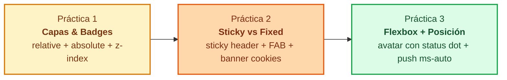

# Prácticas de Posicionamiento en Tailwind CSS 4.0

<div class="badges">
  <span class="badge badge-v4">Tailwind CSS 4.0</span>
  <span class="badge badge-oxide">Layout & Coordenadas</span>
  <span class="badge badge-theme">relative · absolute · fixed · sticky</span>
  <span class="badge badge-ra">RA 2 / RA 3</span>
</div>

El posicionamiento en CSS es la competencia técnica que permite a una interfaz escapar del flujo lineal estándar para crear **capas de interacción ricas**: tarjetas interactivas con insignias superpuestas, cabeceras que se adhieren al hacer scroll, botones flotantes de acción permanente (FAB) y avisos globales anclados al marco del viewport.

En estas prácticas trabajarás con **código HTML semántico base ("virgen")**. Tu misión como desarrollador Frontend consiste en maquetar y dotar de estilo a cada componente aplicando **únicamente clases de utilidad de Tailwind CSS 4.0**, sin recurrir a CSS tradicional escrito a mano ni a identificadores arbitrarios.



---

## 🎯 Práctica 1: Tarjeta Comercial con Capas, Badges e Insignia Flotante

!!! info "Objetivo pedagógico"
    Dominar el control cartesiano de elementos fuera del flujo mediante la pareja **`relative`** (bloque contenedor de coordenadas) y **`absolute`** (elemento satélite superpuesto), junto con la escala de profundidades **`z-index`** y las variantes de interacción del grupo (**`group` / `group-hover`**).

### 1. Escenario y Requerimientos de Maquetación

Debes maquetar la tarjeta de producto de una tienda tecnológica para unos auriculares de alta fidelidad:

1. **Marco Contenedor Principal (`.card-product`):**
    * Ancho acotado para tarjeta de escritorio/móvil (`w-full max-w-xs mx-auto`).
    * Fondo blanco (`bg-white`), bordes sutiles (`border border-slate-200`), esquinas redondeadas (`rounded-2xl`) y sombra suave (`shadow-md`).
    * ⚠️ **Restricción técnica:** No apliques `overflow-hidden` al contenedor global si deseas que los tooltips flotantes puedan desbordar la tarjeta sin ser recortados físicamente.

2. **Zona Multimedia (`.product-media`):**
    * Proporción cuadrada o altura definida (`aspect-square w-full`).
    * **Bloque contenedor de coordenadas:** Debe declarar `relative` para que todos sus hijos con `absolute` tomen sus dimensiones como sistema de referencia.
    * Fondo con degradado neutro (`bg-gradient-to-br from-slate-100 to-slate-200`), esquinas superiores redondeadas (`rounded-t-2xl`) y centrado flexible para el mockup del producto.

3. **Insignia de Descuento (`.badge-discount`):**
    * Posicionada de forma absoluta en la esquina superior izquierda (`absolute top-3 left-3`).
    * Fondo rojo/rosa vibrante (`bg-rose-600 text-white`), texto compacto en negrita (`text-xs font-black uppercase tracking-wider`), padding armónico (`px-2.5 py-1`) y bordes completamente redondeados (`rounded-full shadow-md`).
    * Elevada en el eje de profundidad (`z-10`) para evitar solapamientos con la imagen.

4. **Botón Flotante de Favoritos con Tooltip (`.favorite-container`):**
    * Ubicado de forma absoluta en la esquina superior derecha (`absolute top-3 right-3 z-10`).
    * El botón debe ser un círculo de 36px (`size-9 rounded-full`) con fondo blanco translúcido (`bg-white/90 backdrop-blur-sm`), borde sutil (`border border-slate-200/80`), sombra y centrado flex (`flex items-center justify-center`).
    * Al hacer hover, debe aplicar una micro-interacción suave (`hover:scale-110 transition-transform`).
    * **Tooltip emergente (`.tooltip`):**
      - Declarar el contenedor como `group relative`.
      - El mensaje flotante debe ubicarse sobre el botón (`absolute bottom-full left-1/2 -translate-x-1/2 mb-2`).
      - Fondo oscuro (`bg-slate-900 text-white text-[11px] rounded-md px-2 py-1 shadow-lg whitespace-nowrap`).
      - Invisible por defecto (`opacity-0 pointer-events-none`) y visible únicamente al interactuar con el grupo (`group-hover:opacity-100 transition-opacity`).

5. **Detalles y Botón de Compra (`.product-details`):**
    * Relleno interior (`p-5`).
    * Tipografía jerárquica: marca en mayúsculas pequeñas (`text-xs font-bold text-slate-400 tracking-wider`), título en negrita (`text-base font-bold text-slate-900 mt-1`), valoración en estrellas doradas y bloque de precio con precio rebajado destacado (`text-lg font-black text-slate-900`) y precio anterior tachado (`text-xs text-slate-400 line-through`).
    * Botón de añadir al carrito de ancho completo (`w-full mt-4 py-2.5 bg-blue-600 hover:bg-blue-700 text-white text-sm font-semibold rounded-xl transition-colors shadow-sm`).

### 2. Código HTML Base ("Virgen")

Copia el siguiente código en tu archivo `index.html` (dentro de tu proyecto Vite con Tailwind 4) y aplica las clases correspondientes:

```html title="practica-01-tarjeta-producto-base.html"
<!DOCTYPE html>
<html lang="es">
<head>
  <meta charset="UTF-8">
  <meta name="viewport" content="width=device-width, initial-scale=1.0">
  <title>Práctica 1: Tarjeta Comercial con Capas y Tooltip</title>
  <link rel="stylesheet" href="/src/style.css">
</head>
<body class="bg-slate-50 min-h-screen flex items-center justify-center p-4">

  <!-- CONTENEDOR PRINCIPAL DE LA TARJETA -->
  <article class="card-product">
    
    <!-- ZONA MULTIMEDIA: DEBE SER EL BLOQUE CONTENEDOR (RELATIVE) -->
    <div class="product-media">
      
      <!-- 1. Insignia absoluta en la esquina superior izquierda -->
      <span class="badge-discount">-25% HOY</span>

      <!-- 2. Botón flotante absoluto en la esquina superior derecha con tooltip -->
      <div class="favorite-wrapper">
        <button type="button" class="btn-favorite" aria-label="Guardar en favoritos">
          <svg class="heart-icon" viewBox="0 0 24 24" fill="currentColor">
            <path d="M12 21.35l-1.45-1.32C5.4 15.36 2 12.28 2 8.5 2 5.42 4.42 3 7.5 3c1.74 0 3.41.81 4.5 2.09C13.09 3.81 14.76 3 16.5 3 19.58 3 22 5.42 22 8.5c0 3.78-3.4 6.86-8.55 11.54L12 21.35z"/>
          </svg>
        </button>
        <!-- Mensaje flotante centrado sobre el botón -->
        <span class="tooltip" role="tooltip">Añadir a mi lista</span>
      </div>

      <!-- Mockup gráfico del producto -->
      <div class="product-icon-wrapper">
        <span class="product-icon">🎧</span>
      </div>
    </div>

    <!-- CUERPO DE LA TARJETA (FLUJO NORMAL) -->
    <div class="product-details">
      <span class="product-brand">AudioPro Elite</span>
      <h2 class="product-title">Auriculares Studio Wireless Pro ANC</h2>
      
      <div class="product-rating">
        <span class="stars">★★★★★</span>
        <span class="rating-count">(142 valoraciones)</span>
      </div>

      <div class="product-pricing">
        <span class="price-current">149,99€</span>
        <span class="price-old">199,99€</span>
      </div>

      <button type="button" class="btn-buy">Añadir a la Cesta</button>
    </div>

  </article>

</body>
</html>
```

### 3. Rúbrica de Verificación (Práctica 1)

- [ ] La zona de imagen declara `relative` para servir de marco contextual a sus descendientes.
- [ ] La etiqueta de oferta usa `absolute top-3 left-3 z-10` y se mantiene visible sobre la imagen.
- [ ] El botón de favoritos usa `absolute top-3 right-3 z-10 size-9 rounded-full`.
- [ ] El tooltip se ubica con `absolute bottom-full left-1/2 -translate-x-1/2 mb-2` y aparece suavemente con `group-hover:opacity-100`.
- [ ] La tarjeta no usa `overflow-hidden` exterior para permitir que el tooltip se dibuje sin cortes.

---

## 📌 Práctica 2: Barra Superior Adhesiva y Banner Fijo de Consentimiento (Sticky vs Fixed)

!!! info "Objetivo pedagógico"
    Discernir de manera práctica y visual la diferencia técnica de comportamiento entre:
    
    * **`sticky`:** El elemento convive inicialmente en el flujo normal y se congela al alcanzar un umbral (`top-0`) mientras su ancestro permanezca visible.
    * **`fixed`:** El elemento se desacopla por completo del flujo desde el primer instante y queda fijado de manera inmutable respecto a los límites físicos de la pantalla (`viewport`).

### 1. Escenario y Requerimientos de Maquetación

Vas a maquetar el portal de artículos técnicos de una academia de programación:

1. **Cabecera Adhesiva (`sticky-header`):**
    * Debe permanecer anclada en el techo de la pantalla durante todo el scroll (`sticky top-0 z-30 w-full`).
    * Fondo oscuro (`bg-slate-900/95 backdrop-blur-md`), borde inferior (`border-b border-slate-800`) y sombra de elevación (`shadow-lg`).
    * Contiene el logotipo `⚡ DominIA Academy`, enlaces de navegación (`hidden sm:flex items-center gap-6 text-sm text-slate-300`) y un botón de notificaciones.
    * **Campana con insignia numérica superpuesta:**
      - El botón debe tener `relative` y tamaño cómodo (`size-9 flex items-center justify-center rounded-lg`).
      - La insignia de notificaciones («3») debe posicionarse de forma absoluta en la esquina superior derecha (`absolute -top-1 -right-1 size-4 rounded-full bg-rose-600 text-white text-[10px] font-bold flex items-center justify-center ring-2 ring-slate-900`).

2. **Cuerpo del Artículo y Cuadrícula Comparativa:**
    * Contenedor centrado (`max-width: 56rem; mx-auto; px-4 py-8;`).
    * **Reserva de espacio inferior crítica:** Debe incorporar obligatoriamente `pb-28` (o `pb-32`) para evitar que el banner fijo inferior tape el último bloque de texto o las acciones del usuario.
    * Cuadrícula con dos tarjetas comparativas (`grid grid-cols-1 md:grid-cols-2 gap-6`):
      - Tarjeta 1 (Sticky): Borde superior azul de 4px (`border-t-4 border-t-blue-600 bg-white rounded-2xl p-6 shadow-sm border border-slate-200`).
      - Tarjeta 2 (Fixed): Borde superior naranja de 4px (`border-t-4 border-t-amber-600 bg-white rounded-2xl p-6 shadow-sm border border-slate-200`).

3. **Botón Flotante «Volver Arriba» (`btn-scroll-top`):**
    * Anclado permanentemente a la ventana gráfica mediante `fixed bottom-24 right-6 z-40`.
    * Geometría circular de 48px (`size-12 rounded-full`), fondo azul (`bg-blue-600 hover:bg-blue-500 text-white`), sombra profunda (`shadow-xl shadow-blue-600/30`) y centrado flexible perfecto (`flex items-center justify-center`).
    * Icono de flecha `↑` implementado mediante **SVG vectorial** con `stroke-width="2.5"` para garantizar centrado matemático subpíxel.

4. **Banner Fijo Inferior de Consentimiento de Cookies (`cookie-banner`):**
    * Anclado al borde inferior del viewport cubriendo el 100% de la anchura (`fixed bottom-0 inset-x-0 z-50 w-full`).
    * Fondo oscuro satinado (`bg-slate-900/95 backdrop-blur-md border-t border-slate-800 text-white shadow-2xl`).
    * Contenedor interior centrado con distribución flexible (`max-w-4xl mx-auto px-4 py-3.5 flex flex-col sm:flex-row items-center justify-between gap-4`).
    * Botón de «Aceptar todas» con color esmeralda (`bg-emerald-600 hover:bg-emerald-500 text-white text-xs font-bold px-5 py-2.5 rounded-lg whitespace-nowrap`).

### 2. Código HTML Base ("Virgen")

```html title="practica-02-sticky-fixed-base.html"
<!DOCTYPE html>
<html lang="es">
<head>
  <meta charset="UTF-8">
  <meta name="viewport" content="width=device-width, initial-scale=1.0">
  <title>Práctica 2: Posicionamiento — Sticky vs Fixed</title>
  <link rel="stylesheet" href="/src/style.css">
</head>
<body class="bg-slate-50 min-h-screen text-slate-800">

  <!-- 1. CABECERA ADHESIVA (POSITION: STICKY) -->
  <header class="sticky-header">
    <div class="header-container">
      
      <!-- Logotipo -->
      <a href="#" class="logo">
        <span class="logo-icon">⚡</span>
        <span class="logo-text">DominIA Academy</span>
      </a>

      <!-- Navegación principal -->
      <nav class="main-nav" aria-label="Navegación principal">
        <a href="#" class="nav-link active">Inicio</a>
        <a href="#" class="nav-link">Artículos</a>
        <a href="#" class="nav-link">Lecciones</a>
        <a href="#" class="nav-link">Recursos</a>
      </nav>

      <!-- Botón de notificaciones con insignia absoluta -->
      <div class="header-actions">
        <button type="button" class="btn-notifications" aria-label="Notificaciones">
          <svg class="bell-icon" fill="none" stroke="currentColor" stroke-width="2" viewBox="0 0 24 24">
            <path stroke-linecap="round" stroke-linejoin="round" d="M15 17h5l-1.405-1.405A2.032 2.032 0 0118 14.158V11a6.002 6.002 0 00-4-5.659V5a2 2 0 10-4 0v.341C7.67 6.165 6 8.388 6 11v3.159c0 .538-.214 1.055-.595 1.436L4 17h5m6 0v1a3 3 0 11-6 0v-1m6 0H9" />
          </svg>
          <span class="notification-badge" aria-label="3 notificaciones nuevas">3</span>
        </button>
      </div>

    </div>
  </header>

  <!-- 2. CONTENIDO PRINCIPAL CON SCROLL EXTENSO -->
  <main class="article-container">
    
    <header class="article-intro">
      <h1 class="article-title">Guía Maestra: Sticky vs Fixed en Tailwind CSS</h1>
      <p class="article-lead">
        Aprende la diferencia operativa entre elementos anclados al flujo y fijados a la ventana gráfica.
      </p>
    </header>

    <!-- Cuadrícula comparativa -->
    <section class="cards-grid">
      
      <article class="concept-card concept-card-sticky">
        <h2 class="card-title-sticky">1. Comportamiento Sticky</h2>
        <p class="card-desc">
          El elemento fluye con el scroll natural hasta alcanzar el umbral <code>top-0</code>, donde se congela. Requiere que su contenedor ancestro mantenga altura visible.
        </p>
        <span class="badge-sticky">sticky top-0 z-30</span>
      </article>

      <article class="concept-card concept-card-fixed">
        <h2 class="card-title-fixed">2. Comportamiento Fixed</h2>
        <p class="card-desc">
          Se extrae por completo del flujo del documento y se ancla respecto a la ventana física de la pantalla. No se desplaza jamás con el scroll.
        </p>
        <span class="badge-fixed">fixed bottom-0 inset-x-0</span>
      </article>

    </section>

    <!-- Bloques de lectura para garantizar recorrido de scroll holgado -->
    <section class="text-block">
      <h2>3. Profundizando en el Mecanismo de Sticky</h2>
      <p>
        A diferencia de <code>fixed</code>, un elemento <code>sticky</code> respeta su hueco inicial en el documento y no requiere trucos de compensación superior. Al alcanzar la coordenada indicada, pasa a comportarse como fijo hasta que su contenedor padre finaliza.
      </p>
    </section>

    <section class="text-block">
      <h2>4. El Funcionamiento Inmutable de Fixed</h2>
      <p>
        Los elementos <code>fixed</code> se posicionan siempre respecto al <em>Viewport</em> (la ventana del navegador). Por este motivo son la solución indicada para barras fijas de consentimiento, ventanas modales emergentes y botones flotantes de acción.
      </p>
    </section>

    <section class="text-block">
      <h2>5. La Jerarquía de Capas con z-index</h2>
      <p>
        La cabecera adhesiva (<code>z-30</code>) y los elementos fijos inferiores (<code>z-40</code> y <code>z-50</code>) deben declarar niveles de apilamiento escalonados para evitar que elementos ordinarios los tapen durante la navegación.
      </p>
    </section>

  </main>

  <!-- 3. BOTÓN FLOTANTE FIJO (POSITION: FIXED) -->
  <a href="#" class="btn-scroll-top" title="Volver al principio" aria-label="Volver al principio">
    <svg class="arrow-icon" viewBox="0 0 24 24" fill="none" stroke="currentColor" stroke-width="2.5" stroke-linecap="round" stroke-linejoin="round">
      <path d="M12 19V5M5 12l7-7 7 7"/>
    </svg>
  </a>

  <!-- 4. BANNER DE CONSENTIMIENTO FIJO INFERIOR (POSITION: FIXED) -->
  <aside class="cookie-banner" role="region" aria-label="Aviso de privacidad">
    <div class="cookie-content">
      <p class="cookie-text">
        🍪 Utilizamos cookies técnicas para garantizar el funcionamiento del aula.
      </p>
      <div class="cookie-actions">
        <button type="button" class="btn-cookie">Aceptar todas</button>
      </div>
    </div>
  </aside>

</body>
</html>
```

### 3. Rúbrica de Verificación (Práctica 2)

- [ ] `.sticky-header` usa `sticky top-0 z-30 w-full` y permanece adherida al hacer scroll vertical.
- [ ] La campana de avisos usa `relative` y su insignia numérica se ancla con `absolute -top-1 -right-1`.
- [ ] El contenedor del artículo reserva espacio inferior (`pb-28` o `pb-32`) para que la barra de cookies no tape el contenido final.
- [ ] El botón de retorno usa `fixed bottom-24 right-6 z-40 size-12 rounded-full` con flecha SVG centrada.
- [ ] El banner de cookies abarca todo el ancho con `fixed bottom-0 inset-x-0 z-50 w-full` y se adapta limpiamente en smartphones (`flex-col sm:flex-row`).

---

## 🧭 Práctica 3: Ficha de Perfil Profesional y Barra de Herramientas (Flexbox + Posicionamiento)

!!! info "Objetivo pedagógico"
    Integrar la distribución elástica unidimensional de **Flexbox** con el **posicionamiento absoluto de estado**, dominando:
    
    * El efecto **Push** mediante margen automático lógico (**`ms-auto`**).
    * La protección de avatares circulares con **`shrink-0`** e insignia de conexión en línea con **`absolute bottom-0 right-0`**.
    * La prevención de rotura de layout con textos desbordantes usando **`min-w-0`** y **`truncate`**.

### 1. Escenario y Requerimientos de Maquetación

Vas a maquetar el panel de información de usuario para una plataforma de gestión cloud:

1. **Barra de Herramientas Superior (`.toolbar`):**
    * Contenedor flex horizontal (`flex items-center gap-4 bg-white p-4 rounded-2xl border border-slate-200 shadow-sm`).
    * El botón de «Cerrar Sesión» debe empujarse automáticamente al extremo derecho mediante **`ms-auto`** (`margin-inline-start: auto`), sin necesidad de añadir contenedores vacíos intermedios.

2. **Tarjeta de Perfil (`.profile-card`):**
    * Tarjeta blanca con espaciado amplio (`bg-white p-6 rounded-2xl border border-slate-200 shadow-md mt-6`).
    * **Avatar circular de 56px (`size-14`):**
      - Debe declarar obligatoriamente **`shrink-0`** (`flex-shrink: 0`) para garantizar que nunca se deforme en un óvalo ante nombres de usuario muy largos.
      - Debe declarar **`relative`** para alojar el indicador de estado en línea.
      - **Punto de conexión verde (`.status-dot`):** Posicionado absolutamente en la esquina inferior derecha (`absolute bottom-0 right-0 size-3.5 rounded-full bg-emerald-500 ring-2 ring-white`).
    * **Bloque de Datos del Usuario:**
      - Debe declarar obligatoriamente **`min-w-0`** para desbloquear la contracción elástica de Flexbox.
      - El nombre largo y el cargo deben recortarse limpiamente con puntos suspensivos usando la utilidad **`truncate`**.

3. **Lista de Etiquetas de Habilidades (`.skills-list`):**
    * Debe envolver armónicamente en varias líneas (`flex flex-wrap gap-2 mt-5`).
    * Chips compactos (`px-3 py-1 bg-slate-100 text-slate-700 text-xs font-semibold rounded-lg hover:bg-slate-200 transition-colors`).

### 2. Código HTML Base ("Virgen")

```html title="practica-03-flexbox-perfil-base.html"
<!DOCTYPE html>
<html lang="es">
<head>
  <meta charset="UTF-8">
  <meta name="viewport" content="width=device-width, initial-scale=1.0">
  <title>Práctica 3: Flexbox y Posicionamiento — Ficha de Perfil</title>
  <link rel="stylesheet" href="/src/style.css">
</head>
<body class="bg-slate-50 min-h-screen p-6 flex items-center justify-center">

  <main class="panel-container w-full max-w-xl mx-auto space-y-6">

    <!-- 1. BARRA SUPERIOR CON EFECTO PUSH AUTOMÁTICO -->
    <header class="toolbar">
      <div class="toolbar-brand">
        <span class="toolbar-icon">⚙️</span>
        <h3 class="toolbar-title">Panel de Desarrollador</h3>
      </div>
      <!-- Este botón debe empujarse automáticamente al final derecho mediante ms-auto -->
      <button type="button" class="btn-logout">Cerrar Sesión</button>
    </header>

    <!-- 2. TARJETA DE PERFIL CON AVATAR E INDICADOR ABSOLUTO -->
    <article class="profile-card">
      
      <div class="profile-header">
        <!-- AVATAR: DEBE TENER RELATIVE Y SHRINK-0 -->
        <div class="avatar-wrapper">
          
          <!-- Indicador verde de conexión anclado en la esquina inferior derecha -->
          <span class="status-dot" title="Usuario en línea"></span>
        </div>

        <!-- DATOS: DEBE DECLARAR MIN-W-0 Y TRUNCATE PARA PROTEGERSE DE NOMBRES LARGOS -->
        <div class="profile-data">
          <h2 class="user-name">Alejandra Gómez de la Torre de la Vega y Montesdeoca</h2>
          <span class="user-role">Ingeniera Cloud Architect & Principal SRE</span>
          <span class="user-location">📍 Madrid, España · Remoto</span>
        </div>
      </div>

      <!-- Etiqueta de resumen bio -->
      <p class="profile-bio">
        Especialista en escalabilidad horizontal de clústeres Kubernetes, diseño de infraestructuras multirregión resilientes y arquitectura de microservicios de alto tráfico.
      </p>

      <!-- 3. ETIQUETAS DE HABILIDADES CON FLEX-WRAP -->
      <div class="skills-section">
        <h4 class="skills-title">Competencias Clave</h4>
        <div class="skills-list">
          <span class="skill-badge">Kubernetes</span>
          <span class="skill-badge">Terraform</span>
          <span class="skill-badge">AWS EKS</span>
          <span class="skill-badge">Tailwind CSS 4.0</span>
          <span class="skill-badge">Go</span>
          <span class="skill-badge">Observabilidad OpenTelemetry</span>
          <span class="skill-badge">CI/CD Pipelines</span>
        </div>
      </div>

      <div class="profile-actions">
        <button type="button" class="btn-primary">Ver Proyectos Activos</button>
        <button type="button" class="btn-secondary">Enviar Mensaje</button>
      </div>

    </article>

  </main>

</body>
</html>
```

### 3. Rúbrica de Verificación (Práctica 3)

- [ ] `.btn-logout` utiliza la propiedad lógica `ms-auto` para empujarse a la derecha de la barra.
- [ ] `.avatar-wrapper` declara `relative size-14 shrink-0` evitando cualquier deformación elíptica.
- [ ] `.status-dot` usa `absolute bottom-0 right-0 size-3.5 rounded-full bg-emerald-500 ring-2 ring-white`.
- [ ] `.profile-data` declara `min-w-0` y sus textos largos usan `truncate` sin desbordar la tarjeta.
- [ ] Las insignias usan `flex flex-wrap gap-2` adaptándose al ancho disponible en cualquier pantalla.
